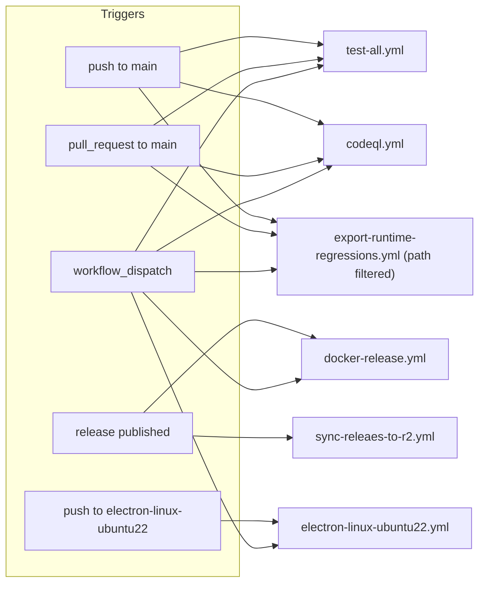

# CI, tests, security

<div class="chapter-meta" markdown>
**Reads:** `.github/workflows/*.yml`, `.github/workflows/README.md`, `test-local.sh`, `package.json`, `servers/fastapi/pyproject.toml`, `servers/fastapi/tests/**`, `servers/nextjs/package.json`, `servers/nextjs/tests/*.test.mjs`, `servers/nextjs/cypress/security/*`, `scripts/*.test.mjs`, `scripts/glob-security-checks.cjs`, `servers/fastapi/utils/{safe_logging,validators,mime_types,path_helpers,file_utils,asset_directory_utils,export_permissions}.py`, `servers/nextjs/app/api/update-svg/route.ts`, `nginx.conf`, `CONTRIBUTING.md`  ·  **Builds on:** [Auth and multi-user](25-auth-and-multiuser.md), [Docker build and deployment](26-docker-and-deployment.md), [Electron desktop app](27-electron.md)  ·  **Time:** ~40 min
</div>

This chapter is the quality and safety layer of the repository. It first walks through every GitHub Actions workflow (what triggers it, what it runs, what it proves, which secrets it touches), then the three test suites (FastAPI pytest, Next.js `node --test` plus Cypress, and the root `scripts/` tests) and how to run each locally. The second half is a catalogue of the security hardening found in the code, each item with its `path:line`, so that when you change a file you know which protection you are touching. It ends with the contributor checklist from `CONTRIBUTING.md`.

## Step 1: The workflow inventory



| Workflow | Triggers | Jobs | Secrets and permissions |
|---|---|---|---|
| `codeql.yml` | push to `main` and `fix/security-and-vulnerabilities`, PR to `main`, manual | `analyze` matrix over `actions`, `javascript-typescript`, `python` | `security-events: write`, `actions: read`; no secrets |
| `test-all.yml` | push to `main`, PR to `main`, manual | `test-repository-tools`, `test-fastapi`, `test-nextjs` | `contents: read`; no secrets |
| `export-runtime-regressions.yml` | push to `main` and the security branch, PR to `main`, only when `scripts/**`, `package.json`, `package-lock.json` or the workflow change; manual | `test` matrix over `ubuntu-latest`, `windows-latest` | `contents: read`; no secrets |
| `docker-release.yml` | `release: published`, manual | `build-and-push` | `packages: write`; `GITHUB_TOKEN` for GHCR |
| `electron-linux-ubuntu22.yml` | push to `electron-linux-ubuntu22`, manual | `build-and-release` | `RELEASE_REPO_TOKEN` |
| `sync-releaes-to-r2.yml` | `release: published` | `upload` in environment `sync_r2` | `GITHUB_TOKEN`, `R2_ACCESS_KEY`, `R2_SECRET_KEY`, `R2_ACCOUNT_ID` |

Every workflow declares a top-level `permissions:` block that starts from `contents: read`, so the default `GITHUB_TOKEN` is read-only unless a job widens it.

!!! info "Not part of upstream"
    The mirror that hosts this tutorial also contains `.github/workflows/docs-pages.yml`, which builds the MkDocs site under `tutorial/`. It is not part of the Presenton source and is not discussed further.

## Step 2: `codeql.yml`

Static analysis for three languages (`.github/workflows/codeql.yml:17` to `:55`):

```yaml title=".github/workflows/codeql.yml (excerpt)"
    strategy:
      fail-fast: false
      matrix:
        language: [actions, javascript-typescript, python]
    steps:
      - name: Checkout source
        uses: actions/checkout@v4
        with:
          persist-credentials: false

      - name: Initialize CodeQL
        uses: github/codeql-action/init@v4
        with:
          languages: ${{ matrix.language }}
          build-mode: none
          queries: security-extended
```

- `build-mode: none` means CodeQL extracts source without compiling. Nothing is built or published.
- `queries: security-extended` runs the broader security query pack, not only the default.
- `persist-credentials: false` keeps the checkout token out of `.git/config`.
- Results are uploaded to code scanning and also kept as a `codeql-<language>` SARIF artifact for 14 days (`:49` to `:55`).
- `concurrency: codeql-<workflow>-<ref>` with `cancel-in-progress: true` (`:13` to `:15`) cancels superseded runs on the same branch.

The `actions` language scans the workflow files themselves. Separately, third-party actions in other workflows are pinned by commit SHA (for example `astral-sh/setup-uv@d0cc045d...` in `test-all.yml:63` and every `docker/*` action in `docker-release.yml:32` to `:62`).

## Step 3: `test-all.yml`

Three independent jobs on `ubuntu-latest` (`.github/workflows/test-all.yml:13` to `:111`).

### 3.1 `test-repository-tools`

Node 20, `npm ci` at the repository root, then:

1. `npm test`: runs `test:template-converter` and seven other `node --test` files under `scripts/` (`package.json:8`).
2. `npm run sync:presentation-export`: downloads the pinned `@presenton/export-core` (`presentationExportVersion: v1.0.51`, `package.json:4`) into `presentation-export/`.
3. `npm run check:presentation-export`: `sync-presentation-export.cjs --check-only` validates it without downloading.

This proves the template converters still work and that the export runtime version pinned for Docker can actually be installed.

### 3.2 `test-fastapi`

```yaml title=".github/workflows/test-all.yml (excerpt)"
    env:
      APP_DATA_DIRECTORY: /tmp/presenton-app-data
      TEMP_DIRECTORY: /tmp/presenton-temp
      DATABASE_URL: sqlite+aiosqlite:////tmp/presenton-test.db
      DISABLE_ANONYMOUS_TRACKING: "true"
      DISABLE_IMAGE_GENERATION: "true"
```

Python 3.11 (matching `requires-python = ">=3.11,<3.12"`, `servers/fastapi/pyproject.toml:11`), `uv sync --locked --dev` (fails if `uv.lock` is out of date), create the two directories, then `uv run --locked python -m pytest --verbose --tb=short` (`:68` to `:75`). The workflow configures no LLM key or other secret, so the suite has to pass without network access to a model.

### 3.3 `test-nextjs`

Node 20, `npm ci` in `servers/nextjs`, then in order: `npm test` (which is `node --test`, `servers/nextjs/package.json` script `test`), `npm run lint` (`eslint .`), `npm run build` with `NEXT_PUBLIC_FAST_API=http://localhost:8000` and `NEXT_PUBLIC_URL=http://localhost:3000`, and `npx cypress run --component --browser electron` (`:95` to `:111`). A production build failing (type errors, bad imports) fails CI even if no test covers the file.

!!! warning "Gotcha: Node versions differ between workflows"
    `test-all.yml` uses Node 20, while `export-runtime-regressions.yml`, the Linux Electron build, and the Docker image use Node 22. A syntax or API only available in Node 22 can pass the export regression job and fail `test-all`, or the reverse.

### 3.4 Running the same checks locally

`test-local.sh` reproduces the workflow (`test-local.sh:32` to `:61`). It requires `uv`, `npm` and `node` on `PATH`, runs the three groups through `run_check`, counts failures instead of stopping at the first, and exits non-zero if any failed. The FastAPI group uses `/tmp/presenton-tests/{app-data,temp}` and `sqlite+aiosqlite:////tmp/presenton-tests/test.db`. `.github/workflows/README.md` documents running each group on its own with the same commands.

## Step 4: `export-runtime-regressions.yml`

A narrow, cross-platform job (`.github/workflows/export-runtime-regressions.yml:1` to `:39`): when anything under `scripts/` or the root `package*.json` changes, run `npm ci --ignore-scripts --no-audit --no-fund` and `npm test` on both `ubuntu-latest` and `windows-latest` with Node 22 and a 15-minute timeout. The Windows leg exists because `scripts/sync-presentation-export.cjs` and `scripts/run-node-script.mjs` spawn processes and build paths, and the tests check for shell-argument and path handling bugs (Step 7). `--ignore-scripts` means no package install script runs during CI.

## Step 5: The release workflows

These are covered in their own chapters; the summary here is what they verify.

- `docker-release.yml` builds `linux/amd64,linux/arm64` with QEMU and Buildx, tags `ghcr.io/presenton/presenton:<release tag>` (or `:dev` on manual dispatch), uses the GitHub Actions cache, and then verifies with `docker buildx imagetools inspect` that both platforms are present in the manifest (`.github/workflows/docker-release.yml:44` to `:77`). It does not run tests against the image. See [Docker build and deployment](26-docker-and-deployment.md).
- `electron-linux-ubuntu22.yml` builds the Linux `.deb` and `.AppImage` on Ubuntu 22.04 and asserts both exist before uploading. `sync-releaes-to-r2.yml` mirrors published release assets to the `presenton-desktop/<version>` R2 prefix with rclone. See [Electron desktop app](27-electron.md).

!!! warning "Gotcha: one release event, two workflows"
    Publishing a GitHub release triggers both `docker-release.yml` and `sync-releaes-to-r2.yml`. The R2 job expects desktop installers named `Presenton-<version>.<ext>` on that release; a Docker-only release will make it fail.

## Step 6: The FastAPI test suite

### 6.1 Layout

`[tool.pytest.ini_options] testpaths = ["tests"]` (`servers/fastapi/pyproject.toml:72` to `:73`). Dev dependencies are only `pytest>=9.0.3` and `pytest-cov>=7.1.0` (`:66` to `:70`); there is no `pytest-asyncio`, so async code is driven with `asyncio.run(...)` inside synchronous tests, through FastAPI's `TestClient`, or with `@pytest.mark.anyio` and an `anyio_backend` fixture, which uses the pytest plugin that ships with the transitive `anyio` dependency (for example `servers/fastapi/tests/test_image_generation_comfyui.py:157`).

| Directory | Files | Test functions (approx.) | Purpose |
|---|---|---|---|
| `tests/unit/` | 95 | ~790 | One module or one security property per file: auth middleware, API keys, owner isolation, provider discovery, export permissions, safe logging, regex bounds, migrations |
| `tests/integration/` | 6 | ~70 | Full routers mounted on a throwaway `FastAPI()` with a temporary SQLite engine: auth endpoints, image provider test, images, generation flow, Presenton OAuth login, slide edit |
| `tests/regression/` | 1 + `snapshots/outline_generation.json` | 1 | Golden-output check of outline generation with a scripted LLM stream |
| `tests/edge_cases/` | 1 | 3 | Empty input rejected by validation, very large input, invalid LLM payload mapped to a structured HTTP error |
| `tests/` (top level) | 11 | ~114 | Chat, documents loader, image generation backends (ComfyUI, Open WebUI, OpenAI-compatible), LiteParse, mem0, PPTX fonts, generation API |
| `tests/mocks/` | `llm.py`, `normalizers.py` | | `FakeLLMClient`, `content_event(chunk)`, `normalize_payload` (sorts dict keys, collapses whitespace) |

### 6.2 Shared fixtures (`tests/conftest.py`)

| Fixture | Returns |
|---|---|
| `fake_async_session` | A `FakeAsyncSession` that records `add`, `add_all`, `delete`, counts `commit`, returns preset objects from `get`, and returns empty results from `execute` and `scalars` (`servers/fastapi/tests/conftest.py:8` to `:56`) |
| `snapshots_dir` | `tests/regression/snapshots` (`:59` to `:61`) |
| `load_snapshot` | A loader that parses a JSON snapshot by name (`:64` to `:70`) |

Most security tests build their own fixtures instead. The pattern in `tests/unit/test_desktop_security.py:28` to `:73` is representative: `monkeypatch.setenv` the runtime variables, create a temp-file SQLite engine with `create_async_engine("sqlite+aiosqlite:///...")`, create only the needed tables, seed rows, override `get_async_session`, mount the real routers and middleware on a new `FastAPI()`, and yield a `TestClient`. `tests/integration/test_auth_endpoints.py` adds an autouse fixture that wraps every test in `patch.dict("os.environ")`, because settings endpoints write provider values into `os.environ`.

### 6.3 The regression snapshot

`tests/regression/test_outline_generation_snapshots.py` patches `get_model`, `get_client`, `get_llm_config`, `get_generate_kwargs` and `stream_generate_events` in `utils/llm_calls/generate_presentation_outlines.py`, feeds four `content_event` chunks that together form `{"slides":[{"content":"## Intro\n- Point A\n- Point B"},{"content":"## Details\n1. Item one\n2. Item two"}]}`, collects the streamed output, validates it as `PresentationOutlineModel`, normalizes it, and compares it with the snapshot. It pins the streaming contract described in [Standard generation pipeline](08-standard-pipeline.md) without any network.

### 6.4 Running a subset

```bash
cd servers/fastapi
uv sync --locked --dev
APP_DATA_DIRECTORY=/tmp/presenton-tests/app-data TEMP_DIRECTORY=/tmp/presenton-tests/temp \
DATABASE_URL=sqlite+aiosqlite:////tmp/presenton-tests/test.db \
uv run --locked python -m pytest tests/unit/test_owner_isolation.py -q
```

Coverage is configured but not run in CI: `[tool.coverage.run]` uses statement coverage (`branch = false`) and omits `tests/*`, virtualenvs, `alembic/versions/*` and `scripts/*` (`servers/fastapi/pyproject.toml:77` to `:92`). Add `--cov` to the pytest command to use it.

!!! warning "Gotcha: tests read the real environment"
    Many modules read `os.environ` at call time (`utils/get_env.py`). A variable such as `DISABLE_AUTH=true` or `PRESENTON_ELECTRON=true` exported in your shell changes middleware behavior and can make auth tests fail or, worse, pass for the wrong reason. Run tests from a clean shell, as CI does.

## Step 7: The Node test suites

### 7.1 `servers/nextjs/tests` (`node --test`)

`npm test` runs every `*.test.mjs` under `servers/nextjs/tests/` with Node's built-in runner. Tests that need TypeScript sources bundle them on the fly with esbuild into a temp `.cjs` file and `require` it (for example `tests/desktop-security.test.mjs:16` to `:45`, `tests/font-descriptor-security.test.mjs:13` to `:17`). The files cover rendering (`flow-layout-text-sizing`, `latex-html-text-rendering`, `infographic-rendering`, `vector-arrow-rendering`, `template-v2-*`), client behavior (`presentation-autosave`, `clipboard`, `wheel-slide-navigation`, `provider-setup-navigation`), backend reachability (`backend-connectivity`, `runtime-provider-config`), and five security files:

| File | What it pins |
|---|---|
| `desktop-security.test.mjs` | The desktop transport guard on every path, `Host`/`Origin` checks, CSRF on `/api/user-config` (415 for `text/plain`), redaction of provider keys for non-admin users, document reader path restrictions, Electron cookie and header injection. Detailed in [Electron desktop app](27-electron.md) |
| `svg-route-security.test.mjs` | `/api/update-svg`: paint-value escaping, CDATA handling, bounded scanning of unterminated sections, outside-root and symlink rejection, time-of-check races, size bound (Step 9.3) |
| `font-descriptor-security.test.mjs` | Font-family parsing cannot backtrack exponentially on `\!` runs; runs the probe in a child with a 2000 ms timeout (`:21` to `:30`) |
| `dependency-security.test.mjs` | Behavior of patched dependencies: Windows service query output from `systeminformation`, inherited attribute objects, math rendering trust flags, ESLint brace expansion, Markdown attribute tokenizer bounds, `postcss-selector-parser` with many classes, the Cypress query parser |
| `font-cors.test.mjs` | `next.config.mjs` grants `Access-Control-Allow-Origin: *` only to `/vendor/fonts/:path*` |

### 7.2 Cypress component tests

`servers/nextjs/cypress.config.ts` enables component testing with the Next.js framework and webpack bundler and sets `allowCypressEnv: false`. The specs live in `cypress/security/` and run in Cypress's Electron browser in CI:

| Spec | Test |
|---|---|
| `dependencies.cy.ts` | DOMPurify with `USE_PROFILES: { html, svg, svgFilters }` keeps a heading, its `data-slide-title`, an SVG circle and an ``, and removes `<script>`, `onload`, `onerror` and `javascript:` links |
| `editors.cy.tsx` | Serialized editor DOM does not copy inherited event handlers; inline text edits, undo, formatting and LaTeX atoms still work |
| `math.cy.ts` | Equations stay measurable and exportable as SVG images |

These run in a real browser DOM, which Node tests cannot provide.

### 7.3 Root `scripts/` tests

`npm test` at the root (`package.json:8`) runs:

| File | Pins |
|---|---|
| `convert-template.test.mjs`, `convert-presentation-template.test.mjs` | Template conversion output shape and failure before writing on missing assets or unmapped layouts |
| `package-metadata.test.mjs` | Application versions stay aligned; Docker and Electron use the same pinned export runtime; sync preserves a mounted runtime root |
| `desktop-export.test.mjs` | Startup Node helpers keep literal paths and arguments; export credentials are scoped to the two desktop origins |
| `sync-presentation-export.test.mjs` | Cache paths never reach shell arguments; glibc vs musl detection; Sharp native package validation; rejection of known-vulnerable versions and nested engine copies |
| `user-config-env.test.mjs` | Env-to-config normalization, DALL-E to GPT Image 2 migration |
| `export-permissions.test.mjs` | Export files get group-only read access; symlinks are not followed; startup keeps config and recovery files owner-only |
| `document-parser-security.test.mjs` | LiteParse's OCR HTTP stack (`axios` with `follow-redirects`) strips credentials when a redirect crosses origins |
| `sync-document-dependencies.test.mjs` | The document parser volume is replaced or repaired when stale, and a failed install never leaves a trusted cache marker |

### 7.4 Electron

`cd electron && npm run test:security` compiles `app/` and runs `scripts/security-dependencies.test.cjs` and `scripts/private-storage.test.cjs`. This suite is not in any workflow.

## Step 8: What the suites cover, mapped to features

| Feature | Representative tests |
|---|---|
| Auth, sessions, roles | `tests/integration/test_auth_endpoints.py`, `tests/unit/test_session_auth_middleware.py`, `test_auth_bootstrap.py`, `test_auth_schemas.py` |
| API keys and MCP auth | `tests/unit/test_api_keys.py`, `test_mcp_server_auth.py`, `test_nginx_mcp_config.py` |
| Multi-user isolation | `tests/unit/test_owner_isolation.py`, `test_asset_ownership_security.py`, `test_mem0_session_scope_security.py` |
| Generation pipeline | `tests/unit/test_generate_presentation_outlines.py`, `test_generate_presentation_structure.py`, `test_generate_slide_content.py`, `tests/integration/test_presentation_generation_flow.py`, the regression snapshot |
| Providers | `test_available_models.py`, `test_model_availability*.py`, `test_ollama*.py`, `test_openrouter_providers.py`, `test_openai_discovery_security.py`, `test_presenton_cloud*.py` |
| Export | `test_export_cookie_header.py`, `test_export_permissions.py`, `scripts/export-permissions.test.mjs` |
| Desktop | `test_desktop_security.py`, `servers/nextjs/tests/desktop-security.test.mjs` |
| Dependency advisories | `test_python_advisory_regressions.py` (Authlib JWS), `test_dependency_dos_regressions.py` (JOSE and ASN.1 bounds), `test_certifi_security.py`, `test_dns_advisory_regression.py`, `servers/nextjs/tests/dependency-security.test.mjs` |

There is no end-to-end test that drives a browser against a running Docker image, and no test that calls a real LLM.

## Step 9: Security hardening catalogue

Each entry below names the protection, where it lives, and what breaks if you remove it.

### 9.1 Path traversal and file access

| Protection | Location | Detail |
|---|---|---|
| Containment by canonical path | `servers/fastapi/utils/asset_directory_utils.py:169` to `:180` | `_existing_file_within(candidate, root)` resolves both with `os.path.realpath`, requires the candidate to start with `root + os.sep` (so `images-other` cannot satisfy `images`), and requires a regular file |
| Per-asset-root containment for `/app_data` | `servers/fastapi/utils/asset_directory_utils.py:128` to `:137` | The root is `app_data/<first segment>`, so a symlink inside `images/` cannot read private config elsewhere in app data |
| Owner-scoped resolution | `servers/fastapi/utils/asset_directory_utils.py:183` to `:198`, `:201` to `:219` | `_app_data_url_allowed` applies the same rules as nginx's `auth_request` (`is_app_data_path_authorized`); absolute paths are only accepted under app data, the owner's temp subfolder, or `static/` |
| Owner directories | `servers/fastapi/utils/asset_directory_utils.py:23` to `:30` | `images/`, `exports/`, `uploads/` become `<root>/users/<owner_id>` when a principal is set |
| Upload type and size | `servers/fastapi/utils/validators.py:8` to `:48` | `validate_files` rejects files larger than `max_size` MB; a file is accepted when either its client-declared `Content-Type` or its filename extension is in `accepted_types` (`_is_accepted_file_type`), so this is a declared-type filter, not a content check |
| Generated file names | `servers/fastapi/utils/file_utils.py:13` to `:31` | `get_file_name_with_random_uuid` appends `----<uuid4>` and applies `os.path.basename` only to string paths (an `UploadFile.filename` is used as given); `get_original_file_name` reverses it. In this snapshot only `get_original_file_name` has a production caller (`servers/fastapi/api/v1/ppt/endpoints/template.py:459`) |
| nginx `/static/` trailing slash | `nginx.conf:144` to `:157` | The comment explains that a bare `location /static` would let `/static../server.py` resolve through `alias` to any file under `/app` |
| nginx `disable_symlinks on` | `nginx.conf:159` to `:211` | Every `/app_data/*` location refuses to serve symlinks; all except `fonts` and `templates` also require `auth_request /_auth_check` |
| SVG route containment | `servers/nextjs/app/api/update-svg/route.ts:89` to `:166` | Only `/static/icons/*.svg`; rejects NUL bytes; checks containment before and after `realpath`; opens with `O_NOFOLLOW`; stats the open handle (not the path) to defeat swap races; caps at 5 MB (`:16`) both by `stat` and while streaming |
| Electron `read-file` IPC | `electron/app/utils/readable-file-access.ts:45` to `:70` | Only `.txt` files under app-data subfolders or temp, re-checked after `realpath` |

!!! warning "Gotcha: `path_helpers.py` and `file_utils.py` are not traversal guards"
    `get_resource_path` and `get_writable_path` (`servers/fastapi/utils/path_helpers.py:15` to `:29`) simply join a relative path onto the working directory or `APP_DATA_DIRECTORY` with `os.path.abspath`; they do not check containment. `file_utils.py` only manipulates names. Pass user input through `resolve_app_path_to_filesystem` or `_existing_file_within`, never through these helpers.

### 9.2 SSRF and outbound requests

| Protection | Location | Detail |
|---|---|---|
| Model discovery URL validation | `servers/fastapi/utils/available_models.py:120` to `:151` | Rejects control characters and backslashes, non-`http(s)` schemes, missing host, any query or fragment, `\ % ? #` in the decoded path, and `.` or `..` path segments, then applies a strict full-match regex |
| No redirects in discovery | `servers/fastapi/utils/available_models.py:187` to `:192`, `:209` | aiohttp `allow_redirects=False` with a 3xx mapped to an error ("configure the final API URL"); the OpenAI SDK gets `DefaultAsyncHttpxClient(follow_redirects=False)` |
| Ollama URL validation | `servers/fastapi/utils/ollama.py:46` to `:70` | The same checks (a missing scheme defaults to `http://`), canonicalized through yarl's `URL` |
| No redirects to Ollama | `servers/fastapi/utils/ollama.py:117` to `:125`, `:186` to `:190` | A 3xx on `/api/tags` becomes `502`; a 3xx on `/api/pull` is reported as an SSE `error` event |
| Request intent for provider overrides | `servers/fastapi/api/v1/ppt/endpoints/ollama.py:16` to `:40`, `:51` to `:57` | On `GET /api/v1/ppt/ollama/models/available` with auth enabled, an `ollama_url` override is honored only if `Origin`/`Referer` match the app's own origin, the configured public URLs, or the desktop origins, or `Sec-Fetch-Site: same-origin`; "must originate from the app, not merely carry an admin cookie" (`:54`) |
| OpenRouter, Presenton Cloud, OAuth | `servers/fastapi/api/v1/ppt/endpoints/openrouter.py:108`, `servers/fastapi/services/presenton_cloud.py:164`, `:209`, `servers/fastapi/api/v1/auth/presenton_oauth.py:84` | All disable redirects |
| Community catalog | `servers/fastapi/services/community_presentations.py:205` to `:233` | Path must match `(?:/[1-9][0-9]*)?`; redirects are an error `community_redirect_not_allowed`; disabled community opens no connection |
| Credential stripping on redirects in dependencies | `scripts/document-parser-security.test.mjs:12`, `electron/scripts/security-dependencies.test.cjs:7` | Tests that `follow-redirects` and electron-builder's `HttpExecutor` drop `Authorization` across origins |

Tests: `servers/fastapi/tests/unit/test_openai_discovery_security.py` (invalid roots never reach either transport, redirects rejected without follow-up), `test_ollama_request_security.py` (cross-site navigation never reaches the network helper), `test_ollama_transport_security.py`, `test_community_request_security.py`.

!!! warning "Gotcha: the URL checks do not block private addresses"
    None of these validators reject `localhost`, `127.0.0.1` or RFC 1918 addresses; local Ollama and LiteLLM are first-class use cases. The defenses are that the discovery endpoints are admin-only in `SessionAuthMiddleware` and that the Ollama discovery override must come from the app's own origin (the only caller of `_require_provider_request_intent`). If you expose provider discovery to non-admin users, you will need an address-range check as well.

### 9.3 SVG and HTML sanitization

The SVG recoloring endpoint `/api/update-svg` is public by design (`servers/nextjs/proxy.ts:87` to `:95` lists it as auth-exempt, because Konva and `` load it directly). Its defenses:

1. Only local icons: anything not under `/static/icons/` returns `400 {"error":"Only /static/icons SVG sources are supported"}` (`servers/nextjs/app/api/update-svg/route.ts:196` to `:202`). There is no remote fetch, so no SSRF.
2. Every style parameter goes through a validator in `servers/nextjs/lib/svg-color.ts`: `normalizeSvgColor` (`:289` to `:316`) returns `null` for anything containing a double or single quote, `<`, `>`, a backtick, `{`, `}`, `;`, CR or LF (`UNSAFE_SVG_VALUE_CHARS`, `:19`) and otherwise accepts only hex colors (a bare hex value gets a `#` prefix), a list of CSS color functions, or a bare keyword; `normalizeSvgNumberish` (`:318` to `:329`) accepts only a number with an optional CSS unit; line caps and joins are matched against fixed sets.
3. The file must contain `<svg`; `transformSvgMarkup` then escapes values at insertion (covered by `svg-route-security.test.mjs:57` to `:78`).
4. The response is `image/svg+xml; charset=utf-8` with `Cache-Control: no-store` (`route.ts:223` to `:229`).

Slide HTML rendered by the app is passed through DOMPurify with explicit forbidden tags (for example `SANITIZE_CONFIG` in `app/(presentation-generator)/components/SmartHtmlSlide.tsx:25` onward), and the Cypress spec in Step 7.2 checks that profile.

### 9.4 Font descriptor validation

`fontFamilyFromFontDescriptor` (`servers/nextjs/components/slide-editor/text/local-fonts.ts:615` to `:618`) extracts the family with an anchored pattern `^[^"]*"((?:\\.|[^"\\])*)"\s*$`. The comment notes that generated descriptors contain one quoted family and anchoring the opening quote prevents the engine from retrying at every position. `tests/font-descriptor-security.test.mjs:21` to `:40` feeds 1000 repetitions of an escaped character with no closing quote, in a child process with a 2 s timeout, and requires it to finish. On the Python side `tests/unit/test_regex_security.py` does the same for font-name normalization, chart parsing and table parsing.

### 9.5 Dependency pinning and overrides

| Mechanism | Location | Pins |
|---|---|---|
| uv lockfile | `servers/fastapi/uv.lock`, enforced by `uv sync --locked` in CI and `uv export --frozen` in Docker (`Dockerfile:15`) | Every Python dependency |
| uv constraints | `servers/fastapi/pyproject.toml:43` to `:46` | `joserfc>=1.7.6`, `pyasn1>=0.6.5` as transitive floors |
| Exact pins | `servers/fastapi/pyproject.toml:35` | `llmai==0.3.15` |
| npm overrides (Next.js) | `servers/nextjs/package.json:86` onward | `systeminformation>=5.33.16`, `brace-expansion@^1.0.0 -> 1.1.21`, `brace-expansion@^2.0.0 -> 2.1.7`, `postcss-selector-parser 6.1.5` under `@tailwindcss/typography`, `minimatch@>=9 <11.0.1 -> ^11.0.3`, `glob@>=9 <14.0.2 -> ^14.0.3` |
| npm overrides (Electron) | `electron/package.json:101` to `:111` | `sharp ^0.35.5` and `zod ^4.6.6` under LiteParse, `minimatch ^3.1.5` under `serve-handler`, plus the same minimatch and glob ranges |
| npm overrides (root) | `package.json:20` to `:25` | `sharp` and `zod` under LiteParse |
| Exact tool versions | `electron/package.json:94` to `:95` | `electron 42.11.16`, `electron-builder 26.15.0` |
| Pinned Chromium snapshot | `Dockerfile:95` to `:96` | Chromium from a dated `snapshot.debian.org` archive |
| Action SHAs | `test-all.yml:63`, `docker-release.yml:32` to `:62` | Third-party actions by commit |
| Glob regression checks | `scripts/glob-security-checks.cjs:8` to `:65` | Modern `minimatch` respects `braceExpandMax` (64) under a 128 MB heap; aborted `glob` walks stop reading directories; the legacy matcher still works. Registered from `electron/scripts/security-dependencies.test.cjs:46` to `:50` |

The overrides are paired with behavior tests (`dependency-security.test.mjs`, the advisory regression tests in `servers/fastapi/tests/unit/`) so that removing an override, or a dependency upgrade that reintroduces a bug, is caught by CI rather than by an advisory feed.

### 9.6 Log safety (escaping, not redaction)

`servers/fastapi/utils/safe_logging.py` protects log integrity:

```python title="servers/fastapi/utils/safe_logging.py (excerpt)"
_CONTROL_ESCAPES = {
    code: f"\\x{code:02x}"
    for code in (*range(32), *range(127, 160))
}
_CONTROL_ESCAPES.update({9: "\\t", 0x2028: "\\u2028", 0x2029: "\\u2029"})


def _escape_controls(rendered: str) -> str:
    return rendered.replace("\r", "\\r").replace("\n", "\\n").replace("\x1b", "\\x1b").translate(_CONTROL_ESCAPES)
```

`safe_log(logger, level, message, *args)` (`:29` to `:44`) formats the message exactly like `logging` would, then escapes CR, LF, ESC, C0/C1 controls and Unicode line separators, so an attacker-controlled value (an export URL, a provider error) cannot forge extra log lines or send terminal escape codes. Exceptions are re-rendered with the traceback text escaped too (`:16` to `:26`), and a formatting error logs a fixed message instead of raising (`:36` to `:38`). `tests/unit/test_log_callsite_security.py:10` to `:22` checks a real call site with a URL containing `\nFORGED\r\x1b[2J`.

Secret redaction is handled elsewhere and narrowly: `_redact_url_credentials` replaces `user:pass@` in the SearXNG URL with `***:***@` before logging (`servers/fastapi/utils/web_search.py:219` to `:226`), image provider test calls accept the placeholder `__configured__` instead of a real key so the UI never echoes stored keys (`servers/fastapi/api/v1/ppt/endpoints/images.py:53` to `:61`), and non-admin users receive redacted settings from `/api/user-config` (Step 7.1).

!!! warning "Gotcha: `safe_log` does not remove secrets"
    Do not assume that routing a value through `safe_log` hides it. It only escapes control characters. Never log API keys, `Authorization` headers or cookies.

### 9.7 File permissions

| Item | Location | Mode |
|---|---|---|
| `userConfig.json` and `.bak` (FastAPI) | `servers/fastapi/utils/user_config_store.py:25` to `:32`, `:180` to `:192` | Temp file created with `O_CREAT` and `O_EXCL` and `0o600`, `fsync`, `os.replace`, then `chmod 0o600`; existing files (and the `.bak`) are re-chmodded on every `read_user_config_file` call (`:202` to `:205`) |
| `userConfig.json` (Docker start-up) | `start.js:73` (`chmodBestEffort`), `:105`, `:133`, `:145`, `:164` | `0o600`; `chmodBestEffort` tolerates read-only or foreign-owned volumes (Kubernetes, OpenShift) |
| `userConfig.json` (Electron) | `electron/app/utils/user-config-store.ts:105` to `:209` | Lock, temp and backup files `0o600`; parent directory `0o700` via `ensurePrivateDirectory` |
| Export artifacts | `servers/fastapi/utils/export_permissions.py:5` to `:6`, `:47`; called from `servers/fastapi/services/export_task_service.py:271`, `:814`, `:842` | Directories `0o750`, files `0o640`, group set to `www-data` or `nginx` when running as root, so nginx can serve exports without making them world-readable; symlinks are skipped and artifacts outside managed roots raise |
| Export permissions (Node) | `scripts/export-permissions.cjs:4` to `:60` | Same contract for the Node export runner |
| Electron export task file | `electron/app/ipc/export_handlers.ts:97` | `wx`, `0o600` |

### 9.8 MIME handling

`init_sandbox_safe_mimetypes()` (`servers/fastapi/utils/mime_types.py:23` to `:40`), called at import time in `servers/fastapi/api/main.py:29`, initializes Python's `mimetypes` with `files=[]` so it never reads OS MIME databases (sandboxed macOS builds are denied `/etc/apache2/mime.types`), then registers explicit types for `.avif`, `.docx`, `.gif`, `.jpeg`, `.jpg`, `.otf`, `.pdf`, `.png`, `.pptx`, `.svg`, `.ttf`, `.webp`, `.woff`, `.woff2`, `.xlsx`. Static responses therefore have deterministic `Content-Type` headers on every platform. `tests/unit/test_mime_types.py:6` checks that no system file is read.

### 9.9 Auth on `/docs` and `/openapi.json`

`SessionAuthMiddleware._PROTECTED_NON_API_PATHS = {"/docs", "/openapi.json", "/redoc"}` (`servers/fastapi/api/middlewares.py:42`) and `_requires_auth` returns true for them (`:44` to `:53`). The interactive API documentation, which reveals every route and schema, therefore requires a session or API key in account mode. In desktop mode the transport guard still requires the desktop token (`tests/unit/test_desktop_security.py:76` to `:79`). Details of principal resolution are in [Auth and multi-user](25-auth-and-multiuser.md).

### 9.10 CodeQL

Step 2. The `security-extended` suite over Python, TypeScript/JavaScript and the workflows themselves runs on every push and PR to `main`.

```mermaid
flowchart TB
  subgraph Request["Inbound request"]
    A["Desktop transport guard"] --> B["Session or API key principal"]
    B --> C["owner_id contextvar scoping"]
  end
  subgraph Files["File access"]
    D["realpath containment"] --> E["owner-scoped app_data roots"]
    E --> F["nginx auth_request and disable_symlinks"]
  end
  subgraph Outbound["Outbound calls"]
    G["URL validation"] --> H["no redirects"]
    H --> I["origin intent check for overrides"]
  end
  subgraph Supply["Supply chain"]
    J["locks, overrides, constraints"] --> K["behavior regression tests"]
    K --> L["CodeQL security-extended"]
  end
```



## Step 10: Contributor checklist

`CONTRIBUTING.md` sets the ground rules:

- Scope: contributions are focused on the Electron application (desktop app, FastAPI backend, Next.js frontend, local runtime integrations), and "Contributions outside `electron/` may not be accepted at this time" (`CONTRIBUTING.md:16` to `:25`, `:129`).
- Workflow: fork, branch (examples `feature/add-template-support`, `fix/export-pptx-error`, `docs/update-readme`), open a PR (`:44` to `:59`).
- A signed Contributor License Agreement is required; PRs without a CLA for more than 30 days may be closed (`:119` to `:125`).
- PRs must run locally in both development and build environments, be small and focused, explain what and why, and include screenshots for UI changes (`:127` to `:134`).
- AI-assisted PRs are welcome but must say so, state the testing done, and confirm the code was reviewed (`:138` to `:146`).

Combined with the CI above, a practical pre-PR checklist is:

1. `./test-local.sh` passes (repository tools, FastAPI, Next.js tests, lint, build, Cypress).
2. If you touched `electron/`: `npm run typecheck`, `npm run lint:main`, `npm run test:security`, and `npm run dev` starts.
3. If you touched `scripts/` or root `package*.json`: `npm test` also on Windows, or rely on `export-runtime-regressions.yml`.
4. New routes: decide public or protected in `SessionAuthMiddleware`, and confirm the desktop guard behavior.
5. New file reads: go through `_existing_file_within` or `resolve_app_path_to_filesystem`.
6. New outbound HTTP: validate the URL and disable redirects, matching Step 9.2.
7. New dependencies: lockfile updated; if PyInstaller cannot trace it, update `servers/fastapi/server.spec`.
8. Logs: use `safe_log` for request-derived values and never log secrets.

The repository is Apache License 2.0 (`LICENSE`), with third-party notices aggregated in `NOTICE` (regenerated by `scripts/rebuild_notice_all.py`). `VISION.md` states the guiding goal behind many of these measures: generation that runs locally, inside private networks, and in air-gapped environments.

## What you now know

- Six upstream workflows exist: CodeQL (three languages, `security-extended`), `test-all` (repository tools, FastAPI pytest, Next.js tests plus lint, build and Cypress), cross-platform export regressions, and three release workflows for GHCR, Linux desktop builds and R2.
- The FastAPI suite has about 980 test functions across `unit`, `integration`, `regression`, `edge_cases` and the top-level files, runs with plain pytest (plus `asyncio.run` or the `anyio` marker), and uses temp SQLite engines with real routers instead of a shared app fixture.
- Next.js tests run on `node --test` with esbuild bundling, Cypress covers sanitization in a real DOM, and root `scripts/` tests guard the export runtime, permissions and document parser.
- Path access is guarded by canonical containment and owner-scoped roots (not by `path_helpers.py`), outbound calls validate URLs and refuse redirects, and the SVG route accepts only local icons with validated paint values.
- `safe_logging.py` prevents log forging but does not redact secrets; config files are `0o600`, exports `0o640` with a proxy group, and MIME types are deterministic.

## Next

Part VII starts the Superset design: continue with [Part VII landing](../superset/index.md).
