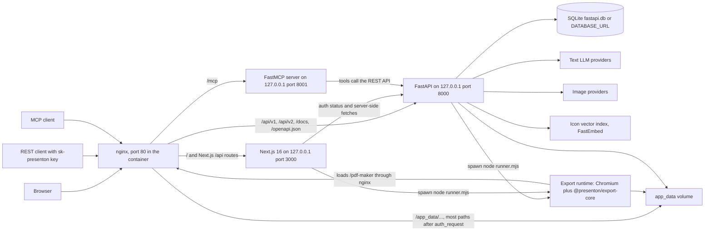

# Presenton internals, Parts I to VI

**Reads:** `README.md`, `start.js`, `nginx.conf`, `servers/fastapi/api/main.py`, `servers/nextjs/proxy.ts`  ·  **Builds on:** [Home](../index.md)  ·  **Time:** ~8 min

This is the entry point for the Presenton half of the book. It shows the whole running system on one diagram, then lists every chapter in Parts I to VI with a one-line description so you can jump straight to the subsystem you need. If you read nothing else before opening the code, read the diagram and the four chapters of Part I.

## The whole system on one page

Presenton ships as one container (or one desktop app) that runs several cooperating processes. In the Docker image, `node start.js` supervises everything (`start.js:720`), nginx is the only listener reachable from outside, and every other server binds to the loopback interface.

How to read it:

- **nginx** (`nginx.conf:25`) routes by path prefix. Pages and the Next.js-owned `/api/*` routes go to Next.js, the REST API goes to FastAPI, `/mcp` goes to the MCP server, and `/app_data/...` files are served straight from disk. Images, exports, uploads and the two PPTX conversion folders first pass an `auth_request` subrequest to FastAPI; fonts and template assets are served without one (`nginx.conf:159-211`).
- **Next.js** renders the UI. Its request middleware (`servers/nextjs/proxy.ts:97`) and server layouts ask FastAPI whether the caller is signed in, over the loopback URL in `FAST_API_INTERNAL_URL` (`start.js:485`).
- **FastAPI** (`servers/fastapi/api/main.py:65`) owns the data model, the LLM calls, image and icon resolution, authentication, and API keys.
- **The MCP server** (`servers/fastapi/mcp_server.py:346`) is generated from a static OpenAPI document and forwards tool calls to FastAPI at `http://127.0.0.1:8000`.
- **The export runtime** is a Node script (`presentation-export/runner.mjs`, copied from `scripts/run-presentation-export.mjs`) that drives headless Chromium through `@presenton/export-core`. It opens the `/pdf-maker` page and writes PPTX or PDF files into `app_data/exports`.
- **app_data** is the only persistent state: the SQLite database (unless `DATABASE_URL` is set), `userConfig.json`, generated images, uploads, fonts, template assets, exports and Mem0 memory.

The Electron desktop app runs the same FastAPI and Next.js code without nginx and without the MCP server. [Runtime topology](03-runtime-topology.md) contrasts the two in detail.

## Part I: Orientation

Start here. These chapters give you the mental map that every later chapter assumes.

- [What Presenton is](01-what-is-presenton.md): the product surface (inputs, Standard and Smart modes, templates, editing, export, providers, deployment shapes, workspaces), a 30,000-foot walk from prompt to PPTX, and the core vocabulary.
- [Repository tour](02-repository-tour.md): every top-level directory and FastAPI/Next.js subpackage with its key files, verified size statistics, the technology stack with exact versions, and a "where do I look for X" index.
- [Runtime topology](03-runtime-topology.md): the process tree under `start.js`, readiness and shutdown, the `app_data` layout and permissions, every nginx `location` block, and four request sequence diagrams.
- [Running it locally](04-running-locally.md): `docker run`, the four Compose services, a minimal `.env`, first-run admin setup, running from source without Docker, Electron dev, Swagger, API keys with curl, tests and troubleshooting.

## Part II: Backend

The FastAPI server, from process start to every generation path.

- [FastAPI app and startup](05-fastapi-startup.md): the app object, router mounting, the middleware stack and the lifespan hook (migrations, admin bootstrap, template import).
- [Configuration and LLM providers](06-configuration-and-providers.md): how environment variables, `userConfig.json` and the provider-settings row combine, and how each LLM provider client is built.
- [Data model](07-data-model.md): every SQLModel table, ownership columns, and the Alembic migration chain.
- [Standard generation pipeline](08-standard-pipeline.md): create, outline stream, prepare, slide stream and the one-shot `/generate` handler, step by step.
- [Prompts and schemas](09-prompts-and-schemas.md): the outline, structure and slide-content prompts and the JSON schemas the LLM must satisfy.
- [Streaming (SSE)](10-streaming.md): the server-sent event formats and the helpers that produce them.
- [Document ingestion](11-document-ingestion.md): uploads, LiteParse and OCR, and how extracted text reaches the prompts.
- [Images, icons, web search](12-images-icons-search.md): image providers, the FastEmbed icon index, and web grounding.
- [Smart mode](13-smart-mode.md): adaptive HTML slides, their prompts, sanitization and streaming.
- [Editing and chat assistant](14-editing-and-chat.md): AI slide edits and the chat assistant with its tools and memory.
- [REST API, async tasks, webhooks, MCP](15-api-async-mcp.md): the public generation API, async task polling, webhook delivery and the MCP tool surface.

## Part III: Templates

How a design becomes something an LLM can fill.

- [Template v2 format](16-template-v2-format.md): the `template.json` structure, components, elements and the `decorative` flag on a 1280 by 720 canvas.
- [From template to schema to slide](17-template-to-slide.md): how layouts become JSON schemas and how generated content is written back into slide UI.
- [Custom templates from PPTX](18-custom-templates.md): the PPTX conversion and the vision-model certification passes.
- [Themes and fonts](19-themes-and-fonts.md): theme roles, font catalogs and font uploads.

## Part IV: Frontend

The Next.js application the user actually sees.

- [Next.js architecture](20-nextjs-architecture.md): route groups, the request proxy, server-side auth checks and the Redux store.
- [User journey](21-user-journey.md): upload, outline review, streaming generation and the dashboard, page by page.
- [Slide editor](22-slide-editor.md): the Konva canvas, Tiptap text editing, selection, undo and autosave.
- [Settings, onboarding, auth UI](23-settings-and-auth-ui.md): account setup and sign-in, provider onboarding, Settings and the admin pages.

## Part V: Export

- [PPTX and PDF export](24-export-pipeline.md): the `/pdf-maker` page, the export task file, `@presenton/export-core`, and how the output lands in the owner's export directory.

## Part VI: Auth, infra, ops

- [Auth and multi-user](25-auth-and-multiuser.md): users, JWT cookies, API keys, owner scoping of rows and files, and the asset authorization rules.
- [Docker build and deployment](26-docker-and-deployment.md): the multi-stage Dockerfile, pinned Chromium, image contents and release flow.
- [Electron desktop app](27-electron.md): the desktop process model, per-launch desktop credential, packaging and updates.
- [CI, tests, security](28-ci-tests-security.md): the GitHub Actions workflows, the test suites and the security checks.

## Conventions used in every chapter

- Source citations look like `servers/fastapi/api/middlewares.py:29`. Paths are relative to the repository root and line numbers refer to snapshot `571461f`.
- Code excerpts are verbatim apart from elisions marked `# ...` or `// ...`.
- Blocks titled **Gotcha** flag behavior that is easy to break or misread.
- Endpoints are collected in the [Endpoint index](../appendix-endpoints.md) and files in the [File index](../appendix-files.md).

## What you now know

- Presenton is nginx in front of three loopback servers (Next.js on 3000, FastAPI on 8000, MCP on 8001), all supervised by `start.js` in Docker.
- FastAPI owns data, generation, auth and API keys. Next.js renders the UI and checks sessions by calling FastAPI.
- Exports are produced by a separate Node runtime that drives Chromium against the `/pdf-maker` page.
- Everything persistent lives under `app_data`.
- Parts I to VI follow the request path: orientation, backend, templates, frontend, export, then operations.

## Next

Begin with [What Presenton is](01-what-is-presenton.md) for the product surface and the end-to-end walk-through.
