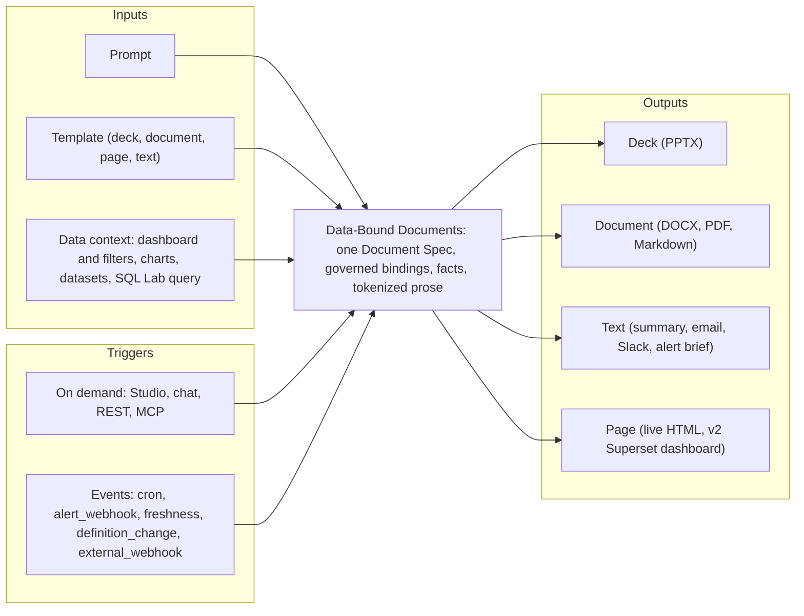
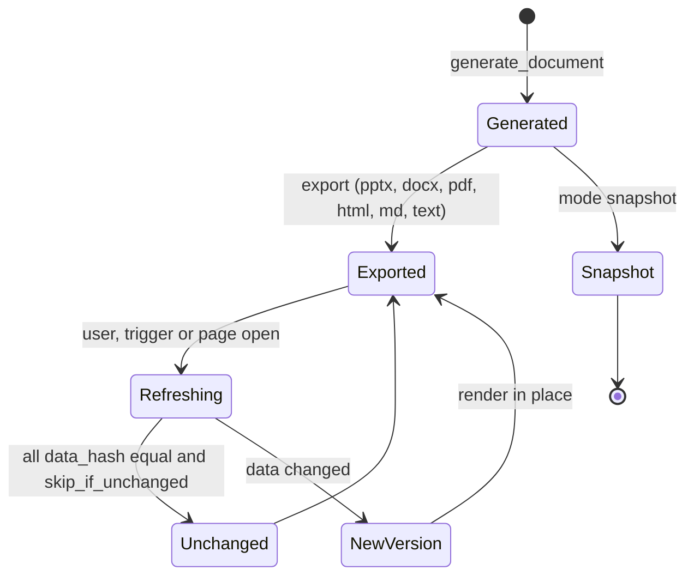

# Vision and requirements

<div class="chapter-meta" markdown>
**Reads:** `superset/commands/chart/data/get_data_command.py`, `superset/charts/data/api.py`, `superset/reports/notifications/webhook.py`, `superset/utils/pdf.py`, `servers/fastapi/templates/v2/schema.py`  ·  **Builds on:** [Part VII landing](index.md)  ·  **Time:** ~30 min
</div>

This chapter turns a one-paragraph request into a specification you can build and test. You will read the request, the interpretation this design adopts and why, the people who use the system, twelve concrete use cases with the exact prompts and triggers they involve, the functional and non-functional requirements with numeric targets, and precise definitions of "dynamic data" and "no screenshots" that later chapters implement. It ends with the explicit non-goals, which matter as much as the goals because they keep the design small enough to ship on Superset 6.1.

## Step 1: The request

The request that drives Part VII, in substance:

> I want to create a common framework and integrate it with Apache Superset, the way Presenton provides an automated workflow. You can generate a PPT out of it just by giving some prompts and, let's say, choosing some templates. Similarly, I want the same flow to be present for Apache Superset's documents, text, or pages for different event features, so that the user can automatically generate these things on the fly. It should also support dynamic data, and the prepared PPT should use dynamic data. It shouldn't use screenshots. Think from that perspective, and design a step-by-step technical-level explanation with respect to how it should be implemented for the Apache Superset project.

Six phrases in it carry the requirements:

| Phrase | What it demands | Where it is met |
|---|---|---|
| "a common framework" | One engine and one data model shared by every output type, not four separate generators | [Data-bound slide model](33-data-bound-model.md) |
| "the way Presenton provides an automated workflow" | Prompt plus template in, finished artifact out, with Presenton's staged pipeline | [Generation flow](34-generation-flow.md) |
| "documents, text, or pages" | Decks are only one of four output families | [Native rendering, no screenshots](35-native-rendering.md) |
| "for different event features ... on the fly" | Interactive generation in seconds, plus generation started by events | [Scheduling and live refresh](39-scheduling-and-refresh.md) |
| "dynamic data ... the prepared PPT should use dynamic data" | Numbers come from live queries and can be refreshed in an already prepared file | [Scheduling and live refresh](39-scheduling-and-refresh.md) |
| "It shouldn't use screenshots" | No pixel capture of Superset UI anywhere, including the PDF path | [Native rendering, no screenshots](35-native-rendering.md) |

## Step 2: The interpretation adopted

The design reads the request as follows, and every later chapter is bound by this reading.

**Build one common, output-agnostic generation framework, Superset Data-Bound Documents.** It turns three inputs into an artifact:

1. a **prompt** in natural language ("Q3 review for EMEA leadership, focus on growth drivers");
2. a **chosen template** from the Template Registry (a deck layout set, a document master, a page template or a text brief template);
3. a **Superset data context**: a dashboard with its live native-filter state, saved charts, datasets with their saved metrics, a semantic view [M], or a SQL Lab query.

It produces four kinds of output:

- **(a) PowerPoint decks** (PPTX) with native, editable charts, tables, KPI groups and speaker notes.
- **(b) Documents**: DOCX, PDF (printed from vector HTML) and Markdown.
- **(c) Text**: narratives, executive summaries, emails, Slack posts and alert briefs.
- **(d) Web pages**: interactive HTML reports that re-query as each viewer opens them, and in v2, generated Superset dashboards.

Generation starts in one of two ways:

- **On demand**: a button or chat message in Superset, a REST call, or an MCP tool call from an agent.
- **By events**: cron schedules (`cron`), Superset Alerts firing a webhook when a data condition holds (`alert_webhook`), data freshness changes (`freshness`), chart or dashboard definition changes (`definition_change`) and signed external webhooks from tools such as dbt or Airflow (`external_webhook`).

The data rules are strict and non-negotiable:

- Every chart, table, KPI and number comes from a **live Superset query** run with the **requesting user's permissions and row-level security (RLS)**. For scheduled and event runs, the explicitly recorded run-as user is used instead.
- Data elements are rendered **natively**: editable PPTX and DOCX charts with an embedded workbook, real tables, real text, vector SVG on the web. No Superset UI page is ever captured as pixels.
- Every artifact is **re-runnable**. A refresh re-executes the queries and replaces data in place. The language model is involved in a refresh only when the narrative policy requires it.

"The Presenton flow" means Presenton's stage shape (outline, layout structure, schema-constrained content, hydration, export; see [Standard generation pipeline](../presenton/08-standard-pipeline.md)) with one essential change. Presenton asks the model for chart `categories` and `series[].values` (`presenton: servers/fastapi/templates/v2/schema.py:1490-1534`). Here, **the language model never produces a number**. It chooses bindings from validated menus and writes prose with fact tokens. Numbers enter an artifact only through the Binding Resolver and the Fact Engine.



!!! info "Why one framework and not four generators"
    Decks, documents, pages and briefs differ only in the last step. The hard parts (capturing context, choosing data, running queries as the right user, computing facts, writing and checking prose, refreshing) are identical. A single `DocumentSpec` with `kind` set to `deck`, `document`, `page` or `text` lets one pipeline serve all four, and lets one document be exported to several formats from the same resolved data.

## Step 3: Personas

| Persona | Superset role (typical) | What they do with Data-Bound Documents | Permissions on `DataBoundDocs` |
|---|---|---|---|
| **Analyst (author)** | Alpha or Gamma with dataset access | Generates decks and reports from dashboards, refines them in chat, exports, shares | `can_read`, `can_generate`, `can_write`, `can_refresh` |
| **Executive (consumer)** | Gamma, often read-only | Receives emails and decks, opens live pages, asks for a quick brief | `can_read`, sometimes `can_generate` for text briefs |
| **Regional manager (RLS viewer)** | Gamma with RLS restricting rows to a region | Opens a shared live page and sees only their region's numbers and prose consistent with them | `can_read` |
| **BI engineer (template admin)** | Alpha or Admin | Imports branded PPTX and DOCX masters with named slots, publishes templates to roles, sets data exposure policies | `can_manage_templates`, `can_admin` for policies |
| **Platform operator** | Superset Admin | Installs the wheel and `.supx`, configures `DATABOUND_DOCS`, Celery routing, storage and the LLM endpoint, runs `superset dbd doctor` | `can_admin` |
| **Scheduler owner** | Alpha | Creates cron, alert and freshness triggers with an explicit run-as user, chooses delivery targets | `can_schedule` |
| **Agent developer** | API or MCP client | Drives generation from an external agent through `dbd_*` MCP tools or REST | Same permissions as the user the agent resolves to |
| **On-call engineer** | Gamma | Receives an alert brief in Slack within a minute of an alert firing, follows links to the live dashboard | `can_read` |

The persona that shapes the design most is the **regional manager**. Because a shared live page re-resolves every binding as the viewer, two managers looking at the same page must see different numbers, and neither may see prose that was written from the other's data. That single requirement is why prose carries tokens instead of literal values or category names (see [Security, RLS, auth](38-security.md)).

## Step 4: Use cases with example prompts

Each use case names its trigger, the document `kind`, the built-in template it starts from, the data context and the outputs. Template ids are the built-ins listed in the blueprint's Template Registry (`tpl_exec_review`, `tpl_dashboard_walkthrough`, `tpl_analytical_report`, `tpl_interactive_report`, `tpl_kpi_brief`, `tpl_weekly_email`, `alert_brief`).

| # | Use case | Persona | Trigger | `kind` | Template | Data context | Outputs |
|---|---|---|---|---|---|---|---|
| UC1 | Quarterly business review deck | Analyst | on demand (chat [M], Studio page [6.1]) | `deck` | `tpl_exec_review` | Sales dashboard, Region = EMEA, Period = last quarter | PPTX, PDF |
| UC2 | Dashboard walkthrough deck | Analyst | on demand | `deck` | `tpl_dashboard_walkthrough` (ordered, one section per tab) | any dashboard with tabs | PPTX |
| UC3 | Incident brief when an alert fires | On-call engineer | `alert_webhook` | `text` | `alert_brief` | the alert's chart and dashboard | Slack post, email |
| UC4 | Weekly KPI email | Executive | `cron` (Monday 07:00 local) | `text` | `tpl_weekly_email` | KPI dashboard, Period = last week | HTML email with KPI cards, optional PPTX attachment |
| UC5 | Monthly analytical report | Analyst | `cron` or on demand | `document` | `tpl_analytical_report` | Finance dashboard plus a dataset | DOCX, PDF, Markdown |
| UC6 | Interactive regional report | Regional managers | on demand, then opened live | `page` | `tpl_interactive_report` | Sales dashboard, no region filter (RLS supplies it) | live HTML page, shared `live` |
| UC7 | Brief from a SQL Lab result | Analyst | on demand (`sqllab.results` menu) | `text` | `tpl_kpi_brief` | the last SQL Lab query, or a dataset saved from it | Markdown, Slack |
| UC8 | Board deck from an external agent | Agent developer | MCP `dbd_generate_document` | `deck` | `tpl_exec_review` | Finance dashboard chosen by the agent | PPTX |
| UC9 | Refresh when the nightly load lands | Scheduler owner | `freshness` (sentinel `MAX(updated_at)`) | `deck` | existing UC1 document | the UC1 document's bindings | refreshed PPTX in place, email |
| UC10 | Data quality report after a dbt run | BI engineer | `external_webhook` (HMAC-signed) | `document` | `tpl_analytical_report` | data quality dataset | PDF, store and notify |
| UC11 | Conversational refinement | Analyst | chat message on an existing document | `deck` | the document's template | the document's context | new document version |
| UC12 | Air-gapped scheduled brief | Platform operator | `cron` | `text` | `tpl_kpi_brief` with the `template` planner (no LLM) | KPI dataset | email |

### UC1: QBR deck from the Sales dashboard for EMEA, last quarter

The analyst opens the Sales Overview dashboard, sets Region to EMEA and Period to last quarter, and types in the chat panel (master) or the Studio page (6.1):

> QBR deck from the Sales dashboard for EMEA, last quarter. Board template. Lead with revenue versus prior year, then product mix, then top countries.

Context Capture reads the dashboard's `native_filters_key` from the URL, converts it into a durable permalink, and submits a request like this:

```json title="CreateDocumentRequest for UC1"
{
  "prompt": "QBR deck from the Sales dashboard for EMEA, last quarter. Board template. Lead with revenue versus prior year, then product mix, then top countries.",
  "title": "Q3 2026 Sales Review: {{p:region}}",
  "kind": "deck",
  "template": {"id": "tpl_exec_review", "version": null},
  "formats": ["pptx", "pdf"],
  "context": {
    "dashboard": {"id_or_slug": "sales-overview", "native_filters_key": "kq8sP0", "permalink_key": null},
    "chart_ids": [], "dataset_ids": [7], "sqllab": null
  },
  "parameters": {"region": ["EMEA"]},
  "options": {"language": "en", "tone": "executive", "max_sections": 8, "exposure": "aggregates",
              "planner_strategy": null, "mode": "live", "sync": false}
}
```

The response is `202` with `document_id`, `job_id` and `task_uuid`. Sections stream into the preview as `section.ready` events. The resulting PPTX has a KPI group whose revenue value is the same number the dashboard's Big Number chart shows for the same user and filters, a stacked column chart whose "Edit Data" opens the monthly rows by product line, and a native table of the top countries. The narrative reads, for example, `Revenue moved {{f:f_rev_yoy}} year over year across the region`, with the token rendered as a separate text run.

### UC3: Incident brief when an alert fires

An Alert in Superset evaluates "orders in the last hour below threshold" every five minutes. Its Webhook recipient targets `https://<superset>/extensions/databound/docgen/v1/hooks/<token>`. When the alert triggers, the Trigger Service validates the token, ignores the payload's text fields, and runs the `alert_brief` template as the trigger's run-as user. Within seconds a Slack post appears:

> What fired: Hourly orders below threshold (threshold from the alert's `validator_config_json`, last value from the report execution log). What changed: orders fell `{{f:f_orders_chg.abs}}` versus the previous hour, led by `{{f:f_worst_region.label}}`. Where to look: links to the live dashboard and chart.

No screenshot is taken by Superset either: the alert is chart-scoped with `report_format = TEXT` on 6.1, or `NONE` on master, so the reports pipeline never starts a browser (see [Superset landscape (6.1)](31-superset-landscape.md)).

### UC4: Weekly KPI email

The executive asks once, in the Studio: "Every Monday at 7 in Paris, email me a one-screen KPI summary of last week from the Executive KPIs dashboard." The analyst saves the document and creates a trigger:

```json title="TriggerSpec for UC4"
{
  "document_id": "doc_01JC8Z6Q4M5K",
  "type": "cron",
  "config": {"crontab": "0 7 * * MON", "timezone": "Europe/Paris",
             "action": "refresh", "narrative": "regenerate_on_drift",
             "parameters": {"time_range": "Last week"},
             "formats": ["email"],
             "deliver": [{"type": "email", "to": ["cfo@example.com"]}, {"type": "store"}],
             "skip_if_unchanged": true},
  "run_as_id": 42,
  "active": true
}
```

Every Monday the beat task `databound_docs.trigger_tick` schedules `run_trigger`. The refresh re-resolves every binding as user 42, rolls `Last week` forward, keeps the prose and updates its tokens unless a drift rule fires (a sign flip, a change in the top three, or a cited value moving more than 10%), and sends the email. If nothing changed, `refresh.unchanged` is recorded and no new version is created.

### UC6: Interactive regional report

The analyst generates a `page` from the Sales dashboard with no region filter and shares it in `live` mode with the Regional Managers role. When the manager for EMEA opens `GET /extensions/databound/docgen/v1/pages/<document_id>`, the page calls `render-model?live=1`, and the server re-resolves every binding as that manager. RLS restricts the rows to EMEA, tokens resolve to EMEA values, and claim lint re-checks each narrative against the manager's facts. If the narrative no longer holds for that viewer's data, it is replaced by deterministic sentences with a "Summary written for different data" notice and a "Regenerate for me" button.

### UC7: Brief from a SQL Lab result

In SQL Lab, after a query succeeds, the analyst clicks "Generate brief from results" in the results toolbar (`sqllab.results`). The panel captures the query's `remoteId` from `sqlLab.onDidQuerySuccess`. The backend reloads the `Query` row, checks that it belongs to the user, and accepts it as a `sql` binding only when the operator enabled `DATABOUND_DOCS["ALLOW_SQL_BINDINGS"]` (default `False`) and `raise_for_access(sql=..., force_dataset_match=True)` passes. Otherwise the panel offers "save as dataset first", after which the brief is built from a governed `dataset` binding. The prompt might be:

> Two-paragraph brief of this result for the ops channel: what stands out, what to check next.

### UC8: Board deck from an external agent

An external agent connected to `superset mcp run` calls the MCP prompt `dbd_deck_from_dashboard(dashboard, template, audience)` to get the ordered steps, then `extensions.databound.docgen.dbd_list_templates`, then `extensions.databound.docgen.dbd_generate_document` with a `CreateDocumentRequest`, and polls `dbd_get_job`. On master the call runs as the user the agent's JWT or API key resolves to. On 6.1, MCP calls run as `MCP_DEV_USERNAME` unless middleware sets `g.user`, so DBD's mutate and data tools refuse to run for the dev user unless `DATABOUND_DOCS["MCP_ALLOW_DEV_USER"]` (a Data-Bound Documents setting, not a Superset one) is set for development.

### UC11: Conversational refinement

On an existing deck the analyst types:

> Make slide 2 a line chart and add a slide on deal size by country.

The Planner runs in edit mode and returns JSON Patch operations restricted to `/sections`, `/facts`, `/title`, plus binding additions that go through the Binding Registry. The server validates the patch against the current version, re-runs only the affected bindings and narratives, and writes a new version. If the planner cannot decide (two datasets both have a `deal_size` column), it emits `job.needs_input` with options and ends the task; the answer schedules `continue_generation`.

### UC12: Air-gapped scheduled brief

A regulated deployment has no LLM endpoint. The operator sets the template planner strategy, and `tpl_kpi_brief` declares fixed bindings and deterministic sentences such as `{binding_title}: {{f:x}} ({{f:delta}} versus the prior period).` The same Binding Resolver, Fact Engine, renderers and triggers run. Only the prose is less fluent.

!!! warning "Gotcha: prompts are not data access"
    A prompt such as "include salaries by employee" cannot widen what a user sees. The Planner can choose only from candidates and datasets the user can already access, and every binding is re-checked by `ChartDataCommand.validate()`, which calls `raise_for_access` before running anything (`apache/superset: superset/commands/chart/data/get_data_command.py:107-108`). A request for data outside the user's access becomes an entry in the outline's `gaps`, not a query.

## Step 5: Functional requirements

Requirements are grouped by the stage they constrain. "Must" items are MVP scope unless the Phase column says otherwise; phases are defined in [Roadmap](40-roadmap.md).

### 5.1 Inputs and context

| Id | Requirement | Phase |
|---|---|---|
| FR-01 | Accept a prompt, a template reference `(id, version)`, a data context and typed parameters through one request schema, `CreateDocumentRequest`, from UI, REST and MCP | MVP |
| FR-02 | Capture a dashboard's live filter state at request time and persist it as a dashboard permalink, so later refreshes reproduce the same selection | MVP |
| FR-03 | Support context from a dashboard, explicit chart ids, explicit dataset ids and a SQL Lab query; support semantic views where `SEMANTIC_LAYERS` is enabled | MVP ([M] for semantic views, v2) |
| FR-04 | Offer a "what will the AI see" preview of the exact Data Digest before generation (`POST /context/digest`) | MVP |
| FR-05 | Deduplicate identical submissions (double clicks) into one job through a deterministic GTF `task_key` | MVP |

### 5.2 Planning and templates

| Id | Requirement | Phase |
|---|---|---|
| FR-06 | Plan sections with a schema-constrained outline whose binding choices are enums generated per request from the digest | MVP |
| FR-07 | Choose layouts deterministically by slot compatibility (shape, x kind, series and category counts), with an LLM tie-break only when two layouts score within 3 points | MVP |
| FR-08 | Provide three planner strategies with one plan contract: `pipeline` (default), `template` (no LLM) and `agent` (opt-in, master only) | MVP (`agent` v2) |
| FR-09 | Let admins import branded PPTX and DOCX masters whose shapes or content controls are named `slot:<type>:<name>`, and version templates immutably | MVP for JSON templates, v1 for master import |
| FR-10 | Ask a clarifying question (`job.needs_input`) instead of guessing, without blocking a worker | v1 |

### 5.3 Data

| Id | Requirement | Phase |
|---|---|---|
| FR-11 | Every chart, table, KPI and number is a `DataBinding` registered through the Binding Registry and resolved through `ChartDataCommand` (or, for opt-in SQL, `Database.execute` after `raise_for_access`) as the requesting or run-as user | MVP |
| FR-12 | Chart-source bindings reproduce the dashboard's numbers exactly, including native filters in scope for that chart | MVP |
| FR-13 | Planner-proposed bindings use only saved metrics and groupable columns of datasets the user can access; the LLM never writes SQL or adhoc SQL expressions | MVP |
| FR-14 | Facts (totals, changes, shares, ranks, labels, periods) are computed by pure functions over resolved rows; candidate facts shown to the planner are recomputed from full results | MVP |
| FR-15 | Each binding result records provenance: as whom, when, cache state, applied and rejected filters, time bounds, row limit, truncation, query hash, data hash and RLS fingerprint | MVP |

### 5.4 Narrative

| Id | Requirement | Phase |
|---|---|---|
| FR-16 | LLM prose cites data only through tokens (`{{f:<id>}}`, `{{f:<id>.label}}`, `{{f:<id>.abs}}`, `{{p:<param>}}`, `{{m:<binding_id>.as_of}}`) | MVP |
| FR-17 | A deterministic Narrative Verifier rejects literal numbers, number words, literal category names, direction words that contradict a change's sign, unsupported superlatives and over-length text, repairs up to two times, then falls back to deterministic sentences | MVP |
| FR-18 | Narratives on live pages follow the viewer rule: tokens re-resolve for the viewer and prose is re-linted against the viewer's facts | v1 |

### 5.5 Rendering and outputs

| Id | Requirement | Phase |
|---|---|---|
| FR-19 | PPTX with native charts (embedded workbook, "Edit Data" works), native tables, KPI groups, speaker notes and named shapes `dbd:chart:<element_id>:<binding_id>` | MVP |
| FR-20 | Markdown, plain text, email and Slack outputs from the same spec | MVP (Markdown, text), v1 (email, Slack) |
| FR-21 | DOCX with native chart parts behind a prototype gate, vector SVG from rows until it passes | v1 |
| FR-22 | Live HTML pages and self-contained static HTML; vector PDF printed from that HTML | v1 |
| FR-23 | A published viz_type coverage matrix with honest fallbacks (native table, vector SVG from rows, or link), never a picture of the chart | MVP for tier 1 |

### 5.6 Refresh, triggers and delivery

| Id | Requirement | Phase |
|---|---|---|
| FR-24 | Refresh in place: re-resolve bindings, `Chart.replace_data` on each bound chart, rewrite table cells, rewrite each token run only if its text is unchanged since generation | MVP for PPTX |
| FR-25 | Skip unchanged refreshes when every `data_hash` matches (`refresh.unchanged`) | MVP |
| FR-26 | Narrative refresh policies `keep`, `retoken`, `regenerate_on_drift` (default) and `regenerate` | MVP |
| FR-27 | Triggers `cron`, `alert_webhook`, `freshness`, `definition_change` and `external_webhook`, each with an explicit run-as user validated before every run | v1 |
| FR-28 | Delivery by email, Slack, generic webhook, or store and notify | v1 |

### 5.7 Editing, sharing and governance

| Id | Requirement | Phase |
|---|---|---|
| FR-29 | Edit by JSON Patch against a base version; every accepted edit is an immutable new version (`409` on a stale base) | MVP |
| FR-30 | Data cells are read-only in the editor; "pin a value" creates a visibly marked text element reported as "edited, not live" | MVP |
| FR-31 | Sharing in `live` mode (recipients see their own data) by default; `snapshot` sharing requires `can_share_snapshot` and is re-checked at download | v1 |
| FR-32 | Every generate, refresh, export, download, share, trigger run and MCP call is audited in `dbd_audit` and in Superset's event log | MVP |

## Step 6: Non-functional requirements

| Area | Requirement | Target or limit |
|---|---|---|
| Latency: capture | Synchronous `POST /documents` returns `202` | under 300 ms |
| Latency: first content | Median time to the first `section.ready` on warm caches | under 20 s |
| Latency: full deck | Eight-section deck to `document.ready` on warm caches | under 90 s |
| Latency: text brief | `kind: text` with `options.sync: true` | 20 s budget, then falls back to async `202` |
| Latency: stage budget | Data Digest 1 to 10 s, outline 5 to 15 s, resolution 1 to 20 s, narrative 3 to 8 s per section (up to 4 in parallel), export 1 to 10 s per format | per stage |
| Scale | 20 concurrent deck jobs on 4 DBD workers without starving the default Celery queue | load test |
| Scale: per document | `MAX_BINDINGS_PER_DOC = 60`, `MAX_ROWS_PER_BINDING = 5000`; chart bindings capped at 50 rows, tables at 200 | configuration |
| Cost: tokens | Data Digest bounded by `max_digest_tokens = 12000`; outline 1 call, tie-break 0 or 1, writer 1 per section plus at most 1 fact follow-up and 2 repairs | per document |
| Cost: agent | `agent` planner budget of 24 tool calls, 6 minutes and 60,000 input tokens | per job |
| Cost: queries | Profiling uses the dashboard's own queries, so with a configured `DATA_CACHE_CONFIG` they are usually cache hits; the cache key includes RLS (`apache/superset: superset/security/manager.py:6304`) | per user |
| Determinism: numbers | Same binding results produce the same facts, displays, chart caches and table cells, always | exact |
| Determinism: layout | Layout fit is a deterministic bipartite match plus score; only ties consult the LLM | exact except ties |
| Determinism: render | Render cache key `sha256(spec_sha256, data_hashes, template_version, renderer_version, format)` reuses artifacts | exact |
| Determinism: prose | Not deterministic, but verified: zero untokenized numerals and entities in shipped LLM text | acceptance |
| Accuracy | 100% of chart, table and KPI values in an exported PPTX equal `GET /api/v1/chart/<id>/data/` for the same user and filters | acceptance |
| Quality | Schema-valid outputs at least 99% after retries; Verifier precision at least 0.98 and recall at least 0.95 per language | eval suite |
| Auditability | Every artifact references `(document_id, version, binding_result_ids)`, so "what data was in Monday's file" is answerable | always |
| Security | Two users with different RLS get different, correct numbers from one document, with no cross-leak into artifacts, events or audit rows | contract test |
| Compatibility | Runs on Superset 6.1.0 with flagged fallbacks and on master; two frontend bundles from one source | both |
| Operability | No new database server or web service; one wheel in the images, one `.supx`, one Celery queue, one beat entry | deployment |
| Portability | Opens in PowerPoint 365, Keynote and LibreOffice with working "Edit Data" | acceptance |

!!! warning "Gotcha: latency targets assume a data cache"
    Superset's default `DATA_CACHE_CONFIG` is `{"CACHE_TYPE": "NullCache"}` (`apache/superset: superset/config.py:1532`), so nothing is cached out of the box. Profiling then re-runs every dashboard query, and the 20 s and 90 s targets become a function of warehouse speed. `superset dbd doctor` warns when the data cache is `NullCache`.

The accuracy requirement is an executable acceptance test. A sketch, using python-pptx's read API and the chart data endpoint as the same user:

```python title="tests/acceptance/test_pptx_matches_chart_data.py (sketch)"
import requests
from pptx import Presentation


def bound_chart_frames(path: str):
    for slide in Presentation(path).slides:
        for shape in slide.shapes:
            if shape.has_chart and shape.name.startswith("dbd:chart:"):
                _, _, element_id, binding_id = shape.name.split(":", 3)
                yield element_id, binding_id, shape.chart


def test_values_equal_chart_data(pptx_path, spec, superset_url, user_session):
    for _element_id, binding_id, chart in bound_chart_frames(pptx_path):
        binding = spec.binding(binding_id)
        if binding.source.kind != "chart":
            continue
        # Same user, same filters: master supports ?filters_dashboard_id=<id>
        res = user_session.get(
            f"{superset_url}/api/v1/chart/{binding.source.chart_id}/data/",
            params={"filters_dashboard_id": spec.context.dashboard.dashboard_id},
        ).json()["result"][binding.source.query_index]
        expected = shape_rows(res, binding.shape)  # test helper: same shaping as the resolver
        for series in chart.plots[0].series:
            assert list(series.values) == expected[series.name]
```

`filters_dashboard_id` applies only the dashboard's saved filter defaults (it passes no active data mask) and exists only on master (`apache/superset: superset/charts/data/api.py:191-219`). The comparison is therefore exact only for documents with `filter_mode: "defaults"`, or for fixture dashboards whose defaults equal the captured selection; a document captured with other filter values (UC1's EMEA selection, for example) is compared against a `POST /api/v1/chart/data` request built from the same permalink data mask. On 6.1 the test compares against the resolver's own 6.1 filter port, and a contract test asserts that the port and the master helper produce identical query contexts.

## Step 7: What "dynamic data" means, precisely

"Dynamic" is ambiguous. In this design it has a precise meaning: **every data-bearing element is a re-executable reference to a governed Superset query, not a copy of numbers.** The reference is a `DataBinding`; the numbers are a `BindingResult` produced by running it at a specific time as a specific identity.

### 7.1 Bindings, not copies

A binding records what to run, not what came back:

- its **source** (`chart`, `dataset`, `semantic` [M] or `sql`);
- its **filters**: dashboard native filters to apply, explicit filters, `time_range`, `time_grain`, `$param.*` references;
- its **shape** (`scalar`, `series`, `xy`, `xyz`, `table`, `pivot`) and **format**;
- its **mode** (`live` or `snapshot`) and, for chart sources, **follow** (`live` reloads the chart's current saved query context on every run; `pinned` uses a stored snapshot of it and flags `definition_changed` when the live chart drifts).

Rows exist in an artifact only as rendered output: chart caches and embedded workbooks in PPTX, table cells, token runs, embedded JSON in a static page. They are stored in `dbd_binding_result.rows` only for `snapshot` mode or when an audit policy requires it.

### 7.2 The four data modes

| Mode | What happens when the artifact is used | Whose data | LLM involved |
|---|---|---|---|
| **Live page** | Every open re-resolves `live` bindings as the viewer; tokens re-resolve; narratives follow the viewer rule | the viewer | only on "Regenerate for me" |
| **Refresh in place** | Re-resolve, then `replace_data`, table rewrite and guarded token rewrite inside the existing PPTX or DOCX; a new version | the run-as user (or the requester) | only if the narrative policy fires |
| **Regenerate** | Full pipeline with the same prompt, template and context; structure may change | the requester | yes |
| **Snapshot** | Frozen rows, never re-queried; exported and shared as generated | stored | no |



### 7.3 Refresh semantics

A refresh is defined by five rules:

1. **Same query, new time.** Parameters roll forward: a binding with `time_range: "$param.time_range"` and a parameter value of `Last quarter` resolves to the quarter that is "last" at refresh time. Absolute ranges (`2026-07-01 : 2026-10-01`) stay absolute.
2. **Same filters.** Dashboard filters come from the stored permalink (`filter_mode: "captured"`), or from the dashboard's current defaults when the document opts into `filter_mode: "defaults"`.
3. **Same identity rules.** Refreshes run as the requesting user, or as the trigger's `run_as_fk`, which is re-validated (active, still has `can_refresh`, still has access to every bound datasource) before every run. There is no fallback to another user.
4. **In place, never re-laid-out.** A refresh rewrites chart caches, embedded workbooks, table cells and token runs, and nothing else. An XML diff between two refreshes of a PPTX touches only those parts. A token run edited by a human since generation is skipped and reported as `token_edited_skipped`.
5. **Prose follows policy.** With the default `regenerate_on_drift`, a narrative is rewritten only when a drift rule fires for one of its facts (`sign_flip`, `rank_change_top3`, `abs_change_pct>10`); otherwise only its tokens update. `user_edited` narratives are never rewritten.

!!! warning "Gotcha: filter state keys expire, permalinks do not"
    The `native_filters_key` in a dashboard URL points to filter state held in `FILTER_STATE_CACHE_CONFIG`, a cache with a TTL. The default is a `SupersetMetastoreCache` with a 90-day timeout that is refreshed on every read (`apache/superset: superset/config.py:1551-1555`), but operators often move it to Redis with a shorter timeout, and any cache entry can be evicted. A document that stored only that key could silently lose its filters. Context Capture therefore converts it into a dashboard permalink at capture time. Permalinks are key-value rows written without an expiry (`apache/superset: superset/commands/dashboard/permalink/create.py:110-115`), and the permalink key is what refreshes use months later.

### 7.4 What "dynamic" does not mean

- It does not mean real-time streaming. Data changes are detected by schedules, alert conditions, freshness sentinels and definition-change listeners. Superset has no change data capture or dataset-refresh event to subscribe to.
- It does not mean a PPTX that queries Superset by itself when opened in PowerPoint. Office files are refreshed by Data-Bound Documents (on a trigger, in the Studio, or by uploading a previously exported copy to `POST /documents/<id>/refresh-upload`); the live, open-time behavior belongs to `page` documents.
- It does not mean the LLM re-reads the data on every refresh. Most refreshes involve no LLM call at all.

## Step 8: What "no screenshots" means, precisely

### 8.1 The rule

**No pixel of a Superset UI page is ever captured, and no bound element is ever stored as a raster image.** Superset's own report pipeline does exactly what this forbids: PNG reports are browser captures and PDF reports are a stack of those captures (`apache/superset: superset/utils/pdf.py:30-41`). [Superset landscape (6.1)](31-superset-landscape.md) explains why that pipeline exists and why the design cannot reuse it for rendering.

| Allowed | Forbidden |
|---|---|
| A native PPTX or DOCX chart built from resolved rows, with an embedded workbook | A PNG or JPEG of a Superset chart or dashboard, from any source |
| A native table with formatted text cells | `build_pdf_from_screenshots` or any PDF made of images of charts |
| Vector SVG computed from rows in Python (Vega-Lite through `vl-convert-python`), or later ECharts server-side SVG | Loading a Superset page in a headless browser, for any purpose, including "to make the frontend save a query context" |
| Chromium printing DBD's own static HTML to PDF with network access disabled (text stays text, SVG stays vector) | Importing `superset.utils.webdriver`, `superset.utils.screenshots`, `superset.utils.screenshot_utils` or `superset.utils.pdf` |
| A PNG rasterized **from DBD's own SVG**, only for email clients that block SVG | MCP `get_chart_preview` with `format: "png"` |
| Static template assets (logos, backgrounds) as `image` elements | An `image` element whose source is a capture |

### 8.2 Editable native charts

"Native" has a testable meaning in PPTX: the chart is a `c:chartSpace` part with cached category and value points and an embedded `.xlsx` workbook, so PowerPoint's "Edit Data" opens the real rows. python-pptx produces exactly this: `ChartPart.new` writes the chart XML and then `chart_workbook.update_from_xlsx_blob(chart_data.xlsx_blob)`, and `Chart.replace_data` later rewrites both the cached values and the workbook while keeping formatting. Values are stored as numbers with an Excel number format derived from Superset's d3 format, so a reader can restyle, re-sort or copy them.

### 8.3 Enforcement

The requirement is enforced by machines, not by convention:

- an import-linter contract in `superset-databound-docs` forbids the screenshot and PDF-from-screenshot modules listed above;
- a renderer contract test unzips every generated PPTX and DOCX and fails if any shape named `dbd:*`, or any `dbd:binding` content control, targets an image part (the only exception is a `native: "svg"` element whose SVG was generated from rows);
- unsupported viz types fall back to vector SVG from rows, a native table, or a link to the live chart.

!!! warning "Gotcha: Alerts used as triggers must not take screenshots either"
    A dashboard-scoped Report or Alert always produces PNG or PDF attachments, so pointing one at the DBD webhook would still start a browser on every run. Use a chart-scoped alert with `report_format = TEXT` on 6.1, or `NONE` on master, and keep the dashboard id in the DBD trigger record.

## Step 9: Explicit non-goals

| Non-goal | Why | What happens instead |
|---|---|---|
| Putting an LLM, or any Presenton code, into `apache/superset` core | Superset should not depend on an LLM; importing Presenton code into an ASF repository would be a code donation | Data-Bound Documents lives in its own Apache-2.0 repository as a wheel plus extension; only small generic hooks are proposed upstream ([Roadmap](40-roadmap.md)) |
| Letting the LLM author SQL or adhoc expressions | Large attack surface and no governance | The LLM chooses chart candidates and proposes dataset queries over saved metrics and columns only; `sql` bindings are opt-in and come from saved queries, the user's own SQL Lab queries or template admins |
| Pixel-identical reproduction of Superset's ECharts look in Office files | Office charts are a different engine | Office charts approximate colors, formats and types; the live page uses ECharts for parity |
| Rendering WebGL maps (deck.gl, Mapbox) natively | No faithful vector rendering exists | An aggregated native table, a narrative and an "Open live map" link |
| Replacing Superset dashboards or Alerts and Reports | They remain the authoring and alerting tools | DBD reads dashboards and uses alerts as triggers; Superset dashboard output arrives only in v2 |
| A new authentication path, service account or credential broker | Any of these is an exfiltration risk | All data access is in-process under `override_user`; schedules use an explicit run-as user |
| Real-time streaming dashboards in documents | No upstream change event exists | Event triggers and live pages |
| Generation for embedded (guest) users in MVP | Guest identity on 6.1 is unverified, and extensions do not load in embedded dashboards | Guest live pages are v2 and master only |
| Using `@presenton/export-core` | License unknown, distributed outside npm, browser DOM measurement | python-pptx, a DrawingML writer and vector HTML printing ([PPTX and PDF export](../presenton/24-export-pipeline.md) shows what is replaced) |
| Free-form "smart mode" HTML generated by the LLM | Cannot guarantee data provenance | Template-driven pages whose data elements are bindings |
| Multi-tenancy beyond Superset's | Tenancy follows the Superset deployment | Owner-scoped documents, explicit shares, template visibility scopes |

!!! warning "Gotcha: 6.1 has no button on dashboards"
    On stock 6.1 an extension can contribute UI only in SQL Lab; the global chat slot that appears on dashboards and Explore exists only on master. UC1 on 6.1 therefore starts from the standalone Studio page (`GET /extensions/databound/docgen/v1/studio?dashboard=12&native_filters_key=...`, reachable from a dashboard Markdown link or a bookmark) or from the SQL Lab panel's dashboard picker. This is a limitation of the host, documented in [Superset landscape (6.1)](31-superset-landscape.md), not a missing feature.

## Step 10: Traceability to the rest of Part VII

| Requirement group | Chapter that implements it |
|---|---|
| Components, processes, deployment (NFR operability, compatibility) | [Target architecture](32-architecture.md) |
| Document Spec, bindings, facts, tokens, slots, provenance (FR-11 to FR-16) | [Data-bound slide model](33-data-bound-model.md) |
| Context Capture, digest, planning, verification, events (FR-01 to FR-10, FR-16, FR-17) | [Generation flow](34-generation-flow.md) |
| Renderers, viz mapping, no-screenshot guarantee (FR-19 to FR-23) | [Native rendering, no screenshots](35-native-rendering.md) |
| REST API, GTF tasks, MCP tools, frontend (FR-01, FR-05, FR-29) | [Building the Superset extension](36-superset-extension.md) |
| Storage, LLM providers, caching, routing (NFR cost, scale) | [Building the generation service](37-generation-service.md) |
| Identity, RLS, sharing, audit (FR-18, FR-31, FR-32, NFR security) | [Security, RLS, auth](38-security.md) |
| Live pages, refresh, triggers, delivery (FR-24 to FR-28) | [Scheduling and live refresh](39-scheduling-and-refresh.md) |
| Phases, acceptance tests, gates, risks | [Roadmap](40-roadmap.md) |

## What you now know

- The request is read as one output-agnostic framework that turns a prompt, a template and a Superset data context into decks, documents, text or pages, on demand or on five kinds of events.
- Twelve use cases, from a QBR deck to an air-gapped brief, fix the triggers, templates and outputs the design must support.
- "Dynamic data" means re-executable bindings resolved as a specific identity, with four modes (live page, refresh in place, regenerate, snapshot) and five refresh rules.
- "No screenshots" means no captured UI pixels and no raster bound elements, enforced by an import-linter contract and a no-raster CI test; vector SVG from rows is allowed.
- Non-functional targets are concrete: under 20 s to the first section, under 90 s for an eight-section deck, exact number parity with the chart data API, and zero untokenized numbers in LLM prose.
- The non-goals (no LLM in core, no LLM-authored SQL, no new auth path, no WebGL rendering) keep the design shippable on 6.1.

## Next

Continue with [Superset landscape (6.1)](31-superset-landscape.md) to see every Superset API and extension point these requirements rely on, and which of them exist only on master.
