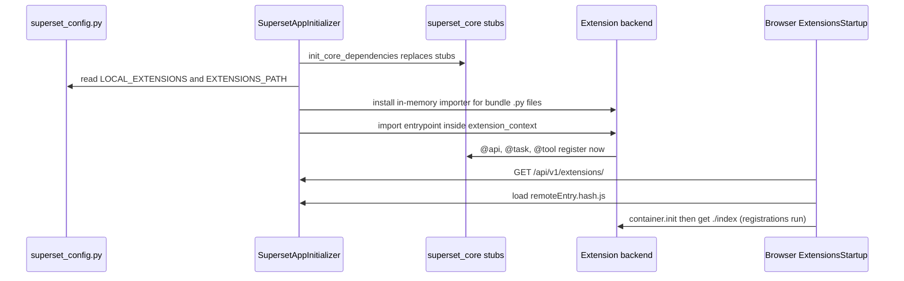

# Superset landscape (6.1)

<div class="chapter-meta" markdown>
**Reads:** `superset/core/api/core_api_injection.py`, `superset/tasks/decorators.py`, `superset/tasks/manager.py`, `superset/core/mcp/core_mcp_injection.py`, `superset/charts/data/api.py`, `superset/charts/data/dashboard_filter_context.py`, `superset/security/manager.py`, `superset/commands/report/execute.py`, `superset-frontend/packages/superset-core/src/`  ·  **Builds on:** [Vision and requirements](30-vision.md)  ·  **Time:** ~50 min
</div>

This chapter is the inventory of what Apache Superset already provides that Data-Bound Documents builds on, with exact module paths, signatures, routes and payloads. You will walk through the extensions framework (backend and frontend), the Global Task Framework, the built-in MCP service, the chart data API and query context, dashboards and their filter state, datasets and metrics, SQL Lab, security, theming, the embedded SDK, and Alerts and Reports. For each piece you will see whether it exists in the 6.1.0 release or only on master, and what the design does on 6.1 when it is missing. The chapter ends with a single availability table you can use as a checklist.

## Step 0: Versions and the availability legend

All citations refer to `apache/superset` master at `cabd8d4ecc6101f04184bd93b5fa77152d139c4d` (2026-11-02) unless marked otherwise. 6.1.0 facts come from the 6.1.0 tag, its versioned documentation and `UPDATING.md`, whose `## 6.1.0` section starts at `apache/superset: UPDATING.md:2689`; everything above it, under `## Next`, is master only.

| Artifact | Version | Released | Notes |
|---|---|---|---|
| Apache Superset | 6.1.0 | tag dated 2026-05-13 | latest stable; a 7.0 branch exists |
| `apache-superset-core` (PyPI) | 0.1.0 | 2026-05-11 | backend extension API; master's copy is the unreleased 0.2.0 line |
| `apache-superset-extensions-cli` (PyPI) | 0.1.0 | 2026-05-11 | `superset-extensions` command |
| `@apache-superset/core` (npm) | 0.1.0 | 2026-05-11 | frontend extension API |
| `@superset-ui/embedded-sdk` (npm) | 0.4.0 in master's `superset-embedded-sdk/package.json` | not checked | release paired with 6.1 not checked; method set at the 6.1.0 tag in Step 10 |

Tags used below: **[6.1]** present in 6.1.0 and on master; **[M]** master only (expected in 7.0, unverified); **[M\*]** present in 6.1.0 but changed on master. Both `superset-core` and the CLI declare `Development Status :: 3 - Alpha`, and `ENABLE_EXTENSIONS` is a development-lifecycle flag defaulting to `False` (`apache/superset: superset/config.py:788`). Plan for churn.

## Step 1: The extensions framework

### 1.1 How an extension is loaded

An extension is a `.supx` zip (or, in development, a local `dist/` folder) discovered at process startup. The host initializes in a fixed order inside `init_app_in_ctx`: views first, then `init_all_dependencies_and_extensions()` (`apache/superset: superset/initialization/__init__.py:640-655`), which always replaces the `superset_core` stubs with host implementations and, only when `ENABLE_EXTENSIONS` is on, calls `init_extensions()` (`:657`). That function imports each extension's backend entrypoint inside `extension_context(manifest)` with `eager_import(backend.entrypoint)` (`:686`).



Facts that shape the design:

- **Every process imports the extension.** Celery workers build the app with `create_app()` (`apache/superset: superset/tasks/celery_app.py:29-33`) and so does the MCP server (`apache/superset: superset/mcp_service/flask_singleton.py:75-90`). With `ENABLE_EXTENSIONS` on in each process's config, a GTF task or MCP tool defined in the extension is executable in a worker or in `superset mcp run`.
- **Discovery is startup only.** `GET /api/v1/extensions/` re-reads the folder on every request (`apache/superset: superset/extensions/api.py:104-115`), so a new bundle's frontend appears, but its backend is not imported until restart. There is no install, enable or upload API.
- **Backend code is never written to disk.** An `InMemoryFinder` on `sys.meta_path` compiles bundle sources with a `supx://<id>/backend/src/...` filename (`apache/superset: superset/extensions/utils.py:51-158`).
- **Failures are isolated.** A broken extension is logged and the app still starts (`apache/superset: superset/initialization/__init__.py:657-701`).

Configuration keys:

| Key | Default | Location | Availability |
|---|---|---|---|
| `FEATURE_FLAGS["ENABLE_EXTENSIONS"]` | `False` | `apache/superset: superset/config.py:788` | [6.1] |
| `LOCAL_EXTENSIONS: list[str]` | `[]` | `apache/superset: superset/config.py:3681` | [6.1] |
| `EXTENSIONS_PATH: str or None` | `None` | `apache/superset: superset/config.py:3682` | [6.1] |
| `EXTENSION_DENYLIST`, `EXTENSION_VERSION_POLICY` | `[]`, `{}` | `apache/superset: superset/config.py:3687, 3693` | [M] |
| `EXTENSIONS_EPHEMERAL_STORAGE`, `EXTENSIONS_PERSISTENT_STORAGE` | 7 days and 100 KB; 100 MB quota and 1 MB values | `apache/superset: superset/config.py:1580-1609` | [M] |

### 1.2 Packages, CLI and the `.supx` bundle

The `superset-extensions` CLI (`apache/superset: superset-extensions-cli/src/superset_extensions_cli/cli.py`) has six commands: `init` scaffolds a project, `validate` checks `extension.json` against `ExtensionConfig` and npm at least `10.8.2`, `update` bumps metadata, `build` (`:554`) runs `npm run build` and copies backend files matched by `[tool.apache_superset_extensions.build] include` (`copy_backend_files`, `:225`), `bundle` (`:587`) zips `dist/` into `{name}-{version}.supx` by default (`:612`), so with name `docgen` the default file is `docgen-1.0.0.supx`; the canonical `databound-docgen-<version>.supx` is produced with `superset-extensions bundle --output databound-docgen-1.0.0.supx`, and `dev` (`:634`) watches and rebuilds into `dist/` for use with `LOCAL_EXTENSIONS`.

`build_manifest` (`:149`) derives two identifiers you cannot choose freely:

- the backend entrypoint `<publisher_snake>.<name_snake>.entrypoint`, so for publisher `databound` and name `docgen` it is `databound.docgen.entrypoint`;
- the Module Federation name `<camel(publisher)>_<camel(name)>`, here `databound_docgen`.

The extension id is computed as `f"{publisher}.{name}"` (`apache/superset: superset-core/src/superset_core/extensions/types.py:38-84`), here `databound.docgen`. The accepted bundle layout is `manifest.json`, `frontend/dist/<file>` and `backend/src/<module path>.py`; anything else raises "Unexpected file in bundle". 6.1.0 accepted only flat files under `frontend/dist`; master allows nested paths [M\*].

```json title="extension/extension.json (Data-Bound Documents)"
{
  "publisher": "databound",
  "name": "docgen",
  "displayName": "Data-Bound Documents",
  "version": "1.0.0",
  "license": "Apache-2.0",
  "description": "Prompt and template driven decks, documents, pages and briefs bound to live Superset data",
  "dependencies": [],
  "permissions": []
}
```

!!! warning "Gotcha: a `.supx` cannot install dependencies"
    Only files matched by `include` are copied, and the host imports only from the in-memory bundle. `[project] dependencies` in the backend `pyproject.toml` are installed by nothing. python-pptx, python-docx, an HTTP client and every other library must be preinstalled in the web, worker and MCP images. This is why Data-Bound Documents is a "thin `.supx`, fat wheel" design: the `superset-databound-docs` wheel holds the engine and the bundle holds only the Superset wiring.

!!! warning "Gotcha: `dependencies` and `permissions` are not enforced"
    A grep of master finds no consumer of the manifest's `dependencies` or `permissions` lists. Authorization must come from FAB permissions on the extension's API classes and MCP tools.

### 1.3 The injection mechanism

Every public function or class in `superset_core` is a stub that raises `NotImplementedError` until the host overwrites the module attribute in `initialize_core_api_dependencies()` (`apache/superset: superset/core/api/core_api_injection.py:318-333`) and `initialize_core_mcp_dependencies()` (`apache/superset: superset/core/mcp/core_mcp_injection.py:375`). Two consequences:

- Import `superset_core` decorators **inside the extension's modules**, which are imported after injection. A library imported earlier (for example from `superset_config.py`) would bind the stubs.
- Models and DAOs are replaced by the host's: `superset_core.common.models.Chart` becomes `superset.models.slice.Slice`, `Dataset` becomes `SqlaTable`, `Dashboard` becomes `superset.models.dashboard.Dashboard` (`apache/superset: superset/core/api/core_api_injection.py:82-125`). Host DAOs apply access base filters evaluated against the current Flask user (`apache/superset: superset/daos/chart.py:47`, `superset/daos/dashboard.py:505`, `superset/daos/dataset.py:80`).

### 1.4 Backend contribution types

| Decorator | Module | What registration does | Availability |
|---|---|---|---|
| `@api(id, name, description=None, resource_name=None)` on a `RestApi` subclass | `superset_core.rest_api.decorators` | In extension context the route base becomes `/extensions/{publisher}/{name}` plus `/{resource_name}`, the id becomes `extensions.{publisher}.{name}.{id}`, and the class is registered immediately with `appbuilder.add_api` and `appbuilder._add_permission` (`apache/superset: superset/core/api/core_api_injection.py:179-227`) | [6.1] |
| `@tool(func_or_name=None, *, name=None, description=None, tags=None, protect=True, class_permission_name=None, method_permission_name=None, annotations=None)`, usable bare or called | `superset_core.mcp.decorators` (`:51-61`) | Name prefixed `extensions.{publisher}.{name}.{tool}`; wrapped in `mcp_auth_hook` when `protect=True`; added to the FastMCP singleton (`apache/superset: superset/core/mcp/core_mcp_injection.py:145-271`) | [6.1] |
| `@prompt(func_or_name=None, *, name=None, title=None, description=None, tags: set[str] or None=None, protect=True)` | `superset_core.mcp.decorators` (`:130-138`) | Same prefixing and auth | [6.1] |
| `@task(name=None, scope=TaskScope.PRIVATE, timeout=None, subscription_policy=None)` | `superset_core.tasks.decorators` (`:32-37`) | Task type prefixed `extensions.{publisher}.{name}.`; registered in `TaskRegistry` (`apache/superset: superset/tasks/decorators.py:147-175`) | [6.1]; `subscription_policy` [M] |
| `@semantic_layer(id, name, description=None)` | `superset_core.semantic_layers` | Registers a semantic layer provider | [M], behind `SEMANTIC_LAYERS` |

With `@api(id="dbd_api", name="Data-Bound Documents API", resource_name="v1")` inside `databound.docgen`, every route lives under `/extensions/databound/docgen/v1`. That is the REST base path used throughout Part VII. Note it is **not** under `/api/v1`.

```python title="backend/src/databound/docgen/api.py (minimal skeleton)"
from flask import Response, g
from flask_appbuilder.api import expose, permission_name, protect, safe
from superset_core.rest_api.api import RestApi
from superset_core.rest_api.decorators import api


@api(id="dbd_api", name="Data-Bound Documents API", resource_name="v1",
     description="Generate data-bound decks, documents, pages and briefs")
class DataBoundDocsApi(RestApi):
    class_permission_name = "DataBoundDocs"
    csrf_exempt = False                 # FAB BaseApi defaults to True
    method_permission_name = {"capabilities": "read"}

    @expose("/capabilities", methods=("GET",))
    @protect()
    @safe
    @permission_name("read")
    def capabilities(self) -> Response:
        return self.response(200, result={"user": g.user.username})
```

!!! warning "Gotcha: extension APIs inherit `csrf_exempt = True`"
    `RestApi` subclasses FAB's `BaseApi` directly (`apache/superset: superset-core/src/superset_core/rest_api/api.py:21-29`), not Superset's `BaseSupersetApiMixin`, which sets `csrf_exempt = False` (`apache/superset: superset/views/base_api.py:340-341`). FAB's `BaseApi` declares `csrf_exempt = True` (seen in FAB 5.0.2; not re-checked for 5.2 and later). Master's `UPDATING.md` documents the same inheritance for extension storage routes (`apache/superset: UPDATING.md:109-123`). Set `csrf_exempt = False` on any API with cookie-authenticated state changes.

!!! warning "Gotcha: `@tool` can take the whole extension down"
    If `fastmcp` is not installed, `initialize_core_mcp_dependencies` returns early without replacing the stubs (`apache/superset: superset/core/mcp/core_mcp_injection.py:384-391`). An extension that decorates a function with `@tool` then raises `NotImplementedError` at import, and its entrypoint fails in that process. Registration errors are also re-raised (`:249-254`). Import MCP modules inside `try/except (ImportError, NotImplementedError)`.

### 1.5 Extension context and storage [M]

`superset_core.extensions.context.get_context()` returns `.extension` (the manifest) and `.storage.ephemeral` / `.storage.persistent` (`apache/superset: superset-core/src/superset_core/extensions/context.py:52-119`). Persistent storage is a table `extension_storage` with 1 MB values and a 100 MB quota per extension.

!!! warning "Gotcha: backend context appears to exist only during import"
    The host sets the extension `ContextVar` in one place, around `eager_import(entrypoint)` (`apache/superset: superset/initialization/__init__.py:686`). Storage accessors resolve the extension id from that variable on every call (`apache/superset: superset/extensions/storage/utils.py:84-97`) and raise when it is unset. Inside a REST handler, an MCP tool or a GTF task body, `get_context()` therefore appears to fail (inferred from source, not exercised). Data-Bound Documents captures `EXTENSION_ID = "databound.docgen"` as a constant at import and keeps its own `dbd_` tables instead of extension storage.

### 1.6 Frontend: `@apache-superset/core` namespaces

The npm package is mostly type stubs; the host assigns real implementations to `window.superset` in `ExtensionsStartup` (`apache/superset: superset-frontend/src/extensions/ExtensionsStartup.tsx:56-67`). Namespaces exported from `src/index.ts` include `authentication`, `commands`, `menus`, `views`, `sqlLab`, `editors`, `extensions`, `theme`, `translation`, `components`, plus master-only `chat`, `navigation` and `storage`.

| Namespace | Key signatures (under `superset-frontend/packages/superset-core/src/`) | Availability |
|---|---|---|
| `authentication` | `getCSRFToken(): Promise<string \| undefined>` (`authentication/index.ts:43`) | [6.1] |
| `commands` | `registerCommand({id, title, icon?, description?}, callback): Disposable` (`commands/index.ts:63`), `executeCommand(id, ...rest)` | [6.1] |
| `views` | `registerView(view: {id, name, description?}, location: string, component: ComponentType): Disposable` (`views/index.ts:73-77`) | [M\*]: 6.1 took a provider function `() => <X/>` |
| `menus` | `registerMenuItem({view, command, description?}, location, group: 'primary' \| 'secondary' \| 'context')` (`menus/index.ts:83-87`) | [6.1] |
| `sqlLab` | `getCurrentTab()` returns `{id, title, databaseId, catalog, schema, getEditor(), panels}` (`sqlLab/index.ts:290`); `executeQuery(...)`; events `onDidQueryRun`, `onDidQueryStop`, `onDidQueryFail`, `onDidQuerySuccess` | [6.1] |
| `navigation` | `getPage(): Page` (`navigation/index.ts:65`) with `Page` one of `'dashboard'`, `'dashboard_list'`, `'explore'`, `'chart_list'`, `'sqllab'`, `'query_history'`, `'saved_queries'`, `'dataset'`, `'dataset_list'`, `'home'`; `onDidChangePage` (`:81`) | [M] |
| `chat` | `registerChat(chat: {id, name, description?}, trigger: ComponentType, panel: ComponentType): Disposable` (`chat/index.ts:76-80`), plus `open`, `close`, `setDisplayMode('floating' \| 'panel')` | [M] |

The success event payload carries `remoteId`, the backend `Query` id (`apache/superset: superset-frontend/packages/superset-core/src/sqlLab/index.ts:214`), alongside `executedSql` and `result`. That id is what the SQL Lab panel sends to the backend, which reloads and re-checks the row rather than trusting the browser's copy of the SQL.

### 1.7 Frontend contribution areas the host actually renders

This is the most consequential limitation in the whole landscape. The only view locations the host defines are SQL Lab's:

```typescript title="apache/superset: superset-frontend/src/SqlLab/contributions.ts:40-50"
export const ViewLocations = {
  sqllab: {
    leftSidebar: 'sqllab.leftSidebar',
    rightSidebar: 'sqllab.rightSidebar',
    panels: 'sqllab.panels',
    editor: 'sqllab.editor',
    statusBar: 'sqllab.statusBar',
    results: 'sqllab.results',
    queryHistory: 'sqllab.queryHistory',
  },
} as const;
```

| Location | Rendered by | Kind | Props | Availability |
|---|---|---|---|---|
| `sqllab.leftSidebar` | `SqlLab/components/TableExploreTree/index.tsx:441-442` | menu | none | [6.1] |
| `sqllab.rightSidebar` | `SqlLab/components/AppLayout/index.tsx:101, 141` | view | none | [6.1] |
| `sqllab.panels` | `SqlLab/components/SouthPane/index.tsx:110, 225, 244` | view and menu | none | [6.1] |
| `sqllab.editor` | `SqlLab/components/SqlEditorTopBar/index.tsx:45-46` | menu | none | [6.1] |
| `sqllab.statusBar` | `SqlLab/components/StatusBar/index.tsx:41, 47` | view | none | [6.1] |
| `sqllab.results` | `SqlLab/components/ResultSet/index.tsx:493-494` | menu | none | [6.1] |
| `sqllab.queryHistory` | `SqlLab/components/QueryHistory/index.tsx:125` | menu | none | [6.1] |
| chat (singleton) | `ChatFloatingHost`, `ChatPanelHost` in `App.tsx:248-264` | trigger and panel | none | [M] |

Views render with **no props at all**: `resolveView(id)` wraps the component in an `ErrorBoundary` and passes nothing (`apache/superset: superset-frontend/src/core/views/index.ts:87-97`), and toolbar menus call `commands.executeCommand(command.id)` with no arguments (`apache/superset: superset-frontend/src/components/PanelToolbar/index.tsx:59, 85`). A view registered at any other string, for example `dashboard.header`, is stored but never displayed.

The dashboard and Explore hooks people often cite (`dashboard.nav.right`, `dashboard.slice.header.menu` [M], `explore.chart.header`) belong to a different, older mechanism: the build-time UI-override registry in `@superset-ui/core` (`apache/superset: superset-frontend/packages/superset-ui-core/src/ui-overrides/types.ts:249-286`). It is a module-local singleton inside the host bundle, and `@superset-ui/core` is not a federated shared module, so a `.supx` remote cannot reach it. Only deployments that build their own Superset frontend can fill those keys.

What Data-Bound Documents does about it:

| Need | Master | 6.1 fallback |
|---|---|---|
| Entry point on dashboards and Explore | `chat.registerChat` with id `databound.docgen.chat`, plus `navigation.getPage()` and URL parsing for the dashboard id, `native_filters_key` or `slice_id` | Standalone Studio page `GET /extensions/databound/docgen/v1/studio?dashboard=...` (its own non-federated bundle with its own React) and the SQL Lab panel's dashboard picker |
| Entry point in SQL Lab | view `databound.docgen.panel` at `sqllab.panels`, menu items at `sqllab.results` and `sqllab.editor` | same, with a provider function for `registerView` |
| Dashboard button for custom builds | optional `databound-docs-ui-overrides` package filling `dashboard.nav.right` and `dashboard.slice.header.menu` | same, minus `dashboard.slice.header.menu` |

```tsx title="extension/frontend/src/index.tsx (skeleton, both versions)"
import React from 'react';
import { commands, menus, sqlLab, views } from '@apache-superset/core';
import { SqlLabDocumentsPanel } from './studio/SqlLabDocumentsPanel';
import { openStudio, setLastSqlResult } from './studio/state';

const ID = 'databound.docgen';
const IS_MASTER_API = typeof (window as any).superset?.navigation?.getPage === 'function';

views.registerView(
  { id: `${ID}.panel`, name: 'Documents', description: 'Generate data-bound documents' },
  'sqllab.panels',
  // 6.1 expects a provider function, master expects the component itself
  (IS_MASTER_API ? SqlLabDocumentsPanel : () => <SqlLabDocumentsPanel />) as any,
);

commands.registerCommand(
  { id: `${ID}.generateFromResults`, title: 'Generate brief from results' },
  () => openStudio({ source: 'sqllab' }),
);
menus.registerMenuItem({ view: `${ID}.panel`, command: `${ID}.generateFromResults` },
  'sqllab.results', 'primary');

sqlLab.onDidQuerySuccess(e => {
  const tab = sqlLab.getCurrentTab();
  setLastSqlResult({ queryId: e.remoteId, databaseId: tab?.databaseId,
                     catalog: tab?.catalog ?? null, schema: tab?.schema ?? null });
});
```

!!! warning "Gotcha: two webpack configurations"
    6.1.0 maps `@apache-superset/core` to `window.superset` through webpack `externals`, while master injects a per-extension copy through the Module Federation share scope (`apache/superset: superset-frontend/src/extensions/ExtensionsLoader.ts:214-244`). An extension built with the 6.1 template needs a webpack change to run on master. Data-Bound Documents builds two bundles from one source and checks the match in `superset dbd doctor`.

!!! warning "Gotcha: no `SupersetClient` and no app root helper"
    `@superset-ui/core` is not shared with remotes, so an extension calls its own backend with `fetch(url, {credentials: 'same-origin', headers: {'X-CSRFToken': await authentication.getCSRFToken()}})`. The loader's `makeUrl` is internal; on subdirectory deployments the extension must derive the application root itself, for example from its own remote entry URL under `/api/v1/extensions/<publisher>/<name>/`.

Frontend extensions are loaded only by `App.tsx`. Nothing under `superset-frontend/src/embedded/` references `ExtensionsStartup`, so **extensions do not load in embedded dashboards** [6.1].

## Step 2: The Global Task Framework (GTF)

GTF is Superset's engine for long-running work, behind `GLOBAL_TASK_FRAMEWORK` (default `False`, `apache/superset: superset/config.py:909`). Data-Bound Documents runs every generation, refresh, render and trigger run as a GTF task.

### 2.1 Public API

```python title="apache/superset: superset-core/src/superset_core/tasks/decorators.py:32-37"
def task(
    name: str | None = None,
    scope: TaskScope = TaskScope.PRIVATE,
    timeout: int | None = None,
    subscription_policy: "TaskSubscriptionPolicy | None" = None,
) -> Callable[[Callable[P, R]], "TaskWrapper[P]"]:
```

- `TaskWrapper.__call__(*args, **kwargs)` runs synchronously; `TaskWrapper.schedule(*args, options: TaskOptions | None = None, **kwargs)` enqueues and returns a `PENDING` task. The function's return value is discarded; output goes to the task `payload`.
- `get_context()` returns a `TaskContext` inside a running task, with `update_task(progress=None, payload=None)` ([6.1]; the keyword `immediate=` is [M]), `on_abort(handler)`, `on_cleanup(handler)` and, on master, `get_dependency_payloads()`.
- `TaskScope`: `PRIVATE` (default, per user), `SHARED` (dedup across users, requires a `task_key`), `SYSTEM` (admin only). `TaskStatus`: `PENDING`, `IN_PROGRESS`, `SUCCESS`, `FAILURE`, `ABORTING`, `ABORTED`, `TIMED_OUT` (`apache/superset: superset-core/src/superset_core/tasks/types.py:30-51`).
- `TaskOptions(task_key, task_name, timeout)` on 6.1; master adds `depends_on` for DAGs (`types.py:138-193`) [M\*].
- `progress` accepts a float 0 to 1, an integer count, or a `(current, total)` tuple. On master, `payload` merges into the existing payload; the 6.1.0 docs said each call replaced it, so write the full payload each time to be portable.

### 2.2 What happens on `.schedule()`

1. `TaskManager.submit_task(...)` (`apache/superset: superset/tasks/manager.py:518-611`) creates or joins a task row under a distributed lock, keyed by type, scope and `task_key`.
2. Only for a new row, it enqueues the single generic Celery task: `execute_task.delay(task_uuid=str(task.uuid), task_type=task_type, args=args, kwargs=kwargs)` (`apache/superset: superset/tasks/manager.py:582`).
3. The Celery task `tasks.execute` (`apache/superset: superset/tasks/scheduler.py:396-512`) loads the row, builds a `TaskContext`, starts the timeout timer, looks up the executor in `TaskRegistry` (`:584`) and runs it inside `use_context(ctx)` (`:595`).

Two design choices follow directly. First, `task_key = sha256(user_id, template@version, canonical(context), prompt, parameters)` makes a double click join the same job. Second, because every GTF task travels as `tasks.execute` with the GTF type in the `task_type` keyword, a Celery router function can send Data-Bound Documents work to its own `databound_docs` queue without any Superset change (behavior on 6.1 is a prototype gate in [Roadmap](40-roadmap.md)).

!!! warning "Gotcha: GTF does not switch users"
    `TaskContext.__init__` (`apache/superset: superset/tasks/context.py:60-125`) does not set `g.user`. Superset's own GTF task passes `user_id` and `guest_token` as arguments and wraps its body in `with override_user(_resolve_user(user_id, guest_token), force=False):` (`apache/superset: superset/tasks/async_queries.py:165-175, 273-297`). A generation task that skips this runs DAO filters, permission checks and RLS without the requester.

!!! warning "Gotcha: positional `@task` arguments break"
    The stub's first positional parameter is `name`, but the host implementation's first positional parameter is `func` (`apache/superset: superset/tasks/decorators.py:57-79`). Always use keywords: `@task(name="generate_document", scope=TaskScope.PRIVATE, timeout=900)`. The host also rejects task functions with parameters named `ctx` or `options` (`apache/superset: superset/tasks/decorators.py:165-173`).

```python title="backend/src/databound/docgen/tasks.py (skeleton)"
from superset_core.tasks.decorators import get_context, task
from superset_core.tasks.types import TaskScope


@task(name="generate_document", scope=TaskScope.PRIVATE, timeout=900)
def generate_document(job_id: str, user_id: int) -> None:
    from superset.extensions import security_manager      # internal, via the Superset Adapter
    from superset.utils.core import override_user

    ctx = get_context()
    cancelled = {"flag": False}

    @ctx.on_abort
    def _abort() -> None:
        cancelled["flag"] = True                         # checked between LLM calls and queries

    user = security_manager.get_user_by_id(user_id)
    if user is None or not user.is_active:
        raise PermissionError("Requesting user no longer exists or is inactive")
    with override_user(user, force=False):
        ctx.update_task(progress=(1, 8), payload={"stage": "digest", "job_id": job_id})
        ...  # digest, outline, layout, register, resolve, write, verify, render
```

### 2.3 REST surface and UI

`TaskRestApi` (`resource_name = "task"`, `class_permission_name = "Task"`) is registered only when the flag is on at startup (`apache/superset: superset/initialization/__init__.py:342-345`; class at `apache/superset: superset/tasks/api.py:60-95`):

| Route | Method | Availability |
|---|---|---|
| `/api/v1/task/` (rison `q`), `/_info`, `/related/<col>` | GET | [6.1] |
| `/api/v1/task/<task_uuid>` | GET | [6.1] |
| `/api/v1/task/<task_uuid>/status` | GET | [6.1] |
| `/api/v1/task/status_changes?cursor=&task_type=` | GET | [M] |
| `/api/v1/task/<task_uuid>/cancel` | POST | [6.1] |

The Task List UI under Manage shows and cancels DBD jobs for free. Abort is cooperative: registering `on_abort` makes the task abortable and starts polling every `TASK_ABORT_POLLING_DEFAULT_INTERVAL = 10` seconds, or uses Redis pub/sub when `DISTRIBUTED_COORDINATION_CONFIG` is set. Master adds heartbeats (`GTF_TASK_HEARTBEAT_INTERVAL = 15`) and orphan reaping.

!!! info "GTF has no scheduler"
    GTF runs work now, or after prerequisites on master. It has no cron, no `run_at` and no retry policy (`apache/superset: superset-core/src/superset_core/tasks/types.py:143-150` lists them as future work). Recurring work needs a Celery beat entry in the operator's `CELERY_CONFIG.beat_schedule`, which no `superset_core` API can add. Data-Bound Documents ships one beat task, `databound_docs.trigger_tick`, documented as a required configuration line.

## Step 3: The built-in MCP service

`superset mcp run --host 127.0.0.1 --port 5008` (`apache/superset: superset/cli/mcp.py:28-41`) starts a FastMCP server inside a Flask app context. It is an optional extra: `fastmcp>=3.1.0,<4.0` in 6.1.0, `fastmcp>=4.1.0,<5.0` on master (`apache/superset: pyproject.toml:202-203`). Master ships 79 tools; 6.1.0 shipped 24.

### 3.1 Data and discovery tools relevant to generation

| Tool | Purpose | Availability |
|---|---|---|
| `get_dashboard_info` | dashboard metadata, accepts `permalink_key` and `filter_state` | [6.1] ([M\*]) |
| `get_dashboard_layout` | tabs, tab tree, charts, native filters, filter state, permalink key | [M] |
| `get_dashboard_data` | compact, filter-aware summary across up to 15 charts (`max_charts` 1 to 30, `fetch_row_limit = 100`, `sample_rows = 10`) | [M] |
| `get_chart_info`, `get_chart_data` | chart metadata; data that prefers the saved `query_context` and runs `ChartDataCommand` | [6.1] ([M\*]) |
| `get_chart_preview` | ASCII, table, Vega-Lite, URL, and on master PNG | [6.1] |
| `get_dataset_info`, `list_datasets` | dataset columns and metrics | [6.1] |
| `query_dataset` | metrics plus columns query through `QueryContext` and `ChartDataCommand` (`row_limit` 1 to 50,000) | [M] |
| `execute_sql` | `raise_for_access(..., force_dataset_match=True)` then `database.execute` (`apache/superset: superset/mcp_service/sql_lab/tool/execute_sql.py:189-236`); tagged `mutate` | [6.1] ([M\*]) |
| `generate_chart`, `generate_dashboard` | create charts and dashboards | [6.1] |
| `list_reports`, `get_report_info`, `list_tasks`, `get_task_info` | reports and GTF tasks | [M] |

### 3.2 Identity: the main 6.1 versus master difference

- **Master.** `get_user_from_request()` (`apache/superset: superset/mcp_service/auth.py:889-950`) resolves, in order: a JWT bearer mapped to a username by `MCP_USER_RESOLVER` (default prefers `preferred_username`, then `username`, `email`, `sub`; `apache/superset: superset/mcp_service/mcp_config.py:937-967`); a FAB API key (`sst_` prefix); `MCP_DEV_USERNAME`; then `g.user` from external middleware. A JWT that resolves to no user fails closed.
- **6.1.0.** Only `g.user` (set by external middleware) and then `MCP_DEV_USERNAME` are consulted. `MCP_AUTH_ENABLED` and `MCP_JWT_*` authenticate the transport, but every call still runs as the dev user unless middleware sets `g.user`.

RBAC: with `MCP_RBAC_ENABLED = True` (`apache/superset: superset/mcp_service/mcp_config.py:150`), `check_tool_permission` verifies `can_<method> on <class_permission_name>` before a tool runs (`apache/superset: superset/mcp_service/auth.py:397-440`). An extension tool declared with `class_permission_name="DataBoundDocs"` gets the same check; the method defaults to `write` when the tags contain `mutate`, else `read`.

!!! warning "Gotcha: never call MCP tool functions in-process from a worker"
    Without a request context, `_setup_user_context` pops `g.user` (`apache/superset: superset/mcp_service/auth.py:1107-1121`), and `MCP_DEV_USERNAME` outranks `g.user` in resolution. A worker that imports and calls a tool function directly can end up running as the dev user. Data-Bound Documents calls MCP only over the transport with a short-lived per-user JWT (master, `agent` planner only), and its own data path never touches MCP.

!!! warning "Gotcha: MCP responses are capped"
    Master caps responses at 50,000 bytes (`MCP_RESPONSE_SIZE_CONFIG`, `apache/superset: superset/mcp_service/mcp_config.py:499-512`); 6.1.0 used a 25,000-token estimate. That is enough for planning and far too small to carry a deck's data. Final numbers always come from the Binding Resolver.

On 6.1, the design therefore uses only the `pipeline` and `template` planners, and DBD's own MCP tools refuse to mutate or read data when the resolved user is the configured dev user unless `DATABOUND_DOCS["MCP_ALLOW_DEV_USER"]` (a Data-Bound Documents setting, not a Superset one) is set for development.

## Step 4: The chart data API and the query context

### 4.1 Endpoints

| Route | Handler | Purpose | Availability |
|---|---|---|---|
| `POST /api/v1/chart/data` | `ChartDataRestApi.data` | run a client-built QueryContext | [6.1] ([M\*] async semantics) |
| `GET /api/v1/chart/<pk>/data/` | `ChartDataRestApi.get_data` (`apache/superset: superset/charts/data/api.py:97`) | run the chart's stored `query_context`; `?format=`, `?type=`, `?force=` | [6.1]; `?filters_dashboard_id=` [M] |
| `GET /api/v1/chart/data/<cache_key>` | `data_from_cache` | async result after a 202 | 6.1 only; removed on master |
| `POST /api/v1/datasource/<type>/<id>/query` | `DatasourceRestApi.query` (`apache/superset: superset/datasource/api.py:790`) | headless metrics and dimensions query, names validated against saved metrics | [M] |
| `POST /api/v1/dashboard/<pk>/export_xlsx/` | `DashboardRestApi.export_xlsx` (`apache/superset: superset/dashboards/api.py:1867`) | every chart's data, filter-aware, into XLSX | [M] |

`GET /api/v1/chart/<pk>/data/` returns 400 "Chart has no query context saved. Please save the chart again." when the chart has none (`apache/superset: superset/charts/data/api.py:180`). On master, `?filters_dashboard_id=<int>` merges the dashboard's **saved default** native filters in scope for that chart (`:191-219`) and adds a `dashboard_filters` object to the response listing each filter's `id`, `name`, `status` (`applied`, `not_applied`, `not_applied_uses_default_to_first_item_prequery`) and `column`.

### 4.2 The QueryContext payload

`ChartDataQueryContextSchema` (`apache/superset: superset/charts/schemas.py:1677-1770`) has, on 6.1.0, exactly `datasource`, `queries`, `custom_cache_timeout`, `force`, `result_type`, `result_format` and `form_data`. Master adds `force_nonce`, `async_mode` and `tab_id`. A dataset-source binding in Data-Bound Documents compiles to a payload like this:

```json title="QueryContext for 'revenue by month, last quarter, EMEA' (6.1 compatible)"
{
  "datasource": {"id": 7, "type": "table"},
  "queries": [{
    "columns": [{"columnType": "BASE_AXIS", "sqlExpression": "order_date", "label": "order_date",
                 "expressionType": "SQL", "timeGrain": "P1M"}],
    "metrics": ["revenue"],
    "filters": [
      {"col": "region", "op": "IN", "val": ["EMEA"]},
      {"col": "order_date", "op": "TEMPORAL_RANGE", "val": "Last quarter"}
    ],
    "orderby": [["revenue", false]],
    "row_limit": 100,
    "time_offsets": ["1 year ago"],
    "series_limit": 0,
    "post_processing": [],
    "extras": {"time_grain_sqla": "P1M"}
  }],
  "form_data": {"datasource": "7__table", "viz_type": "table"},
  "result_type": "full",
  "result_format": "json"
}
```

QueryObject fields the design relies on (`apache/superset: superset/charts/schemas.py:1388-1675`): `columns` (with the `BASE_AXIS` adhoc column for temporal x), `metrics` (saved metric names or `SIMPLE` adhoc metrics), `filters` (`ChartDataFilterSchema`; operators include `==`, `!=`, `>`, `<`, `>=`, `<=`, `LIKE`, `ILIKE`, `IN`, `NOT IN`, `IS NULL`, `IS NOT NULL`, `TEMPORAL_RANGE`), `extras`, `orderby`, `row_limit`, `series_limit`, `time_offsets` and `post_processing`. Registered post-processing operations (`apache/superset: superset/utils/pandas_postprocessing/__init__.py:49-67`) include `aggregate`, `boxplot`, `compare`, `contribution`, `cum`, `diff`, `histogram`, `pivot`, `rank`, `rename`, `resample`, `rolling`, `select`, `sort` and `flatten`. Keeping a chart's own `post_processing` list means shares, pivots and cumulative sums are computed server-side exactly as the dashboard computes them.

`result_type` values (`apache/superset: superset/common/chart_data.py:20-48`) are `columns`, `full`, `query`, `results`, `samples`, `timegrains`, `post_processed` and `drill_detail`. `query` returns compiled SQL without running it, which is useful for an optional SQL appendix; `post_processed` applies the table and pivot shaping the frontend would apply. `result_format` is `csv`, `json`, `xlsx`, and on master `arrow`.

### 4.3 The response

Each entry of `result` (or of `ChartDataCommand(...).run()["queries"]` in-process) carries `colnames`, `coltypes` (`GenericDataType`: `NUMERIC=0`, `STRING=1`, `TEMPORAL=2`, `BOOLEAN=3`, `MULTI_VALUE=4` [M]), `data` (records; temporal values as epoch milliseconds), `rowcount`, `applied_filters`, `rejected_filters`, `cache_key`, `cached_dttm`, `queried_dttm`, `is_cached`, `query`, `status`, `error`, `detected_currency`, `from_dttm` and `to_dttm` (`apache/superset: superset/charts/schemas.py:1807-1940`). Every one of these feeds a `Provenance` field in the Document Spec: "data as of", "filter not applied to this chart", "Top 10 of 47", currency resolution.

### 4.4 Caching, limits and the async hazard

- **Cache.** Results are cached in the data cache, `NullCache` by default (`apache/superset: superset/config.py:1532`). `force: true` bypasses it. The cache key includes RLS through `get_rls_cache_key` (`apache/superset: superset/security/manager.py:6304`), so two users with different RLS never share rows.
- **Limits.** `ROW_LIMIT = 50000` (`apache/superset: superset/config.py:186`) is the default when `row_limit` is 0 or null, and `SQL_MAX_ROW = 100000` (`:1853`) is the hard cap. A slide wants 1 to 500 aggregated rows, so every binding sets an explicit `row_limit`.
- **Async on 6.1.0.** With `GLOBAL_ASYNC_QUERIES` on, every cacheable JSON request to the chart data endpoint returns 202, and the follow-up requires the async JWT cookie; a bearer-token client gets 401. On master, async is opt-in per request through `async_mode`.

!!! warning "Gotcha: do not call the chart data HTTP endpoint from a worker"
    On 6.1 with `GLOBAL_ASYNC_QUERIES`, a server-to-server call can get 202 and then 401. Alerts and Reports work around this by logging an executor in with cookies and calling the endpoint over HTTP. Data-Bound Documents instead calls the same command in-process, which has no transport, no cookie and no credential.

### 4.5 In-process execution: `ChartDataCommand`

The command the endpoint wraps is `ChartDataCommand` (`apache/superset: superset/commands/chart/data/get_data_command.py:36`). Its `validate()` calls `self._query_context.raise_for_access()` before validating queries (`:107-108`), so a caller-supplied filter is never rendered for a resource the user cannot read. Master's dashboard Excel export is the reference implementation of "every chart on a dashboard, with live filters, as the user": it stamps `form_data`, applies the filter context, sets `g.form_data = json_body` so Jinja macros such as `filter_values` work (`apache/superset: superset/dashboards/excel_export/workbook.py:225`), loads the schema and runs the command (`:191-232`) [M].

```python title="databound/docgen/superset_adapter.py (excerpt)"
def run_query_context(json_body: dict) -> dict:
    from flask import g
    from superset.charts.schemas import ChartDataQueryContextSchema
    from superset.commands.chart.data.get_data_command import ChartDataCommand

    g.form_data = json_body                      # as the Excel export does
    query_context = ChartDataQueryContextSchema().load(json_body)
    command = ChartDataCommand(query_context)
    command.validate()                           # raise_for_access first
    return command.run()                         # {"queries": [...]} for result_type "full"
```

`ChartDataCommand`, `ChartDataQueryContextSchema` and `override_user` are internal Superset APIs: `superset_core` exposes no chart-data API. All of them live in one module, the Superset Adapter, with contract tests per Superset version. A public `run_chart_query` in `superset_core` is the first item of the upstream SIP in [Roadmap](40-roadmap.md).

### 4.6 Stored `query_context` versus `form_data`

A chart (`Slice`) stores `params` (the Explore form data) and `query_context` (a full QueryContext). The query context is produced **client-side** by each viz plugin's `buildQuery` and saved when the chart is saved in Explore, so old, imported or API-created charts can have none. Explore backfills it when a user with write access opens the chart (`apache/superset: superset-frontend/src/explore/components/ExploreChartPanel/index.tsx:235-254`).

Master adds a server-side rebuild, `build_query_context_from_form_data(form_data, datasource, viz_type=None)` (`apache/superset: superset/common/form_data_query_context.py:1801`), with explicit adapters for tables, every ECharts timeseries type, pie, big number, pivot, histogram, box plot, waterfall, gantt, treemap, sunburst, bubble and maps, and a generic top-N fallback [M]. It is absent from the 6.1.0 tree.

| Situation | Master | 6.1 fallback |
|---|---|---|
| Chart has a saved query context | use it (`follow: live` reloads it each run) | same |
| Chart has none | rebuild from `params` with a provenance warning `rebuilt_from_form_data` | binding status `error` with the remediation "Chart has no saved query context: open and save it in Explore", mirroring `apache/superset: superset/charts/data/api.py:180` |

!!! warning "Gotcha: the stored query context is a snapshot of `params`"
    If someone edits `params` through the API without re-saving in Explore, `query_context` can drift from `params`. The dashboard renders from `query_context`, so the design prefers it and treats `params` only as a fallback.

## Step 5: Dashboards, native filters and permalinks

### 5.1 Endpoints and structures

Dashboard endpoints [6.1] include `GET /api/v1/dashboard/<id_or_slug>` (`apache/superset: superset/dashboards/api.py:738`), `/datasets` (`:831`), `/tabs` (`:919`), `/charts` (`:981`) and `/<id_or_slug>/embedded` (`:3235-3362`). The `/datasets` response returns, per dataset, `columns`, `metrics`, `verbose_map`, `column_formats`, `main_dttm_col` and `currency_code_column`: everything a renderer needs for labels and formats in one call.

`position_json` is a flat dict of components, each `{type, id, children, parents, meta}`, with types `ROOT`, `GRID`, `HEADER`, `ROW`, `COLUMN`, `CHART`, `MARKDOWN`, `TABS`, `TAB`, `DIVIDER` and `DYNAMIC`. Grid width is 12 columns. `CHART.meta` holds `chartId`, `width`, `height` and `sliceNameOverride`; `MARKDOWN.meta.code` holds author narrative. The Data Digest walks this tree depth-first in layout order (master has `get_charts_in_layout_order` at `apache/superset: superset/dashboards/excel_export/layout.py:69-84`, which DBD ports for 6.1), turning tabs into section hints and Markdown into context, treated as untrusted data.

`json_metadata` (`apache/superset: superset/dashboards/schemas.py:200-235`) contains `native_filter_configuration`, `chart_configuration` (cross-filter scoping), `color_scheme`, `label_colors`, `shared_label_colors`, `map_label_colors`, `color_scheme_domain` and `cross_filters_enabled`. One native filter entry looks like this (shape from `superset-frontend/packages/superset-ui-core/src/query/types/Dashboard.ts:70-93`):

```json title="native_filter_configuration entry (illustrative values)"
{
  "id": "NATIVE_FILTER-region",
  "name": "Region",
  "filterType": "filter_select",
  "targets": [{"datasetId": 7, "column": {"name": "region"}}],
  "scope": {"rootPath": ["ROOT_ID"], "excluded": [104]},
  "chartsInScope": [101, 102, 103],
  "cascadeParentIds": [],
  "defaultDataMask": {"extraFormData": {"filters": [{"col": "region", "op": "IN", "val": ["EMEA"]}]},
                      "filterState": {"value": ["EMEA"]}},
  "controlValues": {"multiSelect": true, "defaultToFirstItem": false},
  "requiredFirst": false,
  "type": "NATIVE_FILTER",
  "description": ""
}
```

### 5.2 The `extra_form_data` contract

Native filters publish a data mask `{extraFormData, filterState, ownState}`. Server-side constants define how `extraFormData` merges into a query (`apache/superset: superset/constants.py:209-234`): append keys `adhoc_filters`, `filters`, `interactive_groupby`, `interactive_highlight`, `interactive_drilldown`, `custom_form_data`; override keys `granularity_sqla` (mapped to `granularity`), `time_column`, `time_grain`, `time_range`, `time_grain_sqla`; extra override keys `relative_start` and `relative_end`.

| Function | Works on | Location | Availability |
|---|---|---|---|
| `merge_extra_form_data(form_data)` | form data, before `buildQuery` | `apache/superset: superset/utils/core.py:1184-1260` | [6.1] |
| `get_dashboard_filter_context(dashboard_id, chart_id, *, active_data_mask=None) -> DashboardFilterContext` | loads filters, checks dashboard access, computes scope, resolves values from the live mask or the saved defaults | `apache/superset: superset/charts/data/dashboard_filter_context.py:272` (dataclass at `:60`) | [M] |
| `apply_dashboard_filter_context(query_context, extra_form_data)` | an already-built query context | `apache/superset: superset/charts/data/dashboard_filter_context.py:365` | [M] |

On 6.1 Data-Bound Documents uses its own port, `databound_docs.compat.filter_scope_61`. It reads `native_filter_configuration`, uses `chartsInScope` when present and otherwise `scope.rootPath` and `scope.excluded`, takes each value from the permalink's data mask or from `defaultDataMask`, appends filters with `isExtra: true`, and overrides the time keys. It deliberately does not implement cascading parents, `requiredFirst` or `defaultToFirstItem` pre-queries; a binding affected by one records a rejected filter with reason `unsupported_on_6.1` instead of guessing.

### 5.3 Live filter state and permalinks

| Source | API | Value | Availability |
|---|---|---|---|
| Filter state (short-lived, per tab) | `POST /api/v1/dashboard/<pk>/filter_state`, `GET/PUT/DELETE .../filter_state/<key>` (`apache/superset: superset/dashboards/filter_state/api.py:54-296`) | `{"value": "<JSON string of the data mask>"}` | [6.1] |
| Dashboard permalink (durable) | `POST /api/v1/dashboard/<pk>/permalink` (`apache/superset: superset/dashboards/permalink/api.py:48`), `GET /api/v1/dashboard/permalink/<key>` (`:182`) | body `DashboardPermalinkState`; response `201 {key, url}` | [6.1] |
| Permalink page | `GET /superset/dashboard/p/<key>/` (`apache/superset: superset/views/core.py:634`) | opens the dashboard with that state | [6.1] |
| Explore permalink and unsaved form data | `/api/v1/explore/permalink`, `/api/v1/explore/form_data` | form data | [6.1] |

```python title="apache/superset: superset/dashboards/permalink/types.py:21-34 (excerpt)"
class DashboardPermalinkState(TypedDict, total=False):
    dataMask: Optional[dict[str, Any]]
    activeTabs: Optional[list[str]]
    anchor: Optional[str]
    # ...
    urlParams: Optional[list[Sequence[str]]]
    chartStates: Optional[dict[str, Any]]


class DashboardPermalinkValue(TypedDict):
    dashboardId: str
    state: DashboardPermalinkState
```

Context Capture reads the `native_filters_key` from the dashboard URL, resolves it with `GetFilterStateCommand` (`apache/superset: superset/commands/dashboard/filter_state/get.py:30`), and writes a permalink with `CreateDashboardPermalinkCommand(dashboard_id, state)` (`apache/superset: superset/commands/dashboard/permalink/create.py:45`), which is get-or-create: the same dashboard, state and user return the same key. The permalink key is stored in `DashboardContext.permalink_key`, so a refresh reproduces the selection long after the filter-state cache entry expires. `chartStates` is also present in the 6.1.0 tag's `DashboardPermalinkState` (checked against the tag source; 6.1.0 types `urlParams` as `list[tuple[str, str]]`). The design does not depend on it.

## Step 6: Datasets, metrics and semantic layers

`GET /api/v1/dataset/<id_or_uuid>` [6.1] returns `main_dttm_col`, `currency_code_column`, `template_params`, and per column `column_name`, `verbose_name`, `type`, `type_generic`, `is_dttm`, `groupby`, `filterable`, `advanced_data_type`, `description`; per metric `metric_name`, `verbose_name`, `expression`, `d3format`, `currency` (`{symbol, symbolPosition}`), `description` and `warning_text` (`apache/superset: superset/datasets/api.py:331-420`).

These fields drive three parts of the design:

- **The Binding Registry** accepts a planner proposal only if every metric is a saved metric of the dataset (or a `SIMPLE` aggregate over a numeric column) and every dimension is a column with `groupby = True`; temporal dimensions must have `is_dttm`.
- **Formatting** follows Superset's precedence: the metric's `d3format` and `currency`, then the chart's `y_axis_format`, `number_format` or `currency_format`, then `SMART_NUMBER`. `AUTO` currency resolves from the result's `detected_currency`.
- **Data exposure policies** use `advanced_data_type` and column names to default PII columns to "never shown to the LLM".

`GET /api/v1/dataset/<id_or_uuid>/related_objects` (`apache/superset: superset/datasets/api.py:1351`) lists the charts and dashboards using a dataset, which helps fan out "this dataset changed" events. On master, the headless `POST /api/v1/datasource/<type>/<id>/query` (`DatasourceQuerySchema`, `apache/superset: superset/datasource/schemas.py:165-260`) accepts `metrics`, `dimensions`, `filters`, `time_range`, `time_column`, `time_grain`, `limit` and `order` and validates names against saved definitions; it is the cleanest "semantic" contract and is what the `dataset` binding source mirrors in a 6.1-compatible QueryObject. Semantic layers (`@semantic_layer`, `SemanticView.get_table(...)`, `apache/superset: superset-core/src/superset_core/semantic_layers/view.py:131-214`) are master only and behind `SEMANTIC_LAYERS` (`apache/superset: superset/config.py:776`); they back the `semantic` source kind in v2.

## Step 7: SQL Lab and `Database.execute`

| Path | What it checks | Availability | Role in the design |
|---|---|---|---|
| `POST /api/v1/sqllab/execute/` (`apache/superset: superset/sqllab/api.py:546`) | DML gating, `raise_for_access(..., force_dataset_match=True)` on master | [6.1] | not used: CSRF applies, results are not cached by chart semantics, raw SQL is a large attack surface |
| `Database.execute(sql, QueryOptions)` and `execute_async` (`apache/superset: superset-core/src/superset_core/common/models.py:87-171`) | Jinja, `SQL_QUERY_MUTATOR`, disallowed functions and tables, DML only if `allow_dml`, RLS by AST rewrite, `SQL_MAX_ROW`, caching | [6.1] | opt-in `sql` bindings only |
| `get_sqlglot_dialect(database)` (`apache/superset: superset-core/src/superset_core/queries/query.py:38-48`) | dialect lookup | [6.1] | SELECT-only parse of opt-in SQL |

`QueryOptions` fields are `catalog`, `schema`, `limit`, `timeout_seconds`, `template_params`, `cache: CacheOptions(timeout, force_refresh)` and `dry_run`; `QueryResult` carries `status`, `statements` (each with `data` as a DataFrame, `row_count`, `truncated`), `query_id` and `is_cached` (`apache/superset: superset-core/src/superset_core/queries/types.py:49-130`).

!!! warning "Gotcha: `Database.execute` does not check datasource access"
    A grep of `superset/sql/execution/` finds no `raise_for_access` or `can_access` call. The executor applies RLS but does not itself check that the user may query the referenced tables (inferred from source). Data-Bound Documents therefore parses opt-in SQL with sqlglot, rejects anything that is not a single SELECT, and calls `security_manager.raise_for_access(database=..., sql=..., catalog=..., schema=..., force_dataset_match=True)` before `Database.execute`, mirroring MCP `execute_sql`.

## Step 8: Security: RBAC, RLS, guest tokens and JWT

### 8.1 Permissions and access checks

- **FAB permissions.** `@api` registers the API class and its permission view immediately (`appbuilder._add_permission`), so `class_permission_name = "DataBoundDocs"` with `method_permission_name` produces `can_read`, `can_generate`, `can_write`, `can_refresh`, `can_schedule`, `can_manage_templates`, `can_share_snapshot` and `can_admin` on the `DataBoundDocs` view, assignable to roles in the normal Security UI.
- **Object access.** `raise_for_access(dashboard=None, chart=None, database=None, datasource=None, query=None, query_context=None, table=None, sql=None, catalog=None, schema=None, template_params=None, force_dataset_match=False, ...)` (`apache/superset: superset/security/manager.py:5199`) raises `SupersetSecurityException` on denial; `can_access_datasource` (`:2673`) is the boolean form. Chart data is gated by dataset-level access, so a user can render a chart in a document exactly when they could see it in Superset.
- **Access-filtered DAOs.** Host DAOs apply `ChartFilter`, `DashboardAccessFilter` and `DatasourceFilter` for the current user, so listing candidates for the digest never reveals objects the user cannot see.

### 8.2 How RLS is applied

`get_rls_filters(table)` (`apache/superset: superset/security/manager.py:6110`) returns the `RowLevelSecurityFilter` rows for the current user's subjects (master: users, roles and groups; 6.1.0: roles only). `REGULAR` filters apply to matching subjects; `BASE` filters apply to everyone except them; filters sharing a `group_key` are ORed and different groups are ANDed. `SqlaTable.get_sqla_row_level_filters(...)` (`apache/superset: superset/connectors/sqla/models.py:1171`) injects them as SQL predicates while the query is built, and clauses are Jinja-rendered as the executing user. Guest RLS rules from a guest token are added for guests.

The design consequence is simple and strict: **any path that ends in `ChartDataCommand` with the right `g.user` gets RLS automatically**, and the framework never opens its own connection to an analytics database. Its only job is to make `g.user` correct, which it does with `override_user(user, force=False)` (`apache/superset: superset/utils/core.py:1633`).

### 8.3 Ways to act as a user

| Option | How | Auth types | Availability | Used by Data-Bound Documents |
|---|---|---|---|---|
| In-process | code inside Superset under the request's `g.user` or `override_user` | all, including OAuth and SSO | [6.1] | **yes, everywhere** |
| Session cookie | same-origin browser calls with `X-CSRFToken` from `GET /api/v1/security/csrf_token/` (`apache/superset: superset/security/api.py:178`) | all | [6.1] | frontend to DBD REST only |
| FAB JWT login | `POST /api/v1/security/login` with username and password | DB and LDAP only | [6.1] | no |
| FAB API keys | user-created `sst_...` bearer keys; `FAB_API_KEY_ENABLED = False` by default (`apache/superset: superset/config.py:2404`) | any | [M] | external REST and MCP clients on master |
| Guest token | `POST /api/v1/security/guest_token/` (`apache/superset: superset/security/api.py:206`), sent as `X-GuestToken` | any | [6.1] ([M\*]) | live pages for guests, v2 only |
| MCP JWT | `MCP_USER_RESOLVER` maps claims to a user | any | [M] | `agent` planner only |

`GuestTokenCreateSchema` (`apache/superset: superset/security/api.py:139-155`) takes `user`, `resources` (dashboards only), `rls` (`[{dataset?, clause}]`) and, on master, a `datasets` allowlist. Guests run under `GUEST_ROLE_NAME = "Public"` (`apache/superset: superset/config.py:3395`) with a default token lifetime of `GUEST_TOKEN_JWT_EXP_SECONDS = 300` (`:3402`).

```json title="POST /api/v1/security/guest_token/ (request body)"
{
  "user": {"username": "partner_viewer", "first_name": "Partner", "last_name": "Viewer"},
  "resources": [{"type": "dashboard", "id": "c5f2a8e0-1f7b-4c2e-9d3a-0b6c1e2f3a4b"}],
  "rls": [{"dataset": 7, "clause": "region = 'EMEA'"}]
}
```

!!! warning "Gotcha: guest tokens are objects, not strings"
    `_resolve_user(user_id, guest_token)` takes a parsed `GuestToken` (`apache/superset: superset/tasks/async_queries.py:165-175`), and `get_guest_user_from_token(token: GuestToken)` (`apache/superset: superset/security/manager.py:6584`) expects the same; `parse_jwt_guest_token(raw_token)` (`:6590`) produces it. Pass the parsed claims through a task, never the raw header. This path is verified on master and unverified on 6.1, which is why guest features are v2.

## Step 9: Theming, color schemes and number formats

- **Theme tokens.** `THEME_DEFAULT` (`apache/superset: superset/config.py:1313`, built from `_THEME_DEFAULT_BASE` at `:1264`) is an Ant Design token dict with `colorPrimary = "#2893B3"`, `colorSuccess`, `colorError`, `fontFamily = "Inter, Helvetica, Arial, sans-serif"`, `brandLogoUrl` and `brandAppName`. Themes are managed at `/api/v1/theme/` (`apache/superset: superset/themes/api.py:106`) and a dashboard references one through its `theme` field (`{id, theme_name, json_data}`), present in 6.1.0. The renderers map these tokens onto PPTX and DOCX accents, positive and negative colors and fonts, unless the template's `theme.lock` is set.
- **Color schemes.** Categorical and sequential schemes are frontend registries; custom ones come from `EXTRA_CATEGORICAL_COLOR_SCHEMES` (`apache/superset: superset/config.py:1228`) and `EXTRA_SEQUENTIAL_COLOR_SCHEMES` (`:1385`). No REST API returns palette hex lists, so the wheel carries a copy generated at build time from `superset-frontend` and merges the `EXTRA_*` lists at runtime. A dashboard's `label_colors` and `map_label_colors` take precedence, so "Classic Cars" keeps its dashboard color in the deck.
- **Number formats.** Charts store d3-format strings (`y_axis_format`, `number_format`, `currency_format`), with special ids `SMART_NUMBER` and `SMART_NUMBER_SIGNED`. Master ships a Python port, `format_number_with_config` (`apache/superset: superset/utils/number_format.py:166`) [M], which reproduces browser output for text; Data-Bound Documents vendors it for 6.1. Chart axes and embedded workbooks instead get a deterministic d3-to-Excel mapping, so values stay numeric and editable.

## Step 10: The embedded SDK

The embedded SDK (npm `@superset-ui/embedded-sdk`, source in `superset-embedded-sdk/`, version 0.4.0 on master) mounts a dashboard in a host page's iframe with `embedDashboard({id, supersetDomain, mountPoint, fetchGuestToken, dashboardUiConfig, ...})` and returns an `EmbeddedDashboard` handle (`apache/superset: superset-embedded-sdk/src/index.ts:159-191`). On master the handle exposes `getScrollSize()`, `unmount()`, `getDashboardPermalink(anchor)`, `getActiveTabs()`, `getDataMask()`, `observeDataMask(cb)`, `setDataMask(mask)`, `getChartStates()`, `getChartDataPayloads({chartId?})`, `setThemeConfig(config)` and `setThemeMode(mode)`. The SDK source at the 6.1.0 tag has all of these except `setDataMask`, which is master only [M]; which npm release is paired with a given 6.1 deployment is not verified here. Embedding requires the `EMBEDDED_SUPERSET` flag (`apache/superset: superset/config.py:991`) and guest tokens.

Two facts limit its role. Extensions do not load inside embedded dashboards (Step 1.7), so Document Studio cannot appear there. And a guest is not the real user, so "generate as me" is not an embedded use case. The SDK matters for v2: a host application can call `getDataMask()` or `getDashboardPermalink()` to capture context, then call the DBD REST API with a guest token to open a live page, which resolves as the guest under the token's RLS. `getChartDataPayloads` hands back data the browser already has; the design does not use it, because numbers must come from a server-side resolution with provenance.

## Step 11: Alerts and Reports

### 11.1 How it works

Three tables back the feature (`apache/superset: superset/reports/models.py`): `report_schedule` (`ReportSchedule`, `:132`, with `type`, `crontab`, `timezone`, `report_format` defaulting to `PNG`, `sql`, `chart_id`, `dashboard_id`, `validator_type`, `validator_config_json`, `last_value`, `extra`), `report_recipient` (`type`, `recipient_config_json`) and `report_execution_log` (`value`, `value_row_json`, `state`, `error_message`, timestamps). The flow:

1. Celery beat fires `reports.scheduler` every minute (`apache/superset: superset/config.py:2095-2096`).
2. `scheduler` (`apache/superset: superset/tasks/scheduler.py:92-131`) returns unless `ALERT_REPORTS` is on, then, for each active schedule and each cron tick in the window computed by `cron_schedule_window(triggered_at, cron, timezone)` (`apache/superset: superset/tasks/cron_util.py:74`), enqueues `reports.execute`.
3. `AsyncExecuteReportScheduleCommand` (`apache/superset: superset/commands/report/execute.py:2668`) runs `ReportScheduleStateMachine` (`:2625`). Alerts run their SQL condition first (`apache/superset: superset/commands/report/alert.py:69`); only a triggered alert proceeds.
4. `_get_notification_content()` (`apache/superset: superset/commands/report/execute.py:1649`) produces content per format, and a notification plugin per recipient type delivers it. Each phase writes a log row, readable at `/api/v1/report/<pk>/log/`.

| `report_format` | Produced by | Raster or data | Dashboards | Availability |
|---|---|---|---|---|
| `PNG` | headless browser screenshot of Explore or each dashboard tab (`execute.py:1096`) | raster | yes | [6.1] |
| `PDF` | `build_pdf_from_screenshots` over those PNGs (`execute.py:1239-1256`) | raster PDF | yes | [6.1] |
| `CSV` | saved `query_context` POSTed to the chart data endpoint over HTTP with executor cookies (`execute.py:1338, 1382`) | data | no (charts only) | [6.1] |
| `XLSX` | same path | data | no | [M] |
| `TEXT` | DataFrame rendered with `to_html` for email or `to_markdown` for Slack (`execute.py:1502`) | data | no | [6.1] |
| `NONE` | link only, alerts only | none | n/a | [M] |

### 11.2 Why its screenshot pipeline is not what we want

The PDF path is literally a stack of images:

```python title="apache/superset: superset/utils/pdf.py:30-41"
def build_pdf_from_screenshots(snapshots: list[bytes]) -> bytes:
    images = []

    for snap in snapshots:
        img = Image.open(BytesIO(snap))
        if img.mode == "RGBA":
            img = img.convert("RGB")
        images.append(img)
    logger.info("building pdf")
    try:
        new_pdf = BytesIO()
        images[0].save(new_pdf, "PDF", save_all=True, append_images=images[1:])
```

The reasons the pipeline is built this way are also the reasons it cannot serve native output:

1. **Rendering exists only in the browser.** Each viz plugin's `buildQuery` makes the query and its `transformProps` makes the ECharts or D3 configuration; the Python backend returns DataFrames and has no renderer.
2. **Dashboards have no server-side composition.** Native filters are applied in the browser, so dashboards can be delivered only as PNG or PDF; tabular formats are guarded by `self._report_schedule.chart and ...` (`execute.py:1675-1677`).
3. **Even query construction leans on the browser.** For charts without a saved query context, the CSV and TEXT paths take a screenshot only to make the frontend persist one (`_update_query_context`, `execute.py:1586`).
4. **The browser machinery is heavy and fragile.** Master carries 1,434 lines in `superset/utils/webdriver.py` and 1,870 in `superset/utils/screenshot_utils.py`, with readiness heuristics (`_wait_for_charts_ready`, `webdriver.py:580`) and tiled capture for large dashboards. 6.1.0 defaults to Selenium with Firefox; master removed Selenium and requires Playwright with Chromium (`apache/superset: UPDATING.md:1621-1638`).
5. **Identity is the executor's.** Data formats run as the user chosen by `ALERT_REPORTS_EXECUTORS` (default `[ExecutorType.EDITOR]` on master, `apache/superset: superset/config.py:2838`; `[ExecutorType.OWNER]` in 6.1.0) [M\*], logged in through machine auth cookies (`apache/superset: superset/utils/machine_auth.py:97-100`), not as each recipient.

Beyond that, the content carrier cannot hold a deck: `NotificationContent` (`apache/superset: superset/reports/notifications/base.py:26-42`) has fields for CSV, XLSX [M], PDF, screenshots, text and a DataFrame, and the recipient types are a closed enum:

```python title="apache/superset: superset/reports/models.py:67-71"
class ReportRecipientType(StrEnum):
    EMAIL = "Email"
    SLACK = "Slack"
    SLACKV2 = "SlackV2"
    WEBHOOK = "Webhook"
```

Adding a "Generator" recipient type is a core change, listed as an upstream follow-up rather than a dependency.

### 11.3 What we reuse: the webhook, the schedule and the log

The **Webhook** recipient (feature flag `ALERT_REPORT_WEBHOOK`, `apache/superset: superset/config.py:848`) turns an Alert into a data-condition trigger, the only "data changed" signal Superset has. It posts JSON to `recipient_config_json["target"]`:

```json title="Webhook body (keys from apache/superset: superset/reports/notifications/webhook.py:84-105)"
{
  "name": "Hourly orders below threshold",
  "header": {
    "notification_format": "TEXT",
    "notification_type": "Alert",
    "notification_source": "chart",
    "chart_id": 101,
    "dashboard_id": null
  },
  "text": null,
  "description": "",
  "url": "https://superset.example.com/explore/?slice_id=101"
}
```

| Aspect | 6.1.0 | Master |
|---|---|---|
| HTTPS only | `ALERT_REPORTS_WEBHOOK_HTTPS_ONLY = True` | same (`apache/superset: superset/config.py:2916`) |
| Internal hosts | allowed | blocked unless `ALERT_REPORTS_WEBHOOK_ALLOW_INTERNAL_HOSTS = True` (`:2929`); SSRF-safe requester, no redirects |
| Retries | exponential backoff, 5 tries on 5xx and 429 | same plus `max_time=120` |
| Signature or auth header | none | none |
| `TEXT` format | no files | no files; `text` is set only on failure, to a generic "contact the report owner" message (`webhook.py:93-99`) |

!!! warning "Gotcha: the webhook payload is a signal, not data"
    It carries no user identity, no execution id, no alert value, and no data for `TEXT` reports. Its `notification_format` and `notification_source` values differ between the 6.1 docs example (`"JSON"`, `"Alert"`) and the code (the schedule's `report_format`; `chart` or `dashboard`). The DBD hook therefore authenticates the call by an unguessable token in the URL path, cross-checks `chart_id` and `dashboard_id` against its own trigger record, ignores `text` and `notification_format`, runs as the trigger's stored run-as user, and reads the alert's value from `/api/v1/report/<pk>/log/` in-process when it writes an alert brief.

What the design reuses and what it leaves alone:

| Reused | How |
|---|---|
| Alerts as data-condition triggers | Webhook recipient pointed at `/extensions/databound/docgen/v1/hooks/<token>`, chart-scoped, `report_format = TEXT` (6.1) or `NONE` (master) so no browser starts |
| Schedule window math | `cron_schedule_window` (`apache/superset: superset/tasks/cron_util.py:74`) inside DBD's own beat task, with a vendored copy if the import fails |
| Execution log | `value` and `value_row_json` for "what fired" in alert briefs |
| The beat-plus-Celery pattern | `databound_docs.trigger_tick` every minute, modeled on `reports.scheduler` |
| SMTP settings | `send_email_smtp` (`apache/superset: superset/utils/core.py:939`) for email delivery |

| Not reused | Why |
|---|---|
| `PNG` and `PDF` content | screenshots |
| CSV and TEXT content | single chart, HTTP plus executor cookies, executor identity |
| Notification plugins for delivery | cannot carry PPTX; closed recipient enum |
| Machine authentication | DBD runs in-process and never holds a service account |

## Step 12: Availability at a glance

| Capability | 6.1.0 | Master | Design use | 6.1 fallback |
|---|---|---|---|---|
| `ENABLE_EXTENSIONS`, `.supx` discovery, `LOCAL_EXTENSIONS`, `EXTENSIONS_PATH` | yes | yes | packaging | none needed |
| Nested `frontend/dist/**` in bundles | no | yes | page and Studio bundles | keep bundles at the top of `frontend/dist` |
| `EXTENSION_DENYLIST`, `EXTENSION_VERSION_POLICY` | no | yes | supply-chain control | pinned wheel hashes, review |
| `@api` + `RestApi` under `/extensions/{publisher}/{name}` | yes | yes | DBD REST API | none needed |
| `@tool`, `@prompt` | yes | yes | `dbd_*` tools and prompts | none needed |
| Per-user MCP identity (JWT resolver, API keys) | no | yes | `agent` planner, external agents | `pipeline` planner; refuse the dev user |
| `@task`, scopes, status, cancel, Task List | yes | yes | all jobs | none needed |
| `TaskOptions.depends_on`, `update_task(immediate=)`, heartbeats, `/status_changes` | no | yes | binding fan-out | sequential resolution in one task, status polling |
| Backend `get_context()`, extension storage | no | yes | UI preferences only | constants at import, own tables |
| `semantic_layers` | no | yes | `semantic` sources (v2) | dataset sources |
| Frontend `views`, `menus`, `commands`, `sqlLab`, `authentication` | yes | yes | SQL Lab panel | none needed |
| `views.registerView(view, location, component)` | provider function | component | SQL Lab panel | provider function |
| Frontend `chat`, `navigation`, `storage` | no | yes | dashboard and Explore entry | Studio page, SQL Lab picker |
| `ChartDataCommand`, `ChartDataQueryContextSchema`, `override_user` | yes | yes | Binding Resolver | none (internal, contract-tested) |
| `get_dashboard_filter_context`, `apply_dashboard_filter_context` | no | yes | native filters in bindings | `filter_scope_61` port |
| `build_query_context_from_form_data` | no | yes | charts without saved query context | remediation error |
| `?filters_dashboard_id=` on chart data GET | no | yes | acceptance tests | compare against the port |
| Dashboard Excel export (reference pipeline) | no | yes | pattern only | ported pieces (layout order) |
| Filter state and permalink commands | yes | yes | Context Capture | none needed |
| `format_number_with_config` | no | yes | text formatting | vendored copy |
| Headless `POST /api/v1/datasource/<type>/<id>/query` | no | yes | pattern for dataset bindings | hand-built QueryObject |
| `GLOBAL_ASYNC_QUERIES` opt-in per request | no (always async when on) | yes | avoided entirely | in-process execution |
| Guest user from parsed token | unverified | yes | guest live pages (v2) | none; feature off |
| RLS subjects | roles | users, roles, groups | automatic | automatic |
| Alerts webhook recipient | yes | yes (SSRF guard) | `alert_webhook` trigger | none needed |
| `report_format = NONE` | no | yes | alert trigger without attachment | chart-scoped `TEXT` |
| Playwright with Chromium for reports | optional | required | PDF Printer can share it | operator installs, or printer sidecar |

## What you now know

- A `.supx` extension can deliver a REST API, GTF tasks and MCP tools on 6.1, but its UI can appear only in SQL Lab; the dashboard-visible chat slot is master only, so 6.1 needs a standalone Studio page.
- GTF is the job engine for every generation, but it neither switches users nor schedules; the task body must use `override_user`, and recurring work needs a beat entry.
- The data primitive is the chart query context executed by `ChartDataCommand` in-process, which applies `raise_for_access` and RLS and reproduces dashboard numbers; the filter-context and form-data helpers that make it easy are master only.
- Permalinks, not filter-state keys, are the durable capture of a dashboard's filter selection.
- MCP is useful for planning on master but is capped and, on 6.1, runs as the dev user; it never carries document data.
- Alerts and Reports are screenshot-based by construction, yet their webhook recipient, schedule math and execution log are reusable as triggers.

## Next

Continue with [Target architecture](32-architecture.md) to see how these pieces are assembled into components, processes and a deployment.
