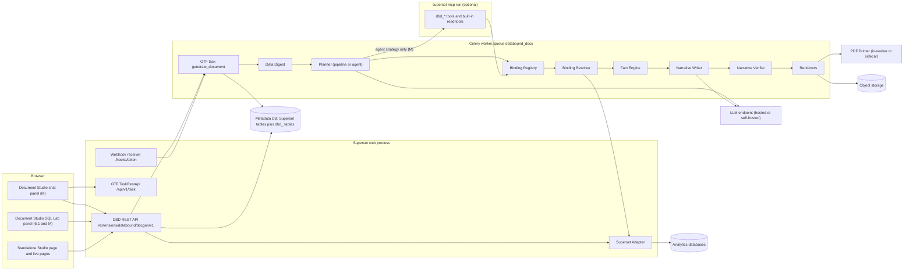
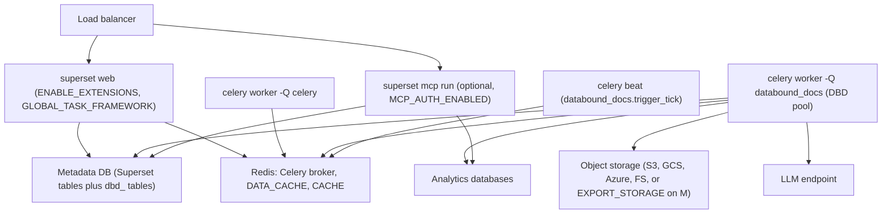
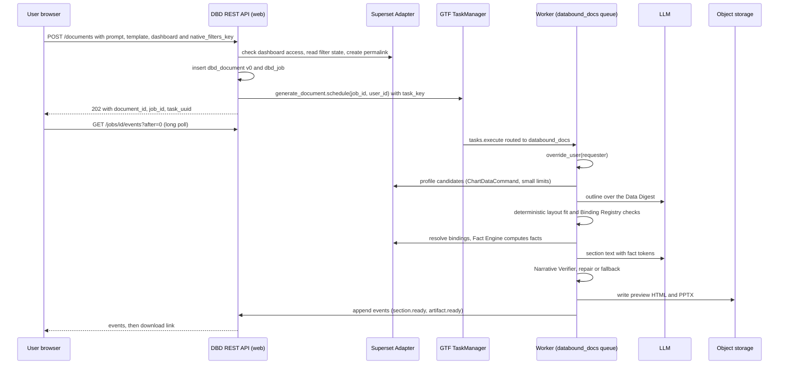
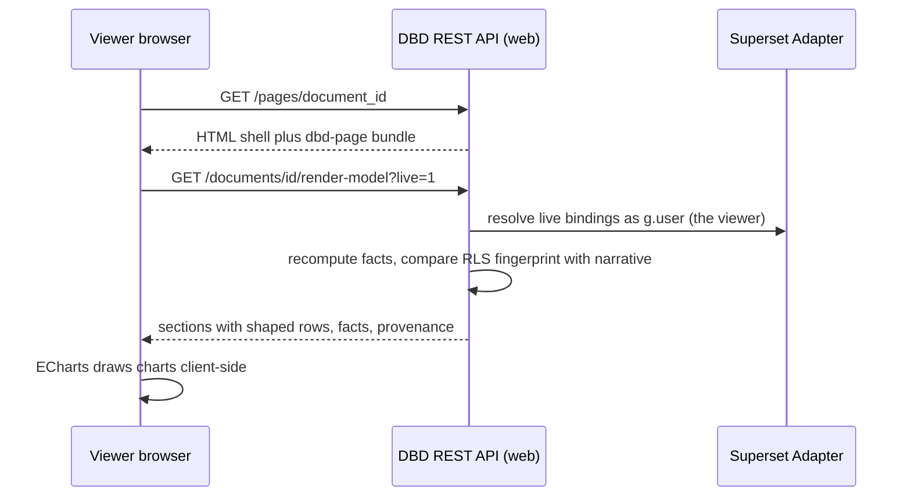
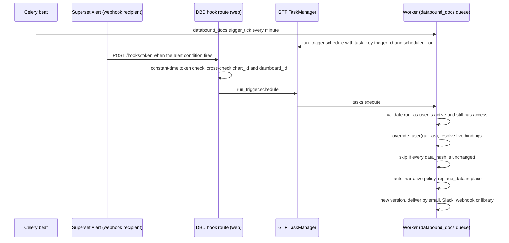
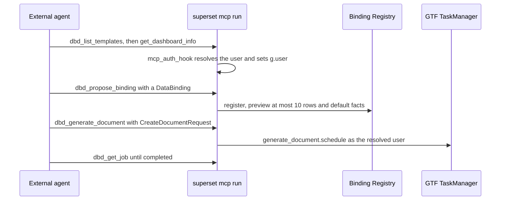
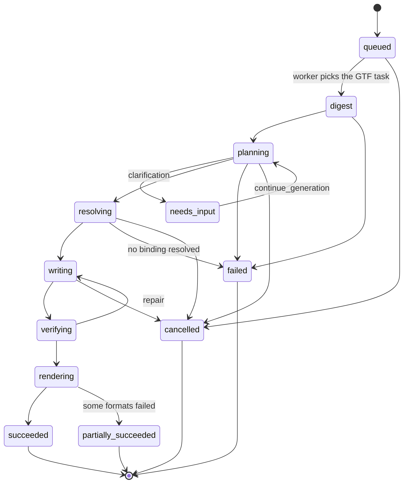

# Target architecture

<div class="chapter-meta" markdown>
**Reads:** `superset/core/api/core_api_injection.py`, `superset/tasks/manager.py`, `superset/tasks/scheduler.py`, `superset/commands/chart/data/get_data_command.py`, `superset/dashboards/excel_export/workbook.py`, `superset-extensions-cli/src/superset_extensions_cli/cli.py`, `servers/fastapi/templates/v2/schema.py`  ·  **Builds on:** [Superset landscape (6.1)](31-superset-landscape.md)  ·  **Time:** ~40 min
</div>

This chapter lays out the final architecture of **Superset Data-Bound Documents** (prose name: Data-Bound Documents; identifiers: `dbd`, `databound`). You will see every component and what it is responsible for, which Superset process each one runs in, how a request travels through the system for each kind of trigger, and which Superset APIs it depends on, with their 6.1.0 and master availability. The chapter closes with a component-by-component mapping to Presenton (what is reused, extended or replaced), the technology choices and why they were made, and a summary of the decision log that produced this design.

Availability tags used throughout Part VII:

| Tag | Meaning |
|---|---|
| **[6.1]** | Present in the 6.1.0 tag (May 2026, the latest stable release) and on master |
| **[M]** | Present only on master (`cabd8d4`, 2026-11-02). Expected in 7.0, but that mapping is UNVERIFIED |
| **[M\*]** | Present in 6.1.0 but changed on master |

## Step 1: The interpretation this architecture serves

The request was for "a common framework" that gives Apache Superset the workflow Presenton gives PowerPoint: write a prompt, pick a template, get a finished artifact. The same flow should produce documents, text and pages, run on the fly and on events, use dynamic data, and never use screenshots. This design adopts the following reading of that request, and every component below exists to satisfy one part of it.

Build **one common, output-agnostic generation framework** that turns three inputs into four kinds of output:

- **Inputs:** a **prompt**, a **chosen template**, and a **Superset data context**. The data context is any of: a dashboard with its live native-filter state, saved charts, datasets with their saved metrics, a semantic view [M], or a SQL Lab query.
- **Outputs:**
    - (a) **PowerPoint decks** (PPTX);
    - (b) **documents** (DOCX, PDF, Markdown);
    - (c) **text** (narratives, executive summaries, emails, Slack posts, alert briefs);
    - (d) **web pages** (interactive HTML reports and, in v2, generated Superset dashboards).
- **Triggers:** on demand (a button or chat message in Superset, a REST call, an MCP tool call) or by events (cron schedules, Superset Alerts firing a webhook, data freshness changes, chart or dashboard definition changes, external webhooks).

Three data rules are non-negotiable:

1. Every chart, table, KPI and number comes from a **live Superset query executed with the requesting user's permissions and row-level security (RLS)**. Scheduled runs use an explicitly recorded run-as user.
2. Data elements are **rendered natively**: editable PPTX and DOCX charts with an embedded workbook, real tables, real text runs, vector SVG on the web. No Superset UI page is ever captured as pixels.
3. Every artifact is **re-runnable**. A refresh re-executes the queries and replaces the data in place.

The design keeps Presenton's stage shape (outline, layout structure, schema-constrained content, hydration, export; see [Standard generation pipeline](../presenton/08-standard-pipeline.md)) but changes one thing at its core. Presenton asks the LLM for chart `categories` and `series[].values` (`presenton: servers/fastapi/templates/v2/schema.py:1490-1534`) and copies them into the slide (`presenton: servers/fastapi/api/v1/ppt/endpoints/presentation.py:1367-1432`). In Data-Bound Documents **the LLM never produces a number**. It picks bindings from menus Superset has validated and writes prose that cites facts by token. Numbers enter an artifact only through deterministic code.

## Step 2: Seven design principles

Each principle rules out a whole family of alternative designs. When you modify the system, check your change against this list first.

1. **Superset is the data plane.** All data access goes through `ChartDataCommand` (`apache/superset: superset/commands/chart/data/get_data_command.py:36`), or through `Database.execute` for the narrow SQL case, inside a Superset process with `g.user` set to the right user. The framework never opens its own connection to an analytics database and never calls Superset's chart-data HTTP endpoint from a worker.
2. **The agent proposes, the engine disposes.** The LLM outputs structure, binding choices from validated menus, and prose with tokens. Every number, label and chart series is produced by deterministic code.
3. **A binding exists only if the Binding Registry accepted it.** The LLM can name only ids the registry issued, as JSON Schema enums, so it cannot invent a query.
4. **One spec, many renderers.** The same `DocumentSpec` renders to a deck, a document, a page and a text brief.
5. **Thin `.supx`, fat wheel.** A `.supx` bundle carries only the extension's own `.py` files and cannot install dependencies (`apache/superset: superset-extensions-cli/src/superset_extensions_cli/cli.py:225-275`). The framework therefore ships as a preinstalled wheel plus a small extension that holds only the Superset wiring.
6. **One version-sniffing Superset Adapter.** Every import of non-public Superset code lives in one module, `databound/docgen/superset_adapter.py`, which detects capabilities at import time.
7. **Fail closed, render honestly.** A forbidden or failed binding becomes a visible placeholder and removes the narrative that depends on it. Nothing ever falls back to a picture of a chart.

!!! warning "Gotcha: why not call `/api/v1/chart/data` from the worker"
    It looks simpler to have a worker call Superset's REST chart-data endpoint with a token. On 6.1 with `GLOBAL_ASYNC_QUERIES` on, that endpoint answers JSON requests with `202` and then requires the async JWT cookie, returning `401` without it. A bearer-token worker cannot read the data. Alerts and Reports work around this by logging the executor in with machine-auth cookies, which is exactly the "executor's data, not the recipient's" model this design avoids. In-process `ChartDataCommand` under `override_user` has neither problem.

## Step 3: Components and their responsibilities

The framework has sixteen named components. The table gives each one's single responsibility, where it runs and where its code lives. The sub-steps after the table group them by the job they do.

| Component | Responsibility | Runs in | Package or module |
|---|---|---|---|
| **Document Spec** (`DocumentSpec`) | Output-agnostic, data-bound description of one immutable document version | everywhere | `databound_docs.spec` |
| **Context Capture** | Turns "what the user is looking at" into ids plus a durable dashboard permalink | browser, web | extension frontend plus the `POST /documents` handler |
| **Data Digest** | Deterministic, token-budgeted summary of the context that the LLM is allowed to see | worker | `databound_docs.planner.digest` |
| **Planner** (`pipeline`, `agent`, `template`) | Decides sections, layouts and which bindings fill which slots | worker (GTF task) | `databound_docs.planner` |
| **Superset Adapter** | The only module that imports Superset internals; version-sniffed at import | web, worker, MCP | `databound/docgen/superset_adapter.py` |
| **Binding Registry** | The only way a binding enters a document: validates names, access, shape and limits, assigns `b_*` ids | worker, web, MCP | `databound_docs.binder.registry` |
| **Binding Resolver** | Runs every `DataBinding` in-process through `ChartDataCommand` as the right user and records provenance | worker, web (live pages), MCP | `databound_docs.binder` plus the Superset Adapter |
| **Fact Engine** | Derives facts (totals, changes, ranks, labels) from resolved rows with pure functions | everywhere | `databound_docs.facts` |
| **Narrative Writer** | One schema-constrained LLM call per section; writes text with fact tokens only | worker | `databound_docs.planner.writer` |
| **Narrative Verifier** | Deterministic checks on tokens, numerals, entities, direction and length, plus a repair loop | worker, web | `databound_docs.planner.verify` |
| **Renderers** | **PPTX Renderer**, **DOCX Renderer**, **HTML Renderer**, **PDF Printer**, **Text Renderer**: resolved spec to native files | worker (PDF optionally in a sidecar) | `databound_docs.render` |
| **DrawingML Chart Writer** | Writes raw `c:chartSpace` XML for charts python-pptx cannot create (combo, emulations) | worker | `databound_docs.render.drawingml` |
| **Template Registry** | Versioned templates with **data slots**, PPTX and DOCX masters, importer | web, worker | `databound_docs.templates` plus table `dbd_template` |
| **Trigger Service** | Schedules, alert webhooks, freshness sentinels, definition-change listeners, external webhooks | beat, worker, web | `databound_docs.triggers` plus the extension |
| **Document Studio** | Chat panel [M], SQL Lab panel [6.1], standalone Studio page, live page viewer | browser | extension frontend |
| **DBD Extension** (`databound.docgen`) | REST API, GTF tasks, MCP tools, frontend contributions | web, worker, MCP | `databound-docgen-<version>.supx` |

### 3.1 Data plane: Context Capture, Superset Adapter, Binding Registry, Binding Resolver

These four components are the reason the framework can promise "live data with the user's permissions".

- **Context Capture** runs synchronously in `POST /extensions/databound/docgen/v1/documents`. It checks `can_generate on DataBoundDocs`, loads each dashboard through the access-filtered DAO, and calls `security_manager.raise_for_access(dashboard=...)`. If the request carries a short-lived `native_filters_key`, it reads the data mask with `GetFilterStateCommand` (`apache/superset: superset/commands/dashboard/filter_state/get.py:30`) and converts it into a durable permalink with `CreateDashboardPermalinkCommand(dashboard_id, state)` (`apache/superset: superset/commands/dashboard/permalink/create.py:45`). The result is a `DataContext` that can be replayed months later.
- **Superset Adapter** (`databound/docgen/superset_adapter.py`) is the only module that imports Superset internals: `ChartDataCommand`, `ChartDataQueryContextSchema`, `override_user` (`apache/superset: superset/utils/core.py:1633`), the filter-context helpers, the form_data rebuild, the permalink and filter-state commands, and the guest-token helpers. It sniffs capabilities at import time and exposes a stable internal interface (`as_user`, `run_query_context`, `apply_dashboard_filters`, `chart_query_context`). [Building the Superset extension](36-superset-extension.md) walks through the file.
- **Binding Registry** is called by every planner strategy, by chat edits and by MCP. It loads the chart or dataset through access-filtered DAOs, re-checks `can_access_datasource`, verifies that every metric is a saved metric (or a simple aggregate over a real numeric column) and every dimension a `groupby=True` column, caps `row_limit`, and only then issues an id `b_<slug>`.
- **Binding Resolver** compiles each binding into a query context JSON, applies the filter merge (dashboard filters, binding filters, parameters, time overrides), sets `g.form_data`, loads it through `ChartDataQueryContextSchema`, calls `ChartDataCommand(qc).validate()` (which runs `raise_for_access` first, `apache/superset: superset/commands/chart/data/get_data_command.py:107-108`) and `.run()`. It then shapes rows and fills a `Provenance` record. [Data-bound slide model](33-data-bound-model.md) specifies every field.

The resolver follows the same recipe as master's dashboard Excel export, which replays each chart's saved query context as the requesting user with live dashboard filters:

```python title="apache/superset: superset/dashboards/excel_export/workbook.py:200-231 (excerpt)"
    json_body = dict(json_body)
    # Export full JSON results, regardless of saved values.
    json_body["result_format"] = ChartDataResultFormat.JSON
    json_body["result_type"] = ChartDataResultType.FULL
    json_body.pop("force", None)
    # ...
    form_data = dict(json_body.get("form_data") or {})
    form_data["dashboardId"] = dashboard_id
    # ...
    form_data["slice_id"] = chart.id
    json_body["form_data"] = form_data

    filter_context = get_dashboard_filter_context(
        dashboard_id=dashboard_id,
        chart_id=chart.id,
        active_data_mask=active_data_mask,
    )
    if filter_context.extra_form_data:
        apply_dashboard_filter_context(json_body, filter_context.extra_form_data)

    # Jinja macros read the query context from ``g.form_data``.
    g.form_data = json_body

    query_context = ChartDataQueryContextSchema().load(json_body)
    command = ChartDataCommand(query_context)
    command.validate()
    result = command.run()
```

That module is [M]. On 6.1 the Superset Adapter falls back to DBD's own port of the native-filter scope logic, `databound_docs.compat.filter_scope_61`, which returns an object with the same `extra_form_data` and `filters` contract, so call sites do not branch.

### 3.2 Language plane: Data Digest, Planner, Narrative Writer, Narrative Verifier

These components are the only ones that talk to an LLM, and each one is fenced so that the LLM cannot affect numbers.

- **Data Digest** builds everything the LLM may see: dashboard inventory in layout order, chart and dataset metadata, and profiles (not rows) of each candidate binding, formatted and labeled with candidate fact ids. It is bounded by `DATA_POLICY.max_digest_tokens` (default 12,000) and an exposure level (`metadata_only`, `aggregates` by default, `samples`). The digest preview endpoint `POST /context/digest` returns exactly this JSON so a user can see "what the AI will see".
- **Planner** has three strategies that all produce the same `Plan` object whose bindings are always registry ids:

| Strategy | Availability | How it plans |
|---|---|---|
| `pipeline` (default) | [6.1], [M] | Fixed stages with strict JSON schemas: outline, deterministic layout fit (with an optional LLM tie-break), section writing. Binding proposals are enums in the outline schema |
| `agent` (opt-in) | [M] only | Tool-calling loop over a read-only MCP allowlist, ending in `submit_plan`. Needs per-user MCP identity, which 6.1 lacks |
| `template` (no LLM) | [6.1], [M] | The template declares fixed bindings and deterministic sentences. For air-gapped or regulated deployments and scheduled briefs |

- **Narrative Writer** makes one call per section. It receives the section intent, the text fields with character budgets, and a FACTS table restricted to that section. It never receives rows. Its response schema has a regex that forbids digits, `%`, `$` and braces except inside valid tokens.
- **Narrative Verifier** is deterministic: token validity, no literal numbers or number words, no literal category names (the entity scan), direction words that agree with the sign of the cited change fact, superlatives only next to rank facts, and length. Violations go back to the writer at most twice, then the field is replaced by a deterministic sentence and marked `fallback`.

All LLM calls go through `call_structured()` on an `LLMProvider` protocol (`openai_compatible`, `anthropic`, `bedrock`, `vertex`). Roles (`planner`, `writer`, `verifier`) map to profiles in `DATABOUND_DOCS["LLM"]`, and `allowed_hosts` restricts egress. [Generation flow](34-generation-flow.md) gives every prompt and schema.

### 3.3 Output plane: Renderers and the DrawingML Chart Writer

Every renderer reads a resolved `DocumentSpec` version and its `BindingResult` rows. None of them re-queries unless asked to refresh, and none of them loads a Superset UI page.

| Renderer | Library | What it produces |
|---|---|---|
| PPTX Renderer | python-pptx 1.0.2 (MIT) | Native charts with an embedded XlsxWriter workbook, native tables, KPI groups, token runs, speaker notes, the `/customXml/dbd-manifest.json` part. Refresh through `Chart.replace_data` |
| DrawingML Chart Writer | lxml over python-pptx's OPC layer | Combo charts (`c:barChart` plus `c:lineChart` on a secondary axis) and emulations (waterfall, funnel, bullet) |
| DOCX Renderer | python-docx 1.2.0 (MIT) | Styled paragraphs, native tables, DrawingML chart parts (prototype gate G5) or vector SVG from rows |
| HTML Renderer | Jinja templates, ECharts (live pages), vl-convert-python (static SVG) | Live pages that resolve as the viewer, static HTML with embedded JSON snapshots |
| PDF Printer | Playwright Chromium `page.pdf()` on a local file (or a printer sidecar, or WeasyPrint) | Vector PDF printed from DBD's own static HTML, network disabled |
| Text Renderer | plain Python | Markdown, plain text, email HTML, Slack mrkdwn, alert briefs |

[Native rendering, no screenshots](35-native-rendering.md) covers each renderer in detail, including the d3-to-Excel number format mapping and the viz_type matrix.

### 3.4 Lifecycle plane: Template Registry, Trigger Service, Document Studio, DBD Extension

- **Template Registry** stores immutable template versions in `dbd_template`: JSON layouts derived from Presenton Template v2 with **data slots**, plus optional PPTX and DOCX masters in object storage. Masters are imported deterministically from shape names such as `slot:chart:trend` (no vision model). Built-ins ship in the wheel: `tpl_exec_review`, `tpl_dashboard_walkthrough`, `tpl_analytical_report`, `tpl_interactive_report`, `tpl_kpi_brief`, `tpl_weekly_email`, `alert_brief`.
- **Trigger Service** covers the five trigger types `cron`, `alert_webhook`, `freshness`, `definition_change` and `external_webhook`. GTF has no cron, so a plain Celery beat task `databound_docs.trigger_tick` runs every minute and schedules `run_trigger` GTF tasks with a deduplicating `task_key`. [Scheduling and live refresh](39-scheduling-and-refresh.md) has the details.
- **Document Studio** is the UI. On master it lives in the global chat slot (`chat.registerChat`, `apache/superset: superset-frontend/packages/superset-core/src/chat/index.ts:76-80`), which is visible on dashboards and Explore. On 6.1 it is a SQL Lab panel at `sqllab.panels` plus a standalone Studio page served by the extension.
- **DBD Extension** (`databound.docgen`) is the wiring: the `@api` REST class `DataBoundDocsApi`, the GTF `@task` functions, the guarded `@tool` and `@prompt` registrations, and the frontend contributions.

!!! warning "Gotcha: there is no dashboard or Explore contribution area"
    The new extension framework renders contributed views only in SQL Lab, plus the global chat slot on master. The legacy keys `dashboard.nav.right`, `dashboard.slice.header.menu` and `explore.chart.header` live in a module-local registry inside the host bundle that a `.supx` cannot reach. Data-Bound Documents covers the gap with the chat slot [M], the Studio page and SQL Lab panel [6.1], and an optional `databound-docs-ui-overrides` npm package for deployments that build their own Superset frontend. Upstream slots are proposed in the [Roadmap](40-roadmap.md).

### 3.5 The component diagram



Note what is missing from the diagram: there is no separate generation server, no second web origin, and no arrow from any renderer back to a Superset page. The only path to the analytics databases goes through the Superset Adapter.

## Step 4: Packaging, thin bundle and fat wheel

A `.supx` is a zip of `manifest.json`, `frontend/dist/<file>` and `backend/src/<module>.py`. Superset imports the backend files from memory through `InMemoryFinder`; nothing installs `[project] dependencies`. python-pptx, python-docx, an HTTP client and the renderers therefore cannot ride in the bundle. The framework ships as two artifacts built from one repository: the `superset-databound-docs` wheel, preinstalled in the web, worker and MCP images, and the `databound-docgen-<version>.supx` bundle, dropped into `EXTENSIONS_PATH`.

The repository has three top-level folders: `core/` (the wheel, package `databound_docs` with `spec`, `planner`, `binder`, `facts`, `format`, `render`, `templates`, `triggers`, `compat`, `llm`, `storage` and `db`), `extension/` (built with the `superset-extensions` CLI, backend modules `entrypoint.py`, `api.py`, `tasks.py`, `tools.py`, `triggers.py` and `superset_adapter.py` under `databound/docgen/`), and the optional `ui-overrides/` npm package. [Building the Superset extension](36-superset-extension.md) walks through every file.

The identifiers follow from `publisher: "databound"` and `name: "docgen"`:

| Identifier | Value | Derived by |
|---|---|---|
| Extension id | `databound.docgen` | `publisher.name` (`apache/superset: superset-core/src/superset_core/extensions/types.py:38-84`) |
| Backend entrypoint | `databound.docgen.entrypoint` | the CLI `build_manifest` |
| Module Federation name | `databound_docgen` | the CLI |
| REST base path | `/extensions/databound/docgen/v1` | `@api(resource_name="v1")` in extension context (`apache/superset: superset/core/api/core_api_injection.py:189-207`) |
| GTF task types | `extensions.databound.docgen.<task>` | host `task` decorator prefixing (`apache/superset: superset/tasks/decorators.py:147-160`) |
| MCP tool names | `extensions.databound.docgen.<tool>` | host `tool` registration (`apache/superset: superset/core/mcp/core_mcp_injection.py:123-142`) |
| Bundle file | `databound-docgen-<version>.supx` | `superset-extensions bundle` |

The core package `databound_docs` must not import Superset at module top level. That rule keeps the Fact Engine, the Narrative Verifier, the renderers and the spec testable without a Superset install, and it keeps the stub-binding problem away: `superset_core` decorators must be imported after the host has injected its implementations, which happens before the extension entrypoint is imported.

!!! warning "Gotcha: two frontend bundles from one source"
    6.1 maps `@apache-superset/core` to `window.superset` through webpack `externals`, while master injects it through the Module Federation share scope. `views.registerView` also takes a provider function on 6.1 and a component on master [M\*]. The repository builds `databound-docgen-1.0.0-superset6.1.supx` and `databound-docgen-1.0.0-superset7.supx`, and `superset dbd doctor` checks that the installed variant matches the host.

!!! warning "Gotcha: `@tool` can take the whole extension down"
    If `fastmcp` is not installed in a process, Superset skips MCP injection and the `@tool` stub raises `NotImplementedError` at import. Because the extension entrypoint imports everything, that would make the REST API disappear too. The entrypoint wraps `from databound.docgen import tools` in `try/except (ImportError, NotImplementedError)`.

## Step 5: Deployment topology

There is no new service. "Runtime" means the `databound_docs` library executing inside Superset's own processes, which all build the app with `create_app()` and therefore all import the extension when `ENABLE_EXTENSIONS` is on in their config.

| Process | DBD code loaded | Role |
|---|---|---|
| Superset web (gunicorn) | `.supx` backend plus wheel | REST API, Context Capture, synchronous text briefs, live page data, webhook receiver |
| Celery worker, queue `databound_docs` | same | GTF tasks: digest, LLM calls, resolution, rendering |
| Celery beat | config only | fires `databound_docs.trigger_tick` every minute |
| MCP server (`superset mcp run`), optional | `.supx` backend plus wheel | `dbd_*` tools for external agents; on master also the tool plane for the `agent` planner |
| PDF Printer | Chromium (Playwright) in the worker image, or a printer sidecar | prints DBD's own static HTML to vector PDF |



### 5.1 Configuration

All configuration lives in `superset_config.py`. Feature flags must be on in every process, because Superset registers APIs and imports extensions from the flag value at startup.

```python title="superset_config.py (Data-Bound Documents section)"
from celery.schedules import crontab
from databound_docs.celery_routing import route_dbd_tasks  # router function, see 5.2

FEATURE_FLAGS = {
    **FEATURE_FLAGS,
    "ENABLE_EXTENSIONS": True,        # [6.1] load .supx bundles in every process
    "GLOBAL_TASK_FRAMEWORK": True,    # [6.1] @task, /api/v1/task, Task List UI
    "ALERT_REPORTS": True,            # only for alert_webhook triggers
    "ALERT_REPORT_WEBHOOK": True,     # only for alert_webhook triggers
}
EXTENSIONS_PATH = "/app/extensions"  # holds databound-docgen-1.0.0.supx

class CeleryConfig:  # extend the deployment's existing CeleryConfig
    # ... existing broker, imports, beat entries ...
    task_routes = [route_dbd_tasks]   # DBD GTF tasks to the databound_docs queue
    beat_schedule = {
        # ... existing entries (reports.scheduler, reports.prune_log) ...
        "databound_docs.trigger_tick": {
            "task": "databound_docs.trigger_tick",
            "schedule": crontab(minute="*"),
        },
    }
CELERY_CONFIG = CeleryConfig

DATABOUND_DOCS = {
    "STORAGE": {"backend": "s3", "bucket": "superset-dbd", "prefix": "dbd/"},
    "LLM": {
        "profiles": {
            "default": {"provider": "openai_compatible", "base_url": "http://vllm:8000/v1",
                        "model": "your-model-id", "api_key_env": "DBD_LLM_KEY"},
        },
        "roles": {"planner": "default", "writer": "default", "verifier": "default"},
        "allowed_hosts": ["vllm"],
    },
    "PLANNER_STRATEGY": "pipeline",       # "pipeline" (default) or "agent" (master only)
    "DATA_POLICY": {"default_exposure": "aggregates", "max_digest_tokens": 12000,
                    "label_masking": False},
    "PDF_ENGINE": "playwright",           # "playwright", "printer_sidecar", "weasyprint", "off"
    "MAX_BINDINGS_PER_DOC": 60,
    "MAX_ROWS_PER_BINDING": 5000,
    "ALLOW_SQL_BINDINGS": False,
    "CHAT_SLOT": True,                    # master only; set False if another chat extension is used
    "MCP_ALLOW_DEV_USER": False,          # refuse mutate tools when MCP resolves the dev user
}
```

`DATABOUND_DOCS` is read at call time from `current_app.config`, never at import time, so a library imported by `superset_config.py` itself does not freeze stale values.

### 5.2 Isolating long jobs on their own queue

GTF enqueues every task through one generic Celery task, `tasks.execute` (`apache/superset: superset/tasks/scheduler.py:396`), passing the GTF type as a keyword:

```python title="apache/superset: superset/tasks/manager.py:582 (call shape)"
execute_task.delay(task_uuid=str(task.uuid), task_type=task_type, args=args, kwargs=kwargs)
```

Celery accepts router functions in `task_routes`, so DBD can route on that keyword without any change to Superset:

```python title="databound_docs/celery_routing.py"
DBD_PREFIX = "extensions.databound.docgen."


def route_dbd_tasks(name, args, kwargs, options, task=None, **kw):
    if name == "tasks.execute" and str((kwargs or {}).get("task_type", "")).startswith(DBD_PREFIX):
        return {"queue": "databound_docs"}
    if name == "databound_docs.trigger_tick":
        return {"queue": "databound_docs"}
    return None   # fall through to the deployment's other routes
```

Operators run at least one worker with `-Q databound_docs` and keep the default queue for reports, thumbnails and other GTF work. A 90-second LLM job then cannot starve a thumbnail. Whether the router sees `task_type` identically on 6.1 is covered by prototype gate G8; the fallback is a concurrency semaphore in the metadata database.

### 5.3 Image build and install

1. Install `superset-databound-docs`, `python-pptx==1.0.2`, `python-docx==1.2.0`, `httpx`, `vl-convert-python`, `jsonschema` and, optionally, `playwright` into the web, worker and MCP images.
2. Copy the `.supx` into `EXTENSIONS_PATH`.
3. Run `superset dbd db-upgrade` (DBD's own Alembic environment, version table `dbd_alembic_version`).
4. Restart every process. Extension discovery happens only at startup.
5. Run `superset dbd doctor`. It checks flags per process, installed packages, the beat entry and router, storage write access, the bundle variant, `DATA_CACHE_CONFIG` (warning on `NullCache`), and that `MCP_DEV_USERNAME` is unset when the `agent` strategy is used.

## Step 6: Request paths

Five request paths cover every trigger. All of them converge on the same Binding Resolver call under a well-defined identity.

### 6.1 On-demand deck from a filtered dashboard

This is the headline flow. The web request does only the synchronous part (access checks, filter capture, row inserts) and returns `202` in well under a second; everything else runs in one GTF task.



Three details make this path robust:

- **Deduplication.** `task_key = sha256(user_id, template_id@version, canonical(context), prompt, parameters)`, so a double click joins the same GTF task instead of starting a second one.
- **Identity.** GTF does not switch the executing user. The task receives `user_id` as an argument and wraps its body in `override_user(user, force=False)`, the pattern of Superset's own `execute_chart_query` (`apache/superset: superset/tasks/async_queries.py:165-175`).
- **Events.** Fine-grained events (`outline.ready`, `binding.resolved`, `section.ready`, `artifact.ready`) go to `dbd_job_event` and are served by long poll (`GET /jobs/<id>/events?after=<seq>&wait=25`). Coarse progress is mirrored into GTF with `get_context().update_task(progress=(i, n), payload=...)`, so the built-in Task List shows it too.

!!! warning "Gotcha: GTF runs your task as nobody in particular"
    `TaskContext.__init__` (`apache/superset: superset/tasks/context.py:60`) records the task UUID, abort and cleanup handlers and the timeout timer, and neither it nor the `tasks.execute` executor sets `g.user`. Superset's own async chart-data task says so in its docstring: "The GTF executor does not impersonate on its own" (`apache/superset: superset/tasks/async_queries.py:165-175`). If a task body forgets `override_user`, DAO base filters, `raise_for_access` and RLS evaluate without the requester. Depending on configuration that either fails every query or, worse, runs with a broader identity. The `as_user` helper in the Superset Adapter is the only sanctioned way in, and it refuses an inactive or missing user.

### 6.2 Synchronous text brief

`kind: "text"` with `options.sync: true` (and the MCP tool `dbd_brief`) runs steps 2 to 10 inline in the web request within a 20-second budget. If the budget runs out, the call falls back to the asynchronous path and returns `202`. This is the "text on the fly" answer: a one-paragraph KPI brief from a dashboard needs one digest, one writer call and a handful of cached queries.

### 6.3 Live page opened by a viewer

A `page` document is never a static file by default. The HTML shell loads a standalone bundle that calls `GET /documents/<id>/render-model?live=1`, and the server re-resolves every `live` binding **as the viewer**, under the viewer's own session.



If the viewer's RLS fingerprint differs from the one the narrative was written under, tokens still re-resolve to the viewer's values, claim lint re-runs against the viewer's facts, and a failing narrative is replaced by deterministic sentences with a "Summary written for different data" notice. Because LLM prose holds no literal numbers or category names, the stored text itself leaks nothing. [Security, RLS, auth](38-security.md) explains the rule.

### 6.4 Scheduled or alert-triggered refresh

Events do not get a human identity, so every trigger row carries `run_as_fk`, and DBD re-validates that user before each run.



The alert route uses Superset's own Alerts and Reports scheduler purely as a data-condition detector. The alert should use `report_format = TEXT` on a chart-scoped alert (6.1) or `NONE` (master), so Superset takes no screenshot for nothing. The webhook payload is unsigned and carries no identity or data, so DBD treats it as a signal only.

### 6.5 External agent through MCP

An external agent (or Superset's own chat surface) can drive the same framework through `dbd_*` tools registered with `superset_core.mcp.decorators.tool` and `class_permission_name="DataBoundDocs"`.



MCP responses carry ids, statuses, display strings and at most 10 preview rows, which respects master's 50 KB response cap (`apache/superset: superset/mcp_service/mcp_config.py:499-512`; 6.1.0 instead caps responses at an estimated 25,000 tokens). The full data for an artifact is always fetched by the worker's own Binding Resolver, never moved through MCP.

!!! warning "Gotcha: MCP on 6.1 is a single shared identity"
    On 6.1, `get_user_from_request()` checks only `g.user` (set by external middleware) and then `MCP_DEV_USERNAME` (6.1.0 tag, `superset/mcp_service/auth.py:176-230`). There is no JWT-claims-to-user mapping, so every call runs as the dev user unless your deployment adds middleware. DBD's mutate and data tools refuse to run when the resolved user is the configured dev user, unless `MCP_ALLOW_DEV_USER` is true. Per-user MCP (`MCP_USER_RESOLVER`, API keys) is [M], which is also why the `agent` planner is master only.

## Step 7: The Superset API surface it rides on

Every arrow into Superset in the diagrams above maps to one row here. "Internal" means the call lives in the Superset Adapter and is covered by per-version contract tests.

| Need | API or extension point | Availability | Public or internal | Fallback when missing |
|---|---|---|---|---|
| REST endpoints | `superset_core.rest_api.api.RestApi`, `superset_core.rest_api.decorators.api` | [6.1] | public | none needed |
| Long jobs, progress, cancel | `superset_core.tasks.decorators.task`, `get_context().update_task`, `on_abort`, `TaskOptions(task_key, task_name, timeout)` | [6.1] basic; `depends_on`, `update_task(immediate=)`, heartbeats, `/status_changes` [M] | public | 6.1: sequential resolution in one task, status polling |
| Agent and external tools | `superset_core.mcp.decorators.tool`, `prompt` | [6.1]; per-user identity [M] | public | 6.1: `pipeline` only; mutate tools refused for the dev user |
| Models and access-filtered DAOs | `superset_core.common.models`, `superset_core.common.daos` (host-replaced, `apache/superset: superset/core/api/core_api_injection.py:37-125`) | [6.1] | public | none needed |
| SQL with RLS | `Database.execute(sql, QueryOptions)` | [6.1] | public; no datasource access check, so DBD adds `raise_for_access` | none needed |
| Chart data as a user | `ChartDataQueryContextSchema`, `ChartDataCommand` | [6.1] | internal | none; contract tests |
| User switching | `superset.utils.core.override_user(user, force=...)` | [6.1] | internal | none |
| Native filters into chart queries | `get_dashboard_filter_context(dashboard_id, chart_id, *, active_data_mask=None)`, `apply_dashboard_filter_context(query_context, extra_form_data)` (`apache/superset: superset/charts/data/dashboard_filter_context.py:272, 365`) | [M] | internal | 6.1: `databound_docs.compat.filter_scope_61` |
| form_data to query context | `build_query_context_from_form_data(form_data, datasource, viz_type=None)` (`apache/superset: superset/common/form_data_query_context.py:1801`) | [M] | internal | 6.1: require a saved `query_context` |
| Filter state and permalinks | `GetFilterStateCommand`, `CreateDashboardPermalinkCommand`, `GetDashboardPermalinkCommand`, `DashboardPermalinkState` (`apache/superset: superset/dashboards/permalink/types.py:21`) | [6.1] (`chartStates` UNVERIFIED on 6.1) | internal; also public REST | browser-side REST calls |
| Text number formatting identical to the browser | `format_number_with_config` (`apache/superset: superset/utils/number_format.py:166`) | [M] | internal | vendored copy in `databound_docs.format.d3` |
| Guest users | `get_guest_user_from_token(token: GuestToken)`, `parse_jwt_guest_token(raw)` | [M] verified, 6.1 UNVERIFIED | internal | guest features are v2 only |
| SQL Lab UI | `views.registerView`, `menus.registerMenuItem`, `commands.registerCommand`, `sqlLab.getCurrentTab`, `sqlLab.onDidQuerySuccess` | [6.1] (`registerView` signature [M\*]) | public | none needed |
| Dashboard and Explore entry | `chat.registerChat`, `navigation.getPage`, `navigation.onDidChangePage` | [M] | public | 6.1: Studio page and SQL Lab panel |
| Frontend CSRF | `authentication.getCSRFToken()` | [6.1] | public | none needed |
| Data-condition events | Alerts and Reports webhook recipient | [6.1]; SSRF guard [M] | public feature | none needed |
| Schedule window math | `cron_schedule_window(triggered_at, cron, timezone)` (`apache/superset: superset/tasks/cron_util.py:74`) | [6.1] | internal | vendored copy |
| Definition-change signal | SQLAlchemy `after_update` listeners (as in `apache/superset: superset/models/slice.py:624`) | [6.1] | SQLAlchemy public, unsupported as an extension practice (UNVERIFIED) | compare `changed_on` at refresh |
| Email delivery | `send_email_smtp` (`apache/superset: superset/utils/core.py:939`) | [6.1] | internal | DBD's own SMTP client |

The version sniffing that makes the "Fallback" column work is two lines at the top of the adapter:

```python title="databound/docgen/superset_adapter.py (excerpt)"
HAS_FILTER_CONTEXT = importlib.util.find_spec(
    "superset.charts.data.dashboard_filter_context") is not None    # [M]
HAS_FORM_DATA_REBUILD = importlib.util.find_spec(
    "superset.common.form_data_query_context") is not None          # [M]
```

`GET /extensions/databound/docgen/v1/capabilities` reports these flags (`filter_context_helper`, `form_data_rebuild`, `chat`, `gtf_dag`, `sse`, `pdf_engine`, `docx_charts`, `agent_planner`) to the frontend, so the Studio shows only what the host can do.

!!! warning "Gotcha: the extension `RestApi` is CSRF-exempt by inheritance"
    `RestApi` subclasses FAB's `BaseApi` directly, not Superset's `BaseSupersetApiMixin`, and FAB declares `csrf_exempt = True`. A cookie-authenticated, state-changing endpoint must set `csrf_exempt = False` explicitly, which `DataBoundDocsApi` does. The frontend always sends `X-CSRFToken` from `authentication.getCSRFToken()`.

## Step 8: State, storage and the job lifecycle

### 8.1 Where state lives

| Kind of state | Store | Why there |
|---|---|---|
| Templates, documents, immutable versions, binding results (provenance), artifacts index, jobs, events, triggers, shares, data policy, audit | `dbd_*` tables in the Superset metadata database (or `DATABOUND_DOCS["DATABASE_URI"]`) | Extension persistent storage [M] is capped at 1 MB per value and appears usable only at import time, so DBD owns its tables with a separate Alembic version table `dbd_alembic_version` |
| PPTX, DOCX, PDF, HTML binaries | object storage at `dbd/<document_id>/<version>/<artifact_id>.<ext>` | Binaries do not belong in the metadata DB. On master, an adapter over `EXPORT_STORAGE` is available |
| Chart data | Superset's `DATA_CACHE_CONFIG`, keyed by Superset's own `cache_key`, which includes RLS (`apache/superset: superset/security/manager.py:6304-6313`) | Profiling and resolution then share cache hits with the dashboard, per user |
| Data Digest | Superset `CACHE_CONFIG`, 10 minutes | Repeat generations from the same context are cheap |
| Per-user UI preferences | extension persistent storage [M] | the one use that fits its limits |

### 8.2 Job state machine



`dbd_job.status` mirrors the GTF statuses (`PENDING`, `IN_PROGRESS`, `SUCCESS`, `FAILURE`, `ABORTED`, `TIMED_OUT`) and adds `needs_input` and `partially_succeeded`. `dbd_job.task_uuid` is the authoritative link to the GTF row. A single failed binding never fails a job: its element shows "data unavailable" and the job completes with warnings. Clarification never blocks a worker: the task persists its state, ends with payload `{"status": "needs_input"}`, and the user's answer schedules `continue_generation`.

### 8.3 GTF tasks at a glance

| Task (type `extensions.databound.docgen.*`) | Scope | Timeout | Arguments |
|---|---|---|---|
| `generate_document` | PRIVATE | 900 s | `job_id, user_id` |
| `continue_generation` | PRIVATE | 900 s | `job_id, user_id` |
| `regenerate_sections` | PRIVATE | 600 s | `job_id, user_id, section_ids` |
| `refresh_document` | PRIVATE | 600 s | `document_id, user_id, narrative, mode, force` |
| `render_artifact` | PRIVATE | 300 s | `document_id, version, fmt, user_id` |
| `run_trigger` | SYSTEM | 900 s | `trigger_id, scheduled_for, event` |
| `resolve_binding` [M] | PRIVATE | 120 s | `job_id, binding_id, user_id` (DAG fan-out with `depends_on`) |

!!! warning "Gotcha: `@task` positional arguments and reserved names"
    The `superset_core` stub's first positional parameter is `name`, but the host implementation's first positional parameter is `func`. `@task("generate_document")` passes a string as the function. Always use keywords: `@task(name="generate_document", scope=TaskScope.PRIVATE, timeout=900)`. The host also rejects task functions with parameters named `ctx` or `options` (`apache/superset: superset/tasks/decorators.py:165-173`).

## Step 9: How it maps to Presenton

Presenton is Apache-2.0, and Data-Bound Documents ports selected parts of it into its own Apache-2.0 repository with NOTICE attribution. Presenton-derived code never enters `apache/superset` itself. The table maps each Presenton component, as covered in Part I, to its fate here.

| Presenton component | Fate | What changes | Presenton chapter |
|---|---|---|---|
| Template v2 element model (`elements.py`) | **Extend** | Keeps geometry and styling on the 1280 x 720 canvas. Adds a `data_slot` object on `chart`, `table` and `text`, and a new `kpi` element. Chart data fields are never filled by the LLM | [Template v2 format](../presenton/16-template-v2-format.md) |
| Schema builder (`extract_slide_schema_from_layout`, `_component_content_field_schema`) | **Extend** | Text fields keep `minLength`/`maxLength` budgets. Bound slots emit only enums of binding or fact ids. `x-element-path` stays for hydration | [From template to schema to slide](../presenton/17-template-to-slide.md) |
| Structured retries (`generate_structured_with_schema_retries`) | **Reuse (ported)** | Becomes `call_structured()`, with regex and budget checks and audit accounting | [Prompts and schemas](../presenton/09-prompts-and-schemas.md) |
| Outline, structure and content calls | **Reuse the stage shape, replace prompts and schemas** | Outline over a Data Digest with binding enums; deterministic layout fit with an LLM tie-break; per-section writing with fact tokens | [Standard generation pipeline](../presenton/08-standard-pipeline.md) |
| SSE envelope and `safe_sse_stream` | **Reuse (ported)** | Same `event:`/`data:` wire format, new event types. Long poll is the default transport | [Streaming (SSE)](../presenton/10-streaming.md) |
| Hydrator dispatch (`_apply_template_content_value`) | **Extend** | Same dispatch pattern; bound chart, table and KPI handlers fill from `BindingResult` rows instead of LLM output | [From template to schema to slide](../presenton/17-template-to-slide.md) |
| Custom templates from PPTX | **Replace** | The importer reads shape names (`slot:chart:trend`) with python-pptx; no vision model and no `@presenton/export-core` | [Custom templates from PPTX](../presenton/18-custom-templates.md) |
| Themes and fonts | **Extend** | Theme comes from the template, or from the dashboard's `label_colors`, color scheme and theme tokens | [Themes and fonts](../presenton/19-themes-and-fonts.md) |
| Export pipeline (`@presenton/export-core`, Puppeteer) | **Replace** | License unknown, distributed outside npm, browser DOM measurement. Replaced by python-pptx, python-docx, DrawingML, vector HTML and a network-isolated PDF print | [PPTX and PDF export](../presenton/24-export-pipeline.md) |
| Next.js editor and Chart.js preview | **Replace** | Document Studio is a Superset extension UI with ECharts and a binding inspector; data cells are read-only | [Slide editor](../presenton/22-slide-editor.md) |
| Smart mode (LLM-written HTML) | **Do not use** | Free-form HTML cannot guarantee data provenance | [Smart mode](../presenton/13-smart-mode.md) |
| REST API, async tasks, webhooks, MCP | **Replace with Superset equivalents** | FAB `@api` routes, GTF tasks, `superset_core` MCP tools | [REST API, async tasks, webhooks, MCP](../presenton/15-api-async-mcp.md) |
| Auth and multi-user | **Replace** | Superset session, FAB permissions on `DataBoundDocs`, `override_user`, RLS | [Auth and multi-user](../presenton/25-auth-and-multiuser.md) |
| Data model (presentations, slides with `content` and `ui`) | **Replace** | Immutable `dbd_document_version.spec` plus `dbd_binding_result` provenance | [Data model](../presenton/07-data-model.md) |
| Docker topology (FastAPI, Next.js, export service) | **Replace** | No new service; DBD runs inside Superset's processes | [Runtime topology](../presenton/03-runtime-topology.md) |

The single most important difference is in the schema builder. Presenton's `_chart_content_schema` (`presenton: servers/fastapi/templates/v2/schema.py:1490-1534`) asks the model for `chart_type`, `categories` and `series[{name, values}]`. The Data-Bound Documents builder emits, for the same slot, only `{"binding": {"enum": [...]}}`, a choice among registry ids. [Data-bound slide model](33-data-bound-model.md) shows the full builder.

## Step 10: Technology choices and why

| Decision area | Choice | Alternatives considered | Why |
|---|---|---|---|
| Where generation runs | In-process: Superset extension plus a preinstalled wheel | Presenton-derived sidecar with its own database and a credential broker; MCP-first agent service | Zero credential handling, works with every auth type including SSO, numbers identical to the dashboard, no new infrastructure. The sidecar needed a non-FAB auth path and standing delegations |
| Data execution | `ChartDataCommand` under `override_user` | REST chart-data calls; raw SQL; MCP `get_chart_data` | RBAC through `raise_for_access`, RLS through `get_sqla_row_level_filters` (`apache/superset: superset/connectors/sqla/models.py:1171`), RLS-aware caching. REST breaks on 6.1 with GAQ; MCP caps responses at 50 KB |
| Long-running work | GTF `@task` on a dedicated Celery queue | Raw Celery tasks; threads in gunicorn | Dedup by `task_key`, cancel, Task List UI, status REST [6.1]; Celery router isolates load |
| Event scheduling | Own `dbd_trigger` table plus one beat entry | Reuse Alerts and Reports schedules for everything | Full control of run-as identity and parameter roll-forward. Alerts are still used as data-condition detectors through webhooks |
| PPTX | python-pptx 1.0.2 plus a DrawingML Chart Writer | pptxgenjs in a Node sidecar | Python, already near Superset's stack (XlsxWriter is a Superset dependency), opens existing files and refreshes with `replace_data`. Combo charts are written as raw `c:chartSpace` |
| DOCX | python-docx 1.2.0 plus a shared DrawingML chart part (gate G5), vector SVG fallback | LibreOffice conversion; pandoc | Native editable charts with one chart builder for both Office formats |
| Static SVG from rows | Vega-Lite through `vl-convert-python` | ECharts SSR in Node; matplotlib | No Node in MVP; BSD-3 Rust wheel. ECharts SSR is an optional v2 sidecar for visual parity |
| Live pages | Standalone non-federated bundle with React and ECharts, served by the extension | Module Federation remote outside the SPA | A federated remote cannot run outside the SPA without the host's share scope |
| PDF | Chromium `page.pdf()` on DBD's own local HTML, network off | Superset's `build_pdf_from_screenshots`; WeasyPrint | Vector text and paths, no auth cookies, no readiness heuristics. WeasyPrint is allowed but its SVG fidelity is UNVERIFIED (gate G7) |
| Text formatting | Vendored `format_number_with_config` (d3-format port) | A Node formatter | Same strings the browser shows; the module is [M], so DBD vendors it for 6.1 |
| Events transport | Long poll by default, SSE when workers are async | SSE only; websockets | Long poll works with every gunicorn worker class; an SSE stream holds a sync worker |
| LLM access | `LLMProvider` protocol with strict structured output where supported | One vendor SDK | Self-hosted (vLLM, Ollama) and hosted models; role-based profiles |
| Metadata storage | Own `dbd_` tables with a separate Alembic version table | Extension persistent storage | Storage values are capped at 1 MB and the backend accessor appears to work only at import time |

All runtime dependencies are ASF Category A licenses: python-pptx (MIT), python-docx (MIT), XlsxWriter (BSD), vl-convert (BSD-3), ECharts (Apache-2.0), Playwright (Apache-2.0). LibreOffice (MPL-2.0, Category B) is an optional operator-installed engine only.

## Step 11: Decision log summary

The blueprint was chosen by scoring three competing designs: D-A (extension-native), D-B (a Presenton-derived sidecar) and D-C (agentic and MCP-first). D-A won on 6.1 feasibility, security and operational simplicity (63 of 80 points, against 62 for D-C and 61 for D-B), and the final design grafts in the strongest ideas of the other two. The full log has 27 entries; this summary groups them.

| Theme | Decisions | Origin |
|---|---|---|
| Skeleton | In-process extension plus a preinstalled wheel, no sidecar (1). No credential broker, grants or delegations (19). No polling proxy task that holds a Celery slot (20) | D-A; D-B parts rejected |
| Naming | "Superset Data-Bound Documents", extension `databound.docgen`, prefix `dbd`; publisher is not `apache` because this is not an ASF artifact (2) | new |
| Number trust | Binding Registry as the only entry point for bindings (3). Label tokens (`.label`, `.abs`), entity scan and deterministic fallback sentences (5). `audience_rls_fingerprint` and the viewer rule on live pages (6). `args_json` string for fact requests, because strict modes reject open objects (11) | D-C, D-B |
| Planning | `pipeline` by default, `agent` opt-in on master, plus a no-LLM `template` strategy (4). Bipartite slot matcher with scoring, LLM only for ties (10). Clarification through `job.needs_input` and chat refinement through JSON Patch (24) | D-A, D-B, D-C |
| Templates | Template-fill mode (`replace_data` on designer charts) and a python-pptx importer instead of `@presenton/export-core` (8). Shape-name slot convention for masters (9) | D-A, D-B, D-C |
| Refresh | Guarded token-run rewrite: a run is rewritten only if its text is unchanged, so user edits in PowerPoint survive (7) | D-B |
| Superset integration fixes | Celery router on `task_type` to the `databound_docs` queue (12). Standalone non-federated bundle for Studio and live pages (13). Two frontend bundles plus a `doctor` check (14). Guest identity passes a parsed `GuestToken` (15). `build_query_context_from_form_data` with an explicit `datasource` argument (16). `g.form_data` set to the whole body (17). MCP never called in-process from workers, `MCP_DEV_USERNAME` must be unset (18). 6.1 filter port limited to `chartsInScope`, scope and defaults, with explicit `unsupported_on_6.1` rejections (21) | new, verified against source |
| Rendering | Vega-Lite through `vl-convert-python` for SVG from rows in MVP, ECharts SSR later (22). Long poll by default, SSE only with async workers (23). No-screenshot guarantee through import-linter plus a no-raster CI test (26) | D-A, D-C |
| Content | Alert briefs from report execution logs, optional label masking (25) | D-B |
| Storage | Own `dbd_` tables with a separate Alembic version table (27) | D-A, D-C |

The blueprint is also candid about its weakest points, and you should keep them in mind when you extend it: it still rides on internal Superset APIs (contained by the Superset Adapter and contract tests until a public chart-data API exists upstream); 6.1 is a second-class experience with no dashboard button; token-only prose constrains style; per-viewer RLS and author-written prose fit together imperfectly; and several native-format pieces sit behind prototype gates G1 to G7. The [Roadmap](40-roadmap.md) lists each gate with its fallback.

## What you now know

- Data-Bound Documents is one framework with sixteen named components across four planes (data, language, output, lifecycle), all running inside Superset's own web, worker, beat and MCP processes.
- It ships as a thin `databound-docgen-<version>.supx` for the wiring and a fat `superset-databound-docs` wheel for everything else, with all Superset internals behind one version-sniffing Superset Adapter.
- Every request path, whether a button, a synchronous brief, a live page, a schedule, an alert or an MCP call, ends in the same Binding Resolver call under an explicit identity: the requester, the viewer or the recorded run-as user.
- GTF provides deduplicated, cancellable jobs on 6.1; a Celery router on `task_type` isolates them on the `databound_docs` queue; master adds the chat slot, per-user MCP, the filter-context helper and DAG fan-out.
- Presenton contributes its template model, schema builder, retries, stage shape and SSE envelope, while its export pipeline, editor and smart mode are replaced, because they let numbers pass through the LLM or through a browser.

## Next

Continue with [Data-bound slide model](33-data-bound-model.md), which specifies the Document Spec and every `DataBinding` field that these components pass between them.
