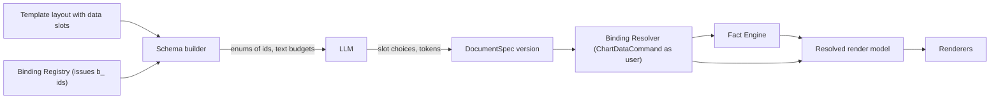
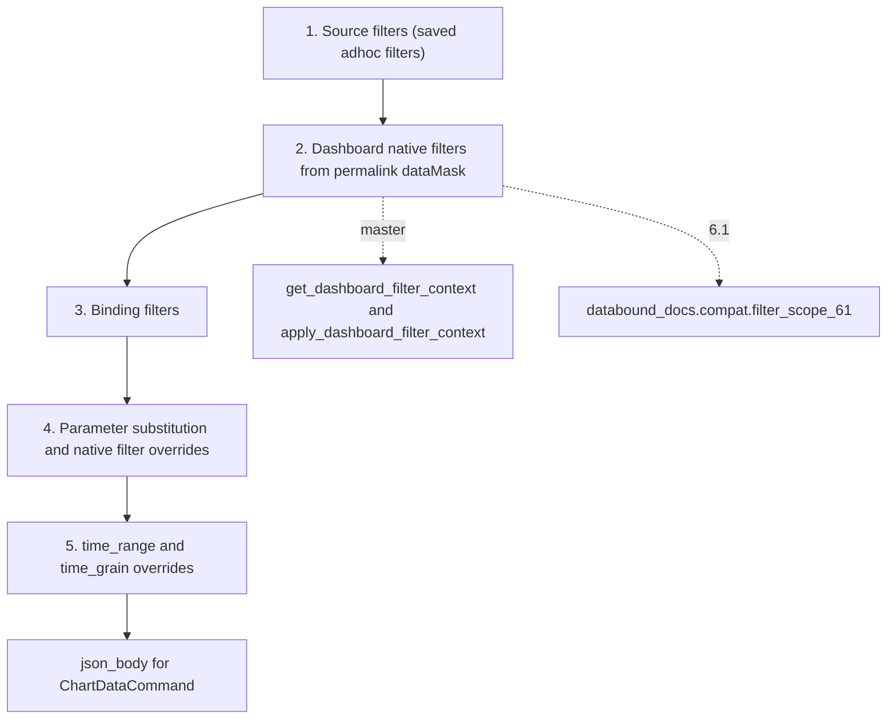

# Data-bound slide model

<div class="chapter-meta" markdown>
**Reads:** `superset/charts/schemas.py`, `superset/charts/data/dashboard_filter_context.py`, `superset/utils/core.py`, `superset/dashboards/permalink/types.py`, `superset/security/manager.py`, `servers/fastapi/templates/v2/models/elements.py`, `servers/fastapi/templates/v2/schema.py`, `servers/fastapi/api/v1/ppt/endpoints/presentation.py`  ·  **Builds on:** [Target architecture](32-architecture.md)  ·  **Time:** ~45 min
</div>

This chapter specifies the **Document Spec**, the data model every Data-Bound Documents component reads and writes, and its heart, the **DataBinding**. You will see every Pydantic model and field, how each binding source compiles into a real Superset query context, how dashboard filters, binding filters and parameters merge, how rows are shaped and formatted, what "live" and "snapshot" mean, and what provenance is recorded per resolution. Then the chapter shows how Presenton's Template v2 is extended with **data slots**, and how the schema builder exposes bindings to the LLM as enums instead of asking it for numbers. It ends with a complete three-slide deck, first as stored and then after resolution.

The models below live in `databound_docs.spec` (the wheel). They are normative: the JSON Schema published at `GET /extensions/databound/docgen/v1/schema/document-spec` is `DocumentSpec.model_json_schema()`, and the Studio's TypeScript types are generated from it at frontend build time.

## Step 1: From "the LLM fills the chart" to "the LLM picks a binding"

In Presenton a chart element is a box plus data. The `Chart` model carries `categories: Optional[list[str]]` and `series: Optional[list[ChartSeries]]`, where `ChartSeries` is only a name and a list of floats:

```python title="presenton: servers/fastapi/templates/v2/models/elements.py:176-178"
class ChartSeries(BaseModel):
    name: str
    values: list[float]
```

The schema builder asks the LLM to produce those lists (`presenton: servers/fastapi/templates/v2/schema.py:1490-1534`), and the hydrator copies them into the element:

```python title="presenton: servers/fastapi/api/v1/ppt/endpoints/presentation.py:1395-1398"
    if isinstance(value.get("categories"), list) and value["categories"]:
        updated["categories"] = value["categories"]
    if isinstance(value.get("series"), list) and value["series"]:
        updated["series"] = value["series"]
```

There is no number format, no x values, no provenance and no way to refresh. [From template to schema to slide](../presenton/17-template-to-slide.md) walks through that path. Data-Bound Documents splits the same responsibility into seven concepts, so that numbers have exactly one way in:

| Concept | What it is | Who creates it |
|---|---|---|
| **Document** | One generated thing of kind `deck`, `document`, `page` or `text`; every change creates an immutable version | the API, the Planner, edits, refreshes |
| **DataBinding** | A governed, re-runnable query plus instructions for shaping its rows | only the Binding Registry |
| **Fact** | A deterministic scalar, label or list derived from one binding's resolved rows | the Fact Engine |
| **Token** | The only way prose refers to data, for example `{{f:f_rev}}` | the Narrative Writer, templates, users |
| **Element** | What a section shows: `chart`, `table`, `kpi`, `text`, `narrative`, `image`, `link` | the Planner and templates |
| **Data slot** | A template-side placeholder that declares which element types and data shapes it accepts | template authors and the importer |
| **Provenance** | As whom, when and how each binding was resolved, with which filters, cache state and RLS context | the Binding Resolver |

The LLM touches only three of these, and only by choosing ids: it picks candidate or binding ids for slots, asks for facts by operation, and writes text containing tokens. A chart's series values, a table's cells and a KPI's number come from the Binding Resolver and the Fact Engine.



## Step 2: The Document Spec envelope

All models inherit from a base with `extra="forbid"`, so an unknown field is a validation error instead of silently dropped data (Presenton's own `ChartSeries` drops unknown keys, see `presenton: servers/fastapi/tests/unit/test_pptx_json_element_metadata.py:79-103`).

```python title="databound_docs/spec/models.py (envelope)"
SPEC_VERSION = "dbd/1.0"
BindingId = Annotated[str, Field(pattern=r"^b_[a-z0-9_]{1,48}$")]
FactId = Annotated[str, Field(pattern=r"^f_[a-z0-9_]{1,48}$")]
ParamRef = Annotated[str, Field(pattern=r"^\$param\.[a-z_][a-z0-9_]*$")]


class _M(BaseModel):
    model_config = ConfigDict(extra="forbid")


class DocumentSpec(_M):
    spec_version: Literal["dbd/1.0"] = SPEC_VERSION
    id: str
    version: int
    kind: Literal["deck", "document", "page", "text"]
    title: str                                  # tokens allowed
    language: str = "en"
    template: TemplateRef
    theme: ThemeSpec = ThemeSpec()
    parameters: dict[str, Parameter] = {}
    context: DataContext
    bindings: list[DataBinding]
    facts: list[Fact] = []
    sections: list[Section]
    generation: GenerationInfo
    provenance: DocumentProvenance
    refresh_policy: RefreshPolicy = RefreshPolicy()
```

| Field | Type | Meaning |
|---|---|---|
| `spec_version` | `"dbd/1.0"` | The binder accepts the current and the previous major version |
| `id` | `str` | ULID with prefix `doc_` |
| `version` | `int` | Immutable version number; each accepted edit, refresh or parameter change adds one |
| `kind` | `deck`, `document`, `page`, `text` | Selects the default renderer and the template family |
| `title` | `str` | User text from the request form; tokens allowed (`{{p:region}}`) |
| `language` | `str` | Output language; also selects the Verifier's number-word and direction lexicons |
| `template` | `TemplateRef {id, version}` | Pinned template version; templates are immutable per version |
| `theme` | `ThemeSpec` | Brand and colors (below) |
| `parameters` | `dict[str, Parameter]` | Typed document parameters, referenced as `$param.<name>` |
| `context` | `DataContext` | The captured data context (Step 3) |
| `bindings` | `list[DataBinding]` | Every query the document runs (Step 4) |
| `facts` | `list[Fact]` | Every number or label prose can cite (Step 11) |
| `sections` | `list[Section]` | Ordered slides, document sections or page blocks (Step 12) |
| `generation` | `GenerationInfo` | Prompt, prompt hash, planner strategy, LLM roles, prompt set version, trigger |
| `provenance` | `DocumentProvenance` | Owner, creation time, parent version, reason, Superset and DBD versions |
| `refresh_policy` | `RefreshPolicy` | What happens to narratives on refresh |

The smaller envelope types are plain records:

| Type | Fields |
|---|---|
| `TemplateRef` | `id`, `version` |
| `ThemeSpec` | `source` (`template`, `dashboard`, `system`), `dashboard_id`, `color_scheme`, `label_colors`, `palette`, `primary`, `positive`, `negative`, `font_family`, `logo_asset`, `lock` (template brand wins except label colors) |
| `GenerationInfo` | `prompt`, `prompt_hash`, `language`, `tone`, `planner_strategy` (`pipeline`, `agent`, `template`), `llm` (role to profile and model), `prompt_set_version`, `trigger` (`ui`, `api`, `mcp`, `cron`, `alert_webhook`, `freshness`, `definition_change`, `external_webhook`), `trigger_ref` |
| `DocumentProvenance` | `owner_user_id`, `created_at`, `parent_version`, `reason` (`generate`, `chat_edit`, `manual_edit`, `refresh`, `param_change`), `superset_version`, `dbd_version` |
| `RefreshPolicy` | `narrative` (`keep`, `retoken`, `regenerate_on_drift` default, `regenerate`), `drift_rules` (default `sign_flip`, `rank_change_top3`, `abs_change_pct>10`), `skip_if_unchanged` (default true), `on_open` (pages only, default true) |

`ThemeSpec` with `source: "dashboard"` is filled from the dashboard's `json_metadata` (`label_colors`, `shared_label_colors`, `map_label_colors`, `color_scheme`) and its theme tokens (`colorPrimary`, `colorSuccess`, `colorError`, `fontFamily`, `brandLogoUrl`). `label_colors` always wins, so "Classic Cars" keeps its dashboard color in the deck. [Native rendering, no screenshots](35-native-rendering.md) has the full color mapping.

## Step 3: Parameters and the data context

### 3.1 Parameters

```python title="databound_docs/spec/models.py (parameters)"
class Parameter(_M):
    type: Literal["time_range", "time_grain", "string", "string_list", "number", "boolean"]
    value: Any = None
    default: Any = None
    label: str | None = None
    native_filter_id: str | None = None        # overrides this dashboard native filter
```

A parameter is a named, typed value that bindings reference with `$param.<name>` in `filters[].val`, `time_range`, `time_grain` and `parameters`. Parameters do three jobs:

1. **Reuse.** One "Period" parameter drives every binding's time range.
2. **Roll-forward.** A scheduled refresh can set `time_range` to `"Last week"` without touching any binding.
3. **Native filter override.** With `native_filter_id` set, the parameter's value replaces that native filter's captured value for every binding the filter is in scope for. A live page renders such parameters as controls, and changing one re-resolves bindings without calling the LLM.

`time_range` values use Superset's own grammar (`"Last quarter"`, `"2026-07-01 : 2026-10-01"`, `"No filter"`), so Superset resolves them and reports the result as `from_dttm`/`to_dttm`.

### 3.2 The data context

```python title="databound_docs/spec/models.py (context)"
class DashboardContext(_M):
    dashboard_id: int
    dashboard_uuid: str | None = None
    permalink_key: str | None = None            # durable capture of the data mask
    native_filters_key: str | None = None       # short-lived key seen at capture time
    active_tabs: list[str] = []
    data_mask_hash: str | None = None
    filter_mode: Literal["captured", "defaults", "none"] = "captured"


class SqlLabContext(_M):
    database_id: int
    catalog: str | None = None
    schema_: str | None = Field(default=None, alias="schema")
    saved_query_id: int | None = None
    query_id: int | None = None                 # sqlLab.onDidQuerySuccess remoteId


class DataContext(_M):
    dashboard: DashboardContext | None = None
    chart_ids: list[int] = []
    dataset_ids: list[int] = []
    sqllab: SqlLabContext | None = None
    captured_at: datetime | None = None
    captured_by_user_id: int | None = None
    locale: str = "en-US"
    timezone: str = "UTC"
```

| Field | Source at capture time | Used for |
|---|---|---|
| `dashboard.permalink_key` | `CreateDashboardPermalinkCommand(dashboard_id, state={"dataMask": ..., "activeTabs": ...})`, or reused from a `/superset/dashboard/p/<key>/` URL | Reading `state.dataMask` at every resolution; the `DashboardPermalinkState` type has `dataMask`, `activeTabs`, `anchor`, `urlParams`, `chartStates` (`apache/superset: superset/dashboards/permalink/types.py:21-30`; `chartStates` is UNVERIFIED on 6.1) |
| `dashboard.native_filters_key` | the dashboard URL | Audit only; it expires |
| `dashboard.data_mask_hash` | sha256 of the canonical data mask | Detecting that two documents share a filter selection |
| `dashboard.filter_mode` | the request | `captured` uses the permalink; `defaults` follows the dashboard's current `defaultDataMask`; `none` ignores native filters |
| `chart_ids`, `dataset_ids` | the request or the Studio picker | Candidates and proposal targets in the Data Digest |
| `sqllab.query_id` | `remoteId` from `sqlLab.onDidQuerySuccess` | Reloaded and ownership-checked on the server; usable only as a `sql` binding when `ALLOW_SQL_BINDINGS` is on |
| `locale`, `timezone` | the user's settings | Formatting and the `{{m:<binding_id>.as_of}}` token |

!!! warning "Gotcha: filter state keys expire, permalinks do not"
    A `native_filters_key` points at dashboard filter state stored in a cache with a TTL. A refresh three months later would find nothing. Context Capture therefore converts it into a permalink immediately and stores `permalink_key`; `native_filters_key` is kept only for audit. Switch a document to `filter_mode: "defaults"` when it should follow future edits to the dashboard's default filters instead of a frozen selection.

## Step 4: DataBinding, field by field

```python title="databound_docs/spec/models.py (DataBinding)"
class DataBinding(_M):
    id: BindingId
    title: str | None = None
    source: Source
    dashboard_filters: DashboardFilterUse | None = None
    filters: list[FilterClause] = []
    time_range: str | ParamRef | None = None    # Superset grammar: "Last quarter", "a : b"
    time_grain: str | ParamRef | None = None
    parameters: dict[str, Any | ParamRef] = {}  # Jinja template_params
    post_processing: list[PostProcessingStep] | None = None  # None = keep the source's
    row_limit: int = Field(default=100, ge=1, le=5000)
    shape: Shape
    format: Format = Format()
    mode: Literal["live", "snapshot"] = "live"
    cache_ttl: int | None = None                # passed as custom_cache_timeout
    created_by: Literal["context", "template", "planner", "user"] = "context"
```

| Field | Meaning | Maps to in the Superset query context |
|---|---|---|
| `id` | `b_` plus up to 48 lowercase characters, issued by the Binding Registry | not sent; used in shape names (`dbd:chart:<element_id>:<binding_id>`), HTML `data-dbd-binding`, the manifest |
| `title` | Human label shown in the binding inspector and alt text | not sent |
| `source` | Discriminated union on `kind`: `chart`, `dataset`, `semantic` [M], `sql` (Step 5) | `datasource` plus the base `queries` |
| `dashboard_filters` | Whether and which native filters apply (Step 6) | `queries[].filters` entries with `isExtra: true`, time overrides |
| `filters` | Extra filter clauses for this binding | appended to `queries[].filters` |
| `time_range` | Time window override, literal or `$param.*` | rewrites the `TEMPORAL_RANGE` filter |
| `time_grain` | Grain override (ISO 8601 duration such as `P1M`) | `extras.time_grain_sqla` and the `BASE_AXIS` column's `timeGrain` |
| `parameters` | Jinja `template_params` for virtual datasets and SQL | `form_data` values that Jinja macros read through `g.form_data` |
| `post_processing` | Server-side pandas steps; `None` keeps the source's own list | `queries[].post_processing` |
| `row_limit` | 1 to 5,000, default 100; further capped by the registry | `queries[].row_limit` (minimum of the saved value and this one for chart sources) |
| `shape` | How rows become a chart, table or scalar (Step 7) | not sent; applied after the query |
| `format` | Per-column formats (Step 8) | not sent |
| `mode` | `live` re-queries on every resolution; `snapshot` stores rows and never re-queries | controls whether `dbd_binding_result.rows` is written and read |
| `cache_ttl` | Seconds | `custom_cache_timeout` |
| `created_by` | Who introduced the binding: `context` (an existing chart), `template`, `planner` (a proposal), `user` | audit and UI badges |

!!! warning "Gotcha: `row_limit` counts long-form rows, before pivoting"
    For a timeseries chart grouped by a dimension, Superset applies `row_limit` to the SQL result (one row per month and product line), and the pivot post-processing runs on that limited frame. A limit of 50 on twelve months by seven product lines (84 rows) silently drops data before the pivot. Chart-shaped bindings need `row_limit >= periods x series`; the Binding Resolver reports `truncated: true` when `rowcount` equals the limit, and the slot assignment check refuses such a binding for a hero chart.

## Step 5: Binding sources and how each resolves to a Superset query

Every source kind ends in the same three calls inside the Superset Adapter, under `override_user`:

```python title="databound/docgen/superset_adapter.py (run_query_context)"
def run_query_context(json_body: dict[str, Any]) -> dict[str, Any]:
    from superset.charts.schemas import ChartDataQueryContextSchema
    from superset.commands.chart.data.get_data_command import ChartDataCommand
    g.form_data = json_body                    # Jinja macros read it (workbook.py:226)
    qc = ChartDataQueryContextSchema().load(json_body)
    command = ChartDataCommand(qc)
    command.validate()                         # raise_for_access before execution
    return command.run()
```

`ChartDataCommand.validate()` is a one-liner that checks access before anything else runs:

```python title="apache/superset: superset/commands/chart/data/get_data_command.py:107-108"
    def validate(self) -> None:
        self._query_context.raise_for_access()
```

What differs between source kinds is how the `json_body` is built.

| Source | When it is used | Execution path | Availability |
|---|---|---|---|
| `chart` | Default for anything the user already built | Reload or pin the saved query context, stamp ids, merge filters, `ChartDataCommand` | [6.1] with a saved query context; [M] adds a form_data rebuild |
| `dataset` | New visuals the planner proposes ("top countries by revenue") | A QueryObject built from validated saved metrics and columns, `ChartDataCommand` | [6.1] |
| `semantic` | Deployments with semantic layers | `SemanticView.get_table(...)` | [M] behind `SEMANTIC_LAYERS` |
| `sql` | Power users with a saved query, or template-admin SQL | SELECT-only check, `raise_for_access(..., force_dataset_match=True)`, `Database.execute` | [6.1], disabled by default |

The LLM may **choose** chart bindings and **propose** dataset bindings through enums. It may never write SQL or adhoc SQL expressions.

### 5.1 Chart sources

```python title="databound_docs/spec/models.py (ChartSource)"
class ChartSource(_M):
    kind: Literal["chart"] = "chart"
    chart_id: int
    chart_uuid: str | None = None
    query_index: int = 0                        # mixed_timeseries has 2 queries
    follow: Literal["live", "pinned"] = "live"  # live: reload chart.query_context each run
    query_context_snapshot: dict[str, Any] | None = None
    query_context_hash: str | None = None
    viz_type: str | None = None
```

Resolution, step by step:

1. **Load the chart** through the access-filtered chart DAO (base filter `ChartFilter`), so a chart the user cannot see is a 404, not a leak.
2. **Get the query context.**
    - `follow: "live"` loads `Slice.query_context`, the JSON that the viz plugin's `buildQuery` produced when the chart was last saved in Explore. Numbers are then identical to the dashboard.
    - `follow: "pinned"` uses `query_context_snapshot`. When the live context's hash differs from `query_context_hash`, the resolver records `definition_changed` and the Studio offers "update to the new chart definition".
    - If `query_context` is null: on [M] the adapter calls `build_query_context_from_form_data(form_data, {"id": ..., "type": ...}, viz_type)` (`apache/superset: superset/common/form_data_query_context.py:1801-1805`) and adds the provenance warning `rebuilt_from_form_data`. On [6.1] the binding resolves with status `error` and the remediation "Chart has no saved query context: open and save it in Explore", the same condition Superset's own endpoint reports (`apache/superset: superset/charts/data/api.py:170-182`).
3. **Stamp ids.** Set `form_data.dashboardId` and `form_data.slice_id`, as the Excel export does for guest authorization (`apache/superset: superset/dashboards/excel_export/workbook.py:205-214`).
4. **Merge filters** in the order of Step 6.
5. **Force the result shape.** `result_type = "full"`, `result_format = "json"`, and pop `force` unless this is a forced refresh.
6. **Execute** with `run_query_context`, then read `result["queries"][query_index]`.

Here is what a saved query context for an `echarts_timeseries_bar` chart typically looks like, and what the resolver changes. The saved part is illustrative: it is the shape the ECharts timeseries `buildQuery` saves, and exact keys vary by plugin version.

```json title="Chart 102: saved query_context (illustrative excerpt)"
{
  "datasource": {"id": 7, "type": "table"},
  "force": false,
  "queries": [{
    "filters": [{"col": "order_date", "op": "TEMPORAL_RANGE", "val": "No filter"}],
    "extras": {"having": "", "where": ""},
    "columns": [{"columnType": "BASE_AXIS", "sqlExpression": "order_date", "label": "order_date",
                 "expressionType": "SQL", "timeGrain": "P1M"}, "product_line"],
    "metrics": ["revenue"],
    "orderby": [["revenue", false]],
    "row_limit": 10000,
    "series_columns": ["product_line"],
    "post_processing": [
      {"operation": "pivot", "options": {"index": ["order_date"], "columns": ["product_line"],
                                         "aggregates": {"revenue": {"operator": "mean"}},
                                         "drop_missing_columns": false}},
      {"operation": "rename", "options": {"columns": {"revenue": null}, "level": 0, "inplace": true}},
      {"operation": "flatten"}
    ]
  }],
  "form_data": {"datasource": "7__table", "viz_type": "echarts_timeseries_bar", "slice_id": 102},
  "result_format": "json",
  "result_type": "full"
}
```

```json title="Chart 102: json_body sent to ChartDataCommand for binding b_rev_by_month (changed keys only)"
{
  "queries": [{
    "filters": [
      {"col": "order_date", "op": "TEMPORAL_RANGE", "val": "2026-07-01 : 2026-10-01"},
      {"col": "region", "op": "IN", "val": ["EMEA"], "isExtra": true}
    ],
    "row_limit": 500
  }],
  "form_data": {"datasource": "7__table", "viz_type": "echarts_timeseries_bar",
                "slice_id": 102, "dashboardId": 12},
  "result_format": "json",
  "result_type": "full"
}
```

The pivot and flatten steps stay, so the result arrives wide, one column per product line, exactly as the dashboard renders it.

### 5.2 Dataset sources

```python title="databound_docs/spec/models.py (DatasetSource)"
class SimpleMetric(_M):
    expressionType: Literal["SIMPLE"] = "SIMPLE"
    column: str
    aggregate: Literal["SUM", "AVG", "COUNT", "COUNT_DISTINCT", "MIN", "MAX"]
    label: str


class DatasetSource(_M):
    kind: Literal["dataset"] = "dataset"
    dataset_id: int
    dataset_uuid: str | None = None
    metrics: list[Union[str, SimpleMetric]]     # saved metric names preferred
    dimensions: list[str] = []                  # validated column names (groupby=True)
    time_column: str | None = None
    time_grain: str | None = None               # ISO 8601 duration, e.g. "P1M"
    time_offsets: list[str] = []                # e.g. ["1 year ago"]
    orderby: list[tuple[str, bool]] = []        # (metric_or_column, ascending)
    series_limit: int | None = None
```

There is deliberately no `SqlMetric`. A planner proposal can name only saved metrics (governed definitions, with their `d3format` and `currency`) or a `SimpleMetric` over an existing numeric column. The Binding Registry rejects anything else before an id is issued.

The compiler is 6.1-compatible and lives in the wheel. A temporal dimension becomes an adhoc `BASE_AXIS` column, the same pattern the ECharts plugins use:

```python title="databound_docs/binder/dataset_query.py (excerpt)"
def build_dataset_query_context(b: DataBinding) -> dict:
    src = b.source
    cols: list = []
    for dim in src.dimensions:
        if dim == src.time_column:
            cols.append({"columnType": "BASE_AXIS", "sqlExpression": dim, "label": dim,
                         "expressionType": "SQL", "timeGrain": src.time_grain})
        else:
            cols.append(dim)
    filters = [f.model_dump() for f in b.filters]
    if b.time_range and src.time_column:
        filters.append({"col": src.time_column, "op": "TEMPORAL_RANGE", "val": b.time_range})
    metrics = [m if isinstance(m, str) else
               {"expressionType": "SIMPLE", "column": {"column_name": m.column},
                "aggregate": m.aggregate, "label": m.label} for m in src.metrics]
    query = {
        "columns": cols, "metrics": metrics, "filters": filters,
        "orderby": [[m, asc] for m, asc in src.orderby], "row_limit": b.row_limit,
        "time_offsets": src.time_offsets, "series_limit": src.series_limit or 0,
        "post_processing": [p.model_dump() for p in (b.post_processing or [])],
        "extras": {"time_grain_sqla": src.time_grain} if src.time_grain else {},
    }
    return {"datasource": {"id": src.dataset_id, "type": "table"}, "queries": [query],
            "form_data": {"datasource": f"{src.dataset_id}__table", "viz_type": "table"},
            "result_type": "full", "result_format": "json"}
```

`$param.*` references are substituted before compilation (Step 6), so the compiler only ever sees literal values. When the shape has `series_by`, the compiler adds `pivot` and `flatten` steps that mirror the ECharts timeseries `buildQuery`, so a proposed "revenue by month by product line" arrives in the same wide form as a saved chart.

The fields map one to one onto `ChartDataQueryObjectSchema` (`apache/superset: superset/charts/schemas.py:1388-1675`): `columns`, `metrics`, `filters` (`ChartDataFilterSchema`, with `op` restricted to `FilterOperator` values), `orderby`, `row_limit`, `series_limit`, `time_offsets`, `post_processing` and `extras.time_grain_sqla`.

!!! warning "Gotcha: `time_offsets` columns are renamed, and need a time column"
    Superset names comparison columns `<metric>__<offset>`, for example `revenue__1 year ago`. Facts and shapes must reference that exact name. The example deck below uses `time_offsets` on a query with a `time_column` but no temporal dimension (`columns: []`). On master, `processing_time_offsets` handles that case explicitly: with no join keys it falls back to a temporary join key and returns one joined row (`apache/superset: superset/models/helpers.py:3604-3613`, `:3794`). Whether the 6.1.0 code path does the same is UNVERIFIED and covered by the binding contract tests. If that test fails on 6.1, the fallback is to add `order_date` as a `BASE_AXIS` dimension at the period's grain (`P3M`), so the comparison has a temporal column to join on, and to read row 0.

### 5.3 Semantic sources [M]

```python title="databound_docs/spec/models.py (SemanticSource)"
class SemanticSource(_M):                       # [M], SEMANTIC_LAYERS flag
    kind: Literal["semantic"] = "semantic"
    view_id: str
    metrics: list[str]
    dimensions: list[str] = []
    time_grain: str | None = None
```

On master with `SEMANTIC_LAYERS` on, the resolver calls the semantic view's `get_table(...)` through the host registry. The `superset_core.semantic_layers` package is absent from the 6.1.0 tag, so on 6.1 the registry refuses this kind with `unsupported_on_6.1`.

### 5.4 SQL sources

```python title="databound_docs/spec/models.py (SqlSource)"
class SqlSource(_M):                            # opt-in, never proposed by the LLM
    kind: Literal["sql"] = "sql"
    database_id: int
    saved_query_id: int | None = None
    template_sql_ref: str | None = None         # admin-authored SQL stored in a template
    catalog: str | None = None
    schema_: str | None = Field(default=None, alias="schema")
```

SQL bindings exist only when `ALLOW_SQL_BINDINGS` is true, and only from a saved query the user can access, a SQL Lab query the user owns, or SQL a template admin (`can_manage_templates`) wrote. The resolver renders Jinja with the document parameters, parses with `get_sqlglot_dialect(database)` and rejects anything but a single SELECT, calls `security_manager.raise_for_access(database=..., sql=..., catalog=..., schema=..., force_dataset_match=True)` (because `Database.execute` performs no datasource access check of its own), and then runs `Database.execute(sql, QueryOptions(limit=..., timeout_seconds=60, cache=CacheOptions(...)))`. RLS applies; chart semantics (saved metrics, formats) do not. [Security, RLS, auth](38-security.md) covers the checks.

### 5.5 Previewing a binding from the Studio

The binding inspector and the MCP tool `dbd_propose_binding` both validate a draft through the same registry call. The REST side is an ordinary `superset_core` API method:

```python title="backend/src/databound/docgen/api.py (bindings preview, excerpt)"
from flask import g, request
from flask_appbuilder.api import expose, permission_name, protect, safe
from superset_core.rest_api.api import RestApi
from superset_core.rest_api.decorators import api

from databound_docs.binder.registry import BindingRegistry
from databound_docs.spec.models import DataBinding
from databound.docgen import superset_adapter as sa


@api(id="dbd_api", name="Data-Bound Documents API", resource_name="v1")
class DataBoundDocsApi(RestApi):
    class_permission_name = "DataBoundDocs"
    csrf_exempt = False

    @expose("/bindings/preview", methods=("POST",))
    @protect()
    @safe
    @permission_name("generate")
    def preview_binding(self):
        draft = DataBinding.model_validate(request.get_json(force=True))
        registry = BindingRegistry(adapter=sa, user=g.user)       # request user, no override
        registered = registry.register(job_id=None, draft=draft)  # raises on bad names or access
        result = registry.resolver.resolve(registered, row_limit=20)
        return self.response(200, result={
            "status": result.status, "shape": registered.shape.kind,
            "rowcount": result.rowcount, "preview_rows": result.rows[:20],
            "default_facts": [f.model_dump() for f in registry.default_facts(registered, result)],
        })
```

And the Studio calls it with plain `fetch`, because `SupersetClient` is not shared with extension remotes:

```ts title="extension/frontend/src/studio/bindings.ts"
import { authentication } from '@apache-superset/core';
import type { DataBinding } from '../generated/document-spec';   // generated from the JSON Schema
import { BASE } from './api';

export async function previewBinding(binding: DataBinding) {
  const csrf = await authentication.getCSRFToken();
  const res = await fetch(`${BASE}/bindings/preview`, {
    method: 'POST',
    credentials: 'same-origin',
    headers: { 'Content-Type': 'application/json', ...(csrf ? { 'X-CSRFToken': csrf } : {}) },
    body: JSON.stringify(binding),
  });
  if (!res.ok) throw new Error(`${res.status} ${await res.text()}`);
  return (await res.json()).result as {
    status: 'ok' | 'empty' | 'error' | 'forbidden' | 'truncated';
    shape: string; rowcount: number; preview_rows: Record<string, unknown>[];
  };
}
```

## Step 6: Filters and parameters

```python title="databound_docs/spec/models.py (filters)"
class FilterClause(_M):
    col: str
    op: Literal["==", "!=", ">", "<", ">=", "<=", "IN", "NOT IN", "LIKE", "ILIKE",
                "IS NULL", "IS NOT NULL", "TEMPORAL_RANGE"]
    val: Any | ParamRef = None


class DashboardFilterUse(_M):
    apply: bool = True
    dashboard_id: int | None = None             # defaults to context.dashboard
    include: list[str] | None = None            # native filter ids, None = all in scope
    exclude: list[str] = []
```

`FilterClause` is a strict subset of Superset's `ChartDataFilterSchema` (`apache/superset: superset/charts/schemas.py:1156`): the same `col`, `op` and `val`, with `op` limited to scalar `FilterOperator` values (`apache/superset: superset/utils/core.py:329`). `NOT LIKE`, `NOT ILIKE`, `IS TRUE` and `IS FALSE` are left out of v1, and the array operators (`CONTAINS_ANY`, `CONTAINS_ALL`, `IS_EMPTY`, `LENGTH_*`), which accompany the master-only `MULTI_VALUE` column type, are not offered.

### 6.1 Merge order

Filters are applied in this order, and later steps win:

1. **The source's own filters.** For chart sources, the adhoc filters inside the saved query context.
2. **Dashboard native filters**, when `dashboard_filters.apply` is true.
    - [M]: `fc = get_dashboard_filter_context(dashboard_id=..., chart_id=..., active_data_mask=data_mask)`, then `apply_dashboard_filter_context(json_body, fc.extra_form_data)` when it is not empty (`apache/superset: superset/charts/data/dashboard_filter_context.py:272, 365`). `fc.to_dict()["filters"]` goes into `Provenance.dashboard_filters`.
    - [6.1]: `databound_docs.compat.filter_scope_61` reads `json_metadata.native_filter_configuration`. For chart sources it uses `chartsInScope` when present, else `scope.rootPath` and `scope.excluded`; for dataset sources it uses `targets[].datasetId`. It takes each value from the permalink `dataMask` or from `defaultDataMask`, appends `filters` with `isExtra: true`, and overrides `time_range`, `time_grain_sqla`, `granularity_sqla` and `relative_start`/`relative_end`, mirroring the `EXTRA_FORM_DATA_*` constants (`apache/superset: superset/constants.py:209-234`).
3. **The binding's `filters`.**
4. **Parameter values.** `$param.*` references are substituted, and `Parameter.native_filter_id` overrides that native filter's value.
5. **`time_range` and `time_grain` overrides**, which rewrite the `TEMPORAL_RANGE` filter with the same semantics as `merge_extra_form_data` (`apache/superset: superset/utils/core.py:1184-1260`).



Both branches return an object with the same contract as master's dataclass, so call sites never branch:

```python title="apache/superset: superset/charts/data/dashboard_filter_context.py:59-75"
@dataclass
class DashboardFilterContext:
    extra_form_data: dict[str, Any] = field(default_factory=dict)
    filters: list[DashboardFilterInfo] = field(default_factory=list)

    def to_dict(self) -> dict[str, Any]:
        return {
            "filters": [
                {
                    "id": f.id,
                    "name": f.name,
                    "status": f.status.value,
                    **({"column": f.column} if f.column else {}),
                }
                for f in self.filters
            ],
        }
```

!!! warning "Gotcha: the 6.1 port refuses to guess"
    The 6.1 port does not implement cascading parents, `requiredFirst` or `defaultToFirstItem` pre-queries. When an in-scope filter uses one of these, the binding resolves with that filter at its captured explicit value, or skips it with a `rejected_filters` entry `{"reason": "unsupported_on_6.1"}` that the provenance footer shows. It never invents a value. The binding contract tests assert that the 6.1 port and the master helper produce identical query contexts for `filter_select`, `filter_range`, `filter_time` and `filter_timegrain`.

!!! warning "Gotcha: dataset proposals honor dashboard filters only when targeted"
    A planner proposal over dataset 7 gets the dashboard's native filters only if dataset 7 is a target of those filters (`targets[].datasetId`). A proposal over a dataset no filter targets runs unfiltered by the dashboard selection, and the provenance footer says so. If the prompt says "for EMEA", put the region into a parameter with a binding filter, as the example deck does.

## Step 7: Post-processing and shaping

### 7.1 Post-processing runs in Superset

```python title="databound_docs/spec/models.py (post-processing)"
class PostProcessingStep(_M):
    operation: Literal["aggregate", "pivot", "rolling", "cum", "contribution", "sort",
                       "rename", "resample", "diff", "compare", "flatten", "select", "rank"]
    options: dict[str, Any] = {}
```

These are Superset's own pandas operations (`apache/superset: superset/utils/pandas_postprocessing/__init__.py:49-67`), executed server-side inside `ChartDataCommand`. Shares, cumulative sums and rolling averages are therefore computed by Superset, so the deck and the dashboard agree. `prophet`, `boxplot`, `histogram` and the geo operations are not offered to proposals; chart sources keep whatever their saved query context contains.

!!! warning "Gotcha: `contribution` is computed over the returned rows"
    Post-processing runs on the result frame after `row_limit` is applied in SQL. In a single-query context, a `contribution` step on a top-10 query computes each row's share of the top 10, not of the whole region. Superset can do better: when the same query context also carries a totals query (metrics, no `columns`, no `post_processing`), `ensure_totals_available` runs it without a row limit and injects `contribution_totals` into every `contribution` step, so shares are of the true total (`apache/superset: superset/common/query_context_processor.py:99-136`, `:709-740`; `ensure_totals_available` is also present in the 6.1.0 tag). The Binding Resolver therefore appends such a metrics-only totals query to any dataset binding with a `contribution` step (a refinement not shown in the `build_dataset_query_context` excerpt above) and reads the binding's rows from `queries[0]`. The example deck would be safe either way, because its region has eight countries and `rowcount` stays below the limit; without a totals query and with `truncated: true`, a share fact must be labeled "share of the listed countries".

### 7.2 Shape: from rows to a renderable structure

```python title="databound_docs/spec/models.py (Shape)"
class Shape(_M):
    kind: Literal["scalar", "series", "xy", "xyz", "table", "pivot"]
    x: str | None = None                        # category or temporal column
    series: list[str] | Literal["*"] = "*"      # value columns after pivot
    series_by: str | None = None                # long-form dimension to pivot on
    size: str | None = None                     # xyz only
    columns: list[str] = []                     # table display order
    top_n: int | None = None
    others_label: str | None = "Other"
```

| `kind` | Required result | Feeds | Check that fails loudly |
|---|---|---|---|
| `scalar` | one row, numeric value columns | KPI groups, facts | exactly one row with a numeric value |
| `series` | one x column plus numeric series columns | category charts (column, bar, line, area, pie) | one x column and at least one numeric series |
| `xy` | numeric x and y per series | scatter | numeric x and y |
| `xyz` | x, y, size | bubble | three numeric columns |
| `table` | any columns | native tables, ranked lists | listed `columns` exist |
| `pivot` | post-processed pivot | tables with merged headers | header levels present |

The resolver's shaping pass, in order:

1. Convert temporal values (Superset serializes them as epoch milliseconds) to timezone-aware `datetime` in the document timezone. Date categories produce a date axis in python-pptx.
2. Apply `top_n`: keep the N largest series (or categories) by total and fold the rest into one column named `others_label`.
3. Compute the reserved virtual columns `__row_total` (row sum across series) and `__row_index` (0-based position after sorting). Facts can reference them, for example `argmax` over `__row_total`, or a `where` of `{"__row_index_lt": 3}`.
4. Enforce the target slot's `series`, `categories` and `rows` ranges (Step 13).

## Step 8: Formatting

```python title="databound_docs/spec/models.py (formats)"
class ColumnFormat(_M):
    d3: str | None = None                       # "$,.2f", ".1%", "SMART_NUMBER"
    currency: dict[str, str] | None = None      # {"symbol": "USD", "symbolPosition": "prefix"}
    time: str | None = None                     # d3-time-format or "smart_date"
    excel: str | None = None                    # derived for chart caches and axes
    label: str | None = None                    # display label (verbose_name)
    null_text: str = "n/a"


class Format(_M):
    columns: dict[str, ColumnFormat] = {}       # "*" applies to all value columns
    locale: str | None = None
```

Resolution follows Superset's own precedence:

1. `DataBinding.format.columns[col]` (then `"*"` for value columns).
2. The dataset metric's `d3format` and `currency`.
3. The chart `form_data` keys `y_axis_format`, `number_format` and `currency_format`.
4. `SMART_NUMBER`.

A currency with symbol `AUTO` resolves from the result's `detected_currency`. The resolved format is then consumed in two different ways, and the distinction matters:

| Consumer | Uses | Why |
|---|---|---|
| Fact displays, table cells, KPI values, token text | `d3` through the vendored `format_number_with_config(d3_format, currency, value)` (`apache/superset: superset/utils/number_format.py:166`, [M]; vendored for 6.1) | The same strings a user sees in the browser |
| Chart caches, axes, data labels, the embedded workbook | `excel`, derived deterministically from `d3` (for example `,.0f` gives `#,##0`, `.1%` gives `0.0%`) | The workbook keeps raw numbers, so "Edit Data" in PowerPoint shows real values |

`label` comes from the column's `verbose_name` or the metric's `verbose_name` unless the binding overrides it. The full d3-to-Excel table is in [Native rendering, no screenshots](35-native-rendering.md).

## Step 9: Live, snapshot, live-follow and pinned

Two independent switches control how "dynamic" a binding is. `mode` decides whether data is re-queried; `follow` (chart sources only) decides whether the query definition is re-read.

| | `follow: "live"` (chart definition re-read) | `follow: "pinned"` (definition frozen) |
|---|---|---|
| `mode: "live"` (data re-queried) | Default. Edits to the chart in Explore and new data both flow into the next refresh | New data flows in, but the query is the one captured at generation time; definition changes raise a flag |
| `mode: "snapshot"` (rows stored) | Rows frozen in `dbd_binding_result.rows`; a definition change is reported but not applied | Fully frozen: what was sent is what is shown, forever |

Live pages re-resolve `live` bindings as the viewer on every open. Refresh in place re-resolves as the run-as user and rewrites the existing PPTX or DOCX. Snapshot shares require `can_share_snapshot`, because they carry the author's data. [Scheduling and live refresh](39-scheduling-and-refresh.md) covers the refresh algorithm.

## Step 10: Results and provenance

Every resolution produces a `BindingResult`, stored in `dbd_binding_result` and passed to the Fact Engine and the renderers.

```python title="databound_docs/spec/models.py (results)"
class Provenance(_M):
    resolved_at: datetime
    executed_as_user_id: int | None             # None for guests
    executed_as_kind: Literal["user", "run_as", "guest"]
    rls_fingerprint: str                        # hash of RLS clauses applied
    superset_version: str
    adapter_path: Literal["chart_data_command", "database_execute", "semantic_view"]
    query_hash: str                             # sha256 of canonical query context, no force
    data_hash: str                              # sha256 of canonical rows
    cache_key: str | None = None
    is_cached: bool | None = None
    queried_dttm: str | None = None
    applied_filters: list[dict[str, Any]] = []
    rejected_filters: list[dict[str, Any]] = []
    dashboard_filters: list[dict[str, Any]] = []
    from_dttm: int | None = None
    to_dttm: int | None = None
    detected_currency: str | None = None
    row_limit: int
    truncated: bool = False


class BindingResult(_M):
    binding_id: BindingId
    status: Literal["ok", "empty", "error", "forbidden", "truncated"]
    colnames: list[str] = []
    coltypes: list[int] = []                    # GenericDataType ints
    rows: list[dict[str, Any]] = []
    rowcount: int = 0
    error: str | None = None
    provenance: Provenance | None = None
```

Most provenance fields are copied straight from Superset's chart-data response (`ChartDataResponseResult`, `apache/superset: superset/charts/schemas.py:1807-1940`); the rest are computed by DBD:

| Field | Origin |
|---|---|
| `cache_key`, `is_cached`, `queried_dttm`, `applied_filters`, `rejected_filters`, `from_dttm`, `to_dttm`, `detected_currency` | the query result returned by `ChartDataCommand.run()` |
| `coltypes` | `GenericDataType` ints: `NUMERIC=0`, `STRING=1`, `TEMPORAL=2`, `BOOLEAN=3`, `MULTI_VALUE=4` [M] (`apache/superset: superset/utils/core.py:251-260`) |
| `dashboard_filters` | `fc.to_dict()["filters"]` on master, or the 6.1 port's equivalent |
| `query_hash` | sha256 of the canonical query JSON without `force` (sorted keys, no nonces) |
| `data_hash` | sha256 of canonical rows; equal hashes let a refresh emit `refresh.unchanged` and skip a new version |
| `rls_fingerprint` | hash of the RLS clauses applied to the executing user, from the same inputs as `get_rls_cache_key` (`apache/superset: superset/security/manager.py:6304-6313`) |
| `executed_as_*` | the `as_user` context: the requester, the trigger's run-as user, or a parsed guest token (v2) |
| `truncated` | `rowcount == row_limit` |

Status mapping: `SupersetSecurityException` becomes `forbidden` (the element renders "You do not have access to this data" and every narrative citing its facts is removed); other errors become `error` and the element uses its `fallback`; zero rows is `empty`; a hit limit is `truncated`. Rows are persisted only for `mode: "snapshot"` or when an audit policy requires it; refreshes add rows and never overwrite them. Each artifact references `(document_id, version, binding_result_ids)`, so "what data was in the file we sent on Monday" is always answerable.

Provenance is also stamped into every output: a visible footer ("Data as of 2 Nov 2026 09:14 UTC. Filters: Region = EMEA."), PPTX shape names and alt text, the `/customXml/dbd-manifest.json` part, HTML `data-dbd-binding`, `data-dbd-query-hash` and `data-dbd-as-of` attributes.

## Step 11: Facts and tokens

### 11.1 Facts

```python title="databound_docs/spec/models.py (facts)"
FactOp = Literal["value", "label_at", "sum", "mean", "min", "max", "count", "first", "last",
                 "abs_change", "pct_change", "share", "rank_of", "argmax", "argmin",
                 "top_k", "count_where", "period_label", "as_of"]


class Fact(_M):
    id: FactId
    binding_id: BindingId
    op: FactOp
    args: dict[str, Any] = {}   # {"column": "revenue", "baseline_column": "revenue__1 year ago"}
    format: ColumnFormat | None = None
    description: str | None = None              # plain-language, shown to the writer
    value: Any = None                           # filled by the Fact Engine
    label: str | None = None                    # argmax, argmin, rank_of, label_at
    display: str | None = None                  # formatted value
    sign: Literal[-1, 0, 1] | None = None       # changes only
```

A fact is a definition plus a computed value. The stored spec holds the definition (`id`, `binding_id`, `op`, `args`, `format`, `description`); `value`, `label`, `display` and `sign` are filled by the Fact Engine at every resolution with pure functions over the shaped rows, so a refresh recomputes them without the LLM.

| Op | Args | Value |
|---|---|---|
| `value`, `label_at` | `column`, `row` or `where` | a cell value or label |
| `sum`, `mean`, `min`, `max`, `count` | `column`, optional `where` | aggregate over rows |
| `first`, `last` | `column` | first or last point in x order |
| `abs_change`, `pct_change` | `column`, `baseline_column` or `vs` (`prev`, `first`, a `time_offsets` column) | delta, with `sign` set |
| `share` | `column`, `label` | value divided by the column total |
| `rank_of` | `column`, `label` | 1-based rank |
| `argmax`, `argmin` | `column`, `label_column` | `label` plus its value |
| `top_k` | `column`, `k` | list of label and value pairs |
| `count_where` | `where` | number of matching rows |
| `period_label` | none | resolved `from_dttm` to `to_dttm` as text |
| `as_of` | none | `queried_dttm` |

### 11.2 Token grammar

| Token | Resolves to | Example rendering |
|---|---|---|
| `{{f:<fact_id>}}` | the fact's `display` | `$2.91M` |
| `{{f:<fact_id>.label}}` | the fact's `label` | `France` |
| `{{f:<fact_id>.abs}}` | the absolute value of a change fact, formatted | `8.4%` (for "fell by" phrasing) |
| `{{p:<param>}}` | a parameter's display value | `EMEA` |
| `{{m:<binding_id>.as_of}}` | the binding's `queried_dttm` in the document timezone | `2 Nov 2026 09:14` |

Each token renders as its own run: an `a:r` in PPTX, a `w:r` in DOCX, a `<span data-dbd-fact="f_rev">` in HTML. That is what makes in-place refresh possible: the manifest records every token run, and a refresh rewrites a run only if its text still equals what DBD last wrote. Category names are tokens too (`.label`), because a label visible to the author may be invisible to another viewer under RLS; the Narrative Verifier's entity scan rejects literal category names in LLM prose.

## Step 12: Elements and sections

A `Section` has `id`, `layout_id`, `title` (tokens allowed), `intent`, `elements` and `speaker_notes` (tokens allowed). Every element inherits `id` and `slot` from a small base class `_El`; the `slot` is the data slot name the element fills. The element union, discriminated on `type`:

| `type` | Data fields | Notes |
|---|---|---|
| `chart` | `binding_id`, `native` (`column`, `bar`, `line`, `area`, `pie`, `doughnut`, `scatter`, `bubble`, `radar`, `combo`, `waterfall`, `funnel`, `histogram`, `step`, `sparkline`, `heat_table`, `svg`), `grouping` (`clustered`, `stacked`, `percent`), `title`, `legend`, `data_labels`, `secondary_series` (combo only), `colors`, `fallback` (`table`, `omit`, `link`) | `native` must be in the slot's `native` list; `fallback` applies when the binding fails or the viz is tier 3 |
| `table` | `binding_id`, `columns`, `max_rows`, `overflow` (`truncate`, `continue`, `appendix`), `totals_row`, `heat_column` | cells are formatted strings; numeric cells right-aligned |
| `kpi` | `value_fact`, `label`, `comparison_fact`, `comparison_label`, `sparkline_binding` | the delta color follows the comparison fact's `sign` |
| `text` | `text`, `role` (`title`, `subtitle`, `heading`, `body`, `caption`, `footer`), `pinned_note` | template or user text; may hold tokens and literal digits; `pinned_note` marks a value a user typed by hand ("edited, not live") |
| `narrative` | `purpose`, `fact_ids`, `max_chars` (default 600), `form` (`paragraph`, `bullets`, `headline`), `text`, `status` (`pending`, `verified`, `fallback`, `flagged`, `user_edited`), `verify_report`, `audience_rls_fingerprint` | LLM prose with tokens only; verified before it ships; `user_edited` text is never regenerated automatically |
| `image` | `asset_ref`, `alt` | template assets only, never a capture |
| `link` | `label`, `target` (`dashboard`, `chart`, `explore`, `page`, `url`), `ref` | links come from templates or bindings, never from LLM output |

## Step 13: Extending Presenton Template v2 with data slots

Templates keep Presenton's Template v2 element model for geometry and styling: the discriminated union `SlideElement` of `Text`, `Container`, `Image`, `TextList`, `Table`, `Vector`, `Chart`, `Infographic`, `Flex`, `Grid` and `Group` (`presenton: servers/fastapi/templates/v2/models/elements.py:624-640`), every element positioned on the fixed 1280 x 720 canvas. On a 16:9 slide that is 9,525 EMU per template unit. [Template v2 format](../presenton/16-template-v2-format.md) documents the base format. Data-Bound Documents makes two additions.

### 13.1 The `data_slot` attribute

A `data_slot` object is added to `chart`, `table` and `text` elements:

```python title="databound_docs/templates/slots.py"
class DataSlot(_M):
    name: str                                    # "trend", "kpi_1", "takeaway"
    accepts: list[Literal["chart", "table", "kpi", "narrative", "sparkline"]]
    shapes: list[Literal["scalar", "series", "xy", "xyz", "table", "pivot"]] = []
    x_kind: list[Literal["temporal", "categorical", "numeric"]] = []
    series: tuple[int, int] = (1, 8)             # inclusive range
    categories: tuple[int, int] = (1, 24)
    rows: tuple[int, int] = (1, 12)              # tables
    max_chars: int | None = None                 # narratives, from box geometry
    native: list[str] = []                       # allowed ChartElement.native values
    aspect: Literal["wide", "square", "tall"] = "wide"
    optional: bool = False
```

| Field | Meaning | Checked against |
|---|---|---|
| `name` | Slot id within the layout; becomes `element.slot` | unique per layout |
| `accepts` | Element types this slot can show | the candidate's kind |
| `shapes` | Allowed `Shape.kind` values | the profiled shape |
| `x_kind` | Allowed x axis kinds | the x column's `GenericDataType` |
| `series`, `categories` | Inclusive count ranges | profiled counts; categorical overflow is allowed when `top_n` can fold into "Other" |
| `rows` | Inclusive row range for tables | `rowcount` and `max_rows` |
| `max_chars` | Narrative budget | the rendered length with tokens replaced by their displays |
| `native` | Allowed native chart types | the viz mapping for the candidate's `viz_type` |
| `aspect` | Box proportion | used in layout scoring |
| `optional` | Whether the slot may stay empty | layouts with an unfillable mandatory slot are discarded |

### 13.2 The new `kpi` element

Presenton has no KPI element (its `Infographic` kinds such as `gauge` and `progress_bar` hold LLM-supplied values). DBD adds one to the `SlideElement` union:

```python title="databound_docs/templates/elements_ext.py"
from databound_docs.templates.v2_port.elements import Font, Position, Size  # ported from Presenton


class Kpi(BaseModel):
    type: Literal["kpi"]
    position: Optional[Position] = None
    size: Optional[Size] = None
    value_font: Optional[Font] = None
    label_font: Optional[Font] = None
    delta_font: Optional[Font] = None
    layout: Literal["stacked", "inline"] = "stacked"
    show_sparkline: bool = False
    # Schema
    decorative: Literal[False] = False
    name: str
    data_slot: DataSlot                          # accepts ["kpi"], shapes ["scalar"]
```

The PPTX Renderer draws it as a group named `dbd:kpi:<element_id>` holding value, label and delta text boxes, plus an optional native LINE sparkline. The ported Presenton `ChartSeries` also gains typed x values, sizes and dates in DBD's copy, and `bubble` becomes a real `ChartType`, fixing the mismatch between the schema's `CHART_TYPE_VALUES` (which lists `"bubble"`, `presenton: servers/fastapi/templates/v2/schema.py:23-36`) and the `ChartType` enum (which does not, `elements.py:76-87`).

### 13.3 A layout with data slots

```json title="Template tpl_exec_review v3, layout chart_takeaway (abridged)"
{
  "id": "chart_takeaway",
  "description": "Title across the top, one chart on the left two thirds, a takeaway on the right",
  "elements": [
    {"type": "text", "name": "title", "decorative": false,
     "position": {"x": 64, "y": 40}, "size": {"width": 1152, "height": 72},
     "runs": [{"text": "Monthly revenue by product line"}], "max_length": 70, "min_length": 10},
    {"type": "chart", "name": "chart", "decorative": false,
     "position": {"x": 64, "y": 136}, "size": {"width": 768, "height": 520},
     "chart_type": "bar", "legend": true, "legend_position": "bottom",
     "data_slot": {"name": "chart", "accepts": ["chart", "table"],
                   "shapes": ["series", "xy"], "x_kind": ["temporal", "categorical"],
                   "series": [1, 8], "categories": [1, 24],
                   "native": ["column", "bar", "line", "area"], "aspect": "wide"}},
    {"type": "text", "name": "takeaway", "decorative": false,
     "position": {"x": 864, "y": 136}, "size": {"width": 352, "height": 520},
     "runs": [{"text": "Takeaway"}], "max_length": 420, "min_length": 40,
     "data_slot": {"name": "takeaway", "accepts": ["narrative"], "max_chars": 420}}
  ]
}
```

The chart element keeps its Presenton styling fields (`chart_type`, `legend`, `legend_position`), but `categories` and `series` are absent: they will never be filled by the LLM. A non-decorative `text` element without a `data_slot` (the title here) keeps Presenton's behavior, a string with `minLength`/`maxLength`, with one addition: the token-only pattern of Step 14.

### 13.4 Three ways a slot gets into a template

1. **Authoring in JSON**, for built-ins and the Studio template editor.
2. **Shape-name convention in a PPTX or DOCX master.** A designer names placeholders `slot:chart:trend`, `slot:kpi:kpi_1`, `slot:narrative:takeaway` and `slot:table:detail` in PowerPoint, or tags Word content controls with the same strings. The importer reads shape names, boxes and fonts with python-pptx, and for a designer chart it reads `graphic_frame.has_chart`, the chart type and the series and category counts to infer `shapes`, `x_kind`, `series` and `categories`. Narrative `max_chars` comes from Presenton's geometry-capacity idea (`TABLE_TEXT_CAPACITY_SAFETY_FACTOR = 0.85`, `presenton: servers/fastapi/templates/v2/schema.py:49`). The importer returns a validation report, for example "slot `trend` holds a pie chart but declares temporal x". No vision model is involved.
3. **Presenton certified import**, an optional v2 plugin. It needs a vision model and `@presenton/export-core`, whose license is unknown, so it is not in the default build. See [Custom templates from PPTX](../presenton/18-custom-templates.md) for how Presenton does it.

!!! warning "Gotcha: a designer chart in a slot is a promise about shape"
    In template-fill mode the PPTX Renderer calls `chart.replace_data(...)` on the designer's chart, which keeps all formatting. That only works if the binding's shape matches the chart: a pie slot cannot take three series, and a clustered column chart designed for six categories will look wrong with twenty. The importer turns the designer's chart into `series` and `categories` ranges precisely so that slot assignment refuses mismatched bindings up front instead of producing a broken slide.

## Step 14: How the schema builder exposes bindings to the LLM

Presenton's builder walks a layout's elements and emits one JSON Schema property per non-decorative element (`_is_editable_element`, `presenton: servers/fastapi/templates/v2/schema.py:53`), with `additionalProperties: False`, every property required, and `x-element-type`/`x-element-path` annotations for hydration (`_component_content_field_schema`, `presenton: servers/fastapi/templates/v2/schema.py:1200-1281`). A text element becomes `{"type": "string", "minLength": ..., "maxLength": ...}`; a chart becomes the `categories`/`series` object shown in Step 1.

DBD keeps the walk, the budgets, the strictness and the annotations, and changes what each element type emits. The builder takes a layout and the **menus** the Binding Registry compiled for the section (which candidate, proposal or binding ids are compatible with each slot), and produces two projections, one per LLM call that needs it:

- the **assignment projection**, used by the layout tie-break and slot assignment call ([Generation flow](34-generation-flow.md), step 4): data slots become enums of ids;
- the **writer projection**, used by the Narrative Writer (step 7): text and narrative fields become strings with budgets and a token-only pattern.

```python title="databound_docs/templates/schema_builder.py (skeleton)"
from dataclasses import dataclass

from databound_docs.templates.errors import TemplateError
from databound_docs.templates.v2_port.schema import strict_object, walk_editable  # ported

TOKEN_ONLY = (r"^(?:[^0-9{}%$]|\{\{(?:f:f_[a-z0-9_]+(?:\.label|\.abs)?"
              r"|p:[a-z_][a-z0-9_]*|m:b_[a-z0-9_]+\.as_of)\}\})*$")


@dataclass(frozen=True)
class SlotMenus:
    ids: dict[str, list[str]]          # slot name -> compatible candidate/binding ids
    facts: dict[str, list[str]]        # kpi slot name -> compatible fact ids


def build_layout_schemas(layout: dict, menus: SlotMenus) -> tuple[dict, dict]:
    assign: dict[str, dict] = {}
    write: dict[str, dict] = {}
    for path, el in walk_editable(layout["elements"]):          # ported from Presenton
        slot = el.get("data_slot")
        meta = {"x-element-type": el["type"], "x-element-path": path}
        if slot and set(slot["accepts"]) & {"chart", "table", "sparkline"}:
            ids = menus.ids.get(slot["name"], []) + (["none"] if slot.get("optional") else [])
            if ids:
                assign[slot["name"]] = {"enum": ids, **meta}     # never categories or series
        elif el["type"] == "kpi":
            facts = menus.facts.get(slot["name"], [])
            if not facts:
                continue                                         # never emit an empty enum
            assign[slot["name"]] = {
                "type": "object", "additionalProperties": False,
                "required": ["value_fact", "comparison_fact"],
                "properties": {"value_fact": {"enum": facts},
                               "comparison_fact": {"enum": facts + ["none"]}}, **meta}
        elif el["type"] == "text":
            limit = (slot or {}).get("max_chars") or el["max_length"]
            write[slot["name"] if slot else el["name"]] = {
                "type": "string", "maxLength": limit, "pattern": TOKEN_ONLY, **meta}
        elif el["type"] == "table" and not slot:
            raise TemplateError(f"{path}: unbound tables are not allowed in data templates")
    return strict_object(assign), strict_object(write)
```

`walk_editable` and `strict_object` are ports of Presenton's element walk and `_object_schema` (`presenton: servers/fastapi/templates/v2/schema.py:455`; `additionalProperties: false`, all properties required, `$defs` hoisted). For layout `chart_takeaway` with the menus `{"chart": ["cand_c102", "p_rev_by_country"]}`, the two projections are:

```json title="Assignment projection for chart_takeaway"
{
  "type": "object", "additionalProperties": false, "required": ["chart"],
  "properties": {
    "chart": {"enum": ["cand_c102", "p_rev_by_country"],
              "x-element-type": "chart", "x-element-path": "elements.1"}
  }
}
```

```json title="Writer projection for chart_takeaway (pattern abbreviated)"
{
  "type": "object", "additionalProperties": false, "required": ["title", "takeaway"],
  "properties": {
    "title": {"type": "string", "maxLength": 70, "pattern": "^(?:[^0-9{}%$]|...)*$",
              "x-element-type": "text", "x-element-path": "elements.0"},
    "takeaway": {"type": "string", "maxLength": 420, "pattern": "^(?:[^0-9{}%$]|...)*$",
                 "x-element-type": "text", "x-element-path": "elements.2"}
  }
}
```

The writer call wraps this projection with `speaker_notes` (no regex, because some providers reject very long patterns, but verified like every other field) and `fact_requests`, whose `binding_id` is an enum of the section's bindings and whose `args_json` is a string (strict structured-output modes reject open objects). [Generation flow](34-generation-flow.md) shows the full response schema.

What the builder **never** emits for a data template: `categories`, `series`, `values`, table `columns` or `rows`, KPI numbers, URLs, or SQL. The menus are compiled per request from the Binding Registry, so the enum contains only ids the requester can access and that fit the slot. Hydration then reverses the `x-element-path` walk, as Presenton's `_apply_template_content_value` dispatcher does (`presenton: servers/fastapi/api/v1/ppt/endpoints/presentation.py:865-881`), with new handlers for bound elements that read `BindingResult` rows instead of LLM output.

!!! warning "Gotcha: an empty enum is a schema error, not an empty choice"
    JSON Schema `{"enum": []}` matches nothing, and several providers reject it outright in strict mode. When no compatible id exists for a mandatory slot, the layout must be discarded before a schema is built (the deterministic layout fit does this), and an optional slot always gets `"none"`. The builder skips a slot with an empty menu rather than emitting an empty enum.

## Step 15: Full example, a three-slide deck before and after resolution

The example is an executive review of a "Sales Overview" dashboard (id 12) filtered to EMEA for Q3 2026, generated by user 42 with template `tpl_exec_review` v3. Data values in 15.2 are illustrative.

### 15.1 Before resolution: the stored DocumentSpec (version 1)

This is exactly what `dbd_document_version.spec` holds. Notice what is absent: no rows, no fact values, no formatted numbers. Every number is a reference.

```json title="DocumentSpec doc_01JC8Z6Q4M5K, version 1 (as stored)"
{
  "spec_version": "dbd/1.0",
  "id": "doc_01JC8Z6Q4M5K",
  "version": 1,
  "kind": "deck",
  "title": "Q3 2026 Sales Review: {{p:region}}",
  "language": "en",
  "template": {"id": "tpl_exec_review", "version": 3},
  "theme": {
    "source": "dashboard", "dashboard_id": 12, "color_scheme": "supersetColors",
    "label_colors": {"Classic Cars": "#1FA8C9", "Motorcycles": "#454E7C"},
    "palette": ["#1FA8C9", "#454E7C", "#5AC189", "#FF7F44", "#666666"],
    "primary": "#2893B3", "positive": "#5AC189", "negative": "#E04355",
    "font_family": "Inter", "logo_asset": null, "lock": false
  },
  "parameters": {
    "time_range": {"type": "time_range", "value": "2026-07-01 : 2026-10-01",
                   "default": "Last quarter", "label": "Period",
                   "native_filter_id": "NATIVE_FILTER-time"},
    "region": {"type": "string_list", "value": ["EMEA"], "label": "Region",
               "native_filter_id": "NATIVE_FILTER-region"}
  },
  "context": {
    "dashboard": {"dashboard_id": 12, "dashboard_uuid": null, "permalink_key": "aB3dK9",
                  "native_filters_key": "kq8sP0", "active_tabs": [],
                  "data_mask_hash": "sha256:5e1c...", "filter_mode": "captured"},
    "chart_ids": [], "dataset_ids": [7], "sqllab": null,
    "captured_at": "2026-11-02T09:13:58Z", "captured_by_user_id": 42,
    "locale": "en-US", "timezone": "UTC"
  },
  "bindings": [
    {
      "id": "b_rev_kpi", "title": "Revenue, current vs prior year",
      "source": {"kind": "dataset", "dataset_id": 7, "metrics": ["revenue"],
                 "dimensions": [], "time_column": "order_date",
                 "time_offsets": ["1 year ago"], "orderby": []},
      "dashboard_filters": {"apply": true, "dashboard_id": 12, "include": null, "exclude": []},
      "filters": [{"col": "region", "op": "IN", "val": "$param.region"}],
      "time_range": "$param.time_range", "row_limit": 1,
      "shape": {"kind": "scalar", "series": ["revenue", "revenue__1 year ago"]},
      "format": {"columns": {"revenue": {"d3": "$,.3s", "label": "Revenue"}}},
      "mode": "live", "created_by": "planner"
    },
    {
      "id": "b_orders_kpi", "title": "Total orders (chart 101)",
      "source": {"kind": "chart", "chart_id": 101, "viz_type": "big_number_total",
                 "follow": "live", "query_context_hash": "sha256:91aa..."},
      "dashboard_filters": {"apply": true, "dashboard_id": 12, "include": null, "exclude": []},
      "time_range": "$param.time_range", "row_limit": 1,
      "shape": {"kind": "scalar", "series": ["count"]},
      "format": {"columns": {"count": {"d3": ",d", "label": "Orders"}}},
      "mode": "live", "created_by": "context"
    },
    {
      "id": "b_rev_by_month", "title": "Revenue by month and product line (chart 102)",
      "source": {"kind": "chart", "chart_id": 102, "viz_type": "echarts_timeseries_bar",
                 "follow": "live", "query_context_hash": "sha256:3b07..."},
      "dashboard_filters": {"apply": true, "dashboard_id": 12, "include": null, "exclude": []},
      "time_range": "$param.time_range", "row_limit": 500,
      "shape": {"kind": "series", "x": "order_date", "series": "*", "top_n": 6},
      "format": {"columns": {"order_date": {"time": "%b %Y", "excel": "mmm yyyy"},
                             "*": {"d3": "$,.2s"}}},
      "mode": "live", "created_by": "context"
    },
    {
      "id": "b_top_countries", "title": "Top countries by revenue",
      "source": {"kind": "dataset", "dataset_id": 7, "metrics": ["revenue"],
                 "dimensions": ["country"], "orderby": [["revenue", false]]},
      "dashboard_filters": {"apply": true, "dashboard_id": 12, "include": null, "exclude": []},
      "filters": [{"col": "region", "op": "IN", "val": "$param.region"}],
      "time_range": "$param.time_range", "row_limit": 10,
      "post_processing": [{"operation": "contribution",
                           "options": {"orientation": "column", "columns": ["revenue"],
                                       "rename_columns": ["revenue_share"]}}],
      "shape": {"kind": "table", "columns": ["country", "revenue", "revenue_share"]},
      "format": {"columns": {"revenue": {"d3": "$,.0f", "label": "Revenue"},
                             "revenue_share": {"d3": ".1%", "label": "Share"},
                             "country": {"label": "Country"}}},
      "mode": "live", "created_by": "planner"
    }
  ],
  "facts": [
    {"id": "f_rev", "binding_id": "b_rev_kpi", "op": "value", "args": {"column": "revenue", "row": 0},
     "description": "Revenue in the selected period"},
    {"id": "f_rev_yoy", "binding_id": "b_rev_kpi", "op": "pct_change",
     "args": {"column": "revenue", "baseline_column": "revenue__1 year ago"},
     "format": {"d3": "+.1%"}, "description": "Revenue change vs the same period last year"},
    {"id": "f_orders", "binding_id": "b_orders_kpi", "op": "value", "args": {"column": "count", "row": 0},
     "description": "Number of orders"},
    {"id": "f_best_month", "binding_id": "b_rev_by_month", "op": "argmax",
     "args": {"column": "__row_total", "label_column": "order_date"},
     "description": "Month with the highest total revenue"},
    {"id": "f_top_country", "binding_id": "b_top_countries", "op": "label_at",
     "args": {"column": "country", "row": 0}, "description": "Country with the most revenue"},
    {"id": "f_top_share", "binding_id": "b_top_countries", "op": "value",
     "args": {"column": "revenue_share", "row": 0}, "description": "Share of the top country"},
    {"id": "f_top3_share", "binding_id": "b_top_countries", "op": "sum",
     "args": {"column": "revenue_share", "where": {"__row_index_lt": 3}},
     "format": {"d3": ".0%"}, "description": "Combined share of the top three countries"}
  ],
  "sections": [
    {
      "id": "s1", "layout_id": "title_kpis", "intent": "Headline result for the quarter",
      "title": "{{p:region}} closed the quarter at {{f:f_rev}} in revenue",
      "elements": [
        {"type": "kpi", "id": "e2", "slot": "kpi_1", "value_fact": "f_rev",
         "label": "Revenue", "comparison_fact": "f_rev_yoy", "comparison_label": "vs prior year"},
        {"type": "kpi", "id": "e3", "slot": "kpi_2", "value_fact": "f_orders", "label": "Orders"},
        {"type": "narrative", "id": "e4", "slot": "subtitle", "purpose": "One-line headline",
         "fact_ids": ["f_rev_yoy"], "max_chars": 160, "form": "headline", "status": "verified",
         "text": "Revenue moved {{f:f_rev_yoy}} year over year across the region.",
         "audience_rls_fingerprint": "rls:9f0c..."}
      ],
      "speaker_notes": "Open with the headline: {{f:f_rev}} ({{f:f_rev_yoy}} year over year)."
    },
    {
      "id": "s2", "layout_id": "chart_takeaway", "intent": "Monthly trend by product line",
      "title": "Monthly revenue by product line",
      "elements": [
        {"type": "chart", "id": "e6", "slot": "chart", "binding_id": "b_rev_by_month",
         "native": "column", "grouping": "stacked", "legend": "bottom",
         "colors": {"Classic Cars": "#1FA8C9", "Motorcycles": "#454E7C"}, "fallback": "table"},
        {"type": "narrative", "id": "e7", "slot": "takeaway", "purpose": "Name the peak month",
         "fact_ids": ["f_best_month"], "max_chars": 420, "form": "paragraph", "status": "verified",
         "text": "{{f:f_best_month.label}} was the strongest month of the quarter.",
         "audience_rls_fingerprint": "rls:9f0c..."}
      ]
    },
    {
      "id": "s3", "layout_id": "table_takeaway", "intent": "Where revenue concentrates",
      "title": "Top countries by revenue",
      "elements": [
        {"type": "table", "id": "e9", "slot": "table", "binding_id": "b_top_countries",
         "columns": ["country", "revenue", "revenue_share"], "max_rows": 10, "overflow": "truncate"},
        {"type": "narrative", "id": "e10", "slot": "takeaway", "purpose": "Concentration",
         "fact_ids": ["f_top_country", "f_top_share", "f_top3_share"], "max_chars": 420,
         "form": "paragraph", "status": "verified",
         "text": "{{f:f_top_country.label}} leads with {{f:f_top_share}} of regional revenue; the leading group of countries accounts for {{f:f_top3_share}}.",
         "audience_rls_fingerprint": "rls:9f0c..."},
        {"type": "text", "id": "e11", "slot": "footer", "role": "footer",
         "text": "Source: Superset dashboard Sales Overview, data as of {{m:b_top_countries.as_of}}"},
        {"type": "link", "id": "e12", "slot": "footer_link", "label": "Open the live dashboard",
         "target": "dashboard", "ref": "/superset/dashboard/p/aB3dK9/"}
      ]
    }
  ],
  "generation": {
    "prompt": "Quarterly review for the EMEA leadership team, focus on growth drivers",
    "prompt_hash": "sha256:0c4e...", "language": "en", "tone": "executive",
    "planner_strategy": "pipeline",
    "llm": {"planner": "default/your-model-id", "writer": "default/your-model-id"},
    "prompt_set_version": "dbd-prompts-1.0", "trigger": "ui", "trigger_ref": null
  },
  "provenance": {"owner_user_id": 42, "created_at": "2026-11-02T09:14:31Z",
                 "parent_version": 0, "reason": "generate",
                 "superset_version": "6.1.0", "dbd_version": "1.0.0"},
  "refresh_policy": {"narrative": "regenerate_on_drift",
                     "drift_rules": ["sign_flip", "rank_change_top3", "abs_change_pct>10"],
                     "skip_if_unchanged": true, "on_open": true}
}
```

Points to notice:

- The document `title` was typed by the user in the request form, so it is user text and may contain literal digits ("Q3 2026"). Every LLM-written field (section titles, narratives, speaker notes) uses tokens only.
- The second narrative says "the leading group of countries" instead of "the top three", because "three" is a number word and the Verifier rejects it in LLM prose. A `{{f:<id>.count}}` token for top-k sizes is a v1 grammar extension.
- `b_rev_by_month` and `b_orders_kpi` are `created_by: "context"`: they reuse charts 102 and 101 as saved, so the deck's numbers equal the dashboard's. `b_rev_kpi` and `b_top_countries` are planner proposals over dataset 7, accepted by the Binding Registry because `revenue` is a saved metric and `country` a `groupby=True` column.
- `__row_total` and `__row_index_lt` are the Fact Engine's reserved virtual columns; `revenue__1 year ago` is Superset's naming for `time_offsets` results; the `contribution` step makes Superset compute shares server-side.

### 15.2 After resolution: binding results

Resolution runs as user 42 inside `override_user`. Each binding becomes one `BindingResult`. Temporal values are shown after shaping (converted from Superset's epoch milliseconds); provenance is shown in full for one binding and abbreviated for the rest.

```json title="BindingResult rows for version 1 (illustrative values)"
[
  {
    "binding_id": "b_rev_kpi", "status": "ok",
    "colnames": ["revenue", "revenue__1 year ago"], "coltypes": [0, 0],
    "rows": [{"revenue": 2910000.0, "revenue__1 year ago": 2684500.0}], "rowcount": 1,
    "provenance": {"resolved_at": "2026-11-02T09:14:07Z", "executed_as_user_id": 42,
                   "executed_as_kind": "user", "rls_fingerprint": "rls:9f0c...",
                   "superset_version": "6.1.0", "adapter_path": "chart_data_command",
                   "query_hash": "sha256:a41d...", "data_hash": "sha256:77e2...",
                   "cache_key": "4f1b2c...", "is_cached": false,
                   "queried_dttm": "2026-11-02T09:14:07",
                   "applied_filters": [{"column": "region"}, {"column": "order_date"}],
                   "rejected_filters": [],
                   "dashboard_filters": [{"id": "NATIVE_FILTER-region", "name": "Region",
                                          "status": "applied", "column": "region"},
                                         {"id": "NATIVE_FILTER-time", "name": "Period",
                                          "status": "applied"}],
                   "from_dttm": 1782864000000, "to_dttm": 1790812800000,
                   "detected_currency": null, "row_limit": 1, "truncated": true}
  },
  {
    "binding_id": "b_orders_kpi", "status": "ok",
    "colnames": ["count"], "coltypes": [0],
    "rows": [{"count": 8214}], "rowcount": 1,
    "provenance": {"executed_as_user_id": 42, "is_cached": true,
                   "queried_dttm": "2026-11-02T09:01:44", "row_limit": 1, "...": "..."}
  },
  {
    "binding_id": "b_rev_by_month", "status": "ok",
    "colnames": ["order_date", "Classic Cars", "Vintage Cars", "Motorcycles", "Trucks and Buses",
                 "Planes", "Ships", "Other", "__row_total"],
    "coltypes": [2, 0, 0, 0, 0, 0, 0, 0, 0],
    "rows": [
      {"order_date": "2026-07-01T00:00:00Z", "Classic Cars": 330000, "Vintage Cars": 180000,
       "Motorcycles": 110000, "Trucks and Buses": 90000, "Planes": 70000, "Ships": 50000,
       "Other": 30000, "__row_total": 860000},
      {"order_date": "2026-08-01T00:00:00Z", "Classic Cars": 355000, "Vintage Cars": 195000,
       "Motorcycles": 120000, "Trucks and Buses": 100000, "Planes": 85000, "Ships": 55000,
       "Other": 30000, "__row_total": 940000},
      {"order_date": "2026-09-01T00:00:00Z", "Classic Cars": 423710, "Vintage Cars": 230000,
       "Motorcycles": 140000, "Trucks and Buses": 120000, "Planes": 100000, "Ships": 61290,
       "Other": 35000, "__row_total": 1110000}
    ],
    "rowcount": 3,
    "provenance": {"executed_as_user_id": 42, "is_cached": true, "row_limit": 500,
                   "truncated": false, "queried_dttm": "2026-11-02T09:01:44", "...": "..."}
  },
  {
    "binding_id": "b_top_countries", "status": "ok",
    "colnames": ["country", "revenue", "revenue_share"], "coltypes": [1, 0, 0],
    "rows": [
      {"country": "France", "revenue": 1010000, "revenue_share": 0.3471},
      {"country": "Germany", "revenue": 560000, "revenue_share": 0.1924},
      {"country": "United Kingdom", "revenue": 470000, "revenue_share": 0.1615},
      {"country": "Spain", "revenue": 390000, "revenue_share": 0.1340},
      {"country": "Italy", "revenue": 230000, "revenue_share": 0.0790},
      {"country": "Belgium", "revenue": 120000, "revenue_share": 0.0412},
      {"country": "Sweden", "revenue": 80000, "revenue_share": 0.0275},
      {"country": "Norway", "revenue": 50000, "revenue_share": 0.0172}
    ],
    "rowcount": 8,
    "provenance": {"executed_as_user_id": 42, "is_cached": false, "row_limit": 10,
                   "truncated": false, "queried_dttm": "2026-11-02T09:14:07", "...": "..."}
  }
]
```

A few things the resolver did here:

- `b_rev_by_month` arrived from Superset with seven product-line columns (pivoted by the chart's own post-processing). `top_n: 6` kept the six largest and folded "Trains" into "Other"; `__row_total` was added. The `rowcount` of 3 is post-pivot; the long-form SQL result had 21 rows, well under the limit of 500.
- `b_rev_kpi` reports `truncated: true` because a scalar binding's `rowcount` equals its `row_limit` of 1. For `scalar` shapes this is expected and is not shown as a footnote; the flag matters for tables and series.
- `b_top_countries` returned 8 rows under a limit of 10, so the `contribution` shares are of the whole region (see the Gotcha in Step 7).
- `b_orders_kpi` and `b_rev_by_month` were cache hits, because they are the dashboard's own queries and the dashboard had just run them for user 42. The cache key includes RLS, so those hits are per user.

### 15.3 After resolution: facts

The Fact Engine fills the computed fields. Formats come from the fact's own `format`, else the binding's column format.

```json title="Facts after resolution"
[
  {"id": "f_rev", "value": 2910000.0, "display": "$2.91M"},
  {"id": "f_rev_yoy", "value": 0.0840, "display": "+8.4%", "sign": 1},
  {"id": "f_orders", "value": 8214, "display": "8,214"},
  {"id": "f_best_month", "value": 1110000, "label": "Sep 2026", "display": "$1.1M"},
  {"id": "f_top_country", "value": "France", "label": "France", "display": "France"},
  {"id": "f_top_share", "value": 0.3471, "display": "34.7%"},
  {"id": "f_top3_share", "value": 0.7010, "display": "70%"}
]
```

### 15.4 After resolution: the render model

`GET /documents/<id>/render-model` returns what renderers and the live page consume: sections with tokens replaced, rows shaped for each element, and provenance for footers. Each resolved token keeps its fact id, so the PPTX Renderer can write it as its own run and record it in the manifest.

```json title="Render model for version 1 (abridged)"
{
  "document_id": "doc_01JC8Z6Q4M5K", "version": 1,
  "title": {"text": "Q3 2026 Sales Review: EMEA", "runs": [
    {"text": "Q3 2026 Sales Review: "}, {"text": "EMEA", "param": "region"}]},
  "sections": [
    {"id": "s1", "layout_id": "title_kpis",
     "title": {"text": "EMEA closed the quarter at $2.91M in revenue"},
     "elements": [
       {"id": "e2", "type": "kpi", "slot": "kpi_1", "value": "$2.91M", "label": "Revenue",
        "comparison": {"display": "+8.4%", "label": "vs prior year", "sign": 1, "color": "#5AC189"}},
       {"id": "e3", "type": "kpi", "slot": "kpi_2", "value": "8,214", "label": "Orders"},
       {"id": "e4", "type": "narrative", "slot": "subtitle", "status": "verified",
        "text": "Revenue moved +8.4% year over year across the region.",
        "runs": [{"text": "Revenue moved "}, {"text": "+8.4%", "fact": "f_rev_yoy"},
                 {"text": " year over year across the region."}]}
     ],
     "speaker_notes": "Open with the headline: $2.91M (+8.4% year over year)."},
    {"id": "s2", "layout_id": "chart_takeaway",
     "title": {"text": "Monthly revenue by product line"},
     "elements": [
       {"id": "e6", "type": "chart", "slot": "chart", "binding_id": "b_rev_by_month",
        "native": "column", "grouping": "stacked",
        "categories": ["2026-07-01", "2026-08-01", "2026-09-01"],
        "category_format": {"time": "%b %Y", "excel": "mmm yyyy"},
        "series": [
          {"name": "Classic Cars", "values": [330000, 355000, 423710], "color": "#1FA8C9"},
          {"name": "Vintage Cars", "values": [180000, 195000, 230000], "color": "#5AC189"},
          {"name": "Motorcycles", "values": [110000, 120000, 140000], "color": "#454E7C"},
          {"name": "Trucks and Buses", "values": [90000, 100000, 120000], "color": "#FF7F44"},
          {"name": "...", "values": ["three more series: Planes, Ships, Other"]}
        ],
        "value_format": {"d3": "$,.2s",
                         "excel": "[>=1000000]#,##0.0,,\"M\";[>=1000]#,##0.0,\"K\";#,##0"},
        "alt": "Revenue by month and product line, Superset chart 102, data as of 2 Nov 2026 09:01 UTC, filters: region IN EMEA"},
       {"id": "e7", "type": "narrative", "slot": "takeaway", "status": "verified",
        "text": "Sep 2026 was the strongest month of the quarter."}
     ]},
    {"id": "s3", "layout_id": "table_takeaway",
     "title": {"text": "Top countries by revenue"},
     "elements": [
       {"id": "e9", "type": "table", "slot": "table", "binding_id": "b_top_countries",
        "header": ["Country", "Revenue", "Share"],
        "rows": [["France", "$1,010,000", "34.7%"], ["Germany", "$560,000", "19.2%"],
                 ["United Kingdom", "$470,000", "16.2%"], ["...", "five more rows", ""]],
        "align": ["left", "right", "right"], "footer": null},
       {"id": "e10", "type": "narrative", "slot": "takeaway", "status": "verified",
        "text": "France leads with 34.7% of regional revenue; the leading group of countries accounts for 70%."},
       {"id": "e11", "type": "text", "slot": "footer", "role": "footer",
        "text": "Source: Superset dashboard Sales Overview, data as of 2 Nov 2026 09:14"},
       {"id": "e12", "type": "link", "slot": "footer_link", "label": "Open the live dashboard",
        "href": "/superset/dashboard/p/aB3dK9/"}
     ]}
  ],
  "provenance_footer": "Data as of 2 Nov 2026 09:01 to 09:14 UTC. Filters: Region = EMEA, Period = 2026-07-01 : 2026-10-01. Generated by Data-Bound Documents for user 42. Numbers verified."
}
```

Series colors follow the theme rules of [Native rendering, no screenshots](35-native-rendering.md): `label_colors` pins "Classic Cars" and "Motorcycles" to their dashboard colors, and the other series take palette colors. The chart keeps raw numbers in `values` and the Excel format separately, so the PPTX workbook holds real data; the table holds formatted strings, because table cells are text.

### 15.5 What a refresh changes

Next quarter, a cron trigger rolls `time_range` forward to `"Last quarter"` and calls `refresh_document` as the run-as user. The spec's `bindings`, `facts` and `sections` do not change. The resolver produces new `BindingResult` rows with new `data_hash` values; the Fact Engine recomputes every fact; the narrative policy `regenerate_on_drift` rewrites a narrative only if a drift rule fires (for example `f_rev_yoy` flips sign, or `f_top_country` changes); and the PPTX Renderer calls `replace_data` on the `dbd:chart:e6:b_rev_by_month` frame, rewrites the cells of `dbd:table:e9:b_top_countries`, and rewrites each token run whose text is still the one it last wrote. The result is version 2 with `provenance.reason = "refresh"` and `parent_version = 1`. If every `data_hash` is unchanged and `skip_if_unchanged` is true, no version is created and the job emits `refresh.unchanged`.

## What you now know

- A `DocumentSpec` stores structure and references only: bindings, fact definitions, sections and tokens. Rows and computed values belong to resolutions (`BindingResult`) and the render model, which is why one spec can be refreshed and re-rendered indefinitely.
- A `DataBinding` has four source kinds, and each compiles into a Superset query context executed by `ChartDataCommand` under the right user: `chart` (saved query context, live or pinned), `dataset` (governed metrics and columns), `semantic` [M] and restricted `sql`.
- Filters merge in a fixed order (source, dashboard native filters, binding filters, parameters, time overrides), using `get_dashboard_filter_context` on master and the `filter_scope_61` port on 6.1, and every applied or rejected filter is recorded in provenance.
- Formatting follows Superset's precedence and splits into d3 strings for text and Excel codes for charts, so numbers in charts stay editable and numbers in prose match the browser.
- Template v2 gains a `data_slot` attribute and a `kpi` element; the schema builder emits only id enums for data slots and token-only strings for text, so the LLM can never write a number into an artifact.

## Next

Continue with [Generation flow](34-generation-flow.md), which walks the ten pipeline steps that turn a prompt and this model into a verified, rendered document.
