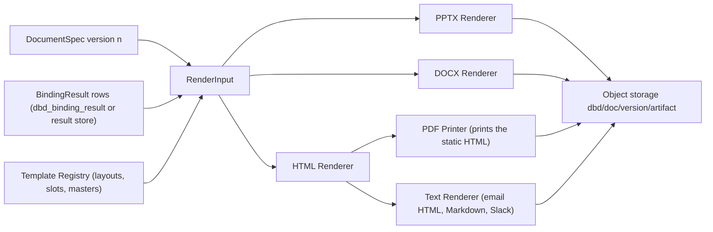

# Native rendering, no screenshots

<div class="chapter-meta" markdown>
**Reads:** `superset/commands/report/execute.py`, `superset/utils/pdf.py`, `superset/utils/number_format.py`, `superset/mcp_service/chart/preview_utils.py`, `superset/config.py`  ·  **Builds on:** [Generation flow](34-generation-flow.md)  ·  **Time:** ~55 min
</div>

This chapter turns a resolved Document Spec into files without ever loading a Superset page in a browser. You will build the PPTX Renderer step by step with python-pptx (native charts with embedded workbooks, tables, KPI tiles and token text runs), add combo and emulated charts through the DrawingML Chart Writer, store binding metadata inside the file so refresh can call `Chart.replace_data` in place, and then see how the same rows become DOCX, live and static HTML, vector PDF, Markdown, email and Slack. The chapter ends with the full `viz_type` mapping, theme and color rules, the automated no-screenshot guarantee, and golden-file tests for every renderer.

!!! info "Interpretation this chapter implements"
    Superset Data-Bound Documents is one output-agnostic framework that turns a prompt, a chosen template and a Superset data context into decks, documents, text and web pages, on demand or on events. Every chart, table, KPI and number comes from a live Superset query run with the requesting user's permissions and RLS. This chapter covers the last promise: each of those values is **rendered natively from data** (editable PPTX and DOCX charts with an embedded workbook, real tables, real text, vector SVG on the web), never as a screenshot, and every artifact is **re-runnable**, so a refresh replaces data in place.

Availability tags: **[6.1]** in 6.1.0 and master, **[M]** master only, **[M\*]** changed on master.

## Why Superset's own reports cannot be reused

Superset's Alerts and Reports already produce PNG, PDF, CSV and text. Only the data formats are data. `BaseReportState._get_notification_content()` (`apache/superset: superset/commands/report/execute.py:1649`) sends PNG requests to `_get_screenshots()`, which loads Explore or dashboard URLs in a headless browser (`execute.py:1096`), and PDF requests to `_get_pdf()`, which stacks those PNGs:

```python title="apache/superset: superset/utils/pdf.py:30-41"
def build_pdf_from_screenshots(snapshots: list[bytes]) -> bytes:
    images = []

    for snap in snapshots:
        img = Image.open(BytesIO(snap))
        if img.mode == "RGBA":
            img = img.convert("RGB")
        images.append(img)
    logger.info("building pdf")
    try:
        new_pdf = BytesIO()
        images[0].save(new_pdf, "PDF", save_all=True, append_images=images[1:])
```

The reason is structural: chart rendering exists only in the browser. Each visualization plugin's `buildQuery` and `transformProps` are TypeScript, and the Python backend returns DataFrames with no renderer. [Superset landscape (6.1)](31-superset-landscape.md) covers this in depth. Data-Bound Documents therefore reuses only Superset's **data path** (`ChartDataCommand`, as the user) and brings its own renderers, which work from rows. Presenton's export is no help either: it drives `@presenton/export-core`, a browser-based DOM measurer with an unknown license that is distributed outside npm ([PPTX and PDF export](../presenton/24-export-pipeline.md)), so it is not used.

| Property | Superset report screenshot | Data-Bound Documents |
|---|---|---|
| Input | pixels of a browser page after async loading | `BindingResult.rows` from `ChartDataCommand` |
| Requires | a full UI session in headless Chromium (Firefox by default on 6.1), auth cookies, readiness heuristics | Python only for PPTX and DOCX; a local file print for PDF |
| Text | rasterized, not searchable | real text (`a:t`, `w:t`, SVG `text`) |
| Numbers | baked into an image | numbers in the chart cache plus an embedded workbook, editable through Edit Data |
| Refresh | re-capture the page | `Chart.replace_data` on new rows |
| Failure modes | blank or partial captures, spinners, tiling | query errors, reported per binding |

## Step 1: The renderer contract

Every renderer reads a resolved `DocumentSpec` version plus its `BindingResult`s and the template. None of them queries Superset (unless the caller asked for a refresh, which re-resolves first), and none of them loads a Superset UI page.

```python title="databound_docs/render/base.py"
from __future__ import annotations
from dataclasses import dataclass, field
from typing import Protocol

from databound_docs.spec.models import BindingResult, DocumentSpec, Fact
from databound_docs.templates.registry import Template


@dataclass(frozen=True)
class RenderInput:
    spec: DocumentSpec
    results: dict[str, BindingResult]          # binding_id -> result for this version
    facts: dict[str, Fact]                     # fact_id -> fact with value, label, display
    template: Template
    base_url: str                              # Superset base URL, for links only
    renderer_version: str = "1.0.0"


@dataclass
class RenderOutput:
    blob: bytes
    content_type: str
    ext: str
    warnings: list[str] = field(default_factory=list)


class Renderer(Protocol):
    format: str                                # "pptx", "docx", "html", "pdf", "md", "text", "email"
    def render(self, inp: RenderInput) -> RenderOutput: ...


RENDERERS: dict[str, Renderer] = {}

def register(r: Renderer) -> Renderer:
    RENDERERS[r.format] = r
    return r
```

The `render_artifact` task loads the inputs, computes the render cache key `sha256(spec_sha256, data_hashes, template_version, renderer_version, format)`, reuses an existing artifact on a hit, and otherwise calls `RENDERERS[fmt].render(inp)` and writes `dbd/<document_id>/<version>/<artifact_id>.<ext>`.



Every element type maps to a handler, which is Presenton's hydrator dispatch pattern (`presenton: servers/fastapi/api/v1/ppt/endpoints/presentation.py:865-881`) applied to bound elements:

| Element | PPTX | DOCX | HTML | Text |
|---|---|---|---|---|
| `chart` | native chart, emulation, or row-derived SVG | chart part (gate G5) or row-derived SVG | ECharts (live) or Vega-Lite SVG (static) | deterministic sentence plus link |
| `table` | native table | Word table | `<table>` | GitHub table or preformatted text |
| `kpi` | named group of text boxes, optional sparkline chart | styled paragraph | KPI card | KPI line |
| `text`, `narrative` | runs, one run per token | runs, one run per token | spans with `data-dbd-fact` | resolved text |
| `image` | template asset only | template asset only | `` of a template asset | omitted |
| `link` | hyperlink run | hyperlink | anchor | URL |

## Step 2: Number formats for text and for Excel

Two formatting paths exist, and mixing them up is the most common renderer bug.

- **Text** (fact displays, table cells, KPI values, narrative tokens) goes through `format_number_with_config(d3_format, currency, value)` (`apache/superset: superset/utils/number_format.py:166`) [M]. Its docstring describes it as the report-side counterpart of the frontend `CurrencyFormatter`, so text matches what users see in the browser. The module is absent from 6.1.0, so the wheel vendors it as `databound_docs.format.d3` (Apache-2.0) and the adapter prefers the host copy when present.
- **Charts** (axes, data labels and the embedded workbook) keep **raw numbers** and receive an Excel format code, so the workbook stays numeric and editable.

| d3 or Superset format | Excel format |
|---|---|
| `,d`, `,.0f` | `#,##0` |
| `,.Nf` | `#,##0.` followed by N zeros |
| `.N%` | `0.` followed by N zeros, then `%` |
| `+,.Nf`, `+.N%` | three sections, for example `+#,##0.0;-#,##0.0;0.0` |
| `$,.2f`, or a currency `{symbol, symbolPosition}` | `"$"#,##0.00`, symbol from a currency table, suffix position supported |
| `.3s`, `SMART_NUMBER`, `$,.2s` | `[>=1000000]#,##0.0,,"M";[>=1000]#,##0.0,"K";#,##0`; when the max absolute value is at least 1e9, the series is pre-scaled to billions and the axis title gets "(billions)" |
| `%Y-%m-%d`, `%b %Y`, `smart_date` | `yyyy-mm-dd`, `mmm yyyy`, or by grain: `P1D` gives `d mmm`, `P1M` gives `mmm yyyy`, `P1Y` gives `yyyy` |
| anything unmappable | `General` on the axis; data labels are written as text through the d3 port |

```python title="databound_docs/format/excel.py (sketch)"
import re

CURRENCY_SYMBOL = {"USD": "$", "EUR": "€", "GBP": "£", "INR": "₹", "JPY": "¥", "CNY": "¥", "MXN": "$"}
_FIXED = re.compile(r"^(?P<sign>\+)?(?P<cur>\$)?(?P<comma>,)?\.(?P<n>\d+)(?P<kind>[f%])$")
SMART = '[>=1000000]#,##0.0,,"M";[>=1000]#,##0.0,"K";#,##0'


def d3_to_excel(d3: str | None, currency: dict | None = None) -> tuple[str, float]:
    """Return (excel_format, scale). Values must be divided by scale before writing."""
    if d3 in (None, "", "SMART_NUMBER") or (d3 or "").endswith("s"):
        return SMART, 1.0
    if d3 in (",d", ",.0f"):
        base = "#,##0"
    else:
        m = _FIXED.match(d3)
        if not m:
            return "General", 1.0
        n = int(m["n"])
        digits = ("0." + "0" * n) if n else "0"
        base = (digits + "%") if m["kind"] == "%" else (("#,##" if m["comma"] else "") + digits)
        if m["sign"]:
            base = f"+{base};-{base};{base}"
        if m["cur"] and not currency:
            base = f'"$"{base}'
    if currency and currency.get("symbol") not in (None, "AUTO"):
        sym = CURRENCY_SYMBOL.get(currency["symbol"], currency["symbol"])
        base = f'"{sym}"{base}' if currency.get("symbolPosition", "prefix") == "prefix" else f'{base}" {sym}"'
    return base, 1.0


def smart_scale(values: list[float | None]) -> tuple[str, float, str | None]:
    """Excel allows two conditions, so billions are handled by pre-scaling."""
    peak = max((abs(v) for v in values if v is not None), default=0)
    if peak >= 1e9:
        return "#,##0.0", 1e9, "(billions)"
    return SMART, 1.0, None
```

!!! warning "Gotcha: Excel number formats allow only two conditions"
    A `SMART_NUMBER` axis cannot express thousands, millions and billions in one Excel format. The renderer pre-scales series whose peak is at least 1e9 and adds "(billions)" to the axis title, and the workbook header records the scale so a human editing the data is not misled.

## Step 3: Compose a PPTX deck from a template

A deck template is one of two things, and both are handled by the same renderer (python-pptx 1.0.2, MIT; it adds only itself to a Superset image, because XlsxWriter and Pillow are already Superset dependencies).

- **A JSON layout set** (built-ins and Studio-authored templates). Elements use Presenton's Template v2 model ([Template v2 format](../presenton/16-template-v2-format.md)) in a 1280 x 720 coordinate space. On a 16:9 slide of 12,192,000 x 6,858,000 EMU, one template unit is 9,525 EMU. `Flex` and `Grid` containers are resolved to absolute boxes by a Python layout pass, and text height is measured with Pillow FreeType and the template's bundled fonts. The renderer draws on a blank layout of the template's theme file.
- **A PPTX master** whose layouts contain shapes named `slot:<type>:<name>` (for example `slot:chart:trend`, `slot:kpi:kpi_1`, `slot:narrative:takeaway`). The renderer clones the layout and fills each slot in place. A designer chart in a chart slot keeps its formatting through `replace_data` ("template-fill mode"); an empty frame is replaced by `add_chart` at the same geometry.

```python title="databound_docs/render/pptx/compose.py (sketch)"
from io import BytesIO
from pptx import Presentation
from pptx.util import Emu

EMU_PER_UNIT = 9525                                   # 12,192,000 EMU / 1,280 units


def box(frame: dict) -> tuple[Emu, Emu, Emu, Emu]:
    return tuple(Emu(int(frame[k] * EMU_PER_UNIT)) for k in ("x", "y", "w", "h"))


def slot_shapes(slide) -> dict[str, object]:
    """Map 'chart:trend' -> shape for every designer slot on a cloned master layout."""
    return {s.name[5:]: s for s in slide.shapes if s.name.startswith("slot:")}


def frame_of(shape) -> dict:
    """Convert a slot shape's EMU geometry back to template units, so box() works for both."""
    return {k: getattr(shape, a) / EMU_PER_UNIT
            for k, a in (("x", "left"), ("y", "top"), ("w", "width"), ("h", "height"))}


def render_deck(inp: RenderInput) -> bytes:
    prs = Presentation(BytesIO(inp.template.pptx_master_bytes()))   # theme, masters, fonts
    for section in inp.spec.sections:
        layout = inp.template.layout(section.layout_id)
        slide = prs.slides.add_slide(prs.slide_layouts.get_by_name(layout.pptx_layout_name)
                                     or prs.slide_layouts[6])         # 6 = Blank in the default master
        slots = slot_shapes(slide)
        for el in section.elements:
            slot_shape = slots.get(f"{el.type}:{el.slot}")
            frame = frame_of(slot_shape) if slot_shape is not None else layout.frame(el.slot)
            HANDLERS[el.type](slide, frame, el, inp)                  # chart, table, kpi, text, ...
            # template-fill mode (replace_data on a designer chart in slot_shape) is elided here
        if section.speaker_notes:
            write_token_text(slide.notes_slide.notes_text_frame, section.speaker_notes, inp,
                             shape_name=f"dbd:notes:{section.id}")
    add_footer_stamps(prs, inp)                                       # "Data as of ...", filters
    write_manifest(prs, inp)                                          # Step 8
    out = BytesIO()
    prs.save(out)
    return out.getvalue()
```

!!! warning "Gotcha: python-pptx does not lay out text"
    `TextFrame.auto_size` values are applied by PowerPoint at render time, and `fit_text()` needs the font file in the worker. The renderer relies on the character budgets that the Narrative Writer already respected (Presenton's geometry-capacity idea) and sets `MSO_AUTO_SIZE.TEXT_TO_FIT_SHAPE` only as a safety net.

## Step 4: Native charts with an embedded workbook

### 4.1 Rows to chart data

Each chart element has a `native` value (chosen in step 4 of the flow) and a shaped `BindingResult`. The renderer converts rows into one of python-pptx's three chart-data classes:

- `CategoryChartData(number_format=excel_fmt)`: categories from the shaped `x` column, one `add_series(name, values, number_format)` per value column. Dates become `datetime`, which gives the chart a date axis.
- `XyChartData`: `add_series(name)` then `add_data_point(x, y)` per row (scatter, step).
- `BubbleChartData`: `add_series(name)` then `add_data_point(x, y, size)` (bubble).

python-pptx writes the embedded workbook with XlsxWriter when the chart is created (`ChartPart.new` calls `chart_workbook.update_from_xlsx_blob(chart_data.xlsx_blob)`), so PowerPoint's Edit Data opens the real rows.

```python title="databound_docs/render/pptx/charts.py (sketch)"
from pptx.chart.data import BubbleChartData, CategoryChartData, XyChartData
from pptx.dml.color import RGBColor
from pptx.enum.chart import XL_CHART_TYPE as T, XL_LEGEND_POSITION as LP

NATIVE_TO_XL = {
    ("column", "clustered"): T.COLUMN_CLUSTERED, ("column", "stacked"): T.COLUMN_STACKED,
    ("column", "percent"): T.COLUMN_STACKED_100, ("bar", "clustered"): T.BAR_CLUSTERED,
    ("bar", "stacked"): T.BAR_STACKED, ("bar", "percent"): T.BAR_STACKED_100,
    ("line", "clustered"): T.LINE_MARKERS, ("area", "clustered"): T.AREA,
    ("area", "stacked"): T.AREA_STACKED, ("area", "percent"): T.AREA_STACKED_100,
    ("pie", "clustered"): T.PIE, ("doughnut", "clustered"): T.DOUGHNUT,
    ("scatter", "clustered"): T.XY_SCATTER, ("step", "clustered"): T.XY_SCATTER_LINES_NO_MARKERS,
    ("bubble", "clustered"): T.BUBBLE, ("radar", "clustered"): T.RADAR_MARKERS,
    ("histogram", "clustered"): T.COLUMN_CLUSTERED, ("sparkline", "clustered"): T.LINE,
}
LEGEND = {"bottom": LP.BOTTOM, "right": LP.RIGHT, "top": LP.TOP}


def build_chart_data(el, res, fmt: ColumnFormats):
    x, series = res.shape_x, res.series_columns            # from the binding's Shape after shaping
    if el.native in ("scatter", "step"):
        cd = XyChartData(number_format=fmt.excel("*"))
        for col in series:
            s = cd.add_series(fmt.label(col))
            pts = [(r[x], r[col]) for r in res.rows]
            if el.native == "step":                         # exact steps: duplicate points
                pts = [p for a, b in zip(pts, pts[1:]) for p in (a, (b[0], a[1]))] + pts[-1:]
            for px, py in pts:
                s.add_data_point(excel_x(px), py)
        return cd
    if el.native == "bubble":
        cd = BubbleChartData(number_format=fmt.excel("*"))
        for group, rows in res.group_by(res.series_by):
            s = cd.add_series(str(group))
            for r in rows:
                s.add_data_point(r[res.x], r[res.y], r[res.size])
        return cd
    cd = CategoryChartData(number_format=fmt.excel("*"))
    cd.categories = [r[x] for r in res.rows]               # datetime -> date axis
    if res.x_kind == "temporal":                          # rows hold datetime after shaping
        cd.categories.number_format = fmt.excel_time(x)    # "mmm yyyy" for P1M
    for col in series:
        cd.add_series(fmt.label(col), [r[col] for r in res.rows], number_format=fmt.excel(col))
    return cd


def add_bound_chart(slide, frame, el, inp: RenderInput):
    res = inp.results[el.binding_id]
    if res.status not in ("ok", "truncated"):
        return add_placeholder(slide, frame, el, res)       # "data unavailable", never a picture
    fmt = ColumnFormats.for_binding(inp.spec, el.binding_id, res)
    xl_type = NATIVE_TO_XL[(el.native, el.grouping if el.native in ("column", "bar", "area") else "clustered")]
    gf = slide.shapes.add_chart(xl_type, *box(frame), build_chart_data(el, res, fmt))
    gf.name = f"dbd:chart:{el.id}:{el.binding_id}"
    set_alt_text(gf, chart_alt_text(el, res, inp))          # human sentence plus provenance
    chart = gf.chart
    style_chart(chart, el, res, fmt, inp.spec.theme)
    return gf


def style_chart(chart, el, res, fmt, theme):
    chart.has_legend = el.legend != "none" and (len(res.series_columns) > 1
                                                or el.native in ("pie", "doughnut"))
    if chart.has_legend:
        chart.legend.position = LEGEND[el.legend if el.legend != "none" else "bottom"]
        chart.legend.include_in_layout = False
    plot = chart.plots[0]
    if el.native == "histogram":
        plot.gap_width = 0
    if el.data_labels:
        plot.has_data_labels = True
        plot.data_labels.number_format = fmt.excel("*")
        plot.data_labels.number_format_is_linked = False
        if el.native in ("pie", "doughnut"):
            plot.data_labels.show_percentage = True
    if el.native not in ("pie", "doughnut", "radar"):
        chart.value_axis.tick_labels.number_format = fmt.excel("*")
        chart.value_axis.tick_labels.number_format_is_linked = False
    colors = series_colors(el, res, theme)                  # Step 15
    if el.native in ("pie", "doughnut"):
        for i, point in enumerate(plot.series[0].points):
            point.format.fill.solid()
            point.format.fill.fore_color.rgb = RGBColor.from_string(colors[i][1:])
    else:
        stroke_only = el.native in ("line", "sparkline", "step", "scatter")
        for i, s in enumerate(plot.series):
            rgb = RGBColor.from_string(colors[i][1:])
            if stroke_only:
                s.format.line.color.rgb = rgb
            else:
                s.format.fill.solid()
                s.format.fill.fore_color.rgb = rgb


def set_alt_text(shape, text: str) -> None:
    shape._element.xpath("./p:nvGraphicFramePr/p:cNvPr")[0].set("descr", text[:1000])
```

The alt text reads, for example, "Revenue by month and product line, Superset chart 102, data as of 2 Nov 2026 09:14 UTC, filters: region IN EMEA". Screen readers get a real description, and the provenance survives copy and paste into other decks.

!!! warning "Gotcha: temporal values arrive as epoch milliseconds"
    Chart-data JSON serializes temporal columns as epoch ms (`apache/superset: superset/charts/data/api.py:579-583`). The Binding Resolver converts them to timezone-aware `datetime` during shaping. A renderer that receives raw integers produces a category axis of thirteen-digit numbers instead of a date axis.

!!! warning "Gotcha: pie charts have no category axis"
    `chart.category_axis` raises `ValueError` on pie charts, and `chart.value_axis` does too. Guard every axis access by `native`.

### 4.2 Nulls and gaps (gate G4)

The python-pptx 1.0.2 source answers half of gate G4. Its chart XML writers skip `None` values when they write cached points (`python-pptx 1.0.2: pptx/chart/xmlwriter.py:150-152` for category series, `:1605-1606` for XY series), so a null leaves a missing `c:pt` rather than a zero. The chart templates write `c:dispBlanksAs val="gap"` for most chart types, but the area-chart template writes `val="zero"` (`pptx/chart/xmlwriter.py:345`), so a null in an area chart drops to the axis. What remains unverified, and is what G4 now tests, is that PowerPoint, Keynote and LibreOffice draw those missing points as gaps. The renderer forces `gap` on every chart (area included) with the post-processing step below, which is also safe to run when the template already wrote `gap`.

```python title="databound_docs/render/pptx/nulls.py (fallback if gate G4 fails)"
from pptx.oxml.ns import qn

def force_gaps(chart, null_index: dict[int, set[int]]) -> None:
    cs = chart._chartSpace
    c_chart = cs.find(qn("c:chart"))
    disp = c_chart.find(qn("c:dispBlanksAs"))
    if disp is None:
        disp = c_chart.makeelement(qn("c:dispBlanksAs"), {})
        c_chart.find(qn("c:plotVisOnly")).addnext(disp)
    disp.set("val", "gap")
    for s_idx, ser in enumerate(cs.iter(qn("c:ser"))):
        for pt in ser.iter(qn("c:pt")):
            if int(pt.get("idx")) in null_index.get(s_idx, set()) and pt.getparent().tag == qn("c:numCache"):
                pt.getparent().remove(pt)
```

## Step 5: Native tables

Tables use `shapes.add_table(rows, cols, x, y, cx, cy)`, named `dbd:table:<element_id>:<binding_id>`. Header labels come from verbose names, cells hold **formatted strings** (tables are for reading, the workbook is for editing), and numeric columns are right-aligned.

```python title="databound_docs/render/pptx/tables.py (sketch)"
from pptx.dml.color import RGBColor
from pptx.enum.text import PP_ALIGN

def add_bound_table(slide, frame, el, inp: RenderInput):
    res = inp.results[el.binding_id]
    fmt = ColumnFormats.for_binding(inp.spec, el.binding_id, res)
    cols = el.columns or res.colnames
    rows = res.rows[: el.max_rows]
    extra = len(res.rows) - len(rows)
    footer_rows = 1 if (el.totals_row or (extra > 0 and el.overflow == "truncate")) else 0
    gf = slide.shapes.add_table(len(rows) + 1 + footer_rows, len(cols), *box(frame))
    gf.name = f"dbd:table:{el.id}:{el.binding_id}"
    t = gf.table
    for c, col in enumerate(cols):
        t.cell(0, c).text = fmt.label(col)
    scale = heat_scale(res, el.heat_column, inp.spec.theme) if el.heat_column else None
    for r, row in enumerate(rows, start=1):
        for c, col in enumerate(cols):
            cell = t.cell(r, c)
            cell.text = fmt.display(col, row.get(col))       # format_number_with_config
            if fmt.is_numeric(col):
                cell.text_frame.paragraphs[0].alignment = PP_ALIGN.RIGHT
            if scale and col == el.heat_column and row.get(col) is not None:
                cell.fill.solid()
                cell.fill.fore_color.rgb = RGBColor.from_string(scale(row[col])[1:])
    if footer_rows:
        last = t.cell(len(rows) + 1, 0)
        last.merge(t.cell(len(rows) + 1, len(cols) - 1))
        last.text = (f"+{extra} more rows" if extra > 0 else "Total")
    if extra > 0 and el.overflow == "continue":
        schedule_continuation_slide(slide, el, res.rows[el.max_rows:])   # "(continued)"
    return gf
```

- `pivot` shapes (from `pivot_table_v2` with `result_type=post_processed`) get merged header cells with `_Cell.merge`.
- `heat_column` applies a sequential fill from the chart's `linear_color_scheme` (a native "heat table" for `heatmap_v2`).
- Tables do not paginate. `overflow: "continue"` adds continuation slides; `"truncate"` adds a "+N more rows" footer; `"appendix"` moves the full table to an appendix section.

## Step 6: KPI tiles

A KPI is a group shape named `dbd:kpi:<element_id>` holding three text boxes (value, label, delta) and an optional sparkline. The delta color follows the comparison fact's `sign`, using the theme's `positive` and `negative` colors. The sparkline is a native LINE chart with axes, gridlines and legend hidden, so it also has an embedded workbook.

```python title="databound_docs/render/pptx/kpi.py (sketch)"
from pptx.util import Pt

def add_kpi(slide, frame, el, inp: RenderInput):
    x, y, cx, cy = box(frame)
    grp = slide.shapes.add_group_shape()
    grp.name = f"dbd:kpi:{el.id}"
    value = inp.facts[el.value_fact]
    tb = grp.shapes.add_textbox(x, y, cx, int(cy * 0.5))
    write_token_text(tb.text_frame, f"{{{{f:{el.value_fact}}}}}", inp,
                     shape_name=f"dbd:kpi:{el.id}", size=Pt(40), bold=True)
    lb = grp.shapes.add_textbox(x, y + int(cy * 0.5), cx, int(cy * 0.2))
    write_token_text(lb.text_frame, el.label, inp, shape_name=f"dbd:kpi:{el.id}", size=Pt(14))
    if el.comparison_fact:
        cmp = inp.facts[el.comparison_fact]
        db = grp.shapes.add_textbox(x, y + int(cy * 0.7), cx, int(cy * 0.15))
        color = {1: inp.spec.theme.positive, -1: inp.spec.theme.negative}.get(cmp.sign)
        write_token_text(db.text_frame, f"{{{{f:{el.comparison_fact}}}}} {el.comparison_label or ''}",
                         inp, shape_name=f"dbd:kpi:{el.id}", size=Pt(14), color=color)
    if el.sparkline_binding and inp.results[el.sparkline_binding].status == "ok":
        spark = add_bound_chart(grp, {"x": frame["x"], "y": frame["y"] + frame["h"] * 0.85,
                                      "w": frame["w"], "h": frame["h"] * 0.15},
                                SparklineElement(id=f"{el.id}_spark", binding_id=el.sparkline_binding),
                                inp)
        c = spark.chart
        c.has_legend = False
        c.value_axis.visible = False
        c.category_axis.visible = False
        c.value_axis.has_major_gridlines = False
    return grp
```

`GroupShapes.add_chart` is available because group shapes expose the same shape-tree API as the slide.

## Step 7: Data-token text

Text and narrative elements contain tokens (`{{f:f_rev}}`, `{{f:f_top.label}}`, `{{p:region}}`, `{{m:b_x.as_of}}`). The renderer writes **each token as its own run**, and records the run's location so refresh can find it later.

```python title="databound_docs/render/pptx/tokens.py (sketch)"
import re
from pptx.dml.color import RGBColor

TOKEN = re.compile(r"\{\{(f:f_[a-z0-9_]+(?:\.label|\.abs)?|p:[a-z_][a-z0-9_]*|m:b_[a-z0-9_]+\.as_of)\}\}")

def write_token_text(tf, text: str, inp: RenderInput, *, shape_name: str, size=None,
                     bold=False, color: str | None = None) -> None:
    tf.clear()
    for p_idx, para in enumerate(text.split("\n")):
        p = tf.paragraphs[0] if p_idx == 0 else tf.add_paragraph()
        pos, r_idx = 0, 0
        for m in [*TOKEN.finditer(para), None]:
            literal = para[pos: m.start()] if m else para[pos:]
            if literal:
                _run(p, literal, size, bold, color)
                r_idx += 1
            if m is None:
                break
            rendered = resolve_token(m.group(1), inp)          # fact display, label, param, as_of
            _run(p, rendered, size, bold, color)
            inp.manifest.token_run(shape_name=shape_name, paragraph_index=p_idx,
                                   run_index=r_idx, token=m.group(0), rendered_text=rendered)
            r_idx += 1
            pos = m.end()


def _run(p, text, size, bold, color):
    r = p.add_run()
    r.text = text                       # python-pptx XML-escapes run text
    if size:
        r.font.size = size
    r.font.bold = bold or None
    if color:
        r.font.color.rgb = RGBColor.from_string(color[1:])
```

Shape names: text elements are `dbd:text:<element_id>`; the manifest record is `{slide_id, shape_name, paragraph_index, run_index, token, rendered_text}`. Slide ids come from `slide.slide_id`, which is stable across saves, unlike slide indexes.

## Step 8: The manifest part, and refresh in place

### 8.1 Writing the manifest

The renderer adds `/customXml/dbd-manifest.json` (content type `application/json`) and relates it from the presentation part with relationship type `urn:databound-docs:manifest`, using python-pptx's OPC `Part` class. It contains the document id, version and Superset base URL, every binding id with its `query_hash`, and the token-run map. It holds no rows and no credentials.

```python title="databound_docs/render/pptx/manifest.py (sketch)"
import json
from pptx.opc.package import Part
from pptx.opc.packuri import PackURI

MANIFEST_RT = "urn:databound-docs:manifest"
MANIFEST_URI = "/customXml/dbd-manifest.json"


def write_manifest(prs, inp: RenderInput) -> None:
    body = {
        "spec_version": inp.spec.spec_version, "document_id": inp.spec.id,
        "version": inp.spec.version, "superset_base_url": inp.base_url,
        "bindings": {bid: {"query_hash": r.provenance.query_hash if r.provenance else None,
                           "data_hash": r.provenance.data_hash if r.provenance else None}
                     for bid, r in inp.results.items()},
        "shapes": inp.manifest.shapes,            # shape name -> {slide_id, element_id, binding_id, native}
        "token_runs": inp.manifest.token_runs,
        "renderer_version": inp.renderer_version,
    }
    part = Part(partname=PackURI(MANIFEST_URI), content_type="application/json",
                package=prs.part.package, blob=json.dumps(body, sort_keys=True).encode())
    prs.part.relate_to(part, MANIFEST_RT)
    set_custom_property(prs, "DbdDocumentId", inp.spec.id)       # fallback for gate G3
    write_hidden_manifest_slide_notes(prs, body)                  # fallback for gate G3


def read_manifest(prs) -> dict | None:
    for rel in prs.part.rels.values():
        if rel.reltype == MANIFEST_RT:
            return json.loads(rel.target_part.blob)
    return read_hidden_manifest_slide_notes(prs)
```

!!! warning "Gotcha: PowerPoint may drop unknown parts on save (gate G3)"
    Whether PowerPoint preserves an unknown custom part after a user opens, edits and saves the deck is unverified. Refresh therefore never depends on it alone: shape names (`dbd:chart:<element_id>:<binding_id>`), the `docProps/custom.xml` property `DbdDocumentId`, and a JSON copy in the notes of a hidden last slide are written too. Refresh tries them in that order.

### 8.2 Refresh in place

`refresh_document(mode="in_place")` opens the last artifact (or a copy the user edited and uploaded through `POST /documents/<id>/refresh-upload`), re-resolves the bindings as the run identity, and rewrites only data:

```python title="databound_docs/render/pptx/refresh.py (sketch)"
from io import BytesIO
from pptx import Presentation

def refresh_pptx(blob: bytes, inp: RenderInput, report: RefreshReport) -> bytes:
    prs = Presentation(BytesIO(blob))
    manifest = read_manifest(prs) or {}
    seen = set()
    for slide in prs.slides:
        for shape in iter_shapes(slide):                     # recurses into groups
            parts = shape.name.split(":")
            if parts[0] != "dbd":
                continue
            kind, element_id = parts[1], parts[2]
            seen.add(shape.name)
            if kind == "chart" and shape.has_chart:
                el, res = inp.element(element_id), inp.results[parts[3]]
                if res.status not in ("ok", "truncated"):
                    report.skipped(shape.name, res.status)   # keep old data, flag in footer
                    continue
                fmt = ColumnFormats.for_binding(inp.spec, parts[3], res)
                shape.chart.replace_data(build_chart_data(el, res, fmt))   # caches + workbook
                reapply_colors_by_label(shape.chart, el, res, inp.spec.theme)
            elif kind == "table" and shape.has_table:
                rewrite_table_cells(shape.table, inp.element(element_id), inp)
    for run_rec in manifest.get("token_runs", []):
        run = locate_run(prs, run_rec)
        if run is None:
            report.orphaned(run_rec["shape_name"])
        elif run.text != run_rec["rendered_text"]:
            report.token_edited_skipped(run_rec)              # a human edited it: leave it alone
        else:
            run.text = resolve_token(run_rec["token"][2:-2], inp)
    for name in set(manifest.get("shapes", {})) - seen:
        report.binding_orphaned(name)                         # deleted or renamed by the user
    update_footer_stamps(prs, inp)
    write_manifest(prs, inp)                                  # replaces the old part's blob
    out = BytesIO()
    prs.save(out)
    return out.getvalue()
```

The rules that make this safe:

1. `Chart.replace_data` swaps the cached series and category values and replaces the embedded workbook, leaving formatting alone. Colors are re-applied **by label**, because the series set can change (a new product line appears).
2. Table rows grow up to `max_rows` by copying the last row's formatting; extra rows are dropped with a footer.
3. A token run is rewritten **only if its current text equals the recorded `rendered_text`**. Otherwise a human edited it in PowerPoint, and refresh reports `token_edited_skipped`.
4. A bound shape that was deleted or renamed is reported as `binding.orphaned`, and the slide is left unchanged.
5. The narrative policy (`keep`, `retoken`, `regenerate_on_drift`, `regenerate`) decides whether whole narratives are rewritten first; see [Scheduling and live refresh](39-scheduling-and-refresh.md).

`write_manifest` on refresh must replace the existing part rather than add a second relationship; the sketch elides that lookup.

## Step 9: Combo and emulated charts (DrawingML Chart Writer)

python-pptx's `ChartXmlWriter` covers 29 chart types (area, bar and column, bubble, doughnut, line, pie, radar, XY) and its user guide states that it does not create multi-plot charts. Superset's `mixed_timeseries` (bar plus line on a secondary axis) therefore needs the **DrawingML Chart Writer**, `databound_docs.render.drawingml.combo`, which writes the `c:chartSpace` XML itself:

- a `c:barChart` on the primary axes and a `c:lineChart` on a secondary `c:valAx` (`c:crosses val="max"`), sharing one `c:catAx`;
- cached `c:cat` and `c:val` values whose `c:f` references match the workbook layout of python-pptx's `CategoryWorkbookWriter` (categories in column A, one column per series, names in row 1).

```python title="databound_docs/render/drawingml/combo.py (install step, sketch, uses python-pptx internals)"
from pptx.chart.data import CategoryChartData
from pptx.opc.constants import CONTENT_TYPE as CT, RELATIONSHIP_TYPE as RT
from pptx.parts.chart import ChartPart

def add_combo_chart(slide, frame, el, res_a, res_b, fmt):
    # One CategoryChartData holding all series gives the workbook and its cell references.
    cd = CategoryChartData(number_format=fmt.excel("*"))
    cd.categories = [r[res_a.shape_x] for r in res_a.rows]
    bars = [cd.add_series(fmt.label(c), [r[c] for r in res_a.rows]) for c in res_a.series_columns]
    lines = [cd.add_series(fmt.label(c), [r.get(c) for r in res_b.rows_aligned_to(res_a)])
             for c in res_b.series_columns]
    xml = combo_chartspace_xml(cd, bar_series=bars, line_series=lines,
                               primary_fmt=fmt.excel("*"), secondary_fmt=fmt.excel_secondary())
    package = slide.part.package
    chart_part = ChartPart.load(package.next_partname(ChartPart.partname_template),
                                CT.DML_CHART, package, xml)
    chart_part.chart_workbook.update_from_xlsx_blob(cd.xlsx_blob)
    r_id = slide.part.relate_to(chart_part, RT.CHART)
    # private python-pptx helpers: _add_chart_graphicFrame returns the p:graphicFrame element,
    # and _shape_factory wraps it in a GraphicFrame proxy, exactly as SlideShapes.add_chart does
    gf = slide.shapes._shape_factory(slide.shapes._add_chart_graphicFrame(r_id, *box(frame)))
    gf.name = f"dbd:chart:{el.id}:{el.binding_id}"
    return gf
```

This is the same sequence `ChartPart.new` (`pptx/parts/chart.py:29-43`), `SlidePart.add_chart_part` (`pptx/parts/slide.py:171-177`) and `_BaseGroupShapes.add_chart` (`pptx/shapes/shapetree.py:236-258`) run inside python-pptx 1.0.2, with a different XML body. It touches private APIs, so the writer is pinned to python-pptx 1.0.2 and covered by golden tests. Until **gate G1** passes (the file opens without repair in PowerPoint, Keynote and LibreOffice, and Edit Data works), `mixed_timeseries` renders as two stacked native charts. Refresh of a combo chart re-emits the part and copies the old part's formatting elements, because `replace_data` on multi-plot charts is unverified (**gate G2**).

**Emulated charts** are built from stacked bars on ordinary python-pptx charts, plus small lxml edits:

| viz_type | Emulation |
|---|---|
| `waterfall` | COLUMN_STACKED with a transparent base series and separate increase and decrease series |
| `funnel` | BAR_STACKED with a transparent offset series that centers each bar |
| `bullet` | BAR_CLUSTERED with the target as an overlapping series |
| `butterfly` [M] | BAR_CLUSTERED with one side negated, `overlap = 100`, format `#,##0;#,##0` to hide the minus sign |
| `gantt_chart` | BAR_STACKED with a transparent start offset (dates as serials) |

```python title="databound_docs/render/pptx/emulate.py (waterfall, sketch)"
def waterfall_chart_data(labels: list[str], deltas: list[float], fmt) -> CategoryChartData:
    base, up, down, running = [], [], [], 0.0
    for d in deltas:
        start, end = running, running + d
        base.append(min(start, end))
        up.append(d if d > 0 else 0)
        down.append(-d if d < 0 else 0)
        running = end
    cd = CategoryChartData(number_format=fmt.excel("*"))
    cd.categories = labels
    cd.add_series("_base", base)                  # made transparent after add_chart
    cd.add_series("Increase", up)
    cd.add_series("Decrease", down)
    return cd

def finish_waterfall(chart, theme):
    base, inc, dec = chart.plots[0].series
    base.format.fill.background()                 # no fill: the base is invisible
    base.format.line.fill.background()
    inc.format.fill.solid(); inc.format.fill.fore_color.rgb = rgb(theme.positive)
    dec.format.fill.solid(); dec.format.fill.fore_color.rgb = rgb(theme.negative)
    chart.plots[0].gap_width = 50
    chart.has_legend = False
```

The `_base` series stays in the workbook, so a user editing data sees all three columns. The workbook header row explains it.

## Step 10: DOCX (python-docx 1.2.0, MIT)

python-docx has no chart API. The DOCX Renderer writes headings, narratives and KPIs as paragraphs and runs with template styles (`Heading 1`, `DBD KPI`), and tables with `document.add_table` plus the template table style, merges for pivots and a repeated header row. Charts have three paths:

1. **Option A, shared DrawingML chart part (gate G5).** The same chart builder that serves PPTX produces the `c:chartSpace` bytes (`chart_data.xml_bytes(chart_type)`) and the workbook blob (`chart_data.xlsx_blob`). They become `/word/charts/chartN.xml` and `/word/embeddings/Microsoft_Excel_SheetN.xlsx`, related from the document part, and an inline `w:drawing` with `a:graphicData uri="http://schemas.openxmlformats.org/drawingml/2006/chart"` goes into a run.
2. **Option B, designer template data swap.** A branded DOCX master holds a designer chart inside a content control tagged `slot:chart:<name>`; its data is swapped with python-pptx's `SeriesXmlRewriterFactory` on the chart part's XML (the same machinery `replace_data` uses).
3. **Fallback** until G5 passes, and for tier 2 and 3 types: a vector SVG computed from the rows (Step 11.2) inserted as a picture with a PNG fallback **rasterized from that SVG**. That is data-derived vector output, not a screenshot.

```python title="databound_docs/render/docx/chart_part.py (option A, sketch behind gate G5)"
from docx.opc.constants import RELATIONSHIP_TYPE as RT
from docx.opc.packuri import PackURI
from docx.opc.part import Part
from docx.oxml import parse_xml

CT_CHART = "application/vnd.openxmlformats-officedocument.drawingml.chart+xml"
CT_XLSX = "application/vnd.openxmlformats-officedocument.spreadsheetml.sheet"

INLINE = (
    '<w:drawing xmlns:w="http://schemas.openxmlformats.org/wordprocessingml/2006/main" '
    'xmlns:wp="http://schemas.openxmlformats.org/drawingml/2006/wordprocessingDrawing" '
    'xmlns:a="http://schemas.openxmlformats.org/drawingml/2006/main" '
    'xmlns:c="http://schemas.openxmlformats.org/drawingml/2006/chart" '
    'xmlns:r="http://schemas.openxmlformats.org/officeDocument/2006/relationships">'
    '<wp:inline><wp:extent cx="{cx}" cy="{cy}"/>'
    '<wp:docPr id="{doc_pr_id}" name="{name}" descr="{descr}"/>'
    '<a:graphic><a:graphicData uri="http://schemas.openxmlformats.org/drawingml/2006/chart">'
    '<c:chart r:id="{r_id}"/></a:graphicData></a:graphic></wp:inline></w:drawing>'
)

def add_chart_part(doc, paragraph, chart_data, xl_type, *, n: int, cx: int, cy: int,
                   name: str, descr: str, doc_pr_id: int) -> None:
    package = doc.part.package
    xlsx = Part(partname=PackURI(f"/word/embeddings/Microsoft_Excel_Sheet{n}.xlsx"),
                content_type=CT_XLSX, blob=chart_data.xlsx_blob, package=package)
    chart = Part(partname=PackURI(f"/word/charts/chart{n}.xml"), content_type=CT_CHART,
                 blob=b"", package=package)
    xlsx_rid = chart.relate_to(xlsx, RT.PACKAGE)
    chart._blob = add_external_data(chart_data.xml_bytes(xl_type), xlsx_rid)   # c:externalData
    chart_rid = doc.part.relate_to(chart, RT.CHART)
    run = paragraph.add_run()
    run._r.append(parse_xml(INLINE.format(cx=cx, cy=cy, doc_pr_id=doc_pr_id, name=name,
                                          descr=xml_escape(descr), r_id=chart_rid)))
```

!!! warning "Gotcha: python-docx and python-pptx `Part` constructors differ"
    python-pptx 1.0.2 takes `(partname, content_type, package, blob=None)` (`pptx/opc/package.py:289-291`) and python-docx 1.2.0 takes `(partname, content_type, blob=None, package=None)` (`docx/opc/part.py:28-34`). The sketches pass keywords to both, so a positional mix-up cannot write the workbook bytes into the package slot. `wp:docPr` ids must also be unique across the whole document; the renderer allocates them from one counter.

**Refresh anchors in DOCX.** Bound content sits in content controls (`w:sdt` whose `w:sdtPr/w:tag` is `dbd:binding:<id>` or `dbd:fact:<id>`). Whether content controls round-trip around drawings after a Word save is unverified (**gate G6**); the fallback anchor is bookmarks. The same `/customXml/dbd-manifest.json` part is written.

## Step 11: HTML pages

### 11.1 Live pages (the "web page" output)

`GET /extensions/databound/docgen/v1/pages/<document_id>` returns an HTML shell that loads `dbd-page.<hash>.js`, a **standalone, non-federated bundle** with its own React and Apache ECharts (Apache-2.0). A Module Federation remote cannot run outside the Superset SPA without the host's share scope, so the page bundle is a second webpack entry served from the authenticated extension file endpoint `/api/v1/extensions/databound/docgen/<file>` (on 6.1 that endpoint serves flat files only, so the bundle sits at the top of `frontend/dist`).

On open, the page calls `GET /documents/<id>/render-model?live=1&parameters=...`. The server re-resolves every `live` binding **as the viewer**, under the viewer's own session, so the viewer's RLS applies, and returns sections with shaped rows, facts and provenance. A viewer without access to a binding sees a placeholder.

```ts title="extension/frontend/src/page/renderChart.ts (sketch)"
import * as echarts from 'echarts';

type RenderModelChart = {
  element: { id: string; binding_id: string; native: string; grouping: string; legend: string };
  result: { x: string; series: string[]; rows: Record<string, number | string | null>[];
            formats: Record<string, { d3?: string; label?: string }>; as_of: string; query_hash: string };
  colors: string[];
};

export function renderChart(el: HTMLElement, m: RenderModelChart, fmt: (col: string, v: unknown) => string) {
  el.dataset.dbdBinding = m.element.binding_id;          // data-dbd-binding
  el.dataset.dbdQueryHash = m.result.query_hash;          // data-dbd-query-hash
  el.dataset.dbdAsOf = m.result.as_of;                    // data-dbd-as-of
  const chart = echarts.init(el, undefined, { renderer: 'svg' });
  const type = m.element.native === 'column' || m.element.native === 'bar' ? 'bar'
    : m.element.native === 'area' ? 'line' : m.element.native;
  const stacked = m.element.grouping !== 'clustered';
  chart.setOption({
    color: m.colors,
    tooltip: { trigger: 'axis', valueFormatter: (v: unknown) => fmt(m.result.series[0], v) },
    legend: { show: m.element.legend !== 'none' && m.result.series.length > 1, bottom: 0 },
    xAxis: m.element.native === 'bar'
      ? { type: 'value' } : { type: 'category', data: m.result.rows.map(r => fmt(m.result.x, r[m.result.x])) },
    yAxis: m.element.native === 'bar'
      ? { type: 'category', data: m.result.rows.map(r => fmt(m.result.x, r[m.result.x])) } : { type: 'value' },
    series: m.result.series.map(s => ({
      name: m.result.formats[s]?.label ?? s, type,
      stack: stacked ? 'total' : undefined, areaStyle: m.element.native === 'area' ? {} : undefined,
      data: m.result.rows.map(r => r[s]),
    })),
  });
  new ResizeObserver(() => chart.resize()).observe(el);
  return chart;
}
```

Tokens render as `<span data-dbd-fact="f_rev">$4.21M</span>`, re-resolved for the viewer. Parameters (period, region) render as controls; changing them re-requests the render model without the LLM. Narratives follow the RLS viewer rule in [Security, RLS, auth](38-security.md).

### 11.2 Static HTML and vector SVG from rows

A self-contained static HTML file serves export, email and the PDF Printer. Data is embedded as JSON (a snapshot), and each chart is a pre-rendered **SVG computed from rows** in Python, without a browser: a Vega-Lite spec built from the shaped rows and converted with `vl-convert-python` (BSD-3, a Rust wheel with no Node). Master's MCP service already builds Vega-Lite specs from chart data for previews (`apache/superset: superset/mcp_service/chart/preview_utils.py:207-212`), and the `vega_lite` preview format also exists in 6.1.0.

```python title="databound_docs/render/svg_vegalite.py (sketch)"
import vl_convert as vlc

def chart_svg(el, res, fmt, colors: list[str], width=640, height=320) -> str:
    long_rows = [{"x": fmt.iso_x(r[res.shape_x]), "series": fmt.label(c), "value": r[c]}
                 for r in res.rows for c in res.series_columns if r[c] is not None]
    mark = {"column": "bar", "bar": "bar", "line": "line", "area": "area",
            "pie": "arc", "doughnut": "arc", "scatter": "point"}.get(el.native, "bar")
    enc = {"color": {"field": "series", "type": "nominal",
                     "scale": {"range": colors}, "legend": {"orient": "bottom", "title": None}}}
    if mark == "arc":
        enc |= {"theta": {"field": "value", "type": "quantitative", "stack": True}}
    else:
        enc |= {"x": {"field": "x", "type": "temporal" if res.x_kind == "temporal" else "ordinal",
                      "title": None},
                "y": {"field": "value", "type": "quantitative", "title": None,
                      "stack": None if el.grouping == "clustered" else ("normalize" if el.grouping == "percent" else "zero"),
                      "axis": {"format": fmt.d3("*"), "formatType": "number"}}}
        if el.native == "bar":
            enc["x"], enc["y"] = enc["y"], enc["x"]
    spec = {"$schema": "https://vega.github.io/schema/vega-lite/v5.json",
            "width": width, "height": height, "data": {"values": long_rows},
            "mark": {"type": mark, "innerRadius": 60} if el.native == "doughnut" else mark,
            "encoding": enc, "config": {"font": "Inter", "view": {"stroke": None}}}
    return vlc.vegalite_to_svg(vl_spec=spec)
```

Optional hydration with ECharts from the embedded JSON gives interactive static pages. Vega-Lite does not reproduce the ECharts look users know; a v2 Node sidecar `dbd-echarts-ssr` would call ECharts `renderToSVGString()` (available since ECharts 5.3; Superset 6.1 uses `^5.6.0` and master `^6.1.0`, `apache/superset: superset-frontend/package.json:167`) and, after a spike, Superset's own `transformProps`. Running `transformProps` in Node without DOM shims is unverified.

### 11.3 Superset dashboard output (v2)

A `page` document can be published as a Superset dashboard: chart-source bindings reuse the existing charts; dataset-source bindings become new charts created through the same commands as the MCP `generate_chart` and `generate_dashboard` tools, after explicit confirmation and as the user; narratives become `MARKDOWN` components with resolved values and an "as of" stamp, because Markdown components cannot hold live tokens.

## Step 12: PDF as vector

The PDF Printer prints the HTML Renderer's **own static HTML**, never a Superset page. Decks get one 16:9 page per section (`@page { size: 13.333in 7.5in; margin: 0 }`); documents get A4 or Letter with running headers.

```python title="databound_docs/render/pdf.py (playwright engine, sketch)"
from pathlib import Path
from playwright.sync_api import sync_playwright

def print_pdf(html_path: Path, *, deck: bool) -> bytes:
    url = html_path.resolve().as_uri()
    with sync_playwright() as p:
        browser = p.chromium.launch()
        context = browser.new_context(offline=True, java_script_enabled=False)
        page = context.new_page()
        page.route("**/*", lambda route: route.continue_()
                   if route.request.url.startswith("file:") else route.abort())
        page.goto(url, wait_until="load")
        pdf = page.pdf(print_background=True, prefer_css_page_size=True,
                       **({} if deck else {"format": "A4", "display_header_footer": True}))
        browser.close()
        return pdf
```

| Engine (`PDF_ENGINE`) | How | Notes |
|---|---|---|
| `playwright` | Chromium `page.pdf()` on a local file, network disabled, JavaScript off (SVG is already rendered) | text stays text, SVG stays vector paths; on master Playwright with Chromium is the only report and thumbnail backend (installed through the `playwright` extra, `apache/superset: pyproject.toml:268`), on 6.1 (Selenium with Firefox by default) the operator installs it |
| `printer_sidecar` | the same in a separate container | keeps Chromium out of the worker image |
| `weasyprint` | browser-free (BSD) | SVG fidelity unverified (gate G7) |
| LibreOffice (optional) | headless conversion of the PPTX or DOCX | for "PDF identical to the PPTX"; MPL-2.0 (ASF Category B), never bundled |

!!! warning "Gotcha: a browser is not the problem, a captured UI is"
    Chromium printing DBD's own local HTML file is not a screenshot: no Superset page, no auth cookies, no readiness wait, and the output keeps selectable text and vector paths. The import-linter rule in Step 16 still forbids `superset.utils.webdriver`, `superset.utils.screenshots` and `superset.utils.pdf`, so nobody can "simplify" this path into `build_pdf_from_screenshots`.

## Step 13: Text, Markdown, email and Slack

- **Markdown:** headings per section, narratives with tokens resolved, GitHub tables (top N rows), KPI lines such as `**Revenue:** $2.91M (+8.4% vs prior year)`. Each chart becomes a deterministic sentence from facts plus a link to the live page, for example "Bar chart: monthly revenue by product line, Jul to Sep 2026, peak Sep 2026". Charts are never images in Markdown.
- **Plain text:** the same without markup, for MCP results and chat replies.
- **Email:** HTML from the static renderer with each inline SVG converted to PNG **derived from that SVG** (many clients block SVG), KPI cards, the verified narrative, a provenance footer and optional PPTX or PDF attachments. It is sent through `send_email_smtp(to, subject, html_content, config, ..., images=...)` (`apache/superset: superset/utils/core.py:939`, internal; the adapter passes keywords because the signature has changed between versions) with Superset's SMTP settings.
- **Slack:** mrkdwn blocks with KPI lines and narrative, tables as preformatted text of at most 10 rows, optional file upload with a bot token from `DATABOUND_DOCS`.
- **Alert brief** (`kind: text`, template `alert_brief`): "What fired" (alert name, threshold from `validator_config_json`, last value from the report execution log read in-process as the run-as user), "What changed" (facts from the alert's chart binding), "Where to look" (links).

```python title="databound_docs/render/text.py (Markdown, sketch)"
def render_markdown(inp: RenderInput) -> str:
    out = [f"# {resolve_text(inp.spec.title, inp)}", ""]
    for s in inp.spec.sections:
        if s.title:
            out += [f"## {resolve_text(s.title, inp)}", ""]
        for el in s.elements:
            if el.type in ("narrative", "text") and el.text:
                out += [resolve_text(el.text, inp), ""]
            elif el.type == "kpi":
                v = inp.facts[el.value_fact].display
                c = f" ({inp.facts[el.comparison_fact].display} {el.comparison_label or ''})".rstrip() \
                    if el.comparison_fact else ""
                out += [f"**{resolve_text(el.label, inp)}:** {v}{c}", ""]
            elif el.type == "table":
                out += [markdown_table(el, inp.results[el.binding_id], inp), ""]
            elif el.type == "chart":
                out += [chart_sentence(el, inp) + f" [Open live]({live_url(inp, el)})", ""]
    out.append(provenance_footer(inp))        # data as of, filters, truncation, run-as user
    return "\n".join(out)
```

## Step 14: The viz_type mapping

Tier 1 ships in the MVP. Tier 2 ships in v1 as native emulations or vector SVG. Tier 3 is an honest fallback, never a picture of the chart. Viz keys come from `superset-frontend/packages/superset-ui-core/src/chart/types/VizType.ts`; 6.1.0 has the same enum minus `butterfly` and `point_cluster_map`.

| viz_type | Shape | PPTX | DOCX | HTML live | Fallback | Tier |
|---|---|---|---|---|---|---|
| `big_number_total`, `pop_kpi` | scalar | KPI group | KPI paragraph | KPI card | none needed | 1 |
| `big_number` | scalar plus series | KPI plus LINE sparkline | KPI plus chart part | KPI plus sparkline | KPI only | 1 |
| `echarts_timeseries_line`, `echarts_timeseries`, `echarts_timeseries_smooth`, `compare`, `time_pivot` | series (temporal) | LINE or LINE_MARKERS, `smooth` for smooth | chart part | ECharts line | table | 1 |
| `echarts_timeseries_bar` | series | COLUMN or BAR, clustered, stacked or stacked_100 | chart part | bar | table | 1 |
| `echarts_area` | series | AREA, AREA_STACKED, AREA_STACKED_100 | chart part | area | table | 1 |
| `echarts_timeseries_step` | series | XY_SCATTER_LINES_NO_MARKERS with duplicated points | chart part | step line | LINE | 1 |
| `echarts_timeseries_scatter` | xy | XY_SCATTER (date serial x) | chart part | scatter | table | 1 |
| `pie` | series (one) | PIE or DOUGHNUT, per-point colors, percentage labels | chart part | pie | table with share | 1 |
| `bubble_v2` | xyz | BUBBLE | chart part | scatter with symbol size | table | 1 |
| `radar` | series | RADAR, RADAR_MARKERS, RADAR_FILLED | chart part | radar | table | 1 |
| `histogram_v2` | series (bins from server `histogram` post-processing) | COLUMN_CLUSTERED, `gap_width = 0` | chart part | bar | bin table | 1 |
| `table`, `ag-grid-table` | table | native table | Word table | sortable HTML table | truncated table | 1 |
| `pivot_table_v2` | pivot (`result_type=post_processed`) | table with merged headers | table with merges | table with spans | flattened table | 1 |
| `mixed_timeseries` | two queries | DrawingML combo (gate G1) | combo chart part | multi-axis | two native charts | 2 |
| `funnel` | series | BAR_STACKED with a transparent offset series | chart part | funnel | ordered table | 2 |
| `waterfall` | series | COLUMN_STACKED with a transparent base series | chart part | stacked bar | running-total table | 2 |
| `gauge_chart`, `bullet` | scalar | KPI with min, max and target; bullet as a BAR_CLUSTERED overlay | paragraph or chart part | gauge, bullet | KPI text | 2 |
| `heatmap_v2` | pivot | heat table (cell fills) | shaded table | heatmap | plain table | 2 |
| `box_plot` | table (quartiles from server `boxplot` post-processing) | quartile table | table | boxplot | quartile table | 2 |
| `butterfly` [M], `gantt_chart` | series | mirrored or offset stacked bars | chart part | bar | table | 2 |
| `treemap_v2`, `sunburst_v2`, `sankey_v2`, `graph_chart`, `tree_chart`, `rose`, `candlestick` | table | SVG from rows (vector, `native: "svg"`) plus data table | SVG | ECharts equivalent | hierarchical, edge or OHLC table | 2 |
| `word_cloud` | table | ranked table | table | word cloud | ranked table | 3 |
| `world_map`, `country_map` | table by region | ranked region table plus link (v2: SVG choropleth from bundled GeoJSON) | table | ECharts map | region table | 3 |
| `deck_*`, `mapbox`, `point_cluster_map` [M], `cartodiagram` | aggregated table | aggregated table plus narrative plus "Open live map" link | same | link | never rasterized | 3 |
| `handlebars` | table | text from server-side rendering (Python Handlebars unverified) | paragraphs | HTML | raw rows table | 3 |

Backend post-processing already shapes many of these: timeseries arrive pivoted wide, `histogram_v2` arrives binned, `box_plot` arrives as quartiles, and table and pivot results can be requested as `post_processed`. The renderer maps rows to series and does no analytics of its own. The Data Digest shows each candidate's tier, and the planner prefers tier 1 for hero slots.

!!! warning "Gotcha: chartex types do not exist in python-pptx"
    Office 2016 "chartex" charts (waterfall, treemap, sunburst, funnel, box and whisker, histogram, pareto) are not even in `XL_CHART_TYPE`, and 3-D, surface and stock types raise `NotImplementedError` in python-pptx's XML writer factory. Every such type above is either an emulation over a creatable type or row-derived SVG, which is why the mapping is tiered rather than one-to-one.

## Step 15: Theme and color mapping

| Superset source | Target | Rule |
|---|---|---|
| Dashboard `json_metadata.label_colors` | per-series and per-point colors | highest precedence |
| Dashboard `json_metadata.map_label_colors`, `shared_label_colors` | same | next, so "Classic Cars" keeps its dashboard color |
| Chart `form_data.color_scheme`, dashboard `color_scheme` | palette by scheme name | hex lists copied from Superset's built-in categorical and sequential schemes at wheel build time; `EXTRA_CATEGORICAL_COLOR_SCHEMES` and `EXTRA_SEQUENTIAL_COLOR_SCHEMES` merged at runtime (`apache/superset: superset/config.py:1228, 1385`); no REST API returns palettes |
| Dashboard `theme.json_data`, else `THEME_DEFAULT` (`apache/superset: superset/config.py:1264-1313`): `colorPrimary`, `colorSuccess`, `colorError`, `fontFamily`, `brandLogoUrl` | PPTX and DOCX `accent1` to `accent6` (palette first six), positive and negative colors, latin font if available, logo slot; HTML CSS variables | only when the template's `theme.lock` is false |
| Chart `linear_color_scheme` | heat tables | sequential scale |

```python title="databound_docs/render/colors.py (sketch)"
def series_colors(el, res, theme: ThemeSpec) -> list[str]:
    labels = res.point_labels if el.native in ("pie", "doughnut") else [str(s) for s in res.series_labels]
    explicit = {**theme.label_colors, **el.colors}             # element overrides dashboard
    palette = theme.palette or palette_for(theme.color_scheme or "supersetColors")
    used, out, i = set(explicit.values()), [], 0
    for label in labels:
        if label in explicit:
            out.append(explicit[label])
            continue
        while palette[i % len(palette)] in used and i < 2 * len(palette):
            i += 1                                             # skip colors already pinned to labels
        out.append(palette[i % len(palette)])
        i += 1
    return out


def apply_theme_accents(prs, theme: ThemeSpec) -> None:
    if theme.lock:
        return                                                 # template brand wins
    from lxml import etree
    from pptx.opc.constants import RELATIONSHIP_TYPE as RT
    from pptx.oxml.ns import qn
    master = prs.slide_masters[0]
    theme_part = master.part.part_related_by(RT.THEME)         # ppt/theme/theme1.xml
    root = etree.fromstring(theme_part.blob)
    scheme = root.find(".//" + qn("a:clrScheme"))
    for n, color in enumerate(theme.palette[:6], start=1):
        srgb = scheme.find(qn(f"a:accent{n}")).find(qn("a:srgbClr"))
        if srgb is not None:
            srgb.set("val", color.lstrip("#").upper())
    theme_part._blob = etree.tostring(root, xml_declaration=True, encoding="UTF-8", standalone=True)
    # theme parts are plain blob parts in python-pptx, so the XML is edited and written back
```

Colors are assigned **by label**, not by position, so a refresh that adds a series keeps every existing color, and the same label has the same color in the dashboard, the deck, the document and the live page.

## Step 16: The no-screenshot guarantee, enforced

The requirement is turned into checks that fail CI:

```toml title="superset-databound-docs/pyproject.toml (import-linter contract)"
[tool.importlinter]
root_packages = ["databound_docs", "databound"]

[[tool.importlinter.contracts]]
name = "Data-Bound Documents never imports Superset screenshot or webdriver code"
type = "forbidden"
source_modules = ["databound_docs", "databound.docgen"]
forbidden_modules = [
    "superset.utils.webdriver",
    "superset.utils.screenshots",
    "superset.utils.screenshot_utils",
    "superset.utils.pdf",
]
allow_indirect_imports = false
```

```python title="tests/render/test_no_raster.py"
import re
import zipfile
from io import BytesIO
from lxml import etree

NS = {"p": "http://schemas.openxmlformats.org/presentationml/2006/main",
      "a": "http://schemas.openxmlformats.org/drawingml/2006/main"}

def test_no_bound_shape_is_a_picture(rendered_pptx: bytes, manifest: dict):
    svg_ok = {n for n, s in manifest["shapes"].items() if s.get("native") == "svg"}
    with zipfile.ZipFile(BytesIO(rendered_pptx)) as z:
        for name in z.namelist():
            if not re.match(r"ppt/slides/slide\d+\.xml$", name):
                continue
            root = etree.fromstring(z.read(name))
            for pic in root.iterfind(".//p:pic", NS):
                shape_name = pic.find("./p:nvPicPr/p:cNvPr", NS).get("name")
                if shape_name.startswith("dbd:"):
                    assert shape_name in svg_ok, f"{name}: bound shape {shape_name} is a raster picture"
                    assert pic.find(".//a:blip", NS) is not None
                    # the svg element must carry an svgBlip extension generated from rows
                    assert b"svgBlip" in etree.tostring(pic)
```

The same test runs on DOCX for every `dbd:binding` content control. The only images that may exist are template assets (`image` elements, never captures) and PNG conversions of DBD's own SVG for email clients.

## Step 17: Golden-file testing of renderers

Renderer output is XML in a zip, so it can be compared exactly once the volatile parts are normalized. Golden files are checked in per renderer version; a change to them is a reviewed change.

```python title="tests/render/golden.py"
import zipfile
from io import BytesIO
from lxml import etree
from openpyxl import load_workbook
from pptx import Presentation

VOLATILE_ATTRS = {"id", "{http://schemas.openxmlformats.org/officeDocument/2006/relationships}id"}
VOLATILE_PARTS = {"docProps/core.xml", "docProps/app.xml"}

def canonical_xml(blob: bytes) -> bytes:
    root = etree.fromstring(blob)
    for el in root.iter():
        for attr in list(el.attrib):
            if attr in VOLATILE_ATTRS:
                del el.attrib[attr]
    return etree.tostring(root, method="c14n")

def canonical_package(blob: bytes) -> dict[str, bytes]:
    out = {}
    with zipfile.ZipFile(BytesIO(blob)) as z:
        for name in sorted(z.namelist()):
            if name in VOLATILE_PARTS or name.endswith(".xlsx"):
                continue                                   # workbooks are compared by cell values
            data = z.read(name)
            out[name] = canonical_xml(data) if name.endswith((".xml", ".rels")) else data
    return out

def workbook_cells(pptx_blob: bytes) -> dict[str, list[list]]:
    prs = Presentation(BytesIO(pptx_blob))
    cells = {}
    for slide in prs.slides:
        for shape in slide.shapes:
            if shape.has_chart and shape.name.startswith("dbd:chart:"):
                xlsx = shape.chart.part.chart_workbook.xlsx_part.blob
                ws = load_workbook(BytesIO(xlsx), read_only=True).active
                cells[shape.name] = [list(r) for r in ws.iter_rows(values_only=True)]
    return cells

def test_exec_review_deck(golden, render_fixture):
    blob = render_fixture("tpl_exec_review", "example_deck_v1.json", "results_v1.json")
    assert canonical_package(blob) == golden.package("exec_review_v1")
    assert workbook_cells(blob) == golden.json("exec_review_v1.cells")

def test_refresh_changes_only_data(render_fixture, refresh_fixture):
    before = render_fixture("tpl_exec_review", "example_deck_v1.json", "results_v1.json")
    after = refresh_fixture(before, "results_v2.json")
    diff = {k for k, v in canonical_package(after).items() if canonical_package(before).get(k) != v}
    allowed = {n for n in diff if n.startswith(("ppt/charts/", "ppt/slides/", "customXml/"))}
    assert diff == allowed                                  # no theme, layout or master changes
```

The renderer test layer, in full:

| Test | What it proves |
|---|---|
| Golden PPTX and DOCX | canonicalized XML (sorted attributes, ids and timestamps stripped) equals the checked-in package, chart XML included |
| Workbook read-back | every embedded workbook, opened with openpyxl, holds exactly the shaped rows with raw numbers (not formatted strings) |
| `replace_data` round trip | refresh with new fixture rows changes only chart caches, workbooks, table cells and token runs (XML diff), and re-applied colors match labels |
| Guarded token rewrite | a run edited after rendering is reported as `token_edited_skipped` and left unchanged |
| No raster | no `dbd:*` shape or `dbd:binding` control targets an image part, except row-derived SVG |
| Office compatibility | LibreOffice headless conversion in CI checks page counts and text extraction (no pixel diffs); PowerPoint 365, Keynote and LibreOffice open the files with working Edit Data before each release (gates G1 to G6) |
| PDF | text is selectable and charts are vector (`pdffonts` output and path counts), with no image XObjects for chart areas |
| Format mapping | table-driven tests for `d3_to_excel` and the vendored `format_number_with_config` against values produced by the frontend formatter |

## What you now know

- Superset's PNG and PDF reports are browser captures because chart rendering lives in TypeScript, so Data-Bound Documents reuses only Superset's data path and renders every output from `BindingResult` rows.
- The PPTX Renderer builds native python-pptx charts whose embedded XlsxWriter workbook holds raw numbers with Excel formats, plus native tables, KPI groups and one run per token, all named `dbd:*` and described in alt text.
- Combo charts come from the DrawingML Chart Writer and other non-native types from stacked-bar emulations or row-derived SVG, with the honest tiered `viz_type` mapping and its prototype gates.
- A manifest part, shape names and fallbacks let refresh call `Chart.replace_data`, rewrite tables, and rewrite token runs only when their text is unchanged.
- DOCX shares the DrawingML chart builder (gate G5), live pages re-resolve as the viewer and draw with ECharts, static HTML embeds Vega-Lite SVG, and PDF is printed offline from that vector HTML.
- An import-linter contract, a no-raster test and golden-file tests with workbook read-back make "no screenshots, native and refreshable" a property CI checks on every change.

## Next

Continue with [Building the Superset extension](36-superset-extension.md), which packages these renderers, the generation flow and the REST API into the `databound.docgen` extension and its wheel.
