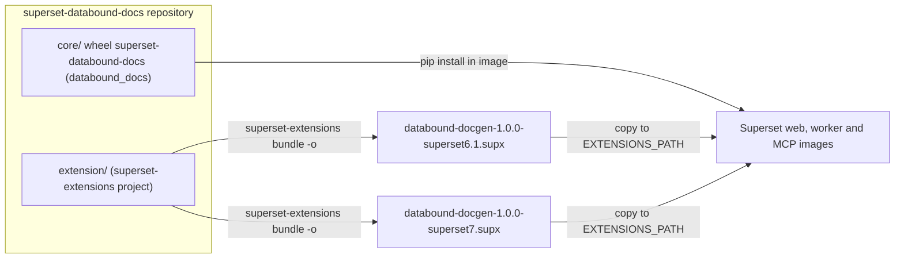
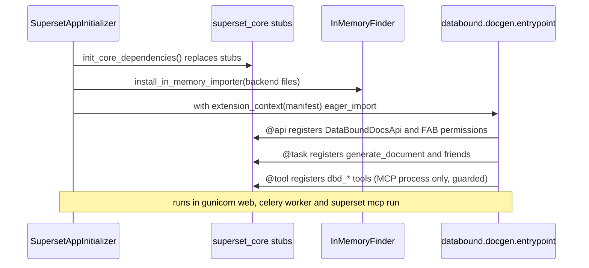
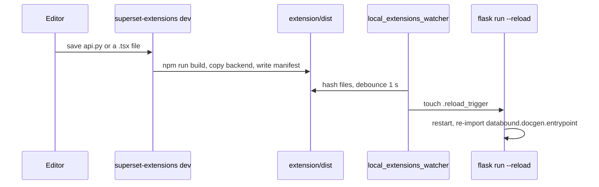

# Building the Superset extension

<div class="chapter-meta" markdown>
**Reads:** `superset-extensions-cli/src/superset_extensions_cli/cli.py`, `superset/core/api/core_api_injection.py`, `superset/tasks/decorators.py`, `superset/core/mcp/core_mcp_injection.py`, `superset-frontend/packages/superset-core/src/views/index.ts`  ·  **Builds on:** [Target architecture](32-architecture.md)  ·  **Time:** ~45 min
</div>

This chapter builds the **DBD Extension** (`databound.docgen`), the thin Superset wiring of Superset Data-Bound Documents, from an empty folder to a deployable `.supx` bundle. You will scaffold it with the real `superset-extensions` CLI, write the `extension.json`, the backend entrypoint, the `@api` REST class, the `@task` Global Task Framework (GTF) tasks and the `@tool` MCP tools, then the frontend contributions (SQL Lab panel, commands, menus, the master-only chat slot and the standalone Studio page). The chapter ends with the local development loop, bundling, deployment and testing. Every API that exists only on Superset master is flagged with the fallback that keeps the extension working on 6.1.0.

The generation runtime itself (the `databound_docs` library that the extension calls) is the subject of the next chapter, [Building the generation service](37-generation-service.md). Here we only build what must live inside a `.supx`.

!!! info "Interpretation this chapter implements"
    Data-Bound Documents is **one common, output-agnostic generation framework**. It turns a **prompt**, a **chosen template** and a **Superset data context** (a dashboard with its live filter state, saved charts, datasets with their saved metrics, or a SQL Lab query) into (a) PowerPoint decks, (b) documents (DOCX, PDF, Markdown), (c) text (narratives, summaries, emails, alert briefs) and (d) web pages (interactive HTML reports, and in v2 generated Superset dashboards). It runs **on demand** (button, chat, REST, MCP) or **on events** (cron schedules, alerts, data freshness, definition changes, webhooks). Every chart, table, KPI and number comes from a **live Superset query executed with the requesting user's permissions and RLS**, is rendered natively (editable PPTX charts with an embedded workbook, real tables, real text), is **never a screenshot**, and can be re-run to refresh with new data. The extension built here is the part of that framework that plugs into Superset's processes and UI. See [Vision and requirements](30-vision.md) for the full requirement list.

## Versions and availability tags

The chapter targets two Superset lines at once, exactly as the blueprint does:

| Tag | Meaning |
|---|---|
| **[6.1]** | Present in the 6.1.0 tag (May 2026, latest stable) and on master |
| **[M]** | Present only on master (`apache/superset` at `cabd8d4`, 2026-11-02). Expected in 7.0, but that mapping is not verified |
| **[M\*]** | Present in 6.1.0 but changed on master |

Published tooling used in this chapter (registry metadata, all released 2026-05-11):

| Package | Version | Role |
|---|---|---|
| `apache-superset-extensions-cli` (PyPI) | 0.1.0 | `superset-extensions init / validate / build / bundle / dev` |
| `apache-superset-core` (PyPI) | 0.1.0 | `superset_core` backend stubs that the host replaces at startup |
| `@apache-superset/core` (npm) | 0.1.0 | frontend type stubs and runtime namespaces |

Master's `superset-core` still declares `0.1.0` but already carries APIs that `UPDATING.md` describes as "available from 0.2.0" (`apache/superset: UPDATING.md:331-333`). Treat anything you do not find in the 0.1.0 packages as master only.



## Step 1: Decide what goes into the `.supx`

A `.supx` is a zip with `manifest.json`, `frontend/dist/<files>` and `backend/src/<files>`. Any other entry is rejected with "Unexpected file in bundle" (`apache/superset: superset/extensions/utils.py:43-48`, regexes `FRONTEND_REGEX` and `BACKEND_REGEX`; the check is in `get_loaded_extension`, `apache/superset: superset/extensions/utils.py:189-239`). Every `backend/src` entry is handed to the in-memory importer as Python source for a module whose name is the path with the file extension stripped (`InMemoryFinder._get_module_name`, `apache/superset: superset/extensions/utils.py:122-131`). The CLI copies only files matched by `[tool.apache_superset_extensions.build] include` and installs nothing (`apache/superset: superset-extensions-cli/src/superset_extensions_cli/cli.py:225-275`). So the split is fixed by the platform, and the blueprint's principle "thin `.supx`, fat wheel" follows from it:

| Lives in the `.supx` (`databound/docgen/...`) | Lives in the wheel `superset-databound-docs` (`databound_docs`) |
|---|---|
| `entrypoint.py`, `api.py`, `tasks.py`, `tools.py`, `triggers.py` | Document Spec models, Planner, Binding Registry, Binding Resolver core, Fact Engine |
| `superset_adapter.py` (the **Superset Adapter**, the only module that imports Superset internals) | Narrative Writer and Verifier, Renderers, DrawingML Chart Writer |
| Frontend: SQL Lab panel, chat panel, Studio page bundle, live page bundle | Template Registry and importers, LLM providers, storage backends, Alembic env |
| | `celery_routing.py`, the `superset dbd` CLI |

The wheel is preinstalled with `python-pptx==1.0.2`, `python-docx==1.2.0`, `httpx`, `vl-convert-python`, `jsonschema` and optionally `playwright` in every Superset image that loads the extension: web, Celery worker and MCP.

!!! warning "Gotcha: the bundle cannot carry dependencies or binary assets"
    `[project] dependencies` in the backend `pyproject.toml` and a `requirements.txt` next to it are never installed by anything. A `.supx` also cannot usefully carry a `.pptx` master in `backend/src`: the bundle regex accepts any file there, but the importer treats it as the source of a module named after the path, and there is no resource reader to get the bytes back. Built-in template masters therefore ship inside the wheel as package data, and admin-uploaded masters go to object storage through the Template Registry.

## Step 2: Scaffold with `superset-extensions init`

Install the CLI in a separate virtual environment (it does not need Superset) and scaffold non-interactively. The option names are the ones defined on `init` (`apache/superset: superset-extensions-cli/src/superset_extensions_cli/cli.py:792-823`):

```bash title="Scaffold the DBD Extension"
python -m venv .venv-ext && . .venv-ext/bin/activate
pip install "apache-superset-extensions-cli==0.1.0"

mkdir -p superset-databound-docs && cd superset-databound-docs
superset-extensions init \
  --publisher databound \
  --name docgen \
  --display-name "Data-Bound Documents" \
  --version 1.0.0 \
  --license Apache-2.0 \
  --frontend --backend
mv docgen extension
```

`init` creates `docgen/` with `extension.json`, `.gitignore`, `frontend/{package.json, webpack.config.js, tsconfig.json, src/index.tsx}` and `backend/{pyproject.toml, src/databound/docgen/entrypoint.py}`. Renaming the folder to `extension/` matches the repository layout of the blueprint; the CLI only cares about the current working directory when you run `build`, `bundle` or `dev`. It also sets the npm package name to `@databound/docgen` and the backend project name to `databound-docgen` (`generate_extension_names`, `apache/superset: superset-extensions-cli/src/superset_extensions_cli/utils.py:334-390`).

!!! warning "Gotcha: the published 0.1.0 CLI and master's CLI scaffold different webpack configs"
    Line references in this chapter are to the CLI source on master. The `init` options, the `bundle -o` option and the default bundle name are the same in the 6.1.0 tag, but the frontend template is not: the 6.1.0 template maps `@apache-superset/core` to `window.superset` with `externalsType: "window"` and shares only `react`, `react-dom` and `antd`, while master's template shares `@apache-superset/core` as a singleton instead. `pip install apache-superset-extensions-cli==0.1.0` was released with 6.1, so expect the 6.1 form; Step 10.2 replaces the generated file with one that builds both.

The names the CLI derives from `publisher` and `name`:

| Identifier | Value | How it is derived |
|---|---|---|
| Extension id | `databound.docgen` | `f"{publisher}.{name}"` (`apache/superset: superset-core/src/superset_core/extensions/types.py:38-84`) |
| Backend entrypoint | `databound.docgen.entrypoint` | `f"{publisher_snake}.{name_snake}.entrypoint"` (`apache/superset: superset-extensions-cli/src/superset_extensions_cli/cli.py:149-184`) |
| Module Federation name | `databound_docgen` | `f"{camel(publisher)}_{camel(name)}"` (`apache/superset: superset-extensions-cli/src/superset_extensions_cli/utils.py:318-331`) |
| REST base | `/extensions/databound/docgen/v1` | `/extensions/{publisher}/{name}` plus `/{resource_name}` (`apache/superset: superset/core/api/core_api_injection.py:189-207`) |
| GTF task types | `extensions.databound.docgen.<task>` | prefix added in extension context (`apache/superset: superset/tasks/decorators.py:147-160`) |
| MCP tool names | `extensions.databound.docgen.<tool>` | prefix added in extension context (`apache/superset: superset/core/mcp/core_mcp_injection.py:123-142`) |
| Frontend asset URL | `/api/v1/extensions/databound/docgen/<file>` | webpack `publicPath` in the template |

## Step 3: Write `extension.json`

```json title="extension/extension.json"
{
  "publisher": "databound",
  "name": "docgen",
  "displayName": "Data-Bound Documents",
  "version": "1.0.0",
  "license": "Apache-2.0",
  "description": "Prompt and template driven decks, documents, pages and briefs bound to live Superset data",
  "dependencies": [],
  "permissions": []
}
```

Validation rules come from `BaseExtension`: `publisher` and `name` match `^[a-z]([a-z0-9]*(-[a-z0-9]+)*)?$`, `displayName` matches `^[a-zA-Z][a-zA-Z0-9\s\-_\.]*$` (so the hyphen in "Data-Bound" is fine), and `version` matches `^\d+\.\d+\.\d+$`. `superset-extensions validate` checks these, the npm version (at least `10.8.2`), the presence of an `include` list in `backend/pyproject.toml`, and the conventional entry files `backend/src/databound/docgen/entrypoint.py` and `frontend/src/index.tsx` (`apache/superset: superset-extensions-cli/src/superset_extensions_cli/cli.py:314-441`). Master's CLI additionally fails when the `version` or `license` in `frontend/package.json` or `backend/pyproject.toml` differs from `extension.json`; the 6.1.0 CLI does not compare them. Keep all three at `1.0.0` and `Apache-2.0` so both pass.

!!! warning "Gotcha: `permissions`, `dependencies` and `description` do nothing at runtime"
    No host code enforces `permissions` or `dependencies` on master (`dependencies` is only echoed by `GET /api/v1/extensions/`). Authorization comes from FAB permissions on the API class and on the MCP tools (Step 6 and Step 8). `build_manifest` also does not copy `description` or `license` into `dist/manifest.json`, so `GET /api/v1/extensions/` reports an empty description for this extension. Keep `"permissions": []` so nobody mistakes it for an enforcement point.

## Step 4: Lay out the project tree

After the scaffold and the files written in this chapter, `extension/` looks like this:

```text title="extension/ (DBD Extension project)"
extension/
├── extension.json
├── frontend/
│   ├── package.json
│   ├── tsconfig.json
│   ├── webpack.config.js          # Module Federation remote (two variants, Step 10)
│   ├── webpack.page.config.js     # standalone Studio and live page bundles
│   └── src/
│       ├── index.tsx              # the only module Superset loads
│       ├── compat.ts              # 6.1 vs master detection
│       ├── studio/
│       │   ├── api.ts             # fetch wrapper, CSRF, app root
│       │   ├── context.ts         # Context Capture helpers (URL parsing)
│       │   ├── state.ts           # last SQL Lab result, openStudio()
│       │   ├── chat.tsx           # DocumentsTrigger, DocumentsChatPanel (master)
│       │   ├── SqlLabDocumentsPanel.tsx
│       │   └── components/        # TemplatePicker, PromptBox, EventFeed, Preview
│       ├── page/main.tsx          # dbd-page bundle (own React and ECharts)
│       └── studio-page/
│           ├── main.tsx           # dbd-studio bundle (own React)
│           └── core-shim.ts       # stands in for @apache-superset/core (Step 10.4)
└── backend/
    ├── pyproject.toml
    ├── tests/                     # pytest, run against a dev Superset
    └── src/databound/docgen/
        ├── entrypoint.py
        ├── api.py
        ├── tasks.py
        ├── tools.py
        ├── triggers.py
        ├── superset_adapter.py
        └── _bundles.py            # generated at build time (Step 10.4)
```

```toml title="extension/backend/pyproject.toml"
[project]
name = "databound-docgen"
version = "1.0.0"
license = "Apache-2.0"

[tool.apache_superset_extensions.build]
include = ["src/databound/docgen/**/*.py"]
exclude = ["src/databound/docgen/**/test_*.py"]
```

`copy_backend_files` keeps the matched path relative to `backend/`, so `backend/src/databound/docgen/api.py` lands at `dist/backend/src/databound/docgen/api.py`, which is exactly what `BACKEND_REGEX` (`^backend/src/(?!.*\.\.)(.+)$`) accepts. Master's CLI rejects absolute patterns, `..` components and symlinks that resolve outside `backend/` (these guards were not checked in the 0.1.0 release). Exclude patterns are tested with `PurePath.match`, which does not treat `**` as recursive, so the `exclude` line is only a safety net: tests live in `backend/tests/`, outside `include`.

## Step 5: Write the backend entrypoint

The host imports the entrypoint once per process, inside `extension_context(manifest)` (`apache/superset: superset/initialization/__init__.py:683-686`), after it has replaced every `superset_core` stub with the host implementation (`apache/superset: superset/core/api/core_api_injection.py:318-333`). Registration happens as an import side effect: there is no `activate()` hook.

```python title="extension/backend/src/databound/docgen/entrypoint.py"
"""Imported once per process by the host inside extension_context(manifest)."""
import logging

logger = logging.getLogger(__name__)

# Capture the id now: superset_core.extensions.context.get_context() is master only
# and appears to be valid only during this import.
EXTENSION_ID = "databound.docgen"

# These modules use superset_core decorators at import time, after host injection.
from databound.docgen import api       # noqa: E402,F401  registers DataBoundDocsApi
from databound.docgen import tasks     # noqa: E402,F401  registers GTF tasks and the beat task
from databound.docgen import triggers  # noqa: E402,F401  registers SQLAlchemy listeners

try:  # @tool raises NotImplementedError when fastmcp is not installed
    from databound.docgen import tools  # noqa: F401
except (ImportError, NotImplementedError):
    logger.info("Data-Bound Documents MCP tools not registered in this process")
```

The same entrypoint runs in three kinds of process, because Celery workers and the MCP server also build the app with `create_app()` (`apache/superset: superset/tasks/celery_app.py:29-33`, `apache/superset: superset/mcp_service/flask_singleton.py:75-90`):



!!! warning "Gotcha: never import `superset_core` decorators from `superset_config.py`"
    Injection works by assigning module attributes. A library that does `from superset_core.rest_api.decorators import api` before the host has run `init_core_dependencies()` binds the stub, which raises `NotImplementedError`. This is why `databound_docs` (the wheel) must not import Superset or `superset_core` decorators at module top level, and why `superset_config.py` imports only `databound_docs.celery_routing`, which imports nothing from Superset.

!!! warning "Gotcha: one failing import disables the whole extension in that process"
    The host logs and counts a failed entrypoint import and keeps starting (`apache/superset: superset/initialization/__init__.py:657-701`). Registration is an import side effect, so whatever was registered before the exception stays registered and everything after it is silently missing: a typo in `tasks.py` leaves the REST API up but registers no GTF task and no MCP tool, so `POST /documents` schedules work that no worker can run. The `try` around `tools` is mandatory, and `superset dbd doctor` (Step 13) checks the URL map, the `TaskRegistry` entries and, where `fastmcp` is installed, the MCP tool list, so a half-loaded extension is visible.

## Step 6: Build the REST API with `@api`

### 6.1 The class and its permissions

`superset_core.rest_api.decorators.api(id, name, description=None, resource_name=None)` registers the class at once with `appbuilder.add_api(api_class)` and `appbuilder._add_permission(view, True)` (`apache/superset: superset/core/api/core_api_injection.py:179-227`). With `resource_name="v1"` the base path becomes `/extensions/databound/docgen/v1` and the API id becomes `extensions.databound.docgen.dbd_api`.

```python title="extension/backend/src/databound/docgen/api.py (class header)"
from __future__ import annotations

from flask import Response, g, request
from flask_appbuilder.api import expose, permission_name, protect, safe
from superset_core.rest_api.api import RestApi
from superset_core.rest_api.decorators import api
from superset_core.tasks.types import TaskOptions

from databound_docs.db import repo
from databound_docs.spec.requests import CreateDocumentRequest
from databound.docgen import superset_adapter as sa
from databound.docgen.tasks import generate_document


@api(id="dbd_api", name="Data-Bound Documents API", resource_name="v1",
     description="Generate data-bound decks, documents, pages and briefs")
class DataBoundDocsApi(RestApi):
    openapi_spec_tag = "Data-Bound Documents"
    class_permission_name = "DataBoundDocs"
    csrf_exempt = False   # FAB BaseApi defaults to exempt; see the Gotcha below
    method_permission_name = {
        "capabilities": "read", "list_templates": "read", "get_template": "read",
        "create_template": "manage_templates", "digest": "generate",
        "create_document": "generate", "list_documents": "read", "get_document": "read",
        "patch_document": "write", "messages": "write", "regenerate": "generate",
        "refresh": "refresh", "refresh_upload": "refresh", "export": "read",
        "render_model": "read", "shares": "write", "binding_preview": "generate",
        "download": "read", "get_job": "read", "events": "read", "stream": "read",
        "cancel": "write", "page": "read", "studio": "read", "triggers": "schedule",
        "spec_schema": "read",
    }
```

FAB turns `class_permission_name` plus each method permission into `can_<method> on DataBoundDocs`, which yields exactly the canonical set: `can_read`, `can_generate`, `can_write`, `can_refresh`, `can_schedule`, `can_manage_templates`, plus `can_share_snapshot` and `can_admin`, which the handlers check explicitly with `security_manager.can_access("can_share_snapshot", "DataBoundDocs")` (`apache/superset: superset/security/manager.py:2530`) because no route maps to them one to one. FAB creates permission rows only for the method permissions of exposed routes, so those two do not exist until something creates them: `superset dbd db-upgrade` calls `security_manager.add_permission_view_menu("can_share_snapshot", "DataBoundDocs")` and the same for `can_admin` (FAB's method, not verified against the FAB version Superset pins).

| Role | Suggested grants on `DataBoundDocs` |
|---|---|
| Gamma | `can_read`, `can_generate`, `can_write`, `can_refresh` |
| Alpha | Gamma plus `can_schedule` |
| Admin | all eight |

!!! warning "Gotcha: extension APIs are CSRF exempt by inheritance"
    `RestApi` subclasses FAB's `BaseApi` directly, not Superset's `BaseSupersetApiMixin`, which is where `csrf_exempt = False` is set (`apache/superset: superset/views/base_api.py:341`). FAB's `BaseApi` declares `csrf_exempt = True`. Master's `UPDATING.md` documents the same inheritance problem for the extension storage routes (`apache/superset: UPDATING.md:109-123`). Set `csrf_exempt = False` on the class, and send `X-CSRFToken` from the frontend (Step 11). The same `UPDATING.md` entry spells out the cost for non-browser clients: a script that authenticates with a JWT or an API key must first call `GET /api/v1/security/csrf_token/`, then send the token in `X-CSRFToken` together with the session cookie from that call, plus a same-origin `Referer` over HTTPS. Document this for REST callers of `POST /documents`, or offer them the MCP tools instead.

### 6.2 Endpoint skeletons

All routes from the canonical list are methods of this one class. The request and response bodies are specified in [Building the generation service](37-generation-service.md); here is the shape of the handlers, which stay thin and delegate to `databound_docs`.

```python title="extension/backend/src/databound/docgen/api.py (selected endpoints)"
    @expose("/capabilities", methods=("GET",))
    @protect()
    @safe
    @permission_name("read")
    def capabilities(self) -> Response:
        from databound_docs.capabilities import detect
        return self.response(200, result=detect(adapter=sa))

    @expose("/documents", methods=("POST",))
    @protect()
    @safe
    @permission_name("generate")
    def create_document(self) -> Response:
        body = CreateDocumentRequest.model_validate(request.get_json(force=True))
        ctx = sa.capture_context(body.context, user=g.user)   # access checks, permalink
        template = repo.templates.get_for_user(body.template.id, body.template.version, g.user.id)
        if body.kind == "text" and body.options.sync:
            from databound_docs.runtime.sync_text import run_sync_text
            done = run_sync_text(body, ctx, template, user_id=g.user.id, budget_s=20)
            if done is not None:
                return self.response(200, result=done)
        doc, job = repo.documents.create_pending(body, ctx, template, owner_id=g.user.id)
        task = generate_document.schedule(
            job_id=job.id, user_id=g.user.id,
            options=TaskOptions(task_key=job.task_key, task_name=f"DBD: {doc.title[:60]}"),
        )
        if (existing := repo.jobs.find_by_task(str(task.uuid))) is not None:
            # GTF joined an active task with the same task_key: drop our new rows.
            repo.documents.discard_pending(doc.id, job.id)
            doc, job = existing.document, existing
        else:
            repo.jobs.attach_task(job.id, str(task.uuid))
            repo.events.append(job.id, "job.accepted",
                               {"document_id": doc.id, "task_uuid": str(task.uuid)})
        return self.response(202, result={"document_id": doc.id, "job_id": job.id,
                                          "task_uuid": str(task.uuid),
                                          "events_url": f"jobs/{job.id}/events"})

    @expose("/jobs/<job_id>/events", methods=("GET",))
    @protect()
    @safe
    @permission_name("read")
    def events(self, job_id: str) -> Response:
        job = repo.jobs.get_for_owner(job_id, g.user.id)      # 404 unless owner
        after = request.args.get("after", 0, type=int)
        wait = min(request.args.get("wait", 0, type=int), 25)
        events = repo.events.wait_since(job.id, after, timeout_s=wait, poll_s=0.5)
        return self.response(200, result={"events": [e.to_dict() for e in events],
                                          "done": repo.jobs.is_terminal(job.id)})

    @expose("/jobs/<job_id>/cancel", methods=("POST",))
    @protect()
    @safe
    @permission_name("write")
    def cancel(self, job_id: str) -> Response:
        job = repo.jobs.get_for_owner(job_id, g.user.id)
        sa.cancel_gtf_task(job.task_uuid)        # same semantics as POST /api/v1/task/<uuid>/cancel
        return self.response(200, result={"status": "cancelling"})

    @expose("/studio", methods=("GET",))
    @protect()
    @safe
    @permission_name("read")
    def studio(self) -> Response:
        from databound.docgen._bundles import STUDIO_JS   # hashed name, generated at build
        from databound_docs.web.shells import studio_shell
        return Response(studio_shell(STUDIO_JS, query=request.args), mimetype="text/html")

    @expose("/hooks/<token>", methods=("POST",))
    @safe
    def hook(self, token: str) -> Response:
        # Deliberately not @protect(): authenticated by an unguessable token.
        from databound_docs.triggers.hooks import accept_hook
        return self.response(202 if accept_hook(token, request) else 404)
```

The `task_key` stored on the job is `sha256(user_id, template_id@version, canonical(context), prompt, parameters)`. GTF deduplicates by it: `.schedule()` returns the already active task instead of enqueuing a second one. Because `create_pending` has already written a new document and job row by then, the handler checks whether that task UUID belongs to an earlier job and, if so, discards its own rows and returns the earlier ids, so a double click lands on one job.

!!! warning "Gotcha: schedule outside any open transaction (master)"
    On master, `SubmitTaskCommand` raises `RuntimeError` when it runs while `g.in_transaction` is set, because it must commit before releasing its dedup lock (`apache/superset: superset/commands/tasks/submit.py:93-113`). Never wrap a DBD handler in Superset's `@transaction` decorator, and let `create_pending` commit its own rows before `generate_document.schedule(...)`. Whether 6.1.0 has the same guard was not checked.

!!! warning "Gotcha: a `Response` from an HTML route still needs `@protect()`"
    `/studio` and `/pages/<document_id>` return HTML, but they must stay behind `@protect()` with `allow_browser_login = True` (inherited from `RestApi`) so the session cookie authenticates them. Only `/hooks/<token>` skips `@protect()`. Skipping `@protect()` does not skip CSRF: with `csrf_exempt = False` the whole blueprint is checked by Flask-WTF's `CSRFProtect`, so a webhook POST from Alerts and Reports, which carries no token, is rejected. Add the view to `WTF_CSRF_EXEMPT_LIST` (`apache/superset: superset/config.py:390`), which Superset passes to `csrf.exempt(...)` at startup (`apache/superset: superset/initialization/__init__.py:1793-1797`). Entries follow the built-in form `superset.charts.data.api.data`, that is `<view module>.<function name>`, so the DBD entry is `"databound.docgen.api.hook"`. Confirm it on a running instance (prototype gate G10).

## Step 7: Write the GTF tasks with `@task`

### 7.1 Declaring tasks

`superset_core.tasks.decorators.task(name=None, scope=TaskScope.PRIVATE, timeout=None, subscription_policy=None)` [6.1, `subscription_policy` M] returns a `TaskWrapper` with `__call__` (synchronous) and `.schedule(...)` (enqueue). The host rejects task functions with parameters named `ctx` or `options` (`apache/superset: superset/tasks/decorators.py:165-173`).

```python title="extension/backend/src/databound/docgen/tasks.py (task declarations)"
from __future__ import annotations
import logging

from superset_core.tasks.decorators import get_context, task
from superset_core.tasks.types import TaskScope

from databound_docs.db import repo
from databound_docs.planner.pipeline import CancelToken, Pipeline
from databound.docgen import superset_adapter as sa

logger = logging.getLogger(__name__)
STAGES = ["digest", "outline", "layout", "register", "resolve", "write", "verify", "render"]


@task(name="generate_document", scope=TaskScope.PRIVATE, timeout=900)   # keywords only
def generate_document(job_id: str, user_id: int) -> None:
    ctx = get_context()
    cancel = CancelToken()

    @ctx.on_abort
    def _abort() -> None:
        cancel.set()

    with sa.as_user(user_id=user_id):            # override_user(user, force=False)
        job = repo.jobs.start(job_id)
        last_payload: dict = {"document_id": job.document_id}

        def progress(stage: str, event: str | None = None, data: dict | None = None) -> None:
            last_payload["stage"] = stage
            # Send the whole payload every time: 6.1 replaces it, master merges it.
            ctx.update_task(progress=(STAGES.index(stage) + 1, len(STAGES)),
                            payload=dict(last_payload))
            if event:
                repo.events.append(job_id, event, data or {})

        try:
            Pipeline(adapter=sa, progress=progress, cancel=cancel).run(job)
            repo.events.append(job_id, "job.completed", {"status": "success"})
        except Exception as ex:  # noqa: BLE001
            logger.exception("DBD job %s failed", job_id)
            repo.events.append(job_id, "job.failed",
                               {"error": str(ex)[:500], "error_type": type(ex).__name__})
            raise


@task(name="continue_generation", scope=TaskScope.PRIVATE, timeout=900)
def continue_generation(job_id: str, user_id: int) -> None: ...

@task(name="regenerate_sections", scope=TaskScope.PRIVATE, timeout=600)
def regenerate_sections(job_id: str, user_id: int, section_ids: list[str]) -> None: ...

@task(name="refresh_document", scope=TaskScope.PRIVATE, timeout=600)
def refresh_document(document_id: str, user_id: int, narrative: str = "regenerate_on_drift",
                     mode: str = "in_place", force: bool = False) -> None: ...

@task(name="render_artifact", scope=TaskScope.PRIVATE, timeout=300)
def render_artifact(document_id: str, version: int, fmt: str, user_id: int) -> None: ...

@task(name="run_trigger", scope=TaskScope.SYSTEM, timeout=900)
def run_trigger(trigger_id: str, scheduled_for: str, event: dict | None = None) -> None: ...
```

| Task (final type `extensions.databound.docgen.*`) | Scope | Timeout | Availability |
|---|---|---|---|
| `generate_document`, `continue_generation` | PRIVATE | 900 s | [6.1] |
| `regenerate_sections`, `refresh_document` | PRIVATE | 600 s | [6.1] |
| `render_artifact` | PRIVATE | 300 s | [6.1] |
| `run_trigger` | SYSTEM | 900 s | [6.1] |
| `resolve_binding` | PRIVATE | 120 s | [M] (needs `TaskOptions(depends_on=...)`) |

!!! warning "Gotcha: always pass keywords to `@task`"
    The stub's first positional parameter is `name`, but the host implementation's first positional parameter is `func` (`apache/superset: superset/tasks/decorators.py:57-79`). `@task("generate_document")` passes a string where the host expects the function. Even the stub's own docstring example uses the positional form, so do not copy it.

!!! warning "Gotcha: GTF does not switch the executing user"
    `TaskContext.__init__` stores the task and does not set `g.user` (`apache/superset: superset/tasks/context.py:60-125`). Without `sa.as_user(user_id=...)`, DAO base filters, `raise_for_access` and RLS run without the requester. Superset's own `execute_chart_query` GTF task [M] uses the same pattern: `with override_user(_resolve_user(user_id, guest_token), force=False):` (`apache/superset: superset/tasks/async_queries.py:273-297`). `user_id` is a plain task argument; task arguments travel through Celery, so keep them small and JSON-serializable.

### 7.2 What differs between 6.1 and master

| Capability | 6.1 | Master | What the extension does on 6.1 |
|---|---|---|---|
| `update_task(progress, payload)` | yes, payload replaced per call | payload merged, `immediate=` keyword, 2 s throttle | always send the full payload, never pass `immediate` |
| `on_abort`, `on_cleanup` | yes | yes | same code |
| `TaskOptions(task_key, task_name, timeout)` | yes | adds `depends_on` | sequential binding resolution inside `generate_document` |
| `get_dependency_payloads()` | no | yes | not used |
| `GET /api/v1/task/<uuid>/status` | yes | yes | Studio can fall back to it if DBD events are unavailable |
| `GET /api/v1/task/status_changes` | no | yes | not used |
| Heartbeats, orphan reaping | no | yes | rely on `timeout` |

The extension detects the master features once, in `compat`:

```python title="databound_docs/compat/gtf.py"
import dataclasses

def supports_depends_on() -> bool:
    from superset_core.tasks.types import TaskOptions
    return "depends_on" in {f.name for f in dataclasses.fields(TaskOptions)}
```

### 7.3 Route DBD tasks to their own queue, and add the beat tick

GTF enqueues every task through one Celery task, `tasks.execute`, with `execute_task.delay(task_uuid=..., task_type=..., args=..., kwargs=...)` (`apache/superset: superset/tasks/manager.py:580-584`). A Celery router function can therefore route on the `task_type` keyword without changing Superset. The router lives in the wheel (it must import nothing from Superset) and is referenced from `CELERY_CONFIG.task_routes`; its full source is in [Building the generation service](37-generation-service.md#step-12-configure-the-runtime). Prototype gate G8 confirms the behavior on 6.1.

GTF has no cron (`apache/superset: superset-core/src/superset_core/tasks/types.py:143-150`), so the extension also defines one plain Celery task that the admin adds to `beat_schedule`:

```python title="extension/backend/src/databound/docgen/tasks.py (beat tick)"
from superset.extensions import celery_app      # apache/superset: superset/extensions/__init__.py:149
from superset_core.tasks.types import TaskOptions


@celery_app.task(name="databound_docs.trigger_tick", ignore_result=True)
def trigger_tick() -> None:
    from databound_docs.triggers.tick import due_cron_triggers
    for trig, scheduled_for in due_cron_triggers():          # uses cron_schedule_window
        run_trigger.schedule(
            trigger_id=trig.id, scheduled_for=scheduled_for.isoformat(), event=None,
            options=TaskOptions(task_key=f"{trig.id}:{scheduled_for.isoformat()}",
                                task_name=f"DBD trigger {trig.id}"))
```

`superset.extensions.celery_app` is an internal import, which is acceptable in the extension package (not in the wheel). The `task_key` makes a doubled tick harmless.

!!! warning "Gotcha: the beat task must be importable in the beat process"
    Celery beat only needs the task name, but the worker that consumes `databound_docs.trigger_tick` must have imported `tasks.py`. That happens only when `ENABLE_EXTENSIONS` is on in the worker's config. A worker without the flag drops the message as an unregistered task.

## Step 8: Expose MCP tools and prompts with `@tool` and `@prompt`

`superset_core.mcp.decorators.tool(func_or_name=None, *, name=None, description=None, tags=None, protect=True, class_permission_name=None, method_permission_name=None, annotations=None)` [6.1] and `prompt(func_or_name=None, *, name=None, title=None, description=None, tags=None, protect=True)` [6.1] register into the singleton FastMCP server (`apache/superset: superset/core/mcp/core_mcp_injection.py:145-271`). With `protect=True` the function is wrapped by `mcp_auth_hook`, which resolves the Superset user and sets `g.user`. With `class_permission_name` set, MCP RBAC checks `can_<method> on DataBoundDocs`; the method defaults to `write` when `mutate` is in the tags, else `read`.

```python title="extension/backend/src/databound/docgen/tools.py (excerpt)"
from __future__ import annotations
from typing import Any

from flask import current_app, g
from superset_core.mcp.decorators import prompt, tool

from databound_docs.binder.registry import BindingRegistry
from databound_docs.spec.models import DataBinding
from databound_docs.spec.requests import CreateDocumentRequest

PERM = "DataBoundDocs"


def _refuse_dev_user() -> None:
    """On 6.1 every MCP call runs as MCP_DEV_USERNAME unless middleware sets g.user."""
    dev = current_app.config.get("MCP_DEV_USERNAME")
    allow = current_app.config.get("DATABOUND_DOCS", {}).get("MCP_ALLOW_DEV_USER", False)
    if dev and getattr(g.user, "username", None) == dev and not allow:
        raise PermissionError("Data-Bound Documents refuses data tools for the MCP dev user")


@tool(name="dbd_list_templates", tags=["discovery"],
      class_permission_name=PERM, method_permission_name="read")
def dbd_list_templates(kind: str | None = None) -> dict[str, Any]:
    """List Data-Bound Documents templates with a summary of their data slots."""
    from databound_docs.templates.registry import list_for_user
    return {"templates": list_for_user(g.user.id, kind=kind, summary=True)}


@tool(name="dbd_propose_binding", tags=["data"],
      class_permission_name=PERM, method_permission_name="generate")
def dbd_propose_binding(binding: dict[str, Any], job_id: str | None = None) -> dict[str, Any]:
    """Register a binding through the Binding Registry and return a preview (max 10 rows)."""
    _refuse_dev_user()
    draft = DataBinding.model_validate(binding)
    if draft.source.kind == "sql":
        return {"status": "rejected", "reason": "sql_sources_not_allowed"}
    return BindingRegistry.for_job(job_id).register(draft, preview_rows=10).to_tool_result()


@tool(name="dbd_generate_document", tags=["mutate"],
      class_permission_name=PERM, method_permission_name="generate")
def dbd_generate_document(request: dict[str, Any]) -> dict[str, Any]:
    """Start a generation job exactly like POST /documents."""
    _refuse_dev_user()
    from databound_docs.runtime.start import start_generation
    body = CreateDocumentRequest.model_validate(request)
    return start_generation(body, user=g.user, trigger="mcp")


@prompt(name="dbd_deck_from_dashboard",
        description="Steps to build a data-bound deck from a dashboard")
def dbd_deck_from_dashboard(dashboard: str, template: str, audience: str) -> str:
    return (f"1. Call get_dashboard_info for {dashboard}.\n"
            f"2. Call extensions.databound.docgen.dbd_get_template_slots for {template}.\n"
            "3. Propose bindings only with extensions.databound.docgen.dbd_propose_binding.\n"
            f"4. Call extensions.databound.docgen.dbd_generate_document for audience {audience}.")
```

The full tool list (`dbd_list_templates`, `dbd_get_template_slots`, `dbd_propose_binding`, `dbd_derive_fact`, `dbd_validate_plan`, `dbd_generate_document`, `dbd_get_job`, `dbd_refresh_document`, `dbd_brief`) and prompts (`dbd_deck_from_dashboard`, `dbd_weekly_kpi_brief`, `dbd_alert_brief`) follow the same pattern. Responses carry ids, statuses, display strings and at most 10 preview rows, which keeps them under master's 50 KB response cap (`apache/superset: superset/mcp_service/mcp_config.py:499-512`) and 6.1's 25,000-token estimate.

| MCP identity | 6.1 | Master |
|---|---|---|
| How the user is resolved | `g.user` from external middleware, else `MCP_DEV_USERNAME` | JWT via `MCP_USER_RESOLVER`, FAB API key, dev user, `g.user` (`apache/superset: superset/mcp_service/auth.py:889-950`) |
| DBD behavior | discovery tools work; data and mutate tools refuse the dev user | all tools; the `agent` planner may use them |

!!! warning "Gotcha: a missing `fastmcp` breaks import, not just MCP"
    When `fastmcp` is absent, `initialize_core_mcp_dependencies` returns early without replacing the stubs (`apache/superset: superset/core/mcp/core_mcp_injection.py:384-391`), so the first `@tool` raises `NotImplementedError` at import. The guarded import in `entrypoint.py` contains that failure. A registration error inside a working FastMCP is logged and re-raised (fail fast), which the same guard also contains.

!!! warning "Gotcha: never call MCP tool functions from a worker"
    Calling a decorated tool in-process from a Celery task goes through `mcp_auth_hook` without a request context: `_setup_user_context` pops `g.user` (`apache/superset: superset/mcp_service/auth.py:1107-1121`), and `MCP_DEV_USERNAME` outranks `g.user` in resolution. Worker code calls `databound_docs` functions directly; the `agent` planner [M] reaches MCP over HTTP with a short-lived per-user JWT.

## Step 9: Write the Superset Adapter

The **Superset Adapter** is the only module that imports non-public Superset code. It sniffs capabilities at import time and gives `databound_docs` a stable interface. Its full contract (resolution, filters, provenance) is built in [Building the generation service](37-generation-service.md#step-8-implement-the-binding-registry-and-resolver); here is the part that matters for wiring.

```python title="extension/backend/src/databound/docgen/superset_adapter.py (wiring excerpt)"
"""The only module that imports Superset internals. Version-sniffed at import."""
from __future__ import annotations
import contextlib
import importlib.util
from typing import Any, Iterator

from flask import g

HAS_FILTER_CONTEXT = importlib.util.find_spec(
    "superset.charts.data.dashboard_filter_context") is not None    # [M]
HAS_FORM_DATA_REBUILD = importlib.util.find_spec(
    "superset.common.form_data_query_context") is not None          # [M]


@contextlib.contextmanager
def as_user(*, user_id: int | None = None, guest_token: dict | None = None,
            force: bool = False) -> Iterator[Any]:
    """Mirror _resolve_user (apache/superset: superset/tasks/async_queries.py:165-175)."""
    from superset.extensions import security_manager
    from superset.utils.core import override_user
    if user_id:
        user = security_manager.get_user_by_id(user_id)
        if user is None or not user.is_active:
            raise PermissionError("Requesting user no longer exists or is inactive")
    elif guest_token:   # parsed GuestToken, never the raw header string; [M], 6.1 unverified
        user = security_manager.get_guest_user_from_token(guest_token)
    else:
        raise PermissionError("No identity for data access")
    with override_user(user, force=force):
        yield user


def run_query_context(json_body: dict[str, Any]) -> dict[str, Any]:
    from superset.charts.schemas import ChartDataQueryContextSchema
    from superset.commands.chart.data.get_data_command import ChartDataCommand
    g.form_data = json_body                    # Jinja macros read it (excel_export/workbook.py:226)
    qc = ChartDataQueryContextSchema().load(json_body)
    command = ChartDataCommand(qc)
    command.validate()                         # raise_for_access before execution
    return command.run()


def cancel_gtf_task(task_uuid: str) -> None:
    from uuid import UUID
    from superset.commands.tasks.cancel import CancelTaskCommand  # internal
    CancelTaskCommand(UUID(task_uuid)).run()     # runs as g.user: the job owner
```

!!! warning "Gotcha: the cancel command is internal"
    The REST route `POST /api/v1/task/<uuid>/cancel` [6.1] is public, but the command behind it, `CancelTaskCommand(task_uuid: UUID, force=False, tab_id=None)` (class at `apache/superset: superset/commands/tasks/cancel.py:51`, `__init__` at line 69), is internal and was read on master only; its 6.1.0 signature is not verified here. The adapter wraps it in one function, and the contract tests (Step 14) fail loudly if the import or signature moves. The equivalent fallback is to call the GTF REST route from the browser with the user's session.

The import-linter contract in the wheel forbids `superset.utils.webdriver`, `superset.utils.screenshots`, `superset.utils.screenshot_utils` and `superset.utils.pdf`. Add the same contract for the extension package so the adapter can never grow a screenshot path:

```toml title="pyproject.toml (repository root, import-linter)"
[tool.importlinter]
root_packages = ["databound_docs", "databound"]

[[tool.importlinter.contracts]]
name = "No screenshot code paths"
type = "forbidden"
source_modules = ["databound_docs", "databound.docgen"]
forbidden_modules = ["superset.utils.webdriver", "superset.utils.screenshots",
                     "superset.utils.screenshot_utils", "superset.utils.pdf"]
```

## Step 10: Configure the frontend build

### 10.1 `package.json`

```json title="extension/frontend/package.json"
{
  "name": "@databound/docgen",
  "version": "1.0.0",
  "private": true,
  "license": "Apache-2.0",
  "scripts": {
    "build": "webpack --stats-error-details --mode production --config webpack.config.js && webpack --mode production --config webpack.page.config.js",
    "build:61": "SUPERSET_TARGET=6.1 npm run build",
    "start": "webpack serve --mode development",
    "test": "jest"
  },
  "peerDependencies": {
    "@apache-superset/core": "*",
    "react": "^18.3.0",
    "react-dom": "^18.3.0"
  },
  "dependencies": {
    "echarts": "^5.6.0"
  },
  "devDependencies": {
    "@apache-superset/core": "^0.1.0",
    "@types/react": "^18.3.0",
    "@types/react-dom": "^18.3.0",
    "jest": "^29.7.0",
    "ts-loader": "^9.5.2",
    "typescript": "^5.8.2",
    "webpack": "^5.98.0",
    "webpack-cli": "^6.0.1",
    "webpack-dev-server": "^5.2.0"
  }
}
```

The peer dependencies and the webpack, TypeScript and React type lines come from the CLI template (`superset-extensions-cli/src/superset_extensions_cli/templates/frontend/package.json.j2` in `apache/superset`); the template's two Babel presets are dropped because `ts-loader` does the compiling, and `jest` is added. `echarts` is a real dependency only of the standalone page bundle (Step 10.4); the federated remote never imports it. 6.1.0 ships `"echarts": "^5.6.0"` and master `"^6.1.0"` (`apache/superset: superset-frontend/package.json:167`); pin the line of the host you target so live pages look like the dashboards.

The scaffolded `tsconfig.json` sets `"target": "es5"` with no `lib`. That default library has no `Promise` and no async iterators, so `api.ts` below (an `async function*` consumed with `for await`) does not compile against it. Raise the target:

```json title="extension/frontend/tsconfig.json"
{
  "compilerOptions": {
    "target": "es2020",
    "lib": ["dom", "es2020"],
    "module": "esnext",
    "moduleResolution": "node10",
    "jsx": "react",
    "strict": true,
    "esModuleInterop": true,
    "skipLibCheck": true,
    "forceConsistentCasingInFileNames": true
  },
  "include": ["src"]
}
```

### 10.2 The federated remote: two variants from one config

The CLI template on master declares `@apache-superset/core` as a shared singleton with `import: false`, and the loader injects a per-extension instance into the share scope (`apache/superset: superset-frontend/src/extensions/ExtensionsLoader.ts:204-220`). The 6.1.0 CLI template and the 6.1.0 versioned docs (`quick-start.md`) instead map it to `window.superset` with `externalsType: 'window'`. One config can produce both. `DefinePlugin` writes the target into the bundle, because webpack 5 does not provide `process.env` to browser code:

```javascript title="extension/frontend/webpack.config.js"
const path = require('path');
const webpack = require('webpack');
const { ModuleFederationPlugin } = webpack.container;
const packageConfig = require('./package');
const extensionConfig = require('../extension.json');

const TARGET_61 = process.env.SUPERSET_TARGET === '6.1';

module.exports = (env, argv) => {
  const isProd = argv.mode === 'production';
  const shared = {
    react: { singleton: true, requiredVersion: packageConfig.peerDependencies.react, import: false },
    'react-dom': { singleton: true, requiredVersion: packageConfig.peerDependencies['react-dom'], import: false },
    antd: { singleton: true, import: false },
  };
  if (!TARGET_61) {
    shared['@apache-superset/core'] = { singleton: true, import: false };  // [M] share scope
  }
  return {
    entry: isProd ? {} : './src/index.tsx',
    mode: isProd ? 'production' : 'development',
    devServer: { port: 3000, headers: { 'Access-Control-Allow-Origin': '*' } },
    output: {
      clean: true,                                  // only this config cleans dist/
      filename: isProd ? undefined : '[name].[contenthash].js',
      chunkFilename: '[name].[contenthash].js',
      path: path.resolve(__dirname, 'dist'),
      publicPath: `/api/v1/extensions/${extensionConfig.publisher}/${extensionConfig.name}/`,
    },
    resolve: { extensions: ['.ts', '.tsx', '.js', '.jsx'] },
    ...(TARGET_61
      ? { externalsType: 'window', externals: { '@apache-superset/core': 'superset' } }  // [6.1]
      : {}),
    module: { rules: [{ test: /\.tsx?$/, use: 'ts-loader', exclude: /node_modules/ }] },
    plugins: [
      new webpack.DefinePlugin({
        'process.env.SUPERSET_TARGET': JSON.stringify(TARGET_61 ? '6.1' : 'master'),
      }),
      new ModuleFederationPlugin({
        name: 'databound_docgen',
        filename: 'remoteEntry.[contenthash].js',
        exposes: { './index': './src/index.tsx' },   // must be exactly './index'
        shared,
      }),
    ],
  };
};
```

!!! warning "Gotcha: a 6.1 bundle does not run on master, and the reverse"
    With externals, `@apache-superset/core` resolves to the global object and there is no per-extension `getContext`. With the share scope, a 6.1 host never provides the module. Build both variants and name them explicitly (Step 13). `superset dbd doctor` compares `GET /capabilities` (`profile: "6.1"` or `"master"`) with a constant compiled into the bundle and reports a mismatch.

### 10.3 Detect the host API at runtime

```ts title="extension/frontend/src/compat.ts"
import * as core from '@apache-superset/core';

// navigation and chat exist only on master (absent from the 6.1.0 package source).
export const HAS_NAVIGATION = typeof (core as any).navigation?.getPage === 'function';
export const HAS_CHAT = typeof (core as any).chat?.registerChat === 'function';
export const IS_MASTER_API = HAS_NAVIGATION;
export const BUILD_TARGET = process.env.SUPERSET_TARGET === '6.1' ? '6.1' : 'master';
```

### 10.4 The standalone Studio and live page bundles

The Studio page (`GET /studio`, the 6.1 entry point for dashboards) and live pages (`GET /pages/<document_id>`) run outside the Superset single-page app, where no share scope and no host React exist. A federated remote cannot run there. They are built as separate, non-federated bundles that include their own React (and ECharts for pages), and are served from the same authenticated extension file endpoint.

```javascript title="extension/frontend/webpack.page.config.js"
const path = require('path');
const fs = require('fs');

class WriteBundleNamesPlugin {
  apply(compiler) {
    compiler.hooks.done.tap('WriteBundleNames', stats => {
      const files = Object.keys(stats.compilation.assets);
      const studio = files.find(f => /^dbd-studio\.[a-f0-9]+\.js$/.test(f));
      const page = files.find(f => /^dbd-page\.[a-f0-9]+\.js$/.test(f));
      // The CLI copies backend files after the frontend build, so this lands in the bundle.
      fs.writeFileSync(
        path.resolve(__dirname, '../backend/src/databound/docgen/_bundles.py'),
        `# Generated by webpack.page.config.js. Do not edit.\nSTUDIO_JS = "${studio}"\nPAGE_JS = "${page}"\n`,
      );
    });
  }
}

module.exports = (env, argv) => ({
  mode: 'production',
  entry: { 'dbd-studio': './src/studio-page/main.tsx', 'dbd-page': './src/page/main.tsx' },
  output: {
    clean: false,                                  // do not wipe the remote's files
    filename: '[name].[contenthash].js',           // flat names: 6.1 accepts no subfolders
    path: path.resolve(__dirname, 'dist'),
  },
  resolve: {
    extensions: ['.ts', '.tsx', '.js'],
    // No host outside the SPA: replace @apache-superset/core with a local shim.
    alias: { '@apache-superset/core$': path.resolve(__dirname, 'src/studio-page/core-shim.ts') },
  },
  module: { rules: [{ test: /\.tsx?$/, use: 'ts-loader', exclude: /node_modules/ }] },
  optimization: { splitChunks: false },            // one file per bundle, no nested chunks
  plugins: [new WriteBundleNamesPlugin()],
});
```

!!! warning "Gotcha: the page bundles cannot import `@apache-superset/core`"
    The npm package is mostly `export declare` type stubs; at runtime the host supplies the real namespaces through `window.superset` (6.1) or the share scope (master), and neither exists on `GET /studio` or `GET /pages/<id>`. Shared code such as `studio/api.ts` imports `authentication` from it, so the page config aliases the package to `src/studio-page/core-shim.ts`, which exports an `authentication.getCSRFToken()` that reads a `<meta name="csrf-token">` tag. The HTML shells (`databound_docs.web.shells`) write that tag with Flask-WTF's `generate_csrf()`. Code that needs `sqlLab`, `chat` or `navigation` must stay out of the page bundles.

!!! warning "Gotcha: extension assets are cached for a year"
    The file endpoint sets `max_age = 31536000`, `public` and `immutable` on every response, because chunk names are expected to carry a hash (`apache/superset: superset/extensions/api.py:222-226`). A fixed name like `studio.js` would never update in browsers after an upgrade. The plugin above therefore writes the hashed names into `_bundles.py`, and the HTML shell references them. The CLI's `build` runs the frontend build before copying backend files (`apache/superset: superset-extensions-cli/src/superset_extensions_cli/cli.py:554-584`), so the generated module is included.

!!! warning "Gotcha: 6.1 serves only flat files"
    6.1.0 accepted only `^frontend/dist/([^/]+)$`; master allows nested paths (`FRONTEND_REGEX`, `apache/superset: superset/extensions/utils.py:43`). Keep both page bundles at the top of `frontend/dist`, disable `splitChunks` for them, and do not emit source maps into subfolders. Prototype gate G11 confirms that the Studio bundle loads from this endpoint on 6.1; until it passes, the SQL Lab panel is the only guaranteed 6.1 entry.

## Step 11: Write the frontend contributions

### 11.1 Where a `.supx` can render UI

Contributed views receive no props (`resolveView` creates the component with `null` props, `apache/superset: superset-frontend/src/core/views/index.ts:87-97`), and menu commands are executed with no arguments. A view registered at an unknown location is stored and never shown.

| Location id | Kind | 6.1 | Master | DBD contribution |
|---|---|---|---|---|
| `sqllab.panels` | view and menu | yes | yes | view `databound.docgen.panel` (Studio in the south pane) |
| `sqllab.results` | menu | yes | yes | `databound.docgen.generateFromResults`, group `primary` |
| `sqllab.editor` | menu | yes | yes | `databound.docgen.open`, group `secondary` |
| `sqllab.leftSidebar`, `sqllab.rightSidebar`, `sqllab.statusBar`, `sqllab.queryHistory` | menu or view | yes | yes | not used |
| chat (singleton) | trigger and panel | no | yes | `databound.docgen.chat` |
| any `dashboard.*` or `explore.*` id | none | no | no | not reachable from a `.supx` |

!!! warning "Gotcha: there is no dashboard or Explore contribution area"
    The dashboard and Explore hooks that appear in Superset code (`dashboard.nav.right`, `dashboard.slice.header.menu` [M], `explore.chart.header`) belong to the legacy UI-override registry in `@superset-ui/core`. It is a module-local singleton inside the host bundle, and `@superset-ui/core` is not a shared module, so a remote cannot reach it. On master the chat slot is the only extension UI visible on dashboards and Explore. On 6.1 the dashboard entry is the Studio page, reached from the SQL Lab panel's dashboard picker, a bookmark, or a link in dashboard Markdown. Deployments that build their own frontend can add the optional `databound-docs-ui-overrides` package.

### 11.2 `index.tsx`: the registrations

```tsx title="extension/frontend/src/index.tsx"
import React from 'react';
import { commands, menus, sqlLab, views } from '@apache-superset/core';
import * as core from '@apache-superset/core';
import { HAS_CHAT } from './compat';
import { DocumentsTrigger, DocumentsChatPanel } from './studio/chat';
import { SqlLabDocumentsPanel } from './studio/SqlLabDocumentsPanel';
import { setLastSqlResult, openStudio } from './studio/state';
import { capabilities } from './studio/api';

const ID = 'databound.docgen';

// [M] The chat slot. Absent from @apache-superset/core 0.1.0 and from the 6.1.0 host.
if (HAS_CHAT) {
  capabilities().then(c => {
    if (c.features.chat_slot_enabled) {          // DATABOUND_DOCS["CHAT_SLOT"]
      (core as any).chat.registerChat(
        { id: `${ID}.chat`, name: 'Documents', description: 'Data-bound documents' },
        DocumentsTrigger, DocumentsChatPanel);
    }
  });
}

// [M*] 6.1 calls a provider function, master renders a component. An arrow that
// returns an element is valid for both, and keeps hooks inside a real component.
views.registerView(
  { id: `${ID}.panel`, name: 'Documents', description: 'Generate data-bound documents' },
  'sqllab.panels',
  () => <SqlLabDocumentsPanel />,
);

commands.registerCommand(
  { id: `${ID}.generateFromResults`, title: 'Generate brief from results', icon: 'FileTextOutlined' },
  () => openStudio({ source: 'sqllab' }),
);
commands.registerCommand({ id: `${ID}.open`, title: 'Open Documents' }, () => openStudio({}));
commands.registerCommand({ id: `${ID}.openLibrary`, title: 'Document library' },
  () => openStudio({ tab: 'library' }));

menus.registerMenuItem({ view: `${ID}.panel`, command: `${ID}.generateFromResults` },
  'sqllab.results', 'primary');
menus.registerMenuItem({ view: `${ID}.panel`, command: `${ID}.open` }, 'sqllab.editor', 'secondary');

sqlLab.onDidQuerySuccess(e => {
  const tab = sqlLab.getCurrentTab();
  setLastSqlResult({
    queryId: e.remoteId,            // the backend reloads and re-checks this Query row
    databaseId: tab?.databaseId,
    catalog: tab?.catalog ?? null,
    schema: tab?.schema ?? null,
    columns: e.result.columns.map(c => c.column_name),
  });
});
```

The signatures used here are `views.registerView(view, location, component): Disposable` (`apache/superset: superset-frontend/packages/superset-core/src/views/index.ts:73-77`), `menus.registerMenuItem(item, location, group)` (`.../menus/index.ts:83-87`), `commands.registerCommand(command, callback, thisArg?)` (`.../commands/index.ts:63`), `chat.registerChat(chat, trigger, panel)` [M] (`.../chat/index.ts:76-80`) and the callable `Event<T>` `sqlLab.onDidQuerySuccess`, whose payload carries `executedSql`, `remoteId` and `result: {columns, data}` (`.../sqlLab/index.ts:209-231`).

!!! warning "Gotcha: the chat slot is a singleton"
    The most recent `registerChat` call wins. If another extension owns the chat (for example a general AI assistant), set `DATABOUND_DOCS["CHAT_SLOT"] = False`; `GET /capabilities` reports it as `chat_slot_enabled: false` and the registration is skipped. The chat API also has no "client actions" yet (`chat/index.ts:154-156`), so the panel cannot open SQL Lab tabs or navigate the host; it can only use links.

### 11.3 Calling the backend: `api.ts`

`SupersetClient` is not shared with remotes, so the extension uses `fetch` plus `authentication.getCSRFToken()` [6.1].

```ts title="extension/frontend/src/studio/api.ts"
import { authentication } from '@apache-superset/core';

// Derive the app root from our own remote entry URL, which the host serves under
// /api/v1/extensions/<publisher>/<name>/. Unverified on subdirectory deployments:
// covered by an end-to-end test.
const ROOT = (() => {
  const src = (document.currentScript as HTMLScriptElement | null)?.src
    ?? Array.from(document.scripts).map(s => s.src)
         .find(s => s.includes('/api/v1/extensions/databound/docgen/')) ?? '';
  const i = src.indexOf('/api/v1/extensions/');
  return i > 0 ? new URL(src).pathname.slice(0, i) : '';
})();
export const BASE = `${ROOT}/extensions/databound/docgen/v1`;

export async function call<T>(path: string, init: RequestInit = {}): Promise<T> {
  const csrf = await authentication.getCSRFToken();
  const res = await fetch(`${BASE}${path}`, {
    credentials: 'same-origin',
    ...init,
    headers: { 'Content-Type': 'application/json',
               ...(csrf ? { 'X-CSRFToken': csrf } : {}), ...(init.headers || {}) },
  });
  if (!res.ok) throw new Error(`${res.status} ${await res.text()}`);
  return res.json() as Promise<T>;
}

export const capabilities = () =>
  call<{ result: { profile: string; features: Record<string, any> } }>('/capabilities')
    .then(r => r.result);

export const createDocument = (body: unknown) =>
  call<{ result: { document_id: string; job_id: string; task_uuid: string } }>(
    '/documents', { method: 'POST', body: JSON.stringify(body) });

export async function* jobEvents(jobId: string) {
  let after = 0;
  for (;;) {
    const { result } = await call<{ result: { events: any[]; done: boolean } }>(
      `/jobs/${jobId}/events?after=${after}&wait=25`);
    for (const ev of result.events) { after = ev.seq; yield ev; }
    if (result.done) return;
  }
}
```

!!! warning "Gotcha: `document.currentScript` is null inside lazy chunks"
    `currentScript` is set only while a classic script executes. Code in a lazily loaded chunk runs later, so the fallback scan over `document.scripts` is the path that actually works for the remote. Compute `ROOT` in the module that `./index` loads eagerly, not inside a component.

### 11.4 Context Capture in the browser

Contributed views receive no props, and `navigation.getPage()` [M] returns only the page kind (`'dashboard'`, `'explore'`, `'sqllab'` and so on), by design (`apache/superset: superset-frontend/packages/superset-core/src/navigation/index.ts:21-26`). The dashboard id, permalink key and filter key come from the URL.

```ts title="extension/frontend/src/studio/context.ts"
import * as core from '@apache-superset/core';
import { HAS_NAVIGATION } from '../compat';

export type CapturedDashboard = {
  id_or_slug: string | null; permalink_key: string | null; native_filters_key: string | null;
};

export function currentDashboardContext(): CapturedDashboard | null {
  if (HAS_NAVIGATION && (core as any).navigation.getPage() !== 'dashboard') return null;
  const path = window.location.pathname;
  const permalink = path.match(/\/superset\/dashboard\/p\/([^/]+)/)?.[1] ?? null;
  const idOrSlug = permalink ? null : path.match(/\/superset\/dashboard\/([^/]+)/)?.[1] ?? null;
  if (!permalink && !idOrSlug) return null;
  const q = new URLSearchParams(window.location.search);
  return { id_or_slug: idOrSlug, permalink_key: permalink,
           native_filters_key: q.get('native_filters_key') };
}

export function onContextChange(cb: () => void): () => void {
  if (HAS_NAVIGATION) {
    const d = (core as any).navigation.onDidChangePage(() => cb());
    return () => d.dispose();
  }
  window.addEventListener('popstate', cb);            // 6.1: Studio page only
  return () => window.removeEventListener('popstate', cb);
}
```

The backend turns `native_filters_key` into a durable permalink with `GetFilterStateCommand` and `CreateDashboardPermalinkCommand` during `POST /documents` (see [Generation flow](34-generation-flow.md)).

!!! warning "Gotcha: the filter key can lag the screen"
    The dashboard writes `native_filters_key` into the URL after filter changes settle. A user who changes a filter and opens the chat immediately can still have the previous key. The chat panel therefore calls `POST /context/digest` before submitting and shows the captured filters as chips, so the user sees exactly what will be used.

### 11.5 The SQL Lab panel and the chat panel

Both panels are the same Document Studio component tree with a different context source.

```tsx title="extension/frontend/src/studio/SqlLabDocumentsPanel.tsx (excerpt)"
import React, { useEffect, useState } from 'react';
import { sqlLab } from '@apache-superset/core';
import { createDocument, jobEvents, call } from './api';
import { getLastSqlResult } from './state';
import { TemplatePicker, PromptBox, EventFeed, DashboardPicker } from './components';

export function SqlLabDocumentsPanel() {
  const [templates, setTemplates] = useState<any[]>([]);
  const [dashboardId, setDashboardId] = useState<number | null>(null);
  const [events, setEvents] = useState<any[]>([]);
  useEffect(() => { call<{ result: any[] }>('/templates').then(r => setTemplates(r.result)); }, []);

  async function generate(prompt: string, templateId: string, kind: string) {
    const last = getLastSqlResult();
    const tab = sqlLab.getCurrentTab();
    const context = dashboardId
      ? { dashboard: { id_or_slug: String(dashboardId), native_filters_key: null, permalink_key: null },
          chart_ids: [], dataset_ids: [], sqllab: null }
      : { dashboard: null, chart_ids: [], dataset_ids: [],
          sqllab: { database_id: tab?.databaseId, catalog: tab?.catalog, schema: tab?.schema,
                    query_id: last?.queryId ?? null } };
    const { result } = await createDocument({
      prompt, kind, template: { id: templateId, version: null }, formats: ['pptx'],
      context, parameters: {}, options: { mode: 'live', sync: kind === 'text' },
    });
    for await (const ev of jobEvents(result.job_id)) setEvents(prev => [...prev, ev]);
  }

  return (
    <div style={{ padding: 12 }}>
      <DashboardPicker value={dashboardId} onChange={setDashboardId} />
      <TemplatePicker templates={templates} />
      <PromptBox onSubmit={generate} />
      <EventFeed events={events} />
    </div>
  );
}
```

!!! warning "Gotcha: a SQL Lab result is not automatically a binding"
    `remoteId` identifies a `Query` row; it is not data access. The backend reloads that row, re-checks that it belongs to the user, and accepts it only as a `sql` binding when `ALLOW_SQL_BINDINGS` is on and `raise_for_access(sql=..., force_dataset_match=True)` passes. Otherwise the panel offers "save as dataset first". SQL Lab panels must never post `executedSql` back as something to run.

## Step 12: Run the local development loop

### 12.1 Point Superset at the working copy

```python title="superset_config.py (development)"
FEATURE_FLAGS = {
    "ENABLE_EXTENSIONS": True,        # [6.1]
    "GLOBAL_TASK_FRAMEWORK": True,    # [6.1]
}
LOCAL_EXTENSIONS = ["/workspace/superset-databound-docs/extension"]   # reads <path>/dist/**
DATABOUND_DOCS = {
    "STORAGE": {"backend": "fs", "root": "/tmp/dbd"},
    "LLM": {"profiles": {"default": {"provider": "openai_compatible",
                                     "base_url": "http://localhost:11434/v1",   # e.g. Ollama
                                     "model": "your-model-id", "api_key_env": "DBD_LLM_KEY"}},
            "roles": {"planner": "default", "writer": "default", "verifier": "default"},
            "allowed_hosts": ["localhost"]},
    "PLANNER_STRATEGY": "pipeline",
    "MCP_ALLOW_DEV_USER": True,       # development only
}
```

`STORAGE` and `LLM` are the two keys without defaults in the runtime's settings loader ([Building the generation service](37-generation-service.md#step-12-configure-the-runtime)); leaving either out fails the first call that reads settings.

`get_extensions()` reads every `LOCAL_EXTENSIONS` path first, then every `*.supx` in `EXTENSIONS_PATH`; a local folder wins on an id collision (`apache/superset: superset/extensions/utils.py:326-387`). Install the wheel in editable mode in the same environment: `pip install -e core/`.

### 12.2 Watch and rebuild

```bash title="Development loop (two terminals)"
# terminal 1: rebuild dist/ on every change to frontend/ or backend/
cd extension && superset-extensions dev

# terminal 2: Superset with the reload sentinel (Superset's docker-compose does this)
flask run --reload --extra-files /app/superset/extensions/.reload_trigger
```

`superset-extensions dev` cleans `dist/`, runs `npm run build`, copies backend files, writes the manifest, and then watches `frontend/` and `backend/` with watchdog (`apache/superset: superset-extensions-cli/src/superset_extensions_cli/cli.py:634-703`). On the host side, `create_app` starts the watcher thread only when `app.debug` is true (`apache/superset: superset/app.py:111-113`), and `setup_local_extensions_watcher` itself also returns early unless `app.debug` or `FLASK_USE_RELOAD` is set; it hashes files under each `LOCAL_EXTENSIONS/<path>/dist`, debounces one second and touches `superset/extensions/.reload_trigger` (`apache/superset: superset/extensions/local_extensions_watcher.py:34, 239-337`), which makes the Flask dev server restart.



!!! warning "Gotcha: workers and the MCP server do not reload"
    The reload sentinel restarts only the Flask dev server. A Celery worker keeps the old `tasks.py` and the old `databound_docs` code until you restart it, so a changed task signature produces confusing `TypeError`s. Restart the worker (or run it under `watchmedo auto-restart`) whenever `tasks.py`, `superset_adapter.py` or the wheel changes.

!!! warning "Gotcha: `dev` rebuilds in production mode"
    `dev` calls the same `npm run build` script as `build` (here, both webpack configs), so every save produces a minified production build, which takes seconds. The docs pair `dev` with `npm run start` (the webpack dev server on port 3000, CORS open in the template), but the host always loads `remoteEntry` from the extension file endpoint, which serves the built `dist/`; how the dev server's output reaches the page is not documented, and this chapter does not rely on it (not verified).

### 12.3 The development database tables

The DBD tables are created by the wheel's own Alembic environment, not by Superset's migrations: run `superset dbd db-upgrade` (or `python -m databound_docs.cli db-upgrade` with `SUPERSET_CONFIG_PATH` set, if the `flask.commands` plugin does not load: gate G9). See [Building the generation service](37-generation-service.md#step-3-create-the-storage-layer).

## Step 13: Bundle and deploy

### 13.1 Build both bundles

```bash title="Build the 6.1 and master bundles"
cd extension
SUPERSET_TARGET=master superset-extensions bundle -o ../dist/databound-docgen-1.0.0-superset7.supx
SUPERSET_TARGET=6.1    superset-extensions bundle -o ../dist/databound-docgen-1.0.0-superset6.1.supx
```

`bundle` invokes `build` (which invokes `validate`), then zips `dist/` with `ZIP_DEFLATED` (`apache/superset: superset-extensions-cli/src/superset_extensions_cli/cli.py:587-631`).

!!! warning "Gotcha: the default bundle name drops the publisher"
    Without `-o`, the file is named `f"{name}-{version}.supx"` from the manifest, which is `docgen-1.0.0.supx` (`cli.py:612`), even though the docs show `my-org.hello-world-0.1.0.supx`. Always pass `-o` so the canonical `databound-docgen-<version>` name (plus the target suffix) is used. The file name is cosmetic for the host, which reads `manifest.json`, but operators rely on it.

### 13.2 Build the image and configure Superset

```dockerfile title="Dockerfile (Superset image with Data-Bound Documents)"
FROM apache/superset:6.1.0
USER root
COPY dist/superset_databound_docs-1.0.0-py3-none-any.whl /tmp/
# The official image keeps its packages in /app/.venv and installs with uv
RUN . /app/.venv/bin/activate && \
    uv pip install /tmp/superset_databound_docs-1.0.0-py3-none-any.whl \
      "python-pptx==1.0.2" "python-docx==1.2.0" httpx vl-convert-python jsonschema
COPY dist/databound-docgen-1.0.0-superset6.1.supx /app/extensions/
USER superset
```

The `uv pip install` form inside `/app/.venv` is the one the 6.1.0 "Docker builds" docs use for extra packages (`docs/admin_docs_versioned_docs/version-6.1.0/installation/docker-builds.mdx` in `apache/superset`).

Use the same image for web, workers and `superset mcp run`. The production `superset_config.py` block is the blueprint's (flags, `EXTENSIONS_PATH = "/app/extensions"`, the Celery router, the beat entry and `DATABOUND_DOCS`); it is reproduced with every key explained in [Building the generation service](37-generation-service.md#step-12-configure-the-runtime).

### 13.3 Roll out

1. Install the wheel and its dependencies in every image.
2. Copy the right `.supx` into `EXTENSIONS_PATH`.
3. Run `superset dbd db-upgrade`.
4. Restart every process (web, every worker, beat, MCP). Discovery happens only at startup; `GET /api/v1/extensions/` lists a new bundle immediately, but its backend is not imported until restart (`apache/superset: superset/extensions/api.py:104-115`).
5. Grant `DataBoundDocs` permissions to roles (Step 6.1).
6. Run `superset dbd doctor`.

`superset dbd doctor` checks the feature flags in each process, the installed packages, the beat entry and the router, that `MCP_DEV_USERNAME` is unset when the `agent` strategy is used, storage write access, that the bundle variant matches the host, and that `DATA_CACHE_CONFIG` is not `NullCache`.

On master, add supply-chain controls that 6.1 lacks: `EXTENSION_DENYLIST` (an id, or `id@version`) and `EXTENSION_VERSION_POLICY` (PEP 440 minimum, fails closed) (`apache/superset: superset/config.py:3681-3693`).

!!! warning "Gotcha: `ENABLE_EXTENSIONS` must be on in every process"
    APIs and tasks are registered from the flag value at each process's startup. A web tier with the flag and a worker without it accepts `POST /documents`, schedules `generate_document`, and the worker fails the task because `extensions.databound.docgen.generate_document` is not in its `TaskRegistry`. The same applies to `GLOBAL_TASK_FRAMEWORK`: the `TaskWrapper` raises `GlobalTaskFrameworkDisabledError` when it is off.

## Step 14: Test the extension

| Layer | Tool | What it proves |
|---|---|---|
| Wheel unit tests | pytest, no Superset installed | Spec, Fact Engine, Verifier, renderers and the d3 to Excel mapper are pure; `import databound_docs` must not import Superset (asserted with `sys.modules`) |
| Import-linter | `lint-imports` in CI | No screenshot module is reachable from `databound_docs` or `databound.docgen` |
| Extension contract tests | pytest against a dev Superset (6.1.0 and master images, extension mounted with `LOCAL_EXTENSIONS`, `superset load-examples`) | Golden query contexts per source kind and tier-1 viz; results equal `GET /api/v1/chart/<id>/data/` for the same user and filters; the 6.1 filter port and the master helper produce identical query contexts; adapter imports resolve on both lines |
| Security tests | pytest | Every state-changing route rejects a missing CSRF token; two RLS users get different numbers with no cross-leak; webhook tokens resist brute force; MCP data tools refuse the dev user |
| Frontend unit tests | jest with `@apache-superset/core` mocked | `currentDashboardContext` parses `/superset/dashboard/12/`, slugs and `/p/<key>/`; `index.tsx` registers the expected ids |
| End to end | Playwright against a dev Superset | Open SQL Lab, open the Documents panel, generate, watch events, download PPTX; repeat under a subdirectory deployment for app-root detection |
| Renderer no-raster test | pytest | Unzip each generated PPTX and DOCX; no `dbd:*` shape targets an image part |

```python title="extension/backend/tests/test_registration.py"
import pytest

@pytest.mark.usefixtures("app_context")
def test_api_and_tasks_registered(app):
    from superset.tasks.registry import TaskRegistry
    rules = {r.rule for r in app.url_map.iter_rules()}
    assert "/extensions/databound/docgen/v1/documents" in rules
    assert "/extensions/databound/docgen/v1/hooks/<token>" in rules
    for name in ["generate_document", "refresh_document", "render_artifact", "run_trigger"]:
        TaskRegistry.get_executor(f"extensions.databound.docgen.{name}")  # KeyError if missing


def test_mutating_routes_require_csrf(client, login_gamma):
    resp = client.post("/extensions/databound/docgen/v1/documents", json={})
    assert resp.status_code in (400, 403)     # CSRF failure, not a 202
```

`TaskRegistry.get_executor` is the lookup `tasks.execute` uses (`apache/superset: superset/tasks/scheduler.py:584`) and raises `KeyError` for an unregistered type (`apache/superset: superset/tasks/registry.py:87-100`); it is internal, which is acceptable in a test.

## Master-only APIs and their 6.1 fallbacks

| Used by the extension | Availability | 6.1 fallback |
|---|---|---|
| `chat.registerChat`, `navigation.getPage`, `navigation.onDidChangePage` | [M] | SQL Lab panel and standalone Studio page |
| `views.registerView` with a component | [M\*] | arrow returning an element, valid on both |
| `@apache-superset/core` through the share scope | [M\*] | `externals` build (`superset6.1` bundle) |
| Nested `frontend/dist` paths | [M] | flat page bundles, `splitChunks: false` |
| `superset_core.extensions.context.get_context()`, extension storage | [M] | `EXTENSION_ID` constant; DBD's own `dbd_` tables |
| `TaskOptions.depends_on`, `get_dependency_payloads`, `update_task(immediate=)` | [M] | sequential resolution in one task, full payload per update |
| Per-user MCP identity (JWT resolver, API keys) | [M] | `pipeline` planner only; data and mutate tools refuse the dev user |
| `get_dashboard_filter_context`, `build_query_context_from_form_data` | [M] | `databound_docs.compat.filter_scope_61`; require a saved `query_context` |
| `EXTENSION_DENYLIST`, `EXTENSION_VERSION_POLICY` | [M] | image pinning and review |

## What you now know

- The `.supx` can carry only `manifest.json`, flat (6.1) or nested (master) frontend files and backend `.py` sources, so Data-Bound Documents ships as a thin `databound.docgen` extension plus the preinstalled `superset-databound-docs` wheel.
- `superset-extensions init --publisher databound --name docgen` derives every identifier: `databound.docgen.entrypoint`, `databound_docgen`, `/extensions/databound/docgen/v1`, and the `extensions.databound.docgen.*` prefixes for tasks and tools.
- The REST class needs `class_permission_name = "DataBoundDocs"`, explicit method permissions and `csrf_exempt = False`; GTF tasks need keyword-only `@task(...)` and an explicit `as_user(user_id=...)`; MCP tools need a guarded import and a dev-user refusal on 6.1.
- Frontend contributions are limited to SQL Lab locations plus the master chat slot; dashboards are reached through the chat (master) or the standalone Studio page (6.1), which is a separate, hashed, non-federated bundle.
- The local loop is `LOCAL_EXTENSIONS` plus `superset-extensions dev` plus Flask's reload sentinel, with manual worker restarts; deployment is two explicitly named bundles, the wheel in every image, `superset dbd db-upgrade`, a restart of every process and `superset dbd doctor`.

## Next

Continue with [Building the generation service](37-generation-service.md), which builds the `databound_docs` runtime that these routes, tasks and tools call.
