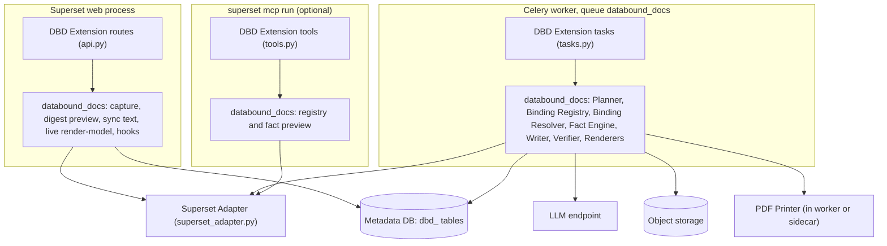
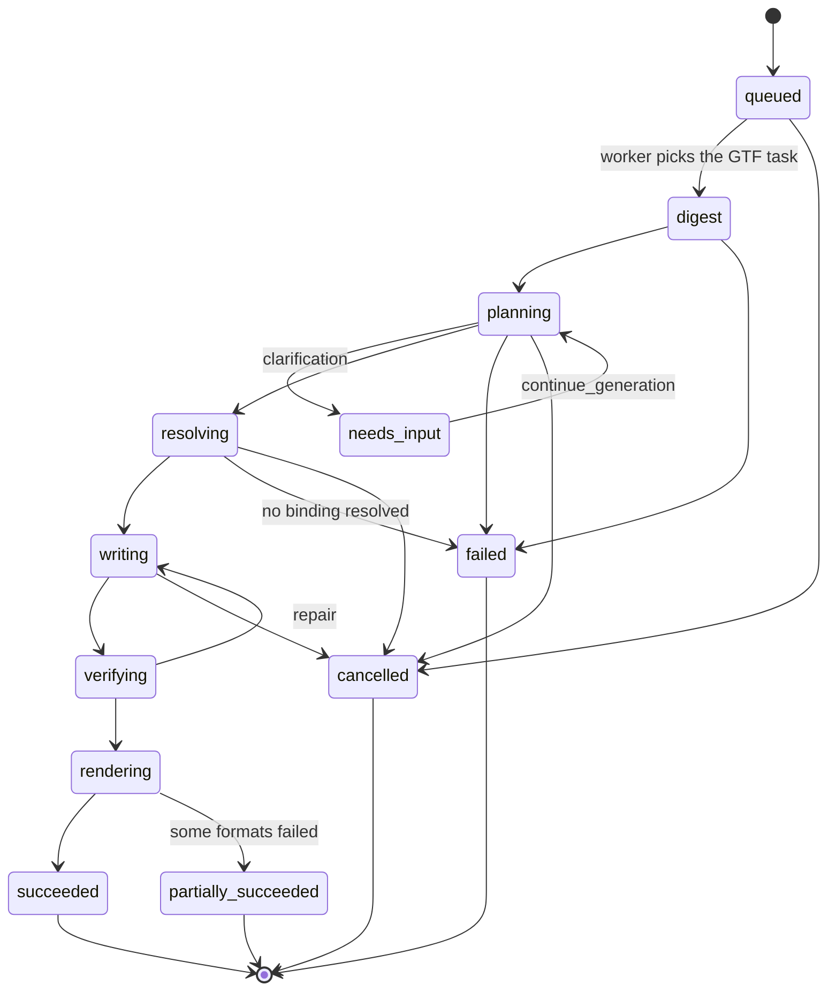
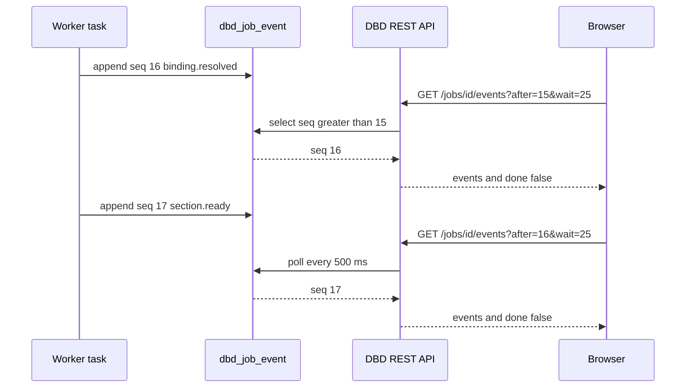

# Building the generation service

<div class="chapter-meta" markdown>
**Reads:** `superset/commands/chart/data/get_data_command.py`, `superset/tasks/manager.py`, `superset/charts/schemas.py`, `servers/fastapi/utils/llm_utils.py` (Presenton), `servers/fastapi/templates/v2/schema.py` (Presenton), `servers/fastapi/models/sse_response.py` (Presenton)  ·  **Builds on:** [Building the Superset extension](36-superset-extension.md)  ·  **Time:** ~50 min
</div>

This chapter builds the generation runtime of Superset Data-Bound Documents: the `databound_docs` Python package, shipped as the `superset-databound-docs` wheel, that the DBD Extension's routes, GTF tasks and MCP tools call. You will lay out its modules, create its tables and object storage, implement the job model and every REST endpoint with its request and response JSON, then build the Template Registry, the LLM provider abstraction, the Binding Registry and Binding Resolver, the renderer interface, event streaming, configuration and caching. The last step maps Presenton's codebase onto this package: which directories to port, which to extend, and which to leave behind.

!!! info "Interpretation this chapter implements"
    Data-Bound Documents is **one common, output-agnostic generation framework** that turns a **prompt**, a **chosen template** and a **Superset data context** (dashboard and live filters, charts, datasets, semantic views [M], SQL) into (a) PowerPoint decks, (b) documents (DOCX, PDF, Markdown), (c) text (narratives, summaries, emails, alert briefs) and (d) web pages (interactive HTML reports, and in v2 Superset dashboards), **on demand** or **on events** (schedules, alerts, data changes, webhooks). Every chart, table, KPI and number comes from a **live Superset query run with the requesting user's permissions and RLS**, is rendered natively (editable PPTX charts with embedded data, real tables, real text), is **never a screenshot**, and is re-runnable to refresh with new data. The runtime in this chapter is where that rule is enforced: the LLM never produces a number, and every value enters an artifact only through the Binding Resolver and the Fact Engine.

Availability tags are the same as in the previous chapter: **[6.1]** in the 6.1.0 tag and master, **[M]** master only, **[M\*]** changed on master.

## Step 1: Decide where the runtime lives

The blueprint's decision is explicit: **there is no separate generation service**. "Runtime" means the `databound_docs` library executing inside Superset's own processes. The reasons come straight from Superset's data plane:

| Concern | In-process library (chosen) | Presenton-style sidecar (rejected) |
|---|---|---|
| Acting as the user | `override_user` plus `ChartDataCommand` in a GTF task; works with every auth type, including OAuth and SSO | needs a credential path: DB/LDAP JWT login, master-only API keys, cookie forwarding, or a custom broker |
| Numbers identical to the dashboard | same `ChartDataCommand`, same cache key (which includes RLS, `apache/superset: superset/security/manager.py:6304-6313`) | chart-data over HTTP; on 6.1 with `GLOBAL_ASYNC_QUERIES` the POST returns 202 and then 401 without the async cookie |
| Operations | one wheel plus one `.supx`; no new web service or database server | Postgres, Redis, object storage, Node and Chromium beside Superset |
| Long jobs | GTF tasks on a dedicated Celery queue | a polling proxy task holding a Celery slot |

The only optional out-of-process component is the **PDF Printer**: Chromium inside the worker image (master removed Selenium and requires Playwright with Chromium for report and thumbnail screenshots, `apache/superset: UPDATING.md:1621-1645`), or a `printer_sidecar` container that prints DBD's own static HTML.



## Step 2: Lay out the `databound_docs` package

```text title="core/src/databound_docs/ (wheel superset-databound-docs)"
databound_docs/
├── __init__.py               # __version__ only; imports nothing from Superset
├── capabilities.py           # GET /capabilities payload
├── settings.py               # reads DATABOUND_DOCS from current_app.config at call time
├── ids.py                    # ULIDs with prefixes doc_, job_, art_, tpl_, trg_, shr_
├── spec/                     # models.py (DocumentSpec), requests.py, schema export, json_patch.py
├── planner/                  # digest.py, outline.py, layout.py, writer.py, verify.py,
│                             # agent.py, pipeline.py, prompts/dbd-prompts-1.0/*.txt
├── binder/                   # registry.py, resolver.py, dataset_query.py, shaping.py, provenance.py
├── facts/                    # engine.py, ops.py
├── format/                   # d3.py (vendored), excel.py, palettes.py (generated)
├── render/                   # base.py, pptx/, docx/, drawingml/, html/, svg_vegalite.py, pdf.py, text.py
├── templates/                # registry.py, slots.py, schema_builder.py, importer_pptx.py,
│                             # importer_docx.py, builtins/ (JSON plus .pptx and .docx package data)
├── triggers/                 # tick.py, hooks.py, freshness.py
├── compat/                   # filter_scope_61.py, layout_order.py, cron_window.py, gtf.py
├── llm/                      # base.py, structured.py, openai_compatible.py, anthropic.py, bedrock.py, vertex.py
├── storage/                  # base.py, s3.py, gcs.py, azure.py, fs.py, export_storage.py
├── db/                       # models.py, repo.py, alembic/ (version table dbd_alembic_version)
├── runtime/                  # start.py, sync_text.py, events.py, cancel.py
├── web/                      # shells.py (Studio and page HTML shells)
├── celery_routing.py
└── cli.py                    # flask.commands entry point: superset dbd ...
```

Three rules keep the package portable and testable:

1. **No Superset import at module top level.** Superset objects arrive through the `adapter` argument (the extension's `superset_adapter` module) or through function-local imports in `db/` (which uses Flask-SQLAlchemy's session). A unit test asserts that `import databound_docs` leaves `superset` out of `sys.modules`.
2. **No screenshot path.** An import-linter contract forbids `superset.utils.webdriver`, `superset.utils.screenshots`, `superset.utils.screenshot_utils` and `superset.utils.pdf`.
3. **Synchronous code.** Superset's web workers and Celery tasks are synchronous. The runtime uses `httpx.Client`, not `asyncio`; this matters when porting Presenton, whose LLM helpers are `async` (Step 14).

```toml title="core/pyproject.toml (excerpt)"
[project]
name = "superset-databound-docs"
version = "1.0.0"
license = "Apache-2.0"
requires-python = ">=3.11"
dependencies = [
  "pydantic>=2.8", "python-pptx==1.0.2", "python-docx==1.2.0", "httpx>=0.27",
  "jsonschema>=4.21", "vl-convert-python>=1.6", "sqlglot", "lxml",
]
[project.optional-dependencies]
pdf = ["playwright"]
[project.entry-points."flask.commands"]
dbd = "databound_docs.cli:dbd"
[tool.setuptools.package-data]
"databound_docs" = ["templates/builtins/**/*", "planner/prompts/**/*.txt", "format/palettes.json"]
```

!!! warning "Gotcha: do not pin libraries Superset already pins"
    Superset master pins `xlsxwriter>=3.2.9, <3.3` (`apache/superset: pyproject.toml:126`), which python-pptx uses for the embedded chart workbook, plus `Pillow>=13.0.0, <14`, `sqlglot>=30.23.0, <31` and `pydantic>=2.14.0` (lines 96, 118 and 97); 6.1.0's pins differ and were not compared here. Declare them without upper bounds (or not at all) so `pip` does not downgrade Superset's own versions inside the image. `superset dbd doctor` prints the resolved versions.

## Step 3: Create the storage layer

### 3.1 Tables

Metadata lives in the Superset metadata database (or in `DATABOUND_DOCS["DATABASE_URI"]`), managed by the wheel's own Alembic environment with version table `dbd_alembic_version`. Extensions have no supported migration path in Superset yet, and extension persistent storage [M] caps values at 1 MB (`apache/superset: superset/config.py:1596-1609`), so it is used only for per-user UI preferences.

```python title="databound_docs/db/models.py (excerpt)"
from sqlalchemy import JSON, BigInteger, Boolean, Column, DateTime, ForeignKey, Integer, \
    LargeBinary, MetaData, String, Table, Text
from sqlalchemy.orm import declarative_base

metadata = MetaData()          # separate from Superset's Model.metadata
Base = declarative_base(metadata=metadata)

# Stub of Superset's user table so ForeignKey("ab_user.id") resolves inside this
# MetaData. It is never created or migrated by DBD (include_object skips it).
ab_user = Table("ab_user", metadata, Column("id", Integer, primary_key=True))


class DbdDocument(Base):
    __tablename__ = "dbd_document"
    id = Column(String(32), primary_key=True)                 # doc_<ulid>
    kind = Column(String(16), nullable=False)                 # deck, document, page, text
    title = Column(String(500), nullable=False)
    owner_fk = Column(Integer, ForeignKey("ab_user.id"), nullable=False)
    current_version = Column(Integer, nullable=False, default=0)
    status = Column(String(32), nullable=False)               # generating, ready, failed
    template_id = Column(String(32), nullable=False)
    template_version = Column(Integer, nullable=False)
    dashboard_id = Column(Integer, nullable=True, index=True)
    created_on = Column(DateTime, nullable=False)
    changed_on = Column(DateTime, nullable=False)


class DbdDocumentVersion(Base):
    __tablename__ = "dbd_document_version"
    document_id = Column(String(32), ForeignKey("dbd_document.id"), primary_key=True)
    version = Column(Integer, primary_key=True)
    spec = Column(JSON, nullable=False)                       # DocumentSpec, immutable
    spec_sha256 = Column(String(64), nullable=False)
    created_by_fk = Column(Integer, ForeignKey("ab_user.id"))
    reason = Column(String(32), nullable=False)               # generate, chat_edit, refresh ...
    created_on = Column(DateTime, nullable=False)


class DbdJobEvent(Base):
    __tablename__ = "dbd_job_event"
    job_id = Column(String(32), ForeignKey("dbd_job.id"), primary_key=True)
    seq = Column(BigInteger, primary_key=True)
    type = Column(String(48), nullable=False)
    data = Column(JSON, nullable=False)
    created_on = Column(DateTime, nullable=False, index=True)  # pruned after 7 days
```

The full table set and key columns:

| Table | Key columns |
|---|---|
| `dbd_template` | `id`, `version`, `kind`, `name`, `json`, `master_object_key`, `owner_fk`, `is_builtin`, `visibility` (`private`, `roles`, `all`), `role_ids`, `created_on` |
| `dbd_document` | `id`, `kind`, `title`, `owner_fk`, `current_version`, `status`, `template_id`, `template_version`, `dashboard_id`, `created_on`, `changed_on` |
| `dbd_document_version` | `document_id`, `version`, `spec`, `spec_sha256`, `created_by_fk`, `reason`, `created_on` |
| `dbd_binding_result` | `id`, `document_id`, `version`, `binding_id`, `status`, `provenance`, `rows` (compressed, nullable), `query_hash`, `data_hash`, `rls_fingerprint`, `executed_as_fk`, `created_on` |
| `dbd_artifact` | `id`, `document_id`, `version`, `format`, `object_key`, `size`, `sha256`, `render_inputs_hash`, `created_on`, `expires_on` |
| `dbd_job` | `id`, `document_id`, `kind`, `task_uuid`, `status`, `stage`, `requested_by_fk`, `trigger`, `trigger_ref`, `agent_state_key`, `started_on`, `ended_on`, `error` |
| `dbd_job_event` | `job_id`, `seq`, `type`, `data`, `created_on` |
| `dbd_trigger` | `id`, `document_id`, `type`, `config`, `run_as_fk`, `token_sha256`, `hmac_secret_ref`, `active`, `last_run_on`, `last_status`, `last_data_hashes` |
| `dbd_share` | `id`, `document_id`, `grantee_type` (`user`, `role`), `grantee_id`, `mode` (`live`, `snapshot`) |
| `dbd_data_policy` | `dataset_id`, `column_name` (nullable), `exposure`, `allow_in_documents`, `pii` |
| `dbd_audit` | `id`, `ts`, `user_fk`, `action`, `document_id`, `job_id`, `details` |

```python title="databound_docs/db/alembic/env.py (excerpt)"
from alembic import context
from databound_docs.db.models import metadata

def run_migrations_online(connection) -> None:
    context.configure(
        connection=connection,
        target_metadata=metadata,
        version_table="dbd_alembic_version",               # never Superset's alembic_version
        include_object=lambda obj, name, type_, *_: type_ != "table" or name.startswith("dbd_"),
    )
    with context.begin_transaction():
        context.run_migrations()
```

!!! warning "Gotcha: autogenerate sees Superset's tables"
    The DBD tables share a database with Superset's, so a naive `alembic revision --autogenerate` proposes to drop every table that is not in DBD's `metadata`, Superset's included. The `include_object` filter limits Alembic to `dbd_` tables, which also keeps it away from the `ab_user` stub that exists only so the foreign keys resolve. Keep the filter in `env.py`, not in a developer's shell history.

When `DATABASE_URI` is set, the DBD tables live in a separate database: `repo` then uses its own engine and `sessionmaker` instead of Superset's `db.session`, and the `ab_user` foreign keys must be dropped from the migration, because a constraint cannot point into another database.

### 3.2 Object storage

Binaries never go into the metadata database. Keys follow `dbd/<document_id>/<version>/<artifact_id>.<ext>`.

```python title="databound_docs/storage/base.py"
from typing import BinaryIO, Iterator, Protocol


class Storage(Protocol):
    def put(self, key: str, data: bytes | BinaryIO, *, content_type: str) -> None: ...
    def get_stream(self, key: str, chunk_size: int = 65536) -> Iterator[bytes]: ...
    def delete(self, key: str) -> None: ...
    def signed_url(self, key: str, expires_s: int = 300) -> str | None: ...   # optional


def artifact_key(document_id: str, version: int, artifact_id: str, ext: str) -> str:
    return f"dbd/{document_id}/{version}/{artifact_id}.{ext}"
```

Backends: `s3`, `gcs`, `azure`, `fs`, and `export_storage`, an adapter over master's `EXPORT_STORAGE` / `ExportStorage` (`upload_file`, `download`) [M] introduced for dashboard Excel exports (`apache/superset: superset/config.py:1700-1733`). `GET /artifacts/<id>/download` always streams through Superset (after the access checks of Step 5) unless `signed_url` is enabled for the backend.

## Step 4: Model jobs and their states

A **job** is one unit of generation work (generate, continue, regenerate, refresh, render, trigger run). It always has a `dbd_job` row and one GTF task. The GTF row is authoritative for execution status; `dbd_job` adds what GTF does not have.



| `dbd_job.status` | GTF `TaskStatus` | Terminal | Notes |
|---|---|---|---|
| `queued` | `PENDING` | no | row created by `POST /documents` |
| `digest` ... `rendering` (in `stage`) | `IN_PROGRESS` | no | stage names mirror `STAGES` in `tasks.py` |
| `needs_input` | `SUCCESS` with payload `{"status": "needs_input"}` | no for DBD, yes for GTF | the task ends; `continue_generation` resumes from `agent_state_key` |
| `succeeded` | `SUCCESS` | yes | |
| `partially_succeeded` | `SUCCESS` | yes | at least one format failed to render |
| `failed` | `FAILURE` or `TIMED_OUT` | yes | `error` holds `{message, error_type, retryable, stage}` |
| `cancelled` | `ABORTED` | yes | via `POST /jobs/<id>/cancel` |

A failed binding never fails a job by itself: its element shows "data unavailable" and the job completes with warnings. A job fails only when no binding resolves.

```python title="databound_docs/db/repo.py (job and event helpers, excerpt)"
TERMINAL = {"succeeded", "partially_succeeded", "failed", "cancelled"}


class Jobs:
    def is_terminal(self, job_id: str) -> bool:
        job = self._get(job_id)
        if job.status in TERMINAL:
            return True
        # Reconcile with GTF: a worker crash leaves dbd_job stale but GTF times out.
        gtf = self.adapter.gtf_status(job.task_uuid)        # TaskDAO lookup by uuid
        if gtf in {"FAILURE", "TIMED_OUT", "ABORTED"}:
            self.finish(job_id, {"FAILURE": "failed", "TIMED_OUT": "failed",
                                 "ABORTED": "cancelled"}[gtf])
            return True
        return False


class Events:
    def append(self, job_id: str, type_: str, data: dict) -> int:
        """Insert with seq = max(seq) + 1 under a row lock on dbd_job."""
        ...

    def wait_since(self, job_id: str, after: int, *, timeout_s: float, poll_s: float):
        deadline = time.monotonic() + timeout_s
        while True:
            rows = self._since(job_id, after)
            if rows or time.monotonic() >= deadline or self.jobs.is_terminal(job_id):
                return rows
            time.sleep(poll_s)
            db.session.expire_all()          # see fresh rows written by the worker
```

!!! warning "Gotcha: long polls hold a web worker"
    `wait_since` sleeps inside a gunicorn worker for up to 25 seconds. With sync workers, ten open Studio panels can pin ten workers. Size the web tier for it, keep `wait` at or below 25 (the handler clamps it), and prefer SSE only when `GET /capabilities` reports `sse: true` (gevent or eventlet workers). The `expire_all()` call matters: without it, the SQLAlchemy identity map returns the same stale rows for the whole request.

!!! warning "Gotcha: 6.1 replaces the GTF payload, master merges it"
    Coarse progress is mirrored into GTF with `update_task(progress=(i, n), payload={...})` so the built-in Task List and `GET /api/v1/task/<uuid>/status` [6.1] show it. On 6.1 each call replaces the payload; on master it merges. The runtime always sends the complete payload (`stage`, `document_id`, `job_id`), so both behave the same.

## Step 5: Implement the API contract

All routes are relative to `/extensions/databound/docgen/v1` and belong to `DataBoundDocsApi` (previous chapter). Conventions:

- Success responses use FAB's envelope: `{"result": ...}`.
- Errors use `{"message", "error_type", "retryable"}`: `message` is the key FAB's `response_400` and friends already emit, and `error_type` and `retryable` are borrowed from Presenton's `SSEErrorResponse` (`presenton: servers/fastapi/models/sse_response.py:32-45`), which calls its text field `detail`.
- Ids are ULIDs with a type prefix: `doc_`, `job_`, `art_`, `tpl_`, `trg_`, `shr_`.
- Mutating endpoints accept an optional `Idempotency-Key` header, stored for 24 hours per user and route.

```json title="Error envelope (any 4xx or 5xx)"
{"message": "Chart 102 has no saved query context. Open and save it in Explore.",
 "error_type": "binding_no_query_context", "retryable": false}
```

### 5.1 Discovery

| Route | Permission |
|---|---|
| `GET /capabilities` | `read` |
| `GET /schema/document-spec` | `read` |

```json title="GET /capabilities (200)"
{"result": {
  "superset_version": "6.1.0", "profile": "6.1", "dbd_version": "1.0.0",
  "features": {"chat": false, "chat_slot_enabled": false, "filter_context_helper": false,
               "form_data_rebuild": false, "semantic_layers": false, "gtf_dag": false,
               "sse": false, "pdf_engine": "playwright", "docx_charts": false,
               "agent_planner": false},
  "formats": ["pptx", "docx", "pdf", "html", "md", "text", "email"],
  "llm_roles": {"planner": "default", "writer": "default", "verifier": "default"}}}
```

`GET /schema/document-spec` returns `DocumentSpec.model_json_schema()`; the frontend build generates TypeScript types from it.

### 5.2 Templates

| Route | Permission |
|---|---|
| `GET /templates?kind=deck` | `read` |
| `GET /templates/<id>?version=` | `read` |
| `POST /templates` (multipart) | `manage_templates` |

```json title="GET /templates?kind=deck (200)"
{"result": [
  {"id": "tpl_exec_review", "version": 3, "name": "Executive review", "kind": "deck",
   "description": "Headline KPIs, trends and rankings for leadership",
   "thumbnail_svg": "<svg ...>",
   "layouts": [
     {"id": "title_kpis", "slots": [
        {"name": "kpi_1", "accepts": ["kpi"], "shapes": ["scalar"]},
        {"name": "kpi_2", "accepts": ["kpi"], "shapes": ["scalar"], "optional": true},
        {"name": "subtitle", "accepts": ["narrative"], "max_chars": 160}]},
     {"id": "chart_takeaway", "slots": [
        {"name": "chart", "accepts": ["chart"], "shapes": ["series", "xy"],
         "x_kind": ["temporal", "categorical"], "series": [1, 8], "categories": [2, 24]},
        {"name": "takeaway", "accepts": ["narrative"], "max_chars": 420}]}]}]}
```

`POST /templates` takes form fields `template.json` and optionally `master.pptx` or `master.docx`, and returns `{"result": {"id": "tpl_...", "version": 1, "warnings": ["slot trend holds a pie chart but declares temporal x"]}}` (Step 6).

### 5.3 Context and digest

`POST /context/digest` (`generate`) returns exactly what the LLM would see, so users and auditors can answer "what will the AI see?".

```json title="POST /context/digest (request)"
{"context": {"dashboard": {"id_or_slug": "sales-overview", "native_filters_key": "kq8sP0",
                           "permalink_key": null},
             "chart_ids": [], "dataset_ids": [7], "sqllab": null},
 "parameters": {"region": ["EMEA"]},
 "exposure": "aggregates"}
```

```json title="POST /context/digest (200, abbreviated)"
{"result": {
  "digest": {"context": {"dashboard": {"id": 12, "title": "Sales Overview",
                         "filters_applied": [{"name": "Region", "value": ["EMEA"]}]}},
             "candidates": [{"id": "cand_c101", "kind": "kpi", "title": "Total orders",
                             "tier": 1, "shape": "scalar",
                             "facts": [{"id": "fc_c101_value", "desc": "Orders in period",
                                        "display": "8,214"}]}],
             "datasets": [{"id": 7, "name": "cleaned_sales_data",
                           "metrics": [{"name": "revenue", "label": "Revenue"}]}]},
  "tokens": 3120, "exposure": "aggregates", "digest_sha256": "9b1f..."}}
```

### 5.4 Documents

| Route | Permission | Success |
|---|---|---|
| `POST /documents` | `generate` | `202` job, or `200` for synchronous text |
| `GET /documents?q=` | `read` | list |
| `GET /documents/<id>?version=` | `read` (owner or share) | document |
| `PATCH /documents/<id>` | `write` | new version, or `409` |
| `POST /documents/<id>/messages` | `write` | `202` |
| `POST /documents/<id>/regenerate` | `generate` | `202` |
| `POST /documents/<id>/refresh` | `refresh` | `202` |
| `POST /documents/<id>/refresh-upload` | `refresh` | `202` |
| `POST /documents/<id>/export` | `read` | `202`, or `200` for `md` and `text` |
| `GET /documents/<id>/render-model?live=1&parameters=` | `read` | sections resolved as the caller |
| `POST /documents/<id>/shares` | `write` (owner) | share |

```json title="POST /documents (request: CreateDocumentRequest)"
{"prompt": "Quarterly review for EMEA leadership, focus on growth drivers",
 "title": "Q3 2026 Sales Review: {{p:region}}",
 "kind": "deck",
 "template": {"id": "tpl_exec_review", "version": null},
 "formats": ["pptx"],
 "context": {"dashboard": {"id_or_slug": "sales-overview", "native_filters_key": "kq8sP0",
                           "permalink_key": null},
             "chart_ids": [], "dataset_ids": [7], "sqllab": null},
 "parameters": {"region": ["EMEA"]},
 "options": {"language": "en", "tone": "executive", "max_sections": 8,
             "exposure": "aggregates", "planner_strategy": null, "mode": "live",
             "sync": false}}
```

```json title="POST /documents (202)"
{"result": {"document_id": "doc_01JC8Z6Q4M5K", "job_id": "job_01JC8Z6R0B2T",
            "task_uuid": "5f0c6a2e-1d2b-4c84-9c43-0f7f8f4a7c11",
            "events_url": "jobs/job_01JC8Z6R0B2T/events"}}
```

With `kind: "text"` and `options.sync: true`, steps 2 to 10 of the [Generation flow](34-generation-flow.md) run inline within a 20 second budget and return `200`; on timeout the call falls back to `202`:

```json title="POST /documents with kind text and sync true (200)"
{"result": {"document": {"id": "doc_01JC9A...", "version": 1, "kind": "text"},
            "text": {"markdown": "**Revenue:** $2.91M (+8.4% vs prior year)\n\n...",
                     "plain": "Revenue: $2.91M (+8.4% vs prior year) ...",
                     "verified": true, "as_of": "2026-11-02T09:14:00Z"}}}
```

```json title="GET /documents/doc_01JC8Z6Q4M5K (200, abbreviated)"
{"result": {"spec": {"spec_version": "dbd/1.0", "id": "doc_01JC8Z6Q4M5K", "version": 1, "...": "..."},
            "status": "ready",
            "artifacts": [{"id": "art_01JC8Z9...", "format": "pptx", "version": 1,
                           "size": 184233, "download_url": "artifacts/art_01JC8Z9.../download"}],
            "versions": [{"version": 1, "reason": "generate", "created_on": "2026-11-02T09:14:31Z"}],
            "triggers": []}}
```

```json title="PATCH /documents/doc_01JC8Z6Q4M5K (request, RFC 6902)"
{"base_version": 1,
 "patch": [{"op": "replace", "path": "/sections/1/elements/0/native", "value": "line"},
           {"op": "replace", "path": "/sections/1/elements/1/text",
            "value": "{{f:f_best_month.label}} was the strongest month."}]}
```

The server validates the patched spec against `DocumentSpec`, rejects patches that add a binding outside the Binding Registry, marks edited narratives `status: "user_edited"`, and answers `{"result": {"version": 2}}` or `409 {"message": "base_version 1 is stale, current is 2", "error_type": "stale_base", "retryable": true}`.

| Route | Request body | Response |
|---|---|---|
| `POST /documents/<id>/messages` | `{"text": "Make slide 2 a line chart and add a slide on deal size by country"}` or `{"answer": "dashboard 12"}` | `202 {"result": {"job_id", "task_uuid"}}` |
| `POST /documents/<id>/regenerate` | `{"section_ids": ["s2"], "instructions": "shorter takeaway"}` | `202 {"result": {"job_id"}}` |
| `POST /documents/<id>/refresh` | `{"narrative": "regenerate_on_drift", "parameters": {"time_range": "Last quarter"}, "force": false, "formats": ["pptx"], "mode": "in_place"}` | `202 {"result": {"job_id"}}` |
| `POST /documents/<id>/refresh-upload` | multipart `file` (a PPTX or DOCX exported earlier) | `202 {"result": {"job_id"}}` |
| `POST /documents/<id>/export` | `{"formats": ["pptx", "pdf"], "refresh": false}` | `202 {"result": {"job_id"}}`; for `md` and `text`: `200 {"result": {"artifacts": [...]}}` |
| `POST /documents/<id>/shares` | `{"user_ids": [57], "role_ids": [], "mode": "live"}` | `200 {"result": {"share_id": "shr_..."}}`; `snapshot` also needs `can_share_snapshot` |

```json title="GET /documents/doc_01JC8Z6Q4M5K/render-model?live=1 (200, one section)"
{"result": {"document_id": "doc_01JC8Z6Q4M5K", "version": 1, "viewer_rls_fingerprint": "rls:9f0c...",
  "sections": [{"id": "s3", "layout_id": "table_takeaway", "title": "Top countries by revenue",
    "elements": [
      {"id": "e9", "type": "table", "binding_id": "b_top_countries", "status": "ok",
       "columns": [{"key": "country", "label": "Country"}, {"key": "revenue", "label": "Revenue"},
                   {"key": "revenue_share", "label": "Share"}],
       "rows": [["France", "$1,204,511", "41.4%"], ["Germany", "$702,330", "24.1%"]],
       "provenance": {"queried_dttm": "2026-11-02T09:14:00Z", "is_cached": true,
                      "applied_filters": [{"column": "region"}], "truncated": false}},
      {"id": "e10", "type": "narrative", "status": "verified",
       "html": "<span data-dbd-fact=\"f_top_country\">France</span> leads with ..."}]}]}}
```

!!! warning "Gotcha: render-model resolves as the caller, not the owner"
    `render-model?live=1` runs every `live` binding under the viewer's own session, so the viewer's RLS applies. When the viewer's RLS fingerprint differs from a narrative's `audience_rls_fingerprint`, claim lint runs against the viewer's facts and the narrative may be replaced by deterministic sentences with a "Summary written for different data" notice ([Security, RLS, auth](38-security.md)). Never cache a render-model response across users.

### 5.5 Bindings and artifacts

```json title="POST /bindings/preview (request is a DataBinding)"
{"id": "b_preview", "source": {"kind": "dataset", "dataset_id": 7, "metrics": ["revenue"],
                               "dimensions": ["country"], "orderby": [["revenue", false]]},
 "dashboard_filters": {"apply": true, "dashboard_id": 12},
 "time_range": "Last quarter", "row_limit": 10, "shape": {"kind": "table"}}
```

```json title="POST /bindings/preview (200)"
{"result": {"status": "ok", "shape": "table", "rowcount": 10,
            "preview_rows": [{"country": "France", "revenue": 1204511.2}],
            "default_facts": [{"op": "count", "display": "10"},
                              {"op": "argmax", "label": "France", "display": "$1.2M"}]}}
```

`GET /artifacts/<id>/download` (`read`) streams the file after checking ownership or a share grant; for snapshot shares it re-checks that the recipient can access every bound datasource and offers a re-render as the recipient otherwise.

### 5.6 Jobs and events

| Route | Response |
|---|---|
| `GET /jobs/<id>` | `{"result": {"status": "resolving", "stage": "resolve", "progress": [5, 8], "document_id": "doc_...", "version": null, "error": null}}` |
| `GET /jobs/<id>/events?after=16&wait=25` | `{"result": {"events": [<envelope>, ...], "done": false}}` |
| `GET /jobs/<id>/stream` | `text/event-stream`, resumable with `Last-Event-ID` |
| `POST /jobs/<id>/cancel` | `{"result": {"status": "cancelling"}}` |

```json title="Event envelope"
{"seq": 17, "job_id": "job_01JC8Z6R0B2T", "ts": "2026-11-02T09:13:44.120Z",
 "type": "binding.resolved",
 "data": {"binding_id": "b_rev_by_month", "status": "ok", "rowcount": 18,
          "truncated": false, "is_cached": true, "queried_dttm": "2026-11-02T09:13:43Z"}}
```

The event types are the canonical list: `job.accepted`, `context.captured`, `digest.ready`, `outline.delta`, `outline.ready`, `layout.selected`, `binding.proposed`, `binding.rejected`, `binding.resolved`, `binding.failed`, `fact.derived`, `section.ready`, `narrative.verified`, `narrative.flagged`, `document.ready`, `artifact.progress`, `artifact.ready`, `job.needs_input`, `job.completed`, `job.failed`, `job.cancelled`, `refresh.unchanged`. Their payloads are tabulated in [Generation flow](34-generation-flow.md).

### 5.7 Pages, Studio, triggers and hooks

| Route | Permission | Response |
|---|---|---|
| `GET /pages/<document_id>` | `read` | HTML shell that loads `dbd-page.<hash>.js` |
| `GET /studio?dashboard=12&native_filters_key=kq8sP0` | `read` | HTML shell that loads `dbd-studio.<hash>.js` |
| `GET /triggers`, `POST /triggers`, `PUT /triggers/<id>`, `DELETE /triggers/<id>` | `schedule` | `TriggerSpec` rows |
| `POST /hooks/<token>` | none (token, plus HMAC for `external_webhook`) | `202` or `404` |

```json title="POST /triggers (request, cron)"
{"document_id": "doc_01JC8Z6Q4M5K", "type": "cron",
 "config": {"crontab": "0 7 * * MON", "timezone": "Europe/Paris", "action": "refresh",
            "narrative": "regenerate_on_drift", "parameters": {"time_range": "Last week"},
            "formats": ["pptx", "email"],
            "deliver": [{"type": "email", "to": ["cfo@example.com"]}, {"type": "store"}],
            "skip_if_unchanged": true},
 "run_as_id": 42, "active": true}
```

```json title="POST /triggers (200, alert_webhook: the URL is shown once)"
{"result": {"id": "trg_01JCB2...", "type": "alert_webhook", "active": true,
            "webhook_url": "https://superset.example.com/extensions/databound/docgen/v1/hooks/q3Xk...",
            "note": "Store this URL now. Only its SHA-256 hash is kept."}}
```

Scheduling, freshness sentinels and the alert webhook payload are covered in [Scheduling and live refresh](39-scheduling-and-refresh.md).

## Step 6: Build the Template Registry

The Template Registry stores versioned templates (immutable per version; documents pin `(id, version)`) made of Presenton Template v2 derived layouts with **data slots**, plus optional PPTX and DOCX masters in object storage.

```python title="databound_docs/templates/registry.py (excerpt)"
class TemplateRegistry:
    def get_for_user(self, template_id: str, version: int | None, user_id: int) -> Template:
        row = repo.templates.latest_or(template_id, version)
        if row is None or not self._visible(row, user_id):
            raise NotFound(template_id)               # 404, never 403: do not leak existence
        return Template.model_validate(row.json)

    def create(self, payload: dict, master: bytes | None, *, owner_id: int) -> tuple[Template, list[str]]:
        template = Template.model_validate(payload)
        warnings: list[str] = []
        if master is not None:
            imported, warnings = import_master(master)  # shape-name convention, below
            template = template.merge_layouts(imported)
        warnings += validate_slots(template)
        version = repo.templates.next_version(template.id)
        key = None
        if master is not None:
            key = f"dbd/templates/{template.id}/{version}/master.{template.master_ext}"
            storage().put(key, master, content_type=template.master_content_type)
        repo.templates.insert(template, version=version, master_object_key=key, owner_id=owner_id)
        return template, warnings
```

Built-ins ship as package data: `tpl_exec_review` (deck, 10 layouts), `tpl_dashboard_walkthrough` (deck, ordered, one section per dashboard tab), `tpl_analytical_report` (document), `tpl_interactive_report` (page), `tpl_kpi_brief` (text), `tpl_weekly_email` (text and HTML) and `alert_brief` (text).

### 6.1 Importing a branded PPTX master

Designers name placeholders `slot:chart:trend`, `slot:kpi:kpi_1`, `slot:narrative:takeaway`, `slot:table:detail`. The importer is deterministic and needs no vision model:

```python title="databound_docs/templates/importer_pptx.py (excerpt)"
from io import BytesIO
from pptx import Presentation
from pptx.util import Emu

EMU_PER_UNIT = 9525          # 1280 x 720 template units on a 16:9 slide

def import_master(blob: bytes) -> tuple[list[dict], list[str]]:
    prs = Presentation(BytesIO(blob))
    layouts, warnings = [], []
    for layout in prs.slide_layouts:
        slots = []
        for shape in layout.shapes:
            if not shape.name.startswith("slot:"):
                continue
            _, kind, name = shape.name.split(":", 2)
            slot = {"name": name, "accepts": [kind],
                    "frame": [round(Emu(v) / EMU_PER_UNIT) for v in
                              (shape.left, shape.top, shape.width, shape.height)]}
            if getattr(shape, "has_chart", False) and shape.has_chart:
                chart = shape.chart
                slot["designer_chart"] = {"type": str(chart.chart_type),
                                          "series": len(list(chart.series)),
                                          "categories": len(chart.plots[0].categories)}
                slot.update(infer_shape_constraints(chart))
            if kind == "narrative":
                slot["max_chars"] = capacity_from_geometry(shape)   # Presenton's 0.85 safety factor
            slots.append(slot)
        if slots:
            layouts.append({"id": layout.name.lower().replace(" ", "_"), "slots": slots})
    return layouts, warnings
```

### 6.2 Porting Presenton's schema builder

Presenton's `extract_slide_schema_from_layout` (`presenton: servers/fastapi/templates/v2/schema.py:183`) builds a strict JSON Schema per layout with character budgets, and `_chart_content_schema` asks the LLM for `categories` and `series[].values` (`presenton: servers/fastapi/templates/v2/schema.py:1490-1534`). Its text budgets use a 0.85 safety factor (`TEXT_CAPACITY_SAFETY_FACTOR`, `presenton: servers/fastapi/templates/v2/certified_generation.py:62`; `TABLE_TEXT_CAPACITY_SAFETY_FACTOR`, `presenton: servers/fastapi/templates/v2/schema.py:50`), which the importer above reuses. The port keeps the budgets and replaces every data field with an enum of registry-issued ids:

```python title="databound_docs/templates/schema_builder.py (excerpt)"
def slot_field_schema(slot: DataSlot, menu: SlotMenu) -> dict:
    if "narrative" in slot.accepts:
        return {"type": "string", "maxLength": slot.max_chars or 420, "pattern": TOKEN_ONLY_PATTERN}
    if "kpi" in slot.accepts:
        return {"type": "object", "additionalProperties": False,
                "required": ["value_fact", "comparison_fact"],
                "properties": {"value_fact": {"enum": menu.value_facts},
                               "comparison_fact": {"enum": menu.comparison_facts + [None]}}}
    # chart and table slots: a choice, never categories, series, values or cells
    ids = menu.compatible_candidates(slot) + (["none"] if slot.optional else [])
    return {"type": "object", "additionalProperties": False, "required": ["binding"],
            "properties": {"binding": {"enum": ids}}}
```

See [Template v2 format](../presenton/16-template-v2-format.md) and [From template to schema to slide](../presenton/17-template-to-slide.md) for the Presenton originals.

!!! warning "Gotcha: an empty enum is an invalid schema"
    If no candidate fits a mandatory slot, `{"enum": []}` is rejected by strict structured-output modes before the model even runs. The layout-fit step (deterministic bipartite matching) must discard such layouts before the schema is built, and fall back to `generic_chart` or `generic_text`.

## Step 7: Build the LLM provider abstraction

### 7.1 The protocol

```python title="databound_docs/llm/base.py"
from dataclasses import dataclass
from typing import Callable, Protocol


@dataclass(frozen=True)
class ProviderCaps:
    strict_schema: bool          # response_format json_schema with strict=true
    regex_in_schema: bool        # honors "pattern"
    tool_calling: bool
    streaming: bool
    max_context: int


class LLMProvider(Protocol):
    name: str
    def capabilities(self) -> ProviderCaps: ...
    def complete_json(self, *, messages: list[dict], schema: dict, schema_name: str,
                      model: str, temperature: float = 0.2, max_tokens: int = 4000,
                      timeout_s: float = 90, on_delta: Callable[[str], None] | None = None,
                      cancel: "CancelToken | None" = None) -> dict: ...
    def complete_tools(self, *, messages: list[dict], tools: list[dict], model: str,
                       **kw) -> "ToolTurn": ...      # agent strategy only [M]
```

Implementations: `openai_compatible` (OpenAI, Azure OpenAI, vLLM, Ollama, LM Studio, LiteLLM proxies), `anthropic` (forced tool input schema as the structured-output mechanism), `bedrock` and `vertex`. Roles (`planner`, `writer`, `verifier`) map to profiles, so a small local model can write sections while a larger one plans.

```python title="databound_docs/llm/openai_compatible.py (excerpt)"
import json
import os
import httpx


class OpenAICompatible:
    name = "openai_compatible"

    def __init__(self, profile: dict, allowed_hosts: list[str]):
        url = httpx.URL(profile["base_url"])
        if url.host not in allowed_hosts:
            raise ValueError(f"LLM host {url.host} is not in DATABOUND_DOCS.LLM.allowed_hosts")
        self.client = httpx.Client(base_url=str(url), timeout=90,
                                   headers={"Authorization": f"Bearer {os.environ[profile['api_key_env']]}"})
        self.strict = profile.get("strict_schema", True)

    def complete_json(self, *, messages, schema, schema_name, model, temperature=0.2,
                      max_tokens=4000, timeout_s=90, on_delta=None, cancel=None) -> dict:
        body = {"model": model, "messages": messages, "temperature": temperature,
                "max_tokens": max_tokens,
                "response_format": {"type": "json_schema", "json_schema":
                                    {"name": schema_name, "schema": schema, "strict": self.strict}}}
        if on_delta is None:
            r = self.client.post("/chat/completions", json=body, timeout=timeout_s)
            r.raise_for_status()
            return json.loads(r.json()["choices"][0]["message"]["content"])
        return self._stream(body, on_delta=on_delta, cancel=cancel, timeout_s=timeout_s)
```

### 7.2 `call_structured`: validation, repair and accounting

Every LLM call goes through one wrapper. It ports the idea of Presenton's `generate_structured_with_schema_retries` (`presenton: servers/fastapi/utils/llm_utils.py:310-386`): an inner loop for empty responses and an outer loop that quotes the validation errors back to the model, using the same feedback shape as `structured_validation_feedback_user_message` (`presenton: servers/fastapi/utils/llm_utils.py:276-308`).

```python title="databound_docs/llm/structured.py"
import time

from jsonschema import Draft202012Validator

MAX_REPAIRS = 2
EMPTY_RETRIES = 3            # Presenton's inner loop: 3 tries, 0.5 s and 1.0 s backoff


def call_structured(role: str, *, messages: list[dict], schema: dict, schema_name: str,
                    budget: "Budget", cancel: "CancelToken", on_delta=None) -> dict:
    provider, model = llm_for_role(role)
    validator = Draft202012Validator(schema)
    working = list(messages)
    errors: list[str] = []
    for attempt in range(MAX_REPAIRS + 1):
        content = None
        for empty_try in range(EMPTY_RETRIES):
            cancel.raise_if_set()
            started = time.monotonic()
            content = provider.complete_json(
                messages=working, schema=schema, schema_name=schema_name, model=model,
                on_delta=on_delta if attempt == 0 and empty_try == 0 else None, cancel=cancel)
            budget.record(role=role, model=model, seconds=time.monotonic() - started)
            if content is not None:
                break
            if empty_try < EMPTY_RETRIES - 1:
                time.sleep(0.5 * (empty_try + 1))
        if content is None:
            raise StructuredOutputError(schema_name, ["empty response"])
        errors = [f"{'/'.join(map(str, e.path)) or '$'}: {e.message}"
                  for e in validator.iter_errors(content)]
        if not errors:
            return content
        working.append({"role": "user", "content": feedback_message(content, errors[:10])})
    raise StructuredOutputError(schema_name, errors)   # fail closed, never return invalid JSON
```

!!! warning "Gotcha: Presenton returns the last invalid response; DBD must not"
    After its last validation loop, Presenton logs "Validation error after max fixes, returning last response" and returns the invalid content (`presenton: servers/fastapi/utils/llm_utils.py:372-377`). For slide prose that is tolerable. For Data-Bound Documents it is not: an invalid outline could reference a binding id outside the enum. `call_structured` raises instead, and the caller degrades (fallback layout, or deterministic sentences from the Narrative Verifier).

!!! warning "Gotcha: Presenton's helpers are async; DBD runs in sync workers"
    Presenton's LLM utilities are `async` and use the `llmai` client library (`presenton: servers/fastapi/utils/llm_utils.py:13-21`). Running an event loop inside a Celery task or a gunicorn sync worker is possible but fragile (nested loops, thread-local Flask state). Port the logic, not the coroutine code: `httpx.Client`, plain loops, and a `CancelToken` checked between calls instead of Presenton's `disconnect_checker`.

Secrets come only from environment variables (`api_key_env`) or a secrets manager named in config, never from tables, specs or events. LLM response caching is off by default (Step 13).

## Step 8: Implement the Binding Registry and Resolver

### 8.1 The Binding Registry

A binding exists only if `BindingRegistry.register(job_id, draft)` accepted it. Every planner (pipeline, agent, template), chat edits and MCP's `dbd_propose_binding` use this one function.

```python title="databound_docs/binder/registry.py (excerpt)"
class BindingRegistry:
    def register(self, draft: DataBinding, *, preview_rows: int = 0) -> Registration:
        src = draft.source
        if src.kind == "sql" and not settings().ALLOW_SQL_BINDINGS:
            return self._reject(draft, "sql_bindings_disabled")
        ds = self.adapter.load_datasource_for_user(src)        # access-filtered DAO
        if ds is None or not self.adapter.can_access_datasource(ds):
            return self._reject(draft, "forbidden")
        if src.kind == "dataset":
            for m in src.metrics:
                name = m if isinstance(m, str) else m.column
                if not (ds.has_saved_metric(name) or ds.is_numeric_column(name)):
                    return self._reject(draft, f"unknown_metric:{name}")
            for d in src.dimensions:
                if not ds.is_groupable(d):
                    return self._reject(draft, f"not_groupable:{d}")
        if self.count >= settings().MAX_BINDINGS_PER_DOC:
            return self._reject(draft, "too_many_bindings")
        draft = draft.model_copy(update={
            "id": self._next_id(draft), "row_limit": cap_row_limit(draft)})
        self.state.add(draft)
        self.events.append(self.job_id, "binding.proposed",
                           {"binding_id": draft.id, "source_kind": src.kind,
                            "shape": draft.shape.kind, "tier": tier_for(draft)})
        return Registration(draft, preview=self._preview(draft, preview_rows) if preview_rows else None)
```

### 8.2 The Binding Resolver

The resolver builds one query context per binding and executes it through the adapter's `run_query_context`, which does `g.form_data = json_body`, `ChartDataQueryContextSchema().load(json_body)`, `ChartDataCommand(qc).validate()` (which calls `raise_for_access` first, `apache/superset: superset/commands/chart/data/get_data_command.py:107-108`) and `.run()`.

```python title="databound_docs/binder/resolver.py (excerpt)"
class BindingResolver:
    def resolve(self, b: DataBinding, *, force: bool = False) -> BindingResult:
        try:
            body, warnings = self._query_context(b)
            fc_filters = []
            if b.dashboard_filters and b.dashboard_filters.apply:
                fc_filters = self.adapter.apply_dashboard_filters(
                    body, dashboard_id=b.dashboard_filters.dashboard_id or self.ctx.dashboard_id,
                    chart_id=getattr(b.source, "chart_id", None),
                    dataset_id=getattr(b.source, "dataset_id", None),
                    data_mask=self.ctx.data_mask)       # [M] helper, or the 6.1 port
            apply_overrides(body, b, self.parameters)   # filters, params, time_range, time_grain
            body["result_type"], body["result_format"] = "full", "json"
            body.pop("force", None)
            query_hash = canonical_sha256(body)          # computed without force
            if force:
                body["force"] = True
            result = self.adapter.run_query_context(body)["queries"][self._query_index(b)]
        except self.adapter.SecurityError:
            return BindingResult(binding_id=b.id, status="forbidden")
        except BindingSourceError as ex:
            return BindingResult(binding_id=b.id, status="error", error=ex.remediation)
        rows, truncated = shape_rows(result, b.shape, tz=self.ctx.timezone)
        return BindingResult(
            binding_id=b.id, status="truncated" if truncated else ("ok" if rows else "empty"),
            colnames=result["colnames"], coltypes=result["coltypes"], rows=rows,
            rowcount=result["rowcount"],
            provenance=build_provenance(result, b, query_hash=query_hash, rows=rows,
                                        fc_filters=fc_filters, adapter=self.adapter))
```

| Source kind | Query context comes from | 6.1 | Master |
|---|---|---|---|
| `chart` (`follow: live`) | `Slice.query_context`, stamped with `form_data.dashboardId` and `slice_id` | required; Superset itself answers a null `query_context` with "Chart has no query context saved. Please save the chart again." (`apache/superset: superset/charts/data/api.py:172-182`), and DBD raises its own `binding_no_query_context` error | falls back to `build_query_context_from_form_data(form_data, datasource, viz_type)` (`apache/superset: superset/common/form_data_query_context.py:1801`) with a provenance warning |
| `chart` (`follow: pinned`) | `query_context_snapshot`; a differing live hash sets `definition_changed` | yes | yes |
| `dataset` | `build_dataset_query_context` (BASE_AXIS adhoc column for temporal x) | yes | yes |
| `semantic` | `SemanticView.get_table(...)` | no | yes, `SEMANTIC_LAYERS` flag |
| `sql` | sqlglot SELECT-only check, `raise_for_access(..., force_dataset_match=True)`, `Database.execute` | yes, off by default | yes, off by default |

The 6.1 dashboard-filter port (`databound_docs.compat.filter_scope_61`) returns the same `extra_form_data` and `filters` contract as master's `DashboardFilterContext`, so call sites do not branch. Its scope rules, the merge order and the `unsupported_on_6.1` rejections are specified in [Data-bound slide model](33-data-bound-model.md).

!!! warning "Gotcha: resolve sequentially on 6.1"
    `ChartDataCommand` needs the Flask app context and `g`. Threads inside a task would each need their own app context and their own `override_user`, which is easy to get wrong and silently drops RLS. On 6.1 the resolver runs bindings one by one inside `generate_document`. On master, documents with more than `DAG_THRESHOLD` (default 12) bindings fan out one `resolve_binding` task per binding with `TaskOptions(depends_on=[...])`; payloads carry only result storage keys, never rows.

!!! warning "Gotcha: `NullCache` makes every refresh a full warehouse query"
    `DATA_CACHE_CONFIG` defaults to `{"CACHE_TYPE": "NullCache"}` (`apache/superset: superset/config.py:1531`). The digest profiles every candidate and the resolver then queries again; without a data cache that doubles warehouse load per generation. `superset dbd doctor` warns about it.

## Step 9: Wire the pipeline

The GTF task body is a thin call into `Pipeline.run(job)`. The pipeline is the [Generation flow](34-generation-flow.md) as code; each stage emits its events and checks the cancel token.

```python title="databound_docs/planner/pipeline.py (excerpt)"
class Pipeline:
    def __init__(self, *, adapter, progress, cancel: CancelToken):
        self.adapter, self.progress, self.cancel = adapter, progress, cancel

    def run(self, job: "Job") -> None:
        spec0 = job.load_request()
        self.progress("digest")
        digest = build_digest(spec0.context, adapter=self.adapter, exposure=spec0.exposure)
        self.progress("digest", "digest.ready", digest.summary())

        self.progress("outline")
        strategy = choose_strategy(spec0)            # pipeline, template, or agent [M]
        plan = strategy.plan(spec0, digest, on_delta=lambda t: job.event("outline.delta", {"text": t}),
                             cancel=self.cancel)
        if plan.needs_input:
            job.park(plan.question, plan.options)      # job.needs_input, task ends
            return

        self.progress("layout");   sections = fit_layouts(plan, job.template)
        self.progress("register"); registry = BindingRegistry.for_job(job.id, adapter=self.adapter)
        bindings = [registry.register(d).binding for d in plan.binding_drafts() if d]

        self.progress("resolve")
        resolver = BindingResolver(self.adapter, job.context, job.parameters)
        results = {}
        for b in bindings:
            self.cancel.raise_if_set()
            results[b.id] = r = resolver.resolve(b)
            job.event("binding.resolved" if r.status in ("ok", "empty", "truncated")
                      else "binding.failed", r.event_data())
        if not any(r.status in ("ok", "truncated") for r in results.values()):
            raise NoBindingResolved()
        facts = FactEngine().compute(plan.facts(), results)

        self.progress("write");  drafts = write_sections(sections, facts, cancel=self.cancel)
        self.progress("verify"); verified = verify_and_repair(drafts, facts, results)
        spec = assemble(spec0, sections, bindings, facts, verified)
        version = job.save_version(spec, results)    # dbd_document_version, dbd_binding_result
        job.event("document.ready", {"document_id": spec.id, "version": version})

        self.progress("render")
        for fmt in job.formats:
            render_and_store(spec, results, fmt, job=job)
```

## Step 10: Plug in the renderers

Each output is one `Renderer` behind a small interface. Renderers read a resolved `DocumentSpec` version and its `BindingResult`s; none of them re-queries unless the call is a refresh, and none of them loads a Superset page.

```python title="databound_docs/render/base.py"
from dataclasses import dataclass
from typing import Protocol


@dataclass
class RenderInput:
    spec: "DocumentSpec"
    results: dict[str, "BindingResult"]
    template: "Template"
    theme: "ResolvedTheme"
    master: bytes | None = None          # PPTX or DOCX master, when the template has one
    previous_artifact: bytes | None = None


@dataclass
class RenderOutput:
    data: bytes
    content_type: str
    ext: str
    warnings: list[str]


class Renderer(Protocol):
    format: str
    def render(self, inp: RenderInput) -> RenderOutput: ...
    def refresh_in_place(self, inp: RenderInput) -> RenderOutput: ...   # pptx and docx only


RENDERERS: dict[str, Renderer] = {}

def register(renderer: Renderer) -> None:
    RENDERERS[renderer.format] = renderer
```

| `format` | Renderer | Native content | Refresh in place |
|---|---|---|---|
| `pptx` | **PPTX Renderer** (python-pptx 1.0.2) plus the **DrawingML Chart Writer** for combo charts | charts with an embedded workbook, tables, KPI groups, token runs, `/customXml/dbd-manifest.json` | `Chart.replace_data`, table rewrite, guarded token-run rewrite |
| `docx` | **DOCX Renderer** (python-docx 1.2.0) | paragraphs, tables; chart parts behind gate G5, vector SVG from rows until then | content controls (gate G6) or bookmarks |
| `html` | **HTML Renderer** | static HTML with embedded JSON and Vega-Lite SVG computed from rows | rerender |
| `pdf` | **PDF Printer** | Chromium `page.pdf()` of the static HTML with network disabled | rerender |
| `md`, `text`, `email`, `slack` | **Text Renderer** | Markdown, plain text, HTML email, mrkdwn | rerender |

```python title="databound_docs/render/pptx/renderer.py (chart element, excerpt)"
from pptx.chart.data import CategoryChartData
from pptx.enum.chart import XL_CHART_TYPE

def add_bound_chart(slide, el: "ChartElement", res: "BindingResult", frame, fmt) -> None:
    excel_fmt = d3_to_excel(fmt.value_format)                 # databound_docs.format.excel
    cd = CategoryChartData(number_format=excel_fmt)
    x = res.shape_x
    cd.categories = [row[x] for row in res.rows]               # datetime gives a date axis
    for col in res.series_columns:
        cd.add_series(fmt.label(col), [row[col] for row in res.rows], excel_fmt)
    gf = slide.shapes.add_chart(NATIVE_TO_XL[el.native, el.grouping], *frame, cd)
    gf.name = f"dbd:chart:{el.id}:{el.binding_id}"
    gf._element.nvGraphicFramePr.cNvPr.set("descr", alt_text(el, res))   # provenance alt text
    apply_series_colors(gf.chart, el.colors)
```

The PPTX, DOCX, HTML and PDF details (number formats, KPI groups, the manifest part, combo charts, the viz_type mapping and the no-screenshot test) are the subject of [Native rendering, no screenshots](35-native-rendering.md).

!!! warning "Gotcha: renderers hold the whole file in memory"
    python-pptx and python-docx build the package in memory, and a 40-slide deck with embedded workbooks can reach tens of megabytes per job. Run DBD workers with a lower `--concurrency` than the default queue's workers and set `worker_max_memory_per_child` in the Celery config for the `databound_docs` pool.

## Step 11: Stream events

Fine-grained events are rows in `dbd_job_event`. Two transports read them:



The SSE route reuses Presenton's frame format `event: <name>\ndata: <json>\n\n` (`SSEResponse.to_string`, `presenton: servers/fastapi/models/sse_response.py:6-11`) and its "catch everything and emit one error event" wrapper idea from `safe_sse_stream` (`presenton: servers/fastapi/utils/sse.py:10`), rewritten as a synchronous Flask generator. Two things change: Presenton sends every frame as `event: response` and puts the kind in `data.type` (`presenton: servers/fastapi/models/sse_response.py:14-45`), while DBD puts the DBD event type in the `event` field and adds an `id:` line so `Last-Event-ID` can resume the stream:

```python title="databound_docs/runtime/events.py (SSE generator)"
import json
from flask import Response, stream_with_context

def sse_response(job_id: str, last_event_id: int) -> Response:
    def gen():
        after = last_event_id
        try:
            while True:
                rows = repo.events.wait_since(job_id, after, timeout_s=15, poll_s=0.5)
                for ev in rows:
                    after = ev.seq
                    yield f"id: {ev.seq}\nevent: {ev.type}\ndata: {json.dumps(ev.to_dict())}\n\n"
                if repo.jobs.is_terminal(job_id) and not rows:
                    return
                if not rows:
                    yield ": keep-alive\n\n"
        except Exception as ex:  # noqa: BLE001
            err = {"type": "error", "detail": "event stream failed", "error_type": type(ex).__name__,
                   "retryable": True}
            # Transport failure, not a job outcome: never reuse job.failed here.
            yield f"event: error\ndata: {json.dumps(err)}\n\n"
    return Response(stream_with_context(gen()), mimetype="text/event-stream",
                    headers={"Cache-Control": "no-cache", "X-Accel-Buffering": "no"})
```

!!! warning "Gotcha: proxies buffer SSE"
    Nginx and many load balancers buffer `text/event-stream` unless told otherwise, which turns streaming into one burst at the end. `X-Accel-Buffering: no` handles Nginx; other proxies need their own setting. This is one more reason long poll is the default transport and SSE is enabled only when `GET /capabilities` reports `sse: true`.

Privacy rule: `fact.derived` events carry displayed values and are delivered only to the job owner; share recipients never read another user's event stream.

## Step 12: Configure the runtime

### 12.1 `superset_config.py`

```python title="superset_config.py (Data-Bound Documents section)"
from celery.schedules import crontab
from databound_docs.celery_routing import route_dbd_tasks  # imports nothing from Superset

FEATURE_FLAGS = {                     # merge into the deployment's existing FEATURE_FLAGS
    "ENABLE_EXTENSIONS": True,        # [6.1] load .supx bundles in every process
    "GLOBAL_TASK_FRAMEWORK": True,    # [6.1] @task, /api/v1/task, Task List UI
    "ALERT_REPORTS": True,            # only for alert_webhook triggers
    "ALERT_REPORT_WEBHOOK": True,     # only for alert_webhook triggers
}
EXTENSIONS_PATH = "/app/extensions"  # holds databound-docgen-1.0.0-superset6.1.supx

# Superset's default list is not in scope here: copy its entries, then add the DBD
# webhook view, which is token-authenticated and cannot send a CSRF token.
WTF_CSRF_EXEMPT_LIST = [
    # ... the entries of the default WTF_CSRF_EXEMPT_LIST from superset/config.py ...
    "databound.docgen.api.hook",       # POST /extensions/databound/docgen/v1/hooks/<token>
]

class CeleryConfig:  # extend the deployment's existing CeleryConfig
    # ... existing broker, imports, beat entries ...
    task_routes = [route_dbd_tasks]   # DBD GTF tasks to the databound_docs queue
    beat_schedule = {
        # ... existing entries (reports.scheduler, reports.prune_log) ...
        "databound_docs.trigger_tick": {
            "task": "databound_docs.trigger_tick",
            "schedule": crontab(minute="*"),
        },
    }
CELERY_CONFIG = CeleryConfig

DATABOUND_DOCS = {
    "STORAGE": {"backend": "s3", "bucket": "superset-dbd", "prefix": "dbd/"},
    "LLM": {
        "profiles": {
            "default": {"provider": "openai_compatible", "base_url": "http://vllm:8000/v1",
                        "model": "your-model-id", "api_key_env": "DBD_LLM_KEY"},
        },
        "roles": {"planner": "default", "writer": "default", "verifier": "default"},
        "allowed_hosts": ["vllm"],
    },
    "PLANNER_STRATEGY": "pipeline",       # "pipeline" (default) or "agent" (master only)
    "DATA_POLICY": {"default_exposure": "aggregates", "max_digest_tokens": 12000,
                    "label_masking": False},
    "PDF_ENGINE": "playwright",           # "playwright", "printer_sidecar", "weasyprint", "off"
    "MAX_BINDINGS_PER_DOC": 60,
    "MAX_ROWS_PER_BINDING": 5000,
    "ALLOW_SQL_BINDINGS": False,
    "CHAT_SLOT": True,                    # master only; set False if another chat extension is used
    "MCP_ALLOW_DEV_USER": False,          # refuse mutate tools when MCP resolves the dev user
}
```

```python title="databound_docs/celery_routing.py"
DBD_PREFIX = "extensions.databound.docgen."


def route_dbd_tasks(name, args, kwargs, options, task=None, **kw):
    if name == "tasks.execute" and str((kwargs or {}).get("task_type", "")).startswith(DBD_PREFIX):
        return {"queue": "databound_docs"}
    if name == "databound_docs.trigger_tick":
        return {"queue": "databound_docs"}
    return None   # fall through to the deployment's other routes
```

GTF sends `task_type` as a keyword of `tasks.execute` (`apache/superset: superset/tasks/manager.py:580-584`), which is what the router reads. Run at least one worker with `celery worker -Q databound_docs` and keep the default queue for reports, thumbnails and other GTF work. Gate G8 verifies the router on 6.1; its fallback is dedicated workers on the default queue plus a concurrency semaphore in the metadata database.

!!! warning "Gotcha: `task_routes` as a list replaces a dict"
    If the deployment already sets `task_routes` as a dict (for example `{"sql_lab.get_sql_results": {"queue": "sql"}}`), put both in a list: `task_routes = [route_dbd_tasks, {"sql_lab.get_sql_results": {"queue": "sql"}}]`. Celery evaluates the entries in order, and the router returns `None` for everything that is not a DBD task.

### 12.2 Settings loader

```python title="databound_docs/settings.py"
from dataclasses import dataclass, field
from flask import current_app

@dataclass(frozen=True)
class Settings:
    STORAGE: dict
    LLM: dict
    PLANNER_STRATEGY: str = "pipeline"
    DATA_POLICY: dict = field(default_factory=lambda: {"default_exposure": "aggregates",
                                                        "max_digest_tokens": 12000,
                                                        "label_masking": False})
    PDF_ENGINE: str = "playwright"
    MAX_BINDINGS_PER_DOC: int = 60
    MAX_ROWS_PER_BINDING: int = 5000
    ALLOW_SQL_BINDINGS: bool = False
    CHAT_SLOT: bool = True
    MCP_ALLOW_DEV_USER: bool = False
    DATABASE_URI: str | None = None
    DAG_THRESHOLD: int = 12


def settings() -> Settings:
    """Read at call time: never at import, which runs before the app is configured."""
    raw = dict(current_app.config.get("DATABOUND_DOCS", {}))
    s = Settings(**raw)
    if s.PLANNER_STRATEGY == "agent" and not supports_per_user_mcp():
        current_app.logger.warning("DBD agent planner needs master MCP identity; using pipeline")
        s = Settings(**{**raw, "PLANNER_STRATEGY": "pipeline"})
    return s
```

`Settings(**raw)` raises `TypeError` on an unknown key, which turns a typo such as `"ALLOW_SQL_BINDING"` into a startup error in `superset dbd doctor` instead of a silently ignored setting.

## Step 13: Add caching

| Cache | Key | Store | TTL |
|---|---|---|---|
| Chart data | Superset's own `cache_key`, which includes RLS | `DATA_CACHE_CONFIG` (recommend Redis) | Superset precedence: `custom_cache_timeout` (from `DataBinding.cache_ttl`), chart, dataset, database, config |
| Data Digest | `sha256(user_id, canonical context, exposure, data hashes)` | Superset `CACHE_CONFIG` | 10 minutes |
| Job results | `job_id:binding_id` | result store (Redis), plus `dbd_binding_result` for snapshots | 1 hour |
| LLM responses | off by default; opt-in `sha256(model, messages, schema)` | `CACHE_CONFIG` | 24 hours, never with `samples` exposure |
| Render | `sha256(spec_sha256, data_hashes, template_version, renderer_version, format)` | object storage (artifact reuse through `dbd_artifact.render_inputs_hash`) | until superseded |

```python title="databound_docs/render/cache.py"
def render_inputs_hash(spec_sha256: str, results: dict, template_version: int, fmt: str) -> str:
    data_hashes = sorted((bid, r.provenance.data_hash) for bid, r in results.items() if r.provenance)
    return canonical_sha256({"spec": spec_sha256, "data": data_hashes,
                             "template": template_version, "renderer": RENDERER_VERSION,
                             "format": fmt})


def render_and_store(spec, results, fmt, *, job) -> "Artifact":
    key = render_inputs_hash(job.spec_sha256, results, spec.template.version, fmt)
    if (hit := repo.artifacts.find_by_inputs(spec.id, key)) is not None:
        return job.attach_existing_artifact(hit)          # same bytes, no re-render
    ...
```

!!! warning "Gotcha: never key a cache on user-invisible state only"
    The digest cache key includes `user_id` on purpose. Two users with the same dashboard and filters can see different rows under RLS, and the digest contains formatted values. Chart-data reuse across users is safe only because Superset's own key includes the RLS clauses; any DBD-level cache of values must include the user or the RLS fingerprint.

## Step 14: Start from the Presenton codebase

Presenton is Apache-2.0 (`presenton: LICENSE`). Data-Bound Documents lives in its own Apache-2.0 repository with NOTICE attribution, so porting is allowed; Presenton-derived code never goes into `apache/superset` itself, because that would be a code donation (policy reasoning, unverified). Start by reading [Repository tour](../presenton/02-repository-tour.md), then map directories:

| Presenton path | Verdict | Becomes | What changes |
|---|---|---|---|
| `servers/fastapi/templates/v2/models/elements.py` | **Extend** | `databound_docs/templates/` element models | add `data_slot`, `kpi`, typed x and size, number formats; `ChartSeries` is strings and floats only today |
| `servers/fastapi/templates/v2/schema.py` | **Port and extend** | `templates/schema_builder.py` | keep budgets and `x-element-path`; data slots emit enums only ([From template to schema to slide](../presenton/17-template-to-slide.md)) |
| `servers/fastapi/templates/v2/content.py` and the hydrator dispatch in `api/v1/ppt/endpoints/presentation.py:575, 865-881` | **Port the pattern** | `render/pptx/` element handlers | handlers fill bound chart, table and KPI elements from `BindingResult`s, never from LLM output |
| `servers/fastapi/utils/llm_calls/generate_presentation_outlines.py`, `generate_presentation_structure.py`, `generate_slide_content.py` | **Same stage shape, new prompts** | `planner/outline.py`, `layout.py`, `writer.py` | outline over the Data Digest with enum schemas; structure becomes deterministic layout fit; content becomes the token-only Narrative Writer ([Prompts and schemas](../presenton/09-prompts-and-schemas.md)) |
| `servers/fastapi/utils/llm_utils.py` (`generate_structured_with_schema_retries`) | **Port the logic** | `llm/structured.py` | synchronous, fail closed, cost accounting |
| `servers/fastapi/utils/llm_provider.py`, `utils/llm_config.py`, `enums/llm_provider.py` | **Replace** | `llm/` providers and `DATABOUND_DOCS["LLM"]` | env-var-per-provider selection becomes named profiles and roles; see [Configuration and LLM providers](../presenton/06-configuration-and-providers.md) for what is being replaced |
| `servers/fastapi/models/sse_response.py`, `utils/sse.py` | **Port** | `runtime/events.py` | same envelope, new event types, synchronous generator ([Streaming (SSE)](../presenton/10-streaming.md)) |
| `servers/fastapi/services/async_tasks.py`, `services/webhook_service.py` | **Replace** | GTF tasks and the Trigger Service | Superset's GTF provides queueing, dedup, progress and cancel ([REST API, async tasks, webhooks, MCP](../presenton/15-api-async-mcp.md)) |
| `servers/fastapi/models/sql/` and `alembic/` | **Replace** | `db/models.py`, own Alembic env | `dbd_` tables in the Superset metadata DB |
| `servers/fastapi/api/v1/ppt/endpoints/` (FastAPI routers) | **Replace** | `DataBoundDocsApi` routes | FAB `@expose`, `@protect()`, permissions on `DataBoundDocs` |
| Template import (`pptx-to-json` through `@presenton/export-core`) | **Replace** | `templates/importer_pptx.py` | python-pptx shape-name reads; no vision model ([Custom templates from PPTX](../presenton/18-custom-templates.md)) |
| `@presenton/export-core`, `scripts/run-presentation-export.mjs` | **Do not use** | PPTX Renderer, PDF Printer | license unknown, distributed outside npm, browser DOM measurement ([PPTX and PDF export](../presenton/24-export-pipeline.md)) |
| `servers/nextjs/` editor and Chart.js preview | **Do not use** | Document Studio in the extension | ECharts, binding inspector, locked data cells |
| Smart mode (`generate_smart_presentation.py`) | **Do not use** | none | free-form HTML cannot guarantee data provenance ([Smart mode](../presenton/13-smart-mode.md)) |
| Images, icons, web search, document ingestion | **Do not use** in MVP | `image` elements take template assets only | an LLM-chosen image is never a data element |

A practical porting order, each step testable without Superset:

1. Copy `templates/v2/models/elements.py` and `templates/v2/schema.py` into `databound_docs/templates/`, add `DataSlot`, and make the schema builder tests pass with data slots that emit only enums.
2. Port `generate_structured_with_schema_retries` and `structured_validation_feedback_user_message` into `llm/structured.py` as synchronous code with a fake provider in tests.
3. Port the SSE envelope into `runtime/events.py`.
4. Write the Fact Engine and Narrative Verifier from scratch (Presenton has no equivalent).
5. Write the PPTX Renderer from scratch on python-pptx (Presenton's export path cannot be reused).
6. Only then add the Superset Adapter and the extension routes, and run the contract tests against a dev Superset.

!!! warning "Gotcha: Presenton prompts ask for numbers"
    `SLIDE_CONTENT_SYSTEM_PROMPT` tells the model to "populate the requested labels, series, and values" (`presenton: servers/fastapi/utils/llm_calls/generate_slide_content.py:48`). Copying a Presenton prompt as a starting point is fine for tone and structure, but every instruction that invites the model to produce data must be removed, and the response schema must not contain any numeric field for bound elements. The Narrative Verifier is the safety net, not the first line.

!!! warning "Gotcha: keep NOTICE attribution with the ported files"
    Ported files keep Presenton's copyright header and the repository's NOTICE credits Presenton. Mark each ported module with a one-line comment naming the Presenton source path and snapshot (`571461f`), so future diffs against upstream stay possible.

## What you now know

- The generation "service" is the `databound_docs` wheel running inside Superset's web, worker and MCP processes; only the PDF Printer may run as a sidecar.
- Jobs are `dbd_job` rows tied to one GTF task each, with DBD-specific states (`needs_input`, `partially_succeeded`), events in `dbd_job_event`, and long poll by default with SSE as an option.
- Every endpoint under `/extensions/databound/docgen/v1` has a fixed JSON contract with FAB's `{"result": ...}` envelope and a `{"message", "error_type", "retryable"}` error shape.
- The Template Registry, the LLM provider abstraction with fail-closed `call_structured`, the Binding Registry and the Binding Resolver keep the rule that the LLM chooses ids and writes tokens, while numbers come only from `ChartDataCommand` results.
- Renderers share one interface, caches are keyed so that RLS can never leak, and Presenton contributes its template model, schema builder, retry logic and SSE envelope, but not its LLM-generated chart data or its export path.

## Next

Continue with [Security, RLS, auth](38-security.md), which hardens identity propagation, sharing, data exposure and the webhook endpoints of the runtime you just built.
