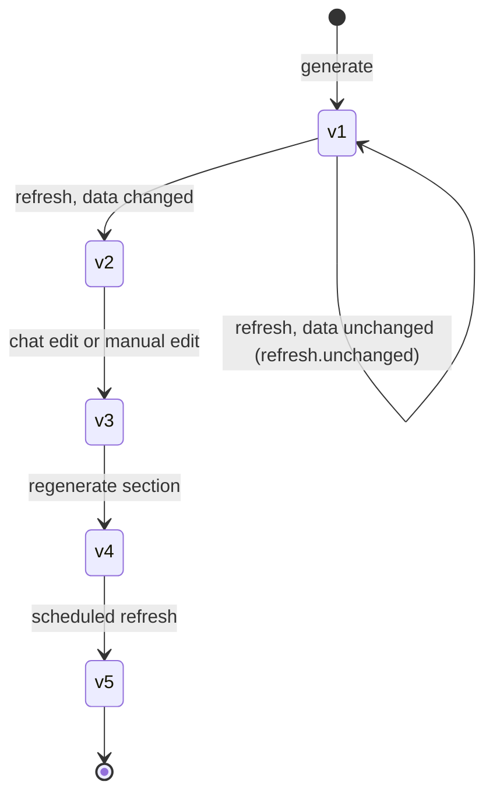
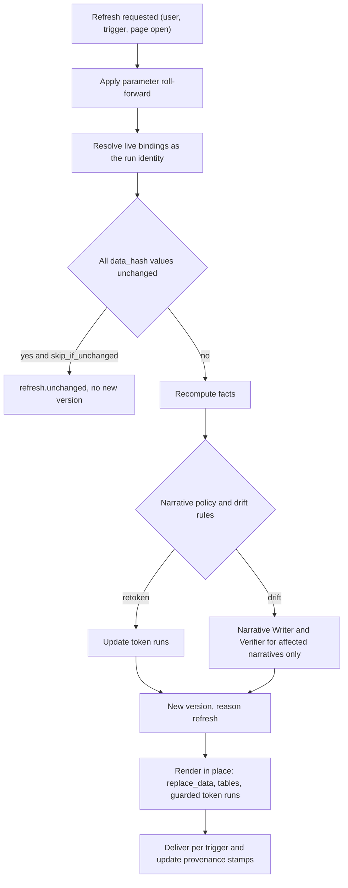
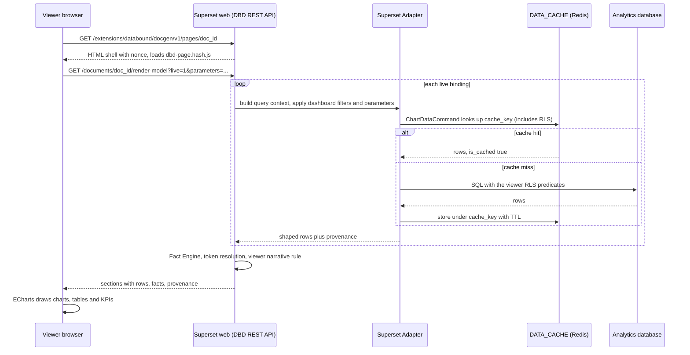
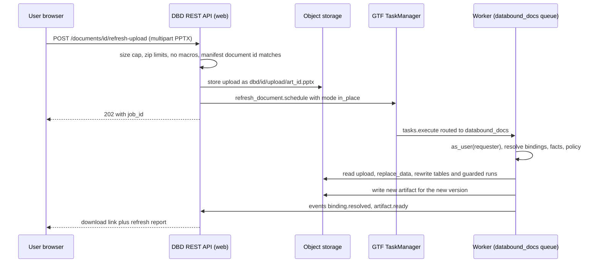
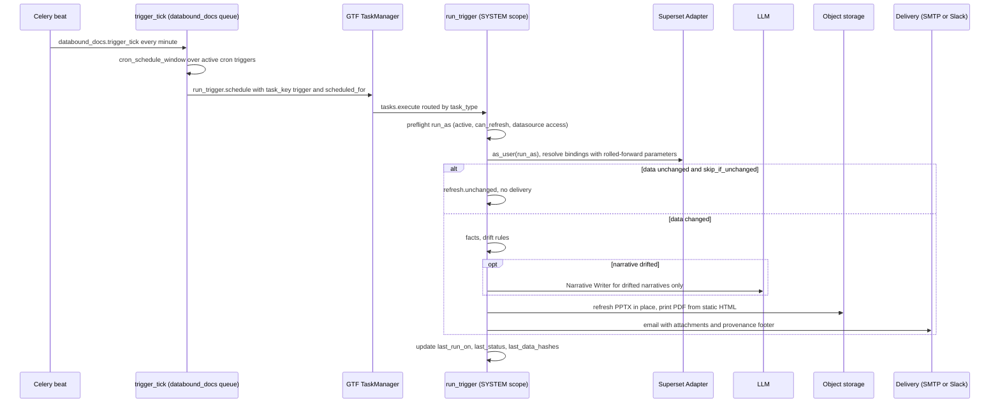
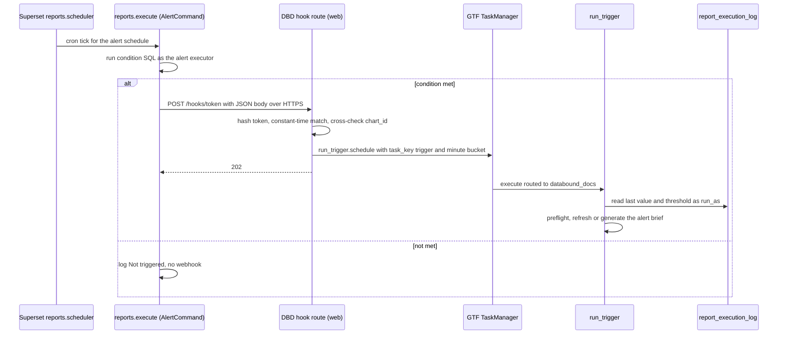
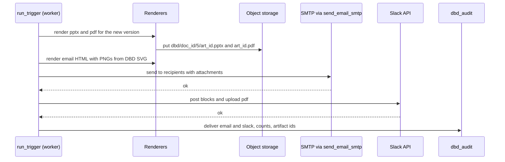

# Scheduling and live refresh

<div class="chapter-meta" markdown>
**Reads:** `superset/tasks/scheduler.py`, `superset/tasks/cron_util.py`, `superset/config.py`, `superset/reports/notifications/webhook.py`, `superset/models/slice.py`, `superset/common/query_context_processor.py`, `superset/charts/data/api.py`, `superset/utils/core.py`  ·  **Builds on:** [Data-bound slide model](33-data-bound-model.md), [Native rendering, no screenshots](35-native-rendering.md), [Security, RLS, auth](38-security.md)  ·  **Time:** ~50 min
</div>

A generated document in Data-Bound Documents is not a file, it is a `DocumentSpec` whose every value is a re-runnable query. This chapter follows that document through the rest of its life: what happens when someone opens a live page, how a PowerPoint or Word file is refreshed in place without being rebuilt, the exact difference between refreshing and regenerating, how schedules and Superset Alerts start runs without an interactive user, how data changes and chart edits are detected, which caches sit in the path and how their keys are built, what provenance is stamped on every artifact, and how results are delivered by email, Slack, webhook or storage. Sequence diagrams show each path end to end.

This is the "dynamic data" half of the requirement adopted for Part VII (see [Vision and requirements](30-vision.md)): the prepared PPT, document, text or page must use live Superset data, never screenshots, and must be re-runnable to refresh with new data.

!!! info "Availability tags"
    **[6.1]** means present in the 6.1.0 tag (May 2026) and on master. **[M]** means master only (expected in 7.0, mapping UNVERIFIED). Superset citations refer to master at `cabd8d4` unless marked otherwise.

## Step 1: Four lifecycles for one document

Every document version can be consumed in four ways: as a live page, by refresh (which has two render modes, in place and re-render), by regeneration, or as a snapshot. They differ in whose data appears, whether the LLM runs, and whether a new version is created.

| Mode | Trigger | Queries run as | LLM | New version | Output |
|---|---|---|---|---|---|
| Live page | a viewer opens `GET /pages/<document_id>` | the viewer | never on open (only "Regenerate for me") | no | HTML rendered client-side from `render-model` |
| Refresh in place | user, schedule or event, `mode: "in_place"` | the requester or run-as user | only when the narrative policy fires | yes, `reason: "refresh"` | the existing PPTX or DOCX with data replaced |
| Re-render | user, schedule or event, `mode: "rerender"` | same | only when the narrative policy fires | yes | fresh files from the template |
| Regenerate | user (`POST /documents/<id>/regenerate`) or a `generate` trigger | the requester or run-as user | yes, full or per section | yes, `reason: "generate"` | new structure, possibly different sections |
| Snapshot | `mode: "snapshot"` bindings, snapshot shares | stored rows | never | no | the stored rows, never re-queried |



Versions are immutable rows in `dbd_document_version` with a `reason` column, and the stored spec records `provenance.parent_version` and `provenance.reason` (`DocumentProvenance`). Binding results are appended to `dbd_binding_result` and never overwritten, so the question "what data was in the file emailed on Monday" always has an answer.

## Step 2: Regenerate versus refresh, precisely

The two words are easy to blur. The design defines them by what they are allowed to change.

| Part of the spec | Refresh | Regenerate (whole document) | Regenerate (sections) |
|---|---|---|---|
| `sections`, layouts, slot assignments | kept | rebuilt by the Planner | rebuilt for the listed sections |
| `bindings` | kept (same ids, same sources) | re-proposed through the Binding Registry | re-proposed for the listed sections |
| Binding results and `facts` values | recomputed | recomputed | recomputed |
| Token runs in text | re-resolved | rewritten | rewritten in the listed sections |
| Narratives (`status: "verified"`) | per narrative policy (Step 3.3) | rewritten | rewritten in the listed sections |
| Narratives (`status: "user_edited"`) | text kept, tokens re-resolved, claim lint may flag | kept unless the user explicitly includes them | same |
| Pinned values (`TextElement.pinned_note`) | kept, still marked "edited, not live" | kept | kept |
| Template version | kept | kept unless the request names a new one | kept |
| User formatting in the PPTX (in-place mode) | kept | lost (new file) | not applicable |

Refresh is cheap and deterministic: zero LLM calls in the common case. Regenerate is an LLM job with the same prompt, template and context, which is what you want when the story itself should change (a new quarter with a different driver).

### 2.1 The refresh request

```json title="POST /extensions/databound/docgen/v1/documents/doc_01JC8Z6Q4M5K/refresh"
{
  "mode": "in_place",
  "narrative": "regenerate_on_drift",
  "parameters": {"time_range": "Last quarter"},
  "force": false,
  "formats": ["pptx", "pdf"]
}
```

```json title="Response 202"
{"result": {"job_id": "job_01JCA2N7W0QH", "task_uuid": "6f1c0f6e-6d1b-4a4c-9a55-1f3b2d0b8e21"}}
```

`narrative` overrides the document's `refresh_policy.narrative` for this run only. `force: true` bypasses Superset's data cache (Step 8). The handler schedules the GTF task `refresh_document(document_id=..., user_id=g.user.id, narrative=..., mode=..., force=...)` with `task_key = sha256(document_id, base_version, canonical(parameters), force)`, so a double click joins one job.

### 2.2 Parameter roll-forward

Parameters decide whether "refresh next quarter" means anything. A `Parameter` of type `time_range` stores both `value` and `default`:

```json title="DocumentSpec.parameters (excerpt)"
"time_range": {"type": "time_range", "value": "2026-07-01 : 2026-10-01",
               "default": "Last quarter", "label": "Period",
               "native_filter_id": "NATIVE_FILTER-time"}
```

At generation time the captured dashboard filter produced the absolute `value`. On refresh the run uses, in order: an explicit `parameters` override in the request or trigger; otherwise the parameter's `default` when the document was created with a relative intent (the trigger config says `"parameters": {"time_range": "Last week"}` for a weekly brief); otherwise the stored `value`. Superset's own time grammar resolves the relative string at query time, and the resolved `from_dttm` and `to_dttm` come back in the chart-data result and are stored in `Provenance`. The `period_label` fact turns them into text, so a title like `Revenue for {{f:f_period}}` updates itself.

!!! warning "Gotcha: an absolute range never moves"
    A document captured from a dashboard filtered to `2026-07-01 : 2026-10-01` will refresh that same quarter forever unless something rolls it forward. That is correct for an audit deck and wrong for a weekly brief. The trigger form makes the choice explicit by showing the effective `time_range` for the next run.

## Step 3: The refresh algorithm



### 3.1 The task body

```python title="backend/src/databound/docgen/tasks.py (refresh_document)"
@task(name="refresh_document", scope=TaskScope.PRIVATE, timeout=600)
def refresh_document(document_id: str, user_id: int, narrative: str = "regenerate_on_drift",
                     mode: str = "in_place", force: bool = False) -> None:
    ctx = get_context()
    cancel = CancelToken()
    ctx.on_abort(cancel.set)
    with sa.as_user(user_id=user_id):
        job = repo.jobs.start_refresh(document_id, user_id)
        spec = repo.documents.current_spec(document_id)
        params = rollforward(spec, job.parameters)
        prev = repo.results.latest_by_binding(document_id, spec.version)

        results = {}
        live = [b for b in spec.bindings if b.mode == "live"]
        for i, b in enumerate(live):
            cancel.check()
            results[b.id] = Resolver(sa).resolve(b, spec.context, params, force=force)
            ctx.update_task(progress=(i + 1, len(live)),
                            payload={"stage": "resolve", "document_id": document_id})
            repo.events.append(job.id, "binding.resolved", results[b.id].summary())

        if spec.refresh_policy.skip_if_unchanged and all(
                prev.get(k) and prev[k].provenance.data_hash == r.provenance.data_hash
                for k, r in results.items()):
            repo.events.append(job.id, "refresh.unchanged",
                               {"document_id": document_id, "version": spec.version})
            return

        new_facts = FactEngine().compute(spec.facts, results)
        plan = NarrativePolicy(narrative, spec.refresh_policy.drift_rules).plan(
            spec, old_facts=spec.facts, new_facts=new_facts)
        new_spec = apply_refresh(spec, new_facts, plan, writer=Writer(cancel=cancel),
                                 verifier=Verifier())
        version = repo.documents.save_version(new_spec, reason="refresh",
                                              parent=spec.version, results=results)
        render_in_place(document_id, version, mode=mode, formats=job.formats)
        repo.events.append(job.id, "document.ready",
                           {"document_id": document_id, "version": version})
```

Two hashes drive this loop, and they answer different questions:

| Hash | Over | Answers |
|---|---|---|
| `query_hash` | the canonical query context JSON, without `force` | "is this the same question?" A change means the chart definition or a filter changed |
| `data_hash` | the canonical shaped rows (sorted keys, normalized numbers, ISO datetimes) | "is this the same answer?" A change means the data changed |

`skip_if_unchanged` compares `data_hash` only. A changed `query_hash` with an identical `data_hash` (for example a chart's color changed) still skips the data refresh but records the new `query_hash` in provenance.

### 3.2 Change detection: the drift rules

Facts are compared one by one between the previous version and the new results. Each rule is a pure function over `(old_fact, new_fact)`:

```python title="databound_docs/facts/drift.py"
from databound_docs.spec.models import Fact


def sign_flip(old: Fact, new: Fact) -> bool:
    return old.sign is not None and new.sign is not None and old.sign != new.sign


def rank_change_top3(old: Fact, new: Fact) -> bool:
    if old.op in ("argmax", "argmin", "label_at"):
        return old.label != new.label
    if old.op == "rank_of":
        return (old.value != new.value) and min(old.value or 99, new.value or 99) <= 3
    if old.op == "top_k":
        return [x["label"] for x in old.value[:3]] != [x["label"] for x in new.value[:3]]
    return False


def abs_change_pct_gt(threshold: float):
    def rule(old: Fact, new: Fact) -> bool:
        if not isinstance(old.value, (int, float)) or not isinstance(new.value, (int, float)):
            return False
        if old.value == 0:
            return new.value != 0
        return abs(new.value - old.value) / abs(old.value) * 100 > threshold
    return rule


RULES = {"sign_flip": sign_flip, "rank_change_top3": rank_change_top3,
         "abs_change_pct>10": abs_change_pct_gt(10.0)}
```

A narrative drifts when any rule fires for any fact in its `fact_ids`. A worked example:

```json title="Drift evaluation for narrative e7 (refresh of version 1)"
{
  "element_id": "e7",
  "fact_ids": ["f_best_month"],
  "old": {"f_best_month": {"label": "Sep 2026", "value": 1041233.5}},
  "new": {"f_best_month": {"label": "Aug 2026", "value": 1102877.0}},
  "rules_fired": ["rank_change_top3"],
  "decision": "regenerate"
}
```

The old text was `{{f:f_best_month.label}} was the strongest month of the quarter.` Retokening alone would render "Aug 2026 was the strongest month", which is still true, so why regenerate? Because the rule cannot know whether the surrounding sentence depended on the old label (for example "...as the back-to-school push landed"). Regeneration costs one short LLM call for one narrative; the verifier then checks the new text against the new facts.

### 3.3 Narrative policies

| Policy | On refresh | LLM calls |
|---|---|---|
| `keep` | text kept, tokens re-resolved; if claim lint fails against the new facts, the narrative is marked `flagged` ("stale narrative") | none |
| `retoken` | tokens re-resolved only | none |
| `regenerate_on_drift` (default) | narratives whose facts trip a drift rule are rewritten by the Narrative Writer and checked by the Narrative Verifier; the rest are retokened | one per drifted narrative |
| `regenerate` | every non-edited narrative rewritten | one per section |

Claim lint (direction words against signs, superlatives next to rank facts, numeric comparatives) runs on every narrative under every policy, including `user_edited` ones, because tokens in a sentence a human wrote can still flip under new data. A `user_edited` narrative is never rewritten automatically; when lint fails it is flagged and the owner sees "your text may no longer match the data".

!!! warning "Gotcha: a flagged narrative still ships under `keep`"
    `keep` means "do not call the LLM". If lint flags a narrative during a scheduled delivery, the artifact still contains it, with a visible "stale narrative" footnote. Deliveries that must never contain flagged text set `narrative: "regenerate_on_drift"` (the default) or configure the trigger to hold delivery when any narrative is flagged (`"hold_on_flagged": true` in the trigger config).

## Step 4: Refresh on open for live pages

A `page` document with `refresh_policy.on_open: true` re-queries every time anyone opens it.



Details that matter in production:

- **No HTTP round trip.** `render-model` calls `ChartDataCommand` in-process under the viewer's request. That avoids the 6.1 `GLOBAL_ASYNC_QUERIES` behavior where the chart-data HTTP endpoint answers `202` and then `401` without the async cookie (R2 1.7). The in-process command runs synchronously on both versions, so the async path never applies.
- **The data cache does the heavy lifting.** Repeat opens by the same RLS context are cache hits in `DATA_CACHE_CONFIG`. Out of the box that is `NullCache` (`apache/superset: superset/config.py:1532`), so nothing is cached and every open re-runs every query. `superset dbd doctor` warns about this.
- **TTL per binding.** `DataBinding.cache_ttl` is passed as the query context's `custom_cache_timeout` (a `ChartDataQueryContextSchema` field, `apache/superset: superset/charts/schemas.py:1681`), which is step 1 of the timeout chain and wins over chart, dataset and database timeouts (`apache/superset: superset/common/query_context_processor.py:816-840`). Leave it null to follow the dashboard's own caching.
- **Parameters re-resolve without the LLM.** Period and region controls on the page send `parameters=` to `render-model`; facts and token text update, narratives follow the viewer rule from [Security, RLS, auth](38-security.md).
- **Large pages.** A page with many bindings and slow sources can set `on_open: false`. It then shows the last refreshed version with its "Data as of" stamp and a "Refresh now" button, and a `cron` or `freshness` trigger keeps it current.
- **"Refresh now"** sends `force=1`, which bypasses the cache for that request only. It needs `can_refresh`.

!!! warning "Gotcha: live pages put query load on the web tier"
    Every open runs inside a gunicorn worker. A page shared with 500 people at 9:00 is 500 concurrent `render-model` calls; with a warm Redis data cache they are cheap, with `NullCache` they are 500 times every query. Configure `DATA_CACHE_CONFIG`, set sensible `cache_ttl` values, and prefer `on_open: false` plus a schedule for heavy pages.

## Step 5: Refresh in place for PPTX and DOCX

In-place refresh keeps the file a person has already formatted. It is the PPTX Renderer's second mode (see [Native rendering, no screenshots](35-native-rendering.md)).

### 5.1 PPTX, step by step

1. **Open the base file.** The last artifact for the base version, or a file the user uploaded through `POST /documents/<id>/refresh-upload` (their own edited copy).
2. **Find the document.** Read `/customXml/dbd-manifest.json` (relationship type `urn:databound-docs:manifest`). If PowerPoint dropped it on save (gate G3), fall back to the `docProps/custom.xml` property `DbdDocumentId`, the `dbd:*` shape names, and the JSON blob in the notes of the hidden last slide.
3. **Re-resolve bindings** (Step 3).
4. **Charts.** For every graphic frame named `dbd:chart:<element_id>:<binding_id>`, build new chart data from the shaped rows and call `chart.replace_data(new_chart_data)`. python-pptx's implementation rewrites the cached series and category values through `SeriesXmlRewriterFactory`, then replaces the embedded workbook (`self._workbook.update_from_xlsx_blob(chart_data.xlsx_blob)`), leaving formatting alone (R3 2.1). When the series set changes, colors are re-applied by label from the theme's `label_colors`.
5. **Tables.** For every `dbd:table:<element_id>:<binding_id>`, rewrite cell text. Rows are added up to `max_rows` by copying the last row's XML (so the user's row formatting carries over); extra rows are removed and a "+N more rows" footer updated.
6. **Token runs, guarded.** For every run in the manifest, rewrite it only if its current text still equals the recorded `rendered_text`.
7. **Narratives** per policy: drifted narratives get new runs built from the new token text, which replaces the paragraph's runs only when every run in that paragraph is unedited.
8. **Stamps.** Update the footer stamp, alt text (`descr`) and the manifest.

```python title="databound_docs/render/pptx/refresh.py (guarded token rewrite)"
def rewrite_token_runs(prs, manifest, displays) -> list[dict]:
    """displays maps a token string such as '{{f:f_rev}}' to its new display text."""
    report = []
    slides = {s.slide_id: s for s in prs.slides}
    for entry in manifest["token_runs"]:
        slide = slides.get(entry["slide_id"])
        shape = next((sh for sh in slide.shapes if sh.name == entry["shape_name"]), None) \
            if slide else None
        if shape is None or not shape.has_text_frame:
            report.append({**entry, "status": "binding.orphaned"})
            continue
        try:
            run = shape.text_frame.paragraphs[entry["paragraph_index"]].runs[entry["run_index"]]
        except IndexError:
            report.append({**entry, "status": "token_edited_skipped"})
            continue
        if run.text != entry["rendered_text"]:
            report.append({**entry, "status": "token_edited_skipped"})   # a human edited it
            continue
        run.text = displays[entry["token"]]
        entry["rendered_text"] = run.text
        report.append({**entry, "status": "ok"})
    return report
```

The guard is the reason a user can type over a number in PowerPoint and not lose it on the next refresh. The refresh report lists every skipped run, and the Studio shows them as "edited in the file, not refreshed".

!!! warning "Gotcha: deleted and renamed shapes"
    If a user deletes a bound chart or renames its shape in the Selection Pane, refresh cannot find it. It records `binding.orphaned` for that binding in the refresh report (a report status, like `token_edited_skipped`, not a job event) and leaves the slide alone. It never re-adds the chart at its old position, because the user may have removed it on purpose. Re-render mode (`mode: "rerender"`) restores the template layout.

!!! warning "Gotcha: combo charts are re-emitted, not replaced"
    `replace_data` on a multi-plot chart is UNVERIFIED (gate G2). The DrawingML Chart Writer therefore re-emits the whole `c:chartSpace` for combo charts and copies the old part's formatting elements (`c:spPr`, `c:txPr`, axis settings) onto the new one. Until gate G1 passes, `mixed_timeseries` renders as two stacked native charts, and each of those refreshes with plain `replace_data`.

### 5.2 Refresh of a user-uploaded copy



### 5.3 DOCX

Bound content in DOCX sits in content controls (`w:sdt` with `w:tag="dbd:binding:<id>"` or `dbd:fact:<id>`). Refresh finds each control by tag and rewrites its content: table cells, chart parts (option A, behind gate G5) through the same DrawingML builder, and token runs under the same "unchanged text only" guard. Whether Word preserves content controls wrapped around drawings on save is UNVERIFIED (gate G6); the fallback anchors are bookmarks named after the same tags. Until G5 passes, DOCX charts are vector SVG pictures computed from rows, and refresh replaces the picture part with a newly computed SVG and its PNG fallback.

## Step 6: Scheduled generation

GTF runs work now; it has no cron, no `run_at` and no retry policy (`apache/superset: superset-core/src/superset_core/tasks/types.py:143-150`). Schedules therefore come from a Celery beat entry the operator adds once, which fires a plain Celery task every minute. That task finds due triggers and schedules GTF tasks for them.

### 6.1 Configuration

```python title="superset_config.py (beat entry and router)"
from datetime import timedelta
from celery.schedules import crontab
from databound_docs.celery_routing import route_dbd_tasks


# CeleryConfig on the right is the class already defined earlier in this file
# (or imported with `from superset.config import CeleryConfig`).
class CeleryConfig(CeleryConfig):  # extend the deployment's existing class
    task_routes = [route_dbd_tasks]
    beat_schedule = {
        **CeleryConfig.beat_schedule,
        "databound_docs.trigger_tick": {
            "task": "databound_docs.trigger_tick",
            "schedule": crontab(minute="*"),
            # Same trick as reports.scheduler: lets the tick recover its intended time.
            "options": {"expires": int(timedelta(weeks=1).total_seconds())},
        },
    }


CELERY_CONFIG = CeleryConfig
```

The `expires` option deserves an explanation. Superset's own report scheduler computes the moment beat meant to fire it from the message expiry, not from the clock when a worker finally picks it up:

```python title="apache/superset: superset/tasks/scheduler.py:111-121"
    active_schedules = ReportScheduleDAO.find_active()
    triggered_at = (
        datetime.fromisoformat(scheduler.request.expires)
        - current_app.config["CELERY_BEAT_SCHEDULER_EXPIRES"]
        if scheduler.request.expires
        else datetime.now(tz=timezone.utc)
    )
    for active_schedule in active_schedules:
        for schedule in cron_schedule_window(
            triggered_at, active_schedule.crontab, active_schedule.timezone
        ):
```

With a queue backlog of a few minutes, "now" would fall outside the cron window and the run would be lost. `databound_docs.trigger_tick` uses the same computation (`CELERY_BEAT_SCHEDULER_EXPIRES` is one week by default, `apache/superset: superset/config.py:2067`).

### 6.2 Finding due triggers

`cron_schedule_window(triggered_at, cron, timezone)` (`apache/superset: superset/tasks/cron_util.py:74`) yields the cron times inside a window of `ALERT_REPORTS_CRON_WINDOW_SIZE` seconds centered on the trigger time (59 by default, `apache/superset: superset/config.py:2810`), converted to naive UTC. An invalid timezone falls back to UTC with a warning.

```python title="databound_docs/triggers/tick.py"
from datetime import datetime, timedelta, timezone

from flask import current_app


def due_cron_triggers(request_expires: str | None):
    from databound_docs.db import repo
    try:
        from superset.tasks.cron_util import cron_schedule_window     # [6.1]
    except ImportError:
        from databound_docs.compat.cron_window import cron_schedule_window   # vendored copy

    if request_expires:
        triggered_at = (datetime.fromisoformat(request_expires)
                        - current_app.config["CELERY_BEAT_SCHEDULER_EXPIRES"])
    else:
        triggered_at = datetime.now(tz=timezone.utc)
    for trig in repo.triggers.active(type="cron"):
        cfg = trig.config
        for scheduled_for in cron_schedule_window(triggered_at, cfg["crontab"],
                                                  cfg.get("timezone", "UTC")):
            yield trig, scheduled_for
```

```python title="backend/src/databound/docgen/tasks.py (beat tick)"
@celery_app.task(name="databound_docs.trigger_tick", bind=True, ignore_result=True)
def trigger_tick(self) -> None:
    from databound_docs.triggers.tick import due_cron_triggers
    for trig, scheduled_for in due_cron_triggers(self.request.expires):
        run_trigger.schedule(
            trigger_id=trig.id, scheduled_for=scheduled_for.isoformat(), event=None,
            options=TaskOptions(task_key=f"{trig.id}:{scheduled_for.isoformat()}",
                                task_name=f"DBD trigger {trig.id}"))
```

The `task_key` `"<trigger_id>:<scheduled_for>"` is what makes duplicate ticks harmless: two beat processes, a retried tick, or two adjacent windows that both contain the same cron time all submit the same key, and GTF joins the existing task instead of creating a second one.

!!! warning "Gotcha: GTF dedup only covers active tasks"
    GTF deduplicates against tasks that are still pending or running. If a run finished in 20 seconds and a late duplicate tick arrives a minute later, the key is free again. `run_trigger` therefore also checks `dbd_job` for a completed job with the same `(trigger_id, scheduled_for)` and returns immediately when one exists.

### 6.3 One scheduled run, end to end



`run_trigger` runs with `TaskScope.SYSTEM` because it is started by the platform, not by a user's click, and it switches to the run-as user only after preflight (see [Security, RLS, auth](38-security.md)). The body calls the refresh pipeline inline rather than scheduling a second task, so one GTF row represents one trigger run in the Task List.

### 6.4 The trigger record

```json title="TriggerSpec (cron, weekly brief)"
{
  "document_id": "doc_01JC8Z6Q4M5K",
  "type": "cron",
  "config": {"crontab": "0 7 * * MON", "timezone": "Europe/Paris",
             "action": "refresh", "narrative": "regenerate_on_drift",
             "parameters": {"time_range": "Last week"},
             "formats": ["pptx", "email"],
             "deliver": [{"type": "email", "to": ["cfo@example.com"]},
                         {"type": "store"}],
             "skip_if_unchanged": true},
  "run_as_id": 42,
  "active": true
}
```

`action: "generate"` instead of `"refresh"` runs the full pipeline (a new story each week). It needs `can_generate` for the run-as user and costs LLM calls every time. `dbd_trigger.last_data_hashes` stores the per-binding `data_hash` values of the last successful run, so the trigger can answer "did anything change since I last delivered?" even when the document was refreshed manually in between.

## Step 7: Event triggers

| Type | Fires when | Mechanism | Needs |
|---|---|---|---|
| `cron` | a time arrives | beat tick (Step 6) | Celery beat |
| `alert_webhook` | a SQL condition becomes true | Superset Alert with a Webhook recipient pointing at `/hooks/<token>` | `ALERT_REPORTS`, `ALERT_REPORT_WEBHOOK` |
| `freshness` | new data lands | a cheap sentinel binding re-run with `force` every N minutes, compared by `data_hash` | beat tick |
| `definition_change` | a bound chart or dashboard is edited | SQLAlchemy `after_update` listener marks documents | in-process listener (support for extensions UNVERIFIED) |
| `external_webhook` | an external system says so | HMAC-signed `POST /hooks/<token>` with optional `parameters` | nothing in Superset |

### 7.1 Alert webhooks: data conditions from Superset

Superset has no change-data-capture event. The closest built-in "data changed" signal is an Alert: SQL evaluated on a cron, with notification only when the condition holds. Data-Bound Documents uses the Alert's Webhook recipient as the trigger.

Setup, as the run-as user or an admin:

1. Create the DBD trigger with `type: "alert_webhook"`. The response shows the hook URL once: `https://superset.example.com/extensions/databound/docgen/v1/hooks/<token>`.
2. In Alerts and Reports, create an Alert on a chart (not a dashboard), with the condition SQL, crontab and timezone.
3. Set the report format to TEXT on 6.1, or NONE on master (`ReportDataFormat.NONE`, alerts only). Dashboard-scoped schedules always produce PNG or PDF by taking browser screenshots, which this design avoids; a chart-scoped alert with TEXT or NONE makes Superset send only the webhook (R3 1.7).
4. Add a Webhook recipient with the hook URL as `target`.
5. Store the alert's `report_schedule_id` on the DBD trigger (`config.report_schedule_id`) so the receiver can cross-check and so alert briefs can read the execution log.

What arrives:

```json title="Superset webhook body for a fired alert (fields from webhook.py:84-105)"
{
  "name": "EMEA revenue below plan",
  "header": {"notification_format": "TEXT", "notification_type": "Alert",
             "notification_source": "chart", "chart_id": 102, "dashboard_id": null},
  "text": null,
  "description": "",
  "url": "https://superset.example.com/explore/?slice_id=102"
}
```

The field values shown are illustrative: `notification_format` carries the schedule's `report_format` and `notification_source` carries `chart` or `dashboard` in code, while the 6.1.0 docs example shows `"JSON"` and `"Alert"`. Parse defensively and rely only on `chart_id` and `dashboard_id`.



Configuration flags and transport rules:

| Setting | Value | Where |
|---|---|---|
| `ALERT_REPORTS` | `True` | feature flag, both versions |
| `ALERT_REPORT_WEBHOOK` | `True` | feature flag, both versions |
| `ALERT_REPORTS_WEBHOOK_HTTPS_ONLY` | `True` (default); the hook URL must be HTTPS | `apache/superset: superset/config.py:2916` |
| `ALERT_REPORTS_WEBHOOK_TIMEOUT` | 60 s (master; hard-coded 60 in 6.1) | `apache/superset: superset/config.py:2922` |
| `ALERT_REPORTS_WEBHOOK_ALLOW_INTERNAL_HOSTS` | `False` by default [M]; an internal target needs `True` | `apache/superset: superset/config.py:2929` |

!!! warning "Gotcha: internal hostnames are blocked on master"
    Master's webhook sender uses an SSRF-safe requester with `allow_redirects=False` and refuses private and internal hosts unless `ALERT_REPORTS_WEBHOOK_ALLOW_INTERNAL_HOSTS` is on. Pointing the alert at `http://superset-web:8088/...` fails twice (not HTTPS, internal host). Point it at Superset's public HTTPS URL instead, which needs neither flag, and keep the hook route rate limited.

The alert brief (template `alert_brief`, `kind: text`) has three parts: what fired (alert name, threshold from `validator_config_json`, last value from the report execution log), what changed (facts from the alert's chart binding), and where to look (links). The execution log exposes `value`, `value_row_json`, `state` and timestamps (`apache/superset: superset/reports/logs/api.py:65-86`); DBD reads it in-process as the run-as user.

### 7.2 Freshness sentinels

For "refresh when the nightly load lands", a freshness trigger re-runs a deliberately cheap binding every N minutes with `force: true` and compares its `data_hash` with the stored one.

```json title="TriggerSpec (freshness)"
{
  "document_id": "doc_01JC8Z6Q4M5K",
  "type": "freshness",
  "config": {
    "every_minutes": 15,
    "sentinel": {
      "id": "b_sentinel_orders",
      "source": {"kind": "dataset", "dataset_id": 7,
                 "metrics": [{"expressionType": "SIMPLE", "column": "updated_at",
                              "aggregate": "MAX", "label": "max_updated_at"}]},
      "row_limit": 1, "shape": {"kind": "scalar", "series": ["max_updated_at"]}
    },
    "action": "refresh", "narrative": "regenerate_on_drift",
    "deliver": [{"type": "store"}]
  },
  "run_as_id": 42,
  "active": true
}
```

The beat tick evaluates freshness triggers whose `every_minutes` has elapsed since `last_run_on`; a changed sentinel hash schedules `run_trigger`. The sentinel goes through the Binding Registry like any other binding, so it is subject to the same access checks and row limits.

!!! warning "Gotcha: the sentinel must bypass the cache"
    Without `force`, the sentinel would read a cached `MAX(updated_at)` for the cache's whole TTL and never see the load. With `force` it hits the database every interval, so choose a column that is indexed or a small summary table, and an interval measured in minutes, not seconds.

### 7.3 Definition changes

When someone edits a chart that a `follow: live` binding references, the next refresh will pick up the new query context automatically, which may surprise the document owner (a metric was swapped). Data-Bound Documents makes that visible instead of silent.

Superset itself uses SQLAlchemy model events for thumbnails:

```python title="apache/superset: superset/models/slice.py:611-624"
def event_after_chart_changed(
    _mapper: Mapper, _connection: Connection, target: Slice
) -> None:
    cache_chart_thumbnail.delay(
        current_user=get_current_user(), chart_id=target.id, force=True
    )


sqla.event.listen(Slice, "before_insert", set_related_perm)
sqla.event.listen(Slice, "before_update", set_related_perm)

if is_feature_enabled("THUMBNAILS_SQLA_LISTENERS"):
    sqla.event.listen(Slice, "after_insert", event_after_chart_changed)
    sqla.event.listen(Slice, "after_update", event_after_chart_changed)
```

DBD registers its own listener from `databound.docgen.triggers` at import. It does almost nothing inside the event: it records the chart or dashboard id in the session, and an `after_commit` hook inserts one `dbd_job_event`-style marker per affected document (`definition_changed`) after the editor's transaction commits.

```python title="backend/src/databound/docgen/triggers.py (listener skeleton)"
from sqlalchemy import event
from sqlalchemy.orm import Session

from superset.models.dashboard import Dashboard
from superset.models.slice import Slice


def _remember(_mapper, _connection, target) -> None:
    session = Session.object_session(target)
    if session is not None:
        session.info.setdefault("dbd_changed", set()).add((type(target).__name__, target.id))


@event.listens_for(Session, "after_commit")
def _after_commit(session) -> None:
    changed = session.info.pop("dbd_changed", None)
    if changed:
        from databound_docs.triggers.definition import mark_definition_changed
        mark_definition_changed(changed)     # separate session, never raises


event.listen(Slice, "after_update", _remember)
event.listen(Dashboard, "after_update", _remember)
```

!!! warning "Gotcha: do not do work inside the editor's transaction"
    An exception raised from an `after_update` listener can abort the user's own chart save. Superset's thumbnail listener only enqueues a Celery task. DBD's listener only records ids and defers everything to `after_commit`, wrapped in a try/except. Whether extensions may register model listeners as a supported practice is UNVERIFIED, so the fallback is always in place: at refresh time the resolver compares the chart's `changed_on` and the live `query_context` hash with the binding's `query_context_hash`, and records `definition_changed` in provenance.

What the owner sees: the Studio lists "chart 102 changed since this document was generated" with a diff of metric and filter names, and offers "update to the new chart definition" (keep `follow: live`) or "keep the old definition" (switch to `follow: pinned`, using `query_context_snapshot`). Pinned bindings ignore definition changes by design.

### 7.4 External webhooks

dbt, Airflow or CI can start a refresh after a model build:

```json title="POST /extensions/databound/docgen/v1/hooks/<token> (external_webhook body)"
{"event": "dbt.run.completed", "parameters": {"time_range": "Yesterday"}}
```

The request must carry `X-DBD-Signature: t=<unix>,v1=<hex>` (HMAC-SHA256 over `"<t>." + body`, 300 second skew, replay cache), as described in [Security, RLS, auth](38-security.md). `parameters` are validated against the document's declared parameters; anything else is ignored.

## Step 8: Caching and cache keys

Five caches sit between a refresh request and a database. Only the first one stores query results.

| Layer | Key | Store | TTL | Invalidated by |
|---|---|---|---|---|
| Superset chart data | Superset's `cache_key` (query object, datasource uid and `changed_on`, extra cache keys, RLS clauses via `get_rls_cache_key`; built in `query_cache_key`, `apache/superset: superset/common/query_context_processor.py:456-480`, with the RLS part at `superset/security/manager.py:6304`) | `DATA_CACHE_CONFIG` (default `NullCache`) | `custom_cache_timeout`, else the chart or datasource timeout, else `DATA_CACHE_CONFIG["CACHE_DEFAULT_TIMEOUT"]`, else `CACHE_DEFAULT_TIMEOUT` | `force`, TTL, `force_nonce` [M] |
| Data Digest | `sha256(user_id, canonical context, exposure, data hashes)` | `CACHE_CONFIG` | 10 minutes | any data hash change |
| Job results | `job_id:binding_id` | result store (Redis) | 1 hour | job end |
| LLM responses (opt-in) | `sha256(model, messages, schema)` | `CACHE_CONFIG` | 24 hours, never with `samples` | prompt set version change |
| Render reuse | `sha256(spec_sha256, data_hashes, template_version, renderer_version, format)` | object storage | until superseded | any input change |

How a binding's provenance records cache state, taken directly from the chart-data result (`cache_key`, `is_cached`, `cached_dttm`, `queried_dttm` are standard result fields):

```json title="BindingResult.provenance after a refresh (cache hit)"
{
  "resolved_at": "2026-11-09T06:00:41Z",
  "executed_as_user_id": 42,
  "executed_as_kind": "run_as",
  "rls_fingerprint": "rls:9f0c3a1b77d2e4c0",
  "superset_version": "6.1.0",
  "adapter_path": "chart_data_command",
  "query_hash": "sha256:3b07...",
  "data_hash": "sha256:a41e...",
  "cache_key": "4f2b8c0d6e1a9f735c2e8d1b0a7f6e54",
  "is_cached": true,
  "queried_dttm": "2026-11-09T05:58:02",
  "applied_filters": [{"column": "region"}, {"column": "order_date"}],
  "rejected_filters": [],
  "dashboard_filters": [{"id": "NATIVE_FILTER-region", "name": "Region", "status": "applied"}],
  "from_dttm": 1761868800000,
  "to_dttm": 1762473600000,
  "row_limit": 500,
  "truncated": false
}
```

Rules the resolver follows:

- **`force` only when asked.** A scheduled refresh relies on TTLs; forcing every query on every schedule defeats the cache for everyone. `force` is set for "Refresh now", freshness sentinels, and triggers whose config says `"force": true`.
- **"Data as of" is `queried_dttm`, not `resolved_at`.** A cache hit at 06:00 may carry data queried at 05:58. The stamp shows the oldest `queried_dttm` across bindings.
- **On master, `force_nonce`** lets a forced refresh share one cache-busting nonce across all queries of one run (`apache/superset: superset/common/query_context.py:68`, schema field at `superset/charts/schemas.py:1663`), so a document refreshed with `force` gets one consistent set of fresh results rather than a mix. The field is master only (R2 1.3), so on 6.1 plain `force` is used.
- **Render reuse** means two exports of the same version with identical data hashes return the same artifact; re-exporting a deck does not re-render it.

!!! warning "Gotcha: `NullCache` turns every refresh into full query load"
    With the default `DATA_CACHE_CONFIG = {"CACHE_TYPE": "NullCache"}`, nothing is cached, `is_cached` is always false, and live pages, profiling during generation and scheduled refreshes all hit the analytics databases directly. `superset dbd doctor` reports this as a warning. Configure Redis for `DATA_CACHE_CONFIG` before enabling live pages broadly.

## Step 9: Provenance stamps

Provenance is what makes a refreshed artifact trustworthy: anyone holding the file can see when the data was queried, with which filters, as whom, and whether every narrative passed verification.

The visible stamp, rendered in every footer:

```text title="Footer stamp (PPTX, DOCX, PDF, HTML)"
Data as of 9 Nov 2026 05:58 UTC. Filters: Region = EMEA, Period = 2 Nov 2026 to 8 Nov 2026.
Refreshed by Data-Bound Documents as a.meyer (scheduled). Numbers verified. Live version: /extensions/databound/docgen/v1/pages/doc_01JC8Z6Q4M5K
```

Footnotes add rejected filters ("Region filter not applied to Orders chart", or `unsupported_on_6.1` for cascading filters on the 6.1 port), truncation ("Top 10 of 47 countries"), stale narratives, and skipped token runs.

Machine-readable stamps:

| Output | Stamp | Content |
|---|---|---|
| PPTX, DOCX | `/customXml/dbd-manifest.json` | document id, version, Superset base URL, binding ids with `query_hash`, token-run map; no rows, no credentials |
| PPTX, DOCX | fallback custom property `DbdDocumentId` | document id |
| PPTX | shape names and alt text (`descr`) | `dbd:chart:<element_id>:<binding_id>`; a sentence with source chart, as-of time and filters |
| HTML | `data-dbd-binding`, `data-dbd-fact`, `data-dbd-query-hash`, `data-dbd-as-of` | ids and hashes only |
| Text, email, Slack | footer line | as-of, filters, link |

```json title="/customXml/dbd-manifest.json (after a refresh, excerpt)"
{
  "dbd": "dbd/1.0",
  "document_id": "doc_01JC8Z6Q4M5K",
  "version": 5,
  "superset_base_url": "https://superset.example.com",
  "bindings": [
    {"id": "b_rev_by_month", "query_hash": "sha256:3b07...", "data_hash": "sha256:a41e..."},
    {"id": "b_top_countries", "query_hash": "sha256:77c1...", "data_hash": "sha256:0d9b..."}
  ],
  "token_runs": [
    {"slide_id": 257, "shape_name": "dbd:text:e1", "paragraph_index": 0, "run_index": 2,
     "token": "{{f:f_rev}}", "rendered_text": "$4.37M"}
  ]
}
```

Each artifact row in `dbd_artifact` references `(document_id, version)` and, through the version, the exact `dbd_binding_result` ids. An auditor can therefore go from a file to the stored provenance of every value in it.

## Step 10: Delivery

Data-Bound Documents delivers with its own senders. Superset's notification plugins cannot carry PPTX or DOCX: `NotificationContent` has fields for CSV, XLSX [M], PDF, screenshots, text and an embedded DataFrame only (`apache/superset: superset/reports/notifications/base.py:26-42`), and recipient types are a closed `StrEnum`, so an extension cannot add one (R3 1.5).

| Channel | Sender | Content | Notes |
|---|---|---|---|
| `email` | `send_email_smtp(to, subject, html_content, config, files=None, data=None, pdf=None, images=None, dryrun=False, cc=None, bcc=None, mime_subtype="mixed", header_data=None)` (`apache/superset: superset/utils/core.py:939`, internal) with Superset's SMTP settings | HTML body from the static HTML Renderer, inline PNGs derived from DBD's own SVG, optional PPTX or PDF attachments via `data` | falls back to DBD's own SMTP client if the import fails |
| `slack` | Slack Web API with a bot token from `DATABOUND_DOCS` | mrkdwn blocks with KPI lines and the verified narrative, tables as preformatted text (at most 10 rows), optional file upload | mentions stripped from LLM text |
| `webhook` | DBD's HTTP client, HMAC-signed outbound (`X-DBD-Signature`) | JSON with document id, version, artifact download URLs (authenticated), stamps | for downstream automation |
| `store` | object storage plus a library notification | the artifacts only | default, always safe |

```json title="TriggerSpec.config.deliver (all channels)"
[
  {"type": "email", "to": ["cfo@example.com"], "cc": [], "subject": "{{p:region}} weekly revenue brief",
   "attach": ["pptx", "pdf"], "max_attachment_mb": 15},
  {"type": "slack", "channel": "C0123456789", "attach": ["pdf"]},
  {"type": "webhook", "url": "https://automation.example.com/dbd", "secret_ref": "dbd/hooks/automation"},
  {"type": "store"}
]
```

Delivery rules:

1. **Deliver after the version is saved**, never before. A failed delivery does not roll back the refresh; it is retried with backoff (three attempts) and recorded as `deliver` in `dbd_audit` with the channel and the recipient count.
2. **Idempotent per run.** Each delivery is keyed by `(trigger_id, scheduled_for, channel)`; a retried `run_trigger` does not send a second email.
3. **`skip_if_unchanged` suppresses delivery** for unchanged data (the run ends with `refresh.unchanged`). A trigger that must deliver every Monday regardless sets `"skip_if_unchanged": false`.
4. **Subjects are templates, not LLM text.** Tokens such as `{{p:region}}` are allowed; LLM-written subject lines go through the Narrative Verifier like any narrative.
5. **Attachments are snapshots** of the run-as user's view (see [Security, RLS, auth](38-security.md)). For recipients who should see their own rows, deliver the live page link instead.
6. **Size limits.** Attachments over `max_attachment_mb` are replaced by an authenticated download link.



## What you now know

- A document has four lifecycles: live pages re-query as the viewer on open, refresh in place rewrites data inside an existing PPTX or DOCX, regenerate rebuilds the story with the LLM, and snapshots never re-query.
- Refresh compares per-binding `data_hash` values, skips when nothing changed, recomputes facts, and calls the LLM only for narratives whose facts trip a drift rule (`sign_flip`, `rank_change_top3`, `abs_change_pct>10`); token runs are rewritten only when a human has not edited them.
- Schedules come from one Celery beat entry, `databound_docs.trigger_tick`, which reuses `cron_schedule_window` and Superset's expiry-based trigger time, and deduplicates with `task_key = "<trigger_id>:<scheduled_for>"` plus a completed-job check.
- Events come from Superset Alerts (webhook recipient, TEXT or NONE format, HTTPS), freshness sentinels with `force`, definition-change listeners that defer work to `after_commit`, and HMAC-signed external webhooks.
- Superset's RLS-aware data cache is the main performance lever (and is off by default); provenance stamps and the manifest make every refreshed file traceable to its queries; delivery uses DBD's own senders because Superset's notifications cannot carry native files.

## Next

[Roadmap](40-roadmap.md) turns everything in Part VII into a phased plan with acceptance criteria, tests, risks and an upstreaming path.
