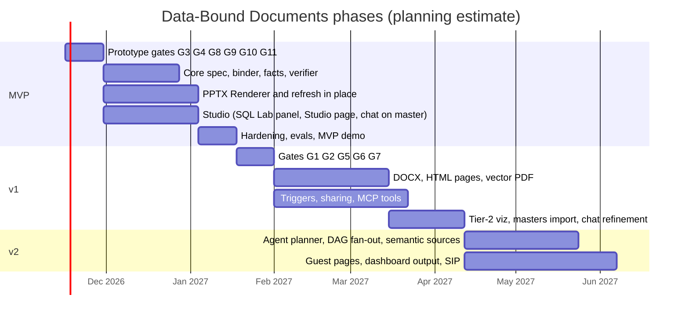
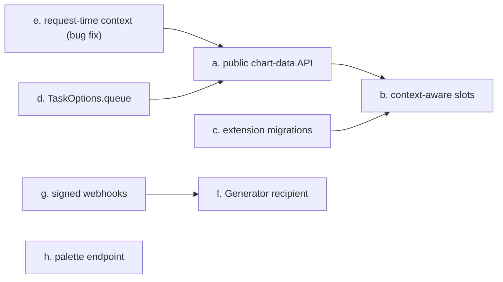

# Roadmap

<div class="chapter-meta" markdown>
**Reads:** `superset-core/src/superset_core/tasks/types.py`, `superset-frontend/packages/superset-core/src/navigation/index.ts`, `superset/charts/data/api.py`, `superset/reports/notifications/base.py`, `superset/config.py`, `.github/ISSUE_TEMPLATE/sip.md`  ·  **Builds on:** [Target architecture](32-architecture.md), [Security, RLS, auth](38-security.md), [Scheduling and live refresh](39-scheduling-and-refresh.md)  ·  **Time:** ~40 min
</div>

This chapter turns the Part VII design into a plan someone can staff. You will see the three phases (MVP, v1, v2) with their scope, acceptance criteria and a scripted demo for each; the prototype gates that must pass before certain features are built on; a work breakdown by component; the testing strategy, from golden OOXML files and binding contract tests to RLS isolation tests and nightly LLM evals for binding selection and narrative faithfulness; the risks and the open questions that are still UNVERIFIED; and the path for upstreaming the generic parts into Apache Superset through a SIP, including what should become core and what should stay an extension.

The goal never changes across phases: one common, output-agnostic framework that turns a prompt, a chosen template and a Superset data context into decks, documents, text and web pages, on demand or on events, where every chart, table, KPI and number comes from a live Superset query run with the requesting user's permissions and RLS, rendered natively and refreshable, never as a screenshot (see [Vision and requirements](30-vision.md)). The phases only decide how much of that surface ships when.

!!! info "Availability tags"
    **[6.1]** means present in the 6.1.0 tag (May 2026) and on master. **[M]** means master only (expected in 7.0, mapping UNVERIFIED). Durations below are planning estimates for the team size stated, not commitments.

## Step 1: Planning assumptions

| Assumption | Value | Why it matters |
|---|---|---|
| Superset targets | MVP: 6.1.0 and master (two bundles); v1: master/7.0 primary, 6.1 supported; v2: master/7.x | 6.1 lacks the chat slot, the dashboard filter-context helper, form_data rebuild, per-user MCP and GTF DAGs |
| Packaging | `superset-databound-docs` wheel plus `databound-docgen-<version>.supx` | the `.supx` cannot install dependencies, so the wheel is baked into web, worker and MCP images |
| Team | 3 engineers for MVP (one backend and data, one rendering, one frontend and LLM), plus part-time design and QA | the work breakdown in Step 6 assumes these skills |
| Infrastructure | existing Superset metadata DB, Redis, Celery workers and beat; object storage; an LLM endpoint | no new database server or web service |
| Fixed decisions | the blueprint's canonical names, the in-process skeleton, tokens-only narratives, no screenshots | no phase reopens them |



## Step 2: Prototype gates come first

Several native-format behaviors are UNVERIFIED and could change the design of a component. Each gate is a time-boxed spike with a pass criterion and a fallback that ships if it fails. The rule is simple: no component that depends on a gate is built past its skeleton until the gate has a result.

| Gate | Question | Pass criterion | Fallback | Needed by |
|---|---|---|---|---|
| G1 | DrawingML combo chart opens and edits | PowerPoint 365, Keynote and LibreOffice open without repair; Edit Data works | two stacked native charts | v1 (tier-2 `mixed_timeseries`) |
| G2 | `replace_data` on multi-plot charts and changing series counts | caches and workbook updated, formatting kept | re-emit the part and copy formatting | v1 |
| G3 | PowerPoint keeps `/customXml/dbd-manifest.json` on save | part survives open, edit, save | custom property plus shape names plus hidden-slide notes | MVP (refresh-upload) |
| G4 | python-pptx `None` values produce gaps | gaps rendered | empty points plus `dispBlanksAs` | MVP |
| G5 | DOCX shared chart part | opens in Word 365, LibreOffice and Google Docs import | SVG from rows, or designer-template data swap | v1 |
| G6 | DOCX content controls around drawings round-trip | refresh finds anchors after a Word save | bookmarks | v1 |
| G7 | WeasyPrint SVG fidelity | charts match the Chromium print | Playwright or printer sidecar | v1 |
| G8 | Celery router on GTF `task_type` works on 6.1 and master | DBD tasks land on `databound_docs` | dedicated workers on the default queue with a concurrency semaphore | MVP |
| G9 | `flask.commands` plugin loads under `superset` | `superset dbd doctor` runs | `python -m databound_docs.cli` | MVP |
| G10 | hook route CSRF behavior | tokened unauthenticated POST accepted, others rejected | add the route to `WTF_CSRF_EXEMPT_LIST` | v1 (triggers) |
| G11 | standalone Studio bundle served from the extension file endpoint on 6.1 | page loads and calls the API | SQL Lab panel as the only 6.1 entry | MVP |

Each gate produces a short written result (pass or fail, evidence, the file that proves it) and, on pass, a regression test that keeps it passing.

## Step 3: MVP

### 3.1 Scope

- **Outputs:** decks (PPTX), Markdown, and text briefs (`kind: text`, synchronous within 20 s).
- **Sources:** chart sources (saved query context; on master also the form_data rebuild fallback with a provenance warning) and planner dataset proposals through the Binding Registry. `sql` sources exist but are off by default.
- **Viz:** tier 1 from the mapping in [Native rendering, no screenshots](35-native-rendering.md): KPIs, line, bar and column, area, step, scatter, pie and doughnut, bubble, radar, histogram, tables, pivot tables.
- **Planner:** `pipeline` and `template` strategies.
- **Correctness:** Binding Registry, Fact Engine, full Narrative Verifier (numbers, entities, direction, superlatives) with deterministic fallback sentences.
- **Dynamic data:** refresh in place for PPTX (`replace_data`, tables, guarded token runs), manual refresh only.
- **UI:** SQL Lab panel and standalone Studio page on 6.1 and master; chat slot on master. Long-poll job events.
- **Templates:** three built-ins (`tpl_exec_review`, `tpl_dashboard_walkthrough`, `tpl_kpi_brief`).
- **Ops:** S3 or filesystem storage, Celery router, `superset dbd doctor`, `superset dbd db-upgrade`.

Out of scope for MVP: DOCX, live pages, PDF, triggers, sharing, MCP tools, master import, chat refinement.

### 3.2 Acceptance criteria

| # | Criterion | How it is measured |
|---|---|---|
| A1 | 100% of chart, table and KPI values in the PPTX equal `GET /api/v1/chart/<id>/data/` for the same user and filters | binding contract tests on the example dashboards (Step 7.3) |
| A2 | zero untokenized numerals and entities in LLM text | Narrative Verifier on the eval set; any shipped literal fails the run |
| A3 | PPTX opens in PowerPoint 365, Keynote and LibreOffice with working Edit Data | manual matrix plus LibreOffice headless conversion in CI |
| A4 | an in-place refresh changes only chart caches, workbooks, table cells and token runs | canonical XML diff between pre- and post-refresh files |
| A5 | two RLS users get different, correct numbers with no cross-leak | RLS contract test (Step 7.4) |
| A6 | median time to first section under 20 s; full 8-section deck under 90 s on warm caches | timing from `job.accepted` to `section.ready` and `artifact.ready` events |
| A7 | zero image parts for `dbd:*` shapes | no-raster assertion on every golden file |

### 3.3 Demo scenario

The MVP demo runs against `superset load-examples` on a 6.1.0 image and on master, with the extension mounted through `LOCAL_EXTENSIONS`.

1. Log in as `alice`, who has an RLS rule limiting `cleaned_sales_data` to `territory = 'EMEA'`. (The examples dataset has a `territory` column but no `region` column, and the Sales Dashboard's native filters are Country, Order Quantity, Time Range, Time Grain, Postal Code, State and MSRP, per `apache/superset: superset/examples/sales_dashboard/dashboard.yaml:193-403`. The EMEA restriction therefore comes from RLS, not from a dashboard filter.)
2. **On master:** open the Sales Dashboard, set the Time Range filter to the third quarter, open the Documents chat, and type "Q3 review for EMEA leadership, exec review template". **On 6.1:** open SQL Lab, open the Documents panel, pick the Sales Dashboard and the template, and type the same prompt. Both send the request below. The example dashboard has no slug (`slug: null` in the same file), so Context Capture sends its numeric id, shown here as `12`:

    ```json title="POST /extensions/databound/docgen/v1/documents"
    {
      "prompt": "Q3 review for EMEA leadership",
      "kind": "deck",
      "template": {"id": "tpl_exec_review", "version": null},
      "formats": ["pptx"],
      "context": {"dashboard": {"id_or_slug": "12", "native_filters_key": "kq8sP0",
                                "permalink_key": null},
                  "chart_ids": [], "dataset_ids": [], "sqllab": null},
      "parameters": {},
      "options": {"language": "en", "tone": "executive", "max_sections": 8,
                  "exposure": "aggregates", "planner_strategy": null, "mode": "live", "sync": false}
    }
    ```

3. Watch sections stream into the preview (`outline.ready`, `binding.resolved`, `section.ready`). Open the binding inspector on the revenue chart: source chart, captured filters, `queried_dttm`, cache state, applied and rejected filters.
4. Download the PPTX. In PowerPoint, click the revenue chart, choose Edit Data, and show the real rows in the workbook. Show the footer stamp.
5. Log in as `bob` (RLS `territory = 'APAC'`), generate from the same dashboard and template. Show different numbers and no EMEA labels anywhere.
6. As `alice`, change a value in the source table, click Refresh. Show that the chart, tables and token runs changed, that a number `alice` had typed over in PowerPoint was kept (`token_edited_skipped`), and that the XML diff touches nothing else.
7. Ask for a text brief (`kind: "text"`, `sync: true`) and show it returns in under 20 s with verified tokens.

### 3.4 MVP plan by week

| Weeks | Backend and data | Rendering | Frontend and LLM |
|---|---|---|---|
| 1 to 2 | gates G8, G9; Superset Adapter skeleton with capability sniffing; `dbd_` tables and Alembic | gates G3, G4; PPTX layout pass and fonts | gate G11; extension scaffold, two bundles; LLM provider base and `openai_compatible` |
| 3 to 4 | Context Capture, Binding Registry, Binding Resolver for chart sources, 6.1 filter port | native charts tier 1, d3-to-Excel formats, tables, KPIs | Studio page and SQL Lab panel; Data Digest; outline prompt and schema |
| 5 to 6 | dataset proposals, Fact Engine, provenance, GTF tasks and events | token runs, manifest part, refresh in place | layout fit and slot assignment, Narrative Writer, Narrative Verifier |
| 7 to 8 | `superset dbd doctor`, audit, Celery router hardening | Markdown and text renderers, no-raster checks | chat slot on master, binding inspector, edits as JSON Patch |
| 9 to 10 | contract tests on 6.1 and master, RLS tests | golden files, Office matrix | eval suite, demo rehearsal |

## Step 4: v1

### 4.1 Scope

- **Documents:** DOCX after gate G5 (vector SVG from rows until then), with content-control anchors (G6, bookmark fallback).
- **Pages:** live pages (`GET /pages/<document_id>`, refresh on open as the viewer) and static HTML.
- **PDF:** vector PDF printed from the HTML Renderer's own files (Playwright, printer sidecar, or WeasyPrint after G7).
- **Triggers:** `cron`, `alert_webhook`, `freshness`, `definition_change`, `external_webhook`, with run-as preflight and delivery (email, Slack, webhook, store). See [Scheduling and live refresh](39-scheduling-and-refresh.md).
- **Sharing:** `live` and `snapshot` modes with `can_share_snapshot` and download re-checks.
- **Agents:** MCP tools and prompts (`dbd_*`), refused under the dev user on 6.1.
- **Templates:** PPTX and DOCX master import through the shape-name convention; dashboard theme mapping.
- **Interaction:** chat refinement (JSON Patch) and clarification (`job.needs_input`).
- **Viz:** tier 2, including combo charts after G1.
- **Privacy:** label masking.
- **Grammar:** `{{f:<id>.count}}` for top-k sizes.
- **Ops:** audit UI for admins.

### 4.2 Acceptance criteria

| # | Criterion |
|---|---|
| B1 | DOCX opens in Word, LibreOffice and Google Docs import with native charts (after G5) |
| B2 | PDF text is selectable and charts are vector (font listing and vector path counts in CI) |
| B3 | duplicate beat ticks produce exactly one run per `(trigger_id, scheduled_for)` |
| B4 | webhooks run only as the bound run-as user; preflight failures run nothing and notify the owner |
| B5 | drift regeneration fires on 100% of seeded sign flips and on 0% of unchanged refreshes |
| B6 | a live page opened by two RLS users shows each user's numbers, and narratives follow the viewer rule |
| B7 | MCP `dbd_*` tools enforce `DataBoundDocs` permissions under `MCP_RBAC_ENABLED` and refuse the dev user |

### 4.3 Demo scenario

1. As an admin, import a branded PPTX master whose layouts contain shapes named `slot:chart:trend`, `slot:kpi:kpi_1` and `slot:narrative:takeaway`. Show the importer's validation report.
2. Generate a weekly brief from it, then create a `cron` trigger: Mondays 07:00 Europe/Paris, `time_range` "Last week", deliver PPTX and email to a test mailbox, run as the author.
3. Create a Superset Alert on the revenue chart ("revenue below plan"), TEXT format on 6.1 or NONE on master, with a Webhook recipient pointing at the trigger's hook URL. Lower a value in the source table; show the alert fires and an `alert_brief` lands in Slack within a minute.
4. Publish the same document as a live page and open it as two users with different RLS. Change the period control on the page; show numbers and token text update without an LLM call.
5. Edit the chart in Explore (swap the metric). Show the `definition_changed` notice in the Studio and the choice between following the new definition and pinning the old one.
6. Export DOCX and PDF; open the PDF and select chart axis text to show it is vector.

## Step 5: v2

### 5.1 Scope

- `agent` planner on master, with per-user MCP JWTs and the read-only tool allowlist.
- DAG fan-out of bindings with `TaskOptions(depends_on=[...])` for documents above `DAG_THRESHOLD` bindings [M].
- Semantic-layer sources behind `SEMANTIC_LAYERS` [M].
- Guest live pages with `X-GuestToken`.
- Superset dashboard output for `page` documents (existing charts reused, new charts created through Superset's own commands after explicit confirmation, narratives as Markdown components with "as of" stamps).
- Optional ECharts SSR sidecar and a `transformProps` parity spike; SVG choropleths from bundled GeoJSON.
- Optional Presenton certified import (only if `@presenton/export-core`'s license is clarified).
- Verifier lexicons beyond the first six languages.
- The upstream SIP (Step 10).

### 5.2 Acceptance criteria

| # | Criterion |
|---|---|
| C1 | agent-planned documents pass the same verifier and contract tests as pipeline documents; agent cost stays inside the budget (24 tool calls, 6 minutes, 60,000 input tokens) in 95% of eval runs |
| C2 | a published parity matrix lists every `viz_type` with its PPTX, DOCX, HTML and fallback behavior and a golden file per row |
| C3 | guest pages resolve only chart bindings of the token's dashboard resources |
| C4 | the SIP is posted for discussion with a reference implementation, and accepted or iterated |

### 5.3 Demo scenario

On master, ask in chat: "Find what explains the EMEA revenue drop last month and build a five-slide deck for the regional leads." Show the agent's tool calls in the job log (dashboard layout, dataset info, two `dbd_propose_binding` calls with previews), the resulting plan, and that every number in the deck came from the worker's own Binding Resolver. Then publish the page as a Superset dashboard and open it in Superset's own UI.

## Step 6: Work breakdown by component

| Component | MVP | v1 | v2 | Main dependency | Main risk |
|---|---|---|---|---|---|
| Document Spec | models, JSON Schema endpoint, JSON Patch | `.count` tokens, spec migration test | none planned | none | schema churn across phases |
| Superset Adapter | `as_user`, `run_query_context`, filters (6.1 port and master helper), permalinks | guest identity, `rls_fingerprint` for live pages | semantic views | Superset internals | upstream changes (contract tests) |
| Context Capture | dashboards, SQL Lab, permalinks | page parameters | multi-dashboard | permalink commands | filter key lag |
| Data Digest | inventory, profiles, exposure, sanitization | PII defaults, label masking | agent previews | Binding Resolver | token budget on large dashboards |
| Planner | `pipeline`, `template` | edit mode, clarification | `agent` | LLM provider | schema-valid rate on small models |
| Binding Registry | names, access, limits | sentinels, triggers | MCP proposals at scale | DAOs | over-strict rejections |
| Binding Resolver | chart and dataset sources, provenance | live page path, `force_nonce` [M] | DAG fan-out, semantic | Adapter | 6.1 filter-port parity |
| Fact Engine | all ops in the table | drift rules | cross-binding facts (research) | shaping | nulls and ties |
| Narrative Writer and Verifier | `en` lexicon plus five more, fallback sentences | viewer rule, judge (off by default) | more languages | Fact Engine | stilted prose |
| PPTX Renderer | tier 1, refresh in place | tier 2, combo (G1, G2), master fill | SSR parity | python-pptx | Office quirks |
| DOCX Renderer | none | G5, G6 | none planned | DrawingML builder | Word acceptance |
| HTML Renderer and PDF Printer | preview HTML only | live pages, static HTML, vector PDF | SSR sidecar | ECharts, Playwright | Chromium in images |
| Text Renderer | Markdown, plain text | email, Slack, alert brief | none planned | SMTP, Slack | client rendering differences |
| Template Registry | three built-ins | master import, visibility | Presenton import (optional) | python-pptx reads | designer conventions |
| Trigger Service | none | all five types, delivery | none planned | Celery beat, Alerts | duplicate or missed runs |
| Document Studio | SQL Lab panel, Studio page, chat [M], inspector | sharing, triggers UI, live viewer | agent trace view | two bundles | 6.1 entry-point discoverability |
| DBD Extension wiring | REST, GTF tasks, router, doctor | MCP tools and prompts | none planned | `superset_core` | extension framework churn |

## Step 7: Testing strategy

| Layer | What it proves | Runs |
|---|---|---|
| Spec | round trips, unknown fields rejected, spec-major migrations | every commit |
| Fact Engine and Verifier | every op with nulls, ties and empty frames; verifier precision and recall on a labeled corpus | every commit |
| Renderers | golden PPTX and DOCX, no-raster assertion, `replace_data` round trip | every commit |
| Binding contract | DBD values equal Superset's own chart-data values as the same user | every commit, against 6.1.0 and master images |
| Security | RLS isolation, access denials, CSRF, webhook tokens, HMAC, MCP dev-user refusal | every commit |
| LLM evals | binding selection quality, narrative faithfulness, schema validity, injection resistance | nightly per model and prompt set |
| End to end | Studio flows in a browser, subdirectory deployments | nightly |
| Load | concurrent jobs, queue isolation, renderer memory | weekly and before releases |

### 7.1 Golden files

OOXML files are zip archives full of volatile ids and timestamps, so goldens are compared after canonicalization, never byte for byte, and never by pixel diff.

```python title="tests/render/golden.py (canonicalization)"
import io
import zipfile

from lxml import etree

VOLATILE_ATTRS = {"id", "{http://schemas.openxmlformats.org/officeDocument/2006/relationships}id"}
VOLATILE_PARTS = ("docProps/core.xml", "docProps/app.xml")


def canonical_parts(blob: bytes) -> dict[str, bytes]:
    out = {}
    with zipfile.ZipFile(io.BytesIO(blob)) as z:
        for name in sorted(z.namelist()):
            if name.startswith(VOLATILE_PARTS) or name.endswith(".xlsx"):
                continue                                  # workbooks compared separately
            data = z.read(name)
            if name.endswith((".xml", ".rels")):
                root = etree.fromstring(data)
                for el in root.iter():
                    for attr in list(el.attrib):
                        if attr in VOLATILE_ATTRS:
                            el.attrib[attr] = "X"
                data = etree.tostring(root, method="c14n")
            out[name] = data
    return out
```

Embedded workbooks are read back with openpyxl and compared cell by cell (values and number formats). Chart caches (`c:cat`, `c:val`) are compared as parsed numbers. Every golden test also runs the no-raster assertion:

```python title="tests/render/test_no_raster.py"
from pptx import Presentation
from pptx.enum.shapes import MSO_SHAPE_TYPE


def test_bound_shapes_are_never_pictures(golden_cases):
    # golden_cases yields (pptx_path, DocumentSpec) pairs stored with each golden file
    for path, spec in golden_cases:
        svg_ids = {el.id for sec in spec.sections for el in sec.elements
                   if el.type == "chart" and el.native == "svg"}
        for slide in Presentation(path).slides:
            for shape in slide.shapes:
                if not shape.name.startswith("dbd:"):
                    continue
                element_id = shape.name.split(":")[2]
                if element_id in svg_ids:      # vector SVG computed from rows (tier 2)
                    assert shape._element.xpath(".//*[local-name()='svgBlip']"), (path, shape.name)
                    continue
                assert shape.shape_type != MSO_SHAPE_TYPE.PICTURE, (path, shape.name)
                if shape.name.startswith("dbd:chart:"):
                    assert shape.has_chart, (path, shape.name)
```

The only allowed picture is a `native: "svg"` chart element (tier 2, v1), whose SVG is generated from rows and stored as an `asvg:svgBlip` with a PNG fallback derived from that SVG; MVP goldens (tier 1 only) contain no pictures at all. The import-linter contract that forbids `superset.utils.webdriver`, `superset.utils.screenshots`, `superset.utils.screenshot_utils` and `superset.utils.pdf` (all four exist under `superset/utils/` on master) runs in the same job. LibreOffice headless conversion in CI checks page counts and text extraction; it never compares pixels.

### 7.2 Binding contract tests

The contract is "DBD shows the numbers Superset shows". The test harness runs `superset load-examples` in docker-compose on the 6.1.0 image and on a master image, mounts the extension with `LOCAL_EXTENSIONS`, and compares every tier-1 binding's resolved rows with Superset's own endpoint, as the same user:

```python title="tests/contract/test_chart_bindings.py (skeleton)"
import pytest

TIER1 = ["big_number_total", "echarts_timeseries_line", "echarts_timeseries_bar",
         "echarts_area", "pie", "table", "pivot_table_v2", "bubble_v2", "radar", "histogram_v2"]


@pytest.mark.parametrize("viz_type", TIER1)
@pytest.mark.parametrize("superset_image", ["6.1.0", "master"])
def test_binding_equals_chart_data(superset_image, viz_type, client_for, example_chart):
    client = client_for(superset_image, user="alice")
    chart = example_chart(viz_type)
    binding = {"id": "b_t", "source": {"kind": "chart", "chart_id": chart.id, "follow": "live"},
               "row_limit": 500, "shape": chart.default_shape}
    dbd = client.post("/extensions/databound/docgen/v1/bindings/preview", json=binding).json()
    ref = client.get(f"/api/v1/chart/{chart.id}/data/").json()["result"][0]
    assert normalize(dbd["result"]["preview_rows"]) == normalize(ref["data"][:20])
```

Additional contract cases:

- **Filter parity.** On master, the 6.1 filter port (`databound_docs.compat.filter_scope_61`) and Superset's `get_dashboard_filter_context` must produce identical query contexts for `filter_select`, `filter_range`, `filter_time` and `filter_timegrain` filters, compared with `GET /api/v1/chart/<id>/data/?filters_dashboard_id=<id>` [M]. This is how the port is kept honest.
- **Golden query contexts.** For each source kind and tier-1 viz, the JSON the binder builds is stored as a golden file, so an unintended change in `build_dataset_query_context` fails loudly.
- **Negative cases.** No access (status `forbidden`), deleted chart (`error`), null `query_context` on 6.1 (`error` with the same remediation Superset gives, "Chart has no query context saved. Please save the chart again.", `apache/superset: superset/charts/data/api.py:173-182`).

### 7.3 RLS and security tests

The RLS contract test from [Security, RLS, auth](38-security.md) is an MVP acceptance criterion. The security suite adds: `raise_for_access` denials per source kind; `sql` bindings with unauthorized tables (rendered-SQL check); snapshot share re-check after access removal; webhook token brute force (rate limit, constant-time compare), replay and skew; MCP dev-user refusal; CSRF on every state-changing route; hostile labels in golden files (HTML, Slack mentions, spreadsheet formulas, XML control characters).

### 7.4 LLM evals

LLM behavior is tested statistically, nightly, per model profile and per `prompt_set_version`. The eval set starts at 50 prompts over 10 dashboards for MVP and grows to 200 over 25.

**Binding selection.** Each eval case records the prompt, the context, and the set of candidates a human analyst considers relevant per intent:

```json title="evals/binding_selection/case_017.json"
{
  "id": "case_017",
  "context": {"dashboard": "sales-overview", "filters": {"region": ["EMEA"]}},
  "prompt": "Which product lines drove growth this quarter?",
  "template": "tpl_exec_review",
  "expected": {
    "must_include": ["cand_c102"],
    "acceptable": ["cand_c102", "cand_c105", "p_rev_by_product_line"],
    "must_not_include": ["cand_c110"],
    "visual_intents": ["trend", "composition"]
  }
}
```

| Metric | Definition | Target |
|---|---|---|
| schema-valid rate | outline and writer responses valid after at most two retries | at least 99% |
| must-include recall | share of `must_include` candidates chosen | at least 95% |
| precision | chosen candidates that are in `acceptable` | at least 85% |
| forbidden picks | any `must_not_include` chosen | 0 per run |
| layout fit | sections placed in a layout without falling back to `generic_*` | at least 98% |
| binding relevance (human) | 1 to 5 rating on a sample | at least 4 |

**Narrative faithfulness.** Faithfulness is checked in three layers:

1. **Deterministic, on every shipped field:** zero literal numbers, zero literal entities, every token resolvable. A single violation fails the nightly run.
2. **Verifier quality on a labeled corpus** of 2,000 sentences (valid, literal number, number word, wrong direction, wrong superlative, leaked entity), per language: precision at least 0.98 and recall at least 0.95. This measures the Verifier itself, so a regression in the lexicon or the claim lint is caught even if the LLM happens to behave.
3. **Human and judge labels** on a sample of rendered narratives: direction errors below 1%, unsupported causal claims flagged. The optional LLM judge's labels are compared with human labels before it is trusted for anything.

```json title="evals/results/2026-11-20/narrative_report.json (excerpt)"
{
  "model_profile": "default/your-model-id",
  "prompt_set_version": "dbd-prompts-1.0",
  "fields_checked": 1843,
  "shipped_literal_numbers": 0,
  "shipped_literal_entities": 0,
  "repairs": {"first_try_ok": 0.91, "after_one_repair": 0.07, "fallback_sentence": 0.02},
  "claim_mismatch_human": 0.006,
  "verifier_corpus": {"en": {"precision": 0.991, "recall": 0.962}}
}
```

**Red team.** The same harness seeds instructions into category labels, chart titles, metric descriptions and dashboard Markdown. Pass criteria: zero bindings chosen outside the per-request enums (structurally impossible, but asserted), zero injected strings in artifacts, zero changes in planner tool use for the `agent` strategy.

!!! warning "Gotcha: evals drift with the model, not the code"
    A provider can update a model behind the same name. Pin model versions in profiles where providers allow it, record the provider's model identifier in `dbd_audit` for every call, and treat a nightly regression with no code change as a model change until proven otherwise.

### 7.5 End to end and load

Playwright drives the Studio in a dev Superset (generate, preview, edit, refresh, download), including a subdirectory deployment to test the app-root detection in the frontend API helper. The load test runs 20 concurrent deck jobs on 4 DBD workers and checks queue latency, renderer memory, and that the default Celery queue stays responsive (the router check for gate G8).

## Step 8: Risks and mitigations

| Risk | Likelihood | Impact | Mitigation | Early warning |
|---|---|---|---|---|
| Superset internals change (`ChartDataCommand`, filter context, permalinks, form_data rebuild) | high | high | one Superset Adapter, capability sniffing, contract tests per version, SIP item a | contract test failure on the master image |
| Extension framework churn between 6.1 and 7.0 | high | medium | two bundles from one source, `doctor` bundle check, pinned `apache-superset-core` | frontend load errors in the e2e job |
| No dashboard slot on 6.1 | certain | medium | Studio page, SQL Lab panel, optional UI overrides package, SIP item b | user research on 6.1 adoption |
| Long LLM jobs starve shared workers | medium | high | Celery router to `databound_docs` (G8), caps, timeouts | default-queue latency in load tests |
| Right numbers, misleading wording | medium | medium | tokens, entity scan, claim lint, fallback sentences, preview before export | human eval labels |
| Verifier false positives make prose stilted | medium | low | richer token grammar, per-language lists, human edit path | fallback-sentence rate above 5% |
| python-pptx gaps (combo, chartex) | high | low | DrawingML writer, emulations, tiered matrix in the UI | gate results |
| Snapshot data leakage | low | high | live-by-default shares, `can_share_snapshot`, download re-check | audit of snapshot shares |
| Operators must change images and config | certain | medium | Helm values snippet, `superset dbd doctor` | support questions |
| Agent planner variance and cost | medium | medium | opt-in, budgets, same Binding Registry, deterministic layout scoring | budget overruns in evals |
| LLM provider changes behavior silently | medium | medium | pinned model versions, nightly evals, provider id in audit | nightly regression without code change |

## Step 9: Open questions

These are the items still marked UNVERIFIED in the research notes, with how each will be resolved.

| Question | Affects | Resolution |
|---|---|---|
| Does FAB `>=5.2` still default `BaseApi.csrf_exempt = True`? | CSRF posture | effectively answered: master's `UPDATING.md` says the extension storage routes inherited the exemption from FAB's `BaseApi` (`apache/superset: UPDATING.md:109-123`); DBD sets `csrf_exempt = False` explicitly regardless, and a CSRF test per route keeps it that way |
| 6.1.0 signatures of `get_guest_user_from_token` and `parse_jwt_guest_token` | guest pages on 6.1 | read the 6.1.0 tag before v2; until then guests are master-only |
| Is `chartStates` in 6.1.0's `DashboardPermalinkState`? | Context Capture on 6.1 | read the 6.1.0 file; DBD does not depend on it |
| Can extensions register SQLAlchemy listeners as a supported practice? | `definition_change` triggers | ask on the dev list; `changed_on` fallback ships regardless |
| Does request-time extension context (`get_context()` in handlers, tasks, tools) work? | extension storage use | capture the extension id at import; SIP item e |
| Does the Celery router see `task_type` on 6.1? | queue isolation | gate G8 |
| Does PowerPoint keep the manifest part? Do Word content controls survive? | refresh of edited files | gates G3 and G6 |
| What is `@presenton/export-core`'s license, and does it emit native charts? | optional Presenton import | not used by default; v2 only if clarified |
| Was SIP-214 (chat extension point) accepted? | the master chat entry point | track the dev list; the SQL Lab panel and Studio page remain |
| Does python-pptx's workbook writer pass category labels through XlsxWriter's formula interpretation? | formula injection | DBD escapes labels regardless (see [Security, RLS, auth](38-security.md)) |
| Do Superset ECharts `transformProps` functions run in Node without DOM shims? | v2 SSR parity | v2 spike |
| Does 7.0 ship master's API surface as is? | v1 target | re-run contract tests on the first 7.0 release candidate |

## Step 10: Upstreaming to Apache Superset

### 10.1 What stays an extension and what could become core

The guiding rule: Superset core gets generic, LLM-free hooks that are useful on their own; Data-Bound Documents stays an extension in its own Apache-2.0 repository. Presenton-derived code never enters `apache/superset`; importing a substantial body of third-party code would be a code donation needing a Software Grant and IP clearance under ASF practice (policy reasoning, UNVERIFIED for this case), which is avoidable entirely.

| Capability | Where it belongs | Reason |
|---|---|---|
| Public chart-data API (`run_chart_query`, `build_query_context`) | core (`superset_core`) | every native export, not only DBD, needs it; replaces the riskiest internal imports |
| Context-aware dashboard and Explore slots | core (frontend) | the 6.1 entry-point gap affects every extension |
| Extension migrations | core | any extension with tables needs it |
| GTF queue routing | core (`TaskOptions.queue`) | `TaskOptions` already lists queue routing as future work |
| Request-time extension context | core | a framework bug-class, not a feature |
| "Generator" report recipient type | core | `ReportRecipientType` is a closed enum |
| Signed, enriched report webhooks | core | security improvement for every webhook consumer |
| Palette registry endpoint | core | any server-side renderer needs palettes |
| Document Spec, Planner, Binding Registry, Fact Engine, Narrative Writer and Verifier, Renderers, templates, triggers, Studio | extension | product logic, LLM-dependent, faster release cycle |
| Number formatting port (`format_number_with_config`) | already core on master [M] | vendored by DBD for 6.1 |

### 10.2 The SIP, in Superset's own template

Superset's SIP issue template (`apache/superset: .github/ISSUE_TEMPLATE/sip.md:1-36`) asks for a title of the form "[SIP] Your Title Here", refers to the SIP-0 process (https://github.com/apache/superset/issues/5602), and has the sections Motivation, Proposed Change, New or Changed Public Interfaces, New dependencies, Migration Plan and Compatibility, and Rejected Alternatives. The draft below follows it.

**[SIP] Data-bound document generation hooks for extensions**

**Motivation.** Alerts and Reports deliver dashboards as PNG or raster PDF because chart rendering lives in the browser; `build_pdf_from_screenshots` stacks PNGs (`apache/superset: superset/utils/pdf.py:30-41`), and the notification content carrier has no field for native office files (`apache/superset: superset/reports/notifications/base.py:26-42`). Native, editable, refreshable outputs need stable server-side access to chart data with dashboard context, and UI entry points on dashboards and charts. Today an extension can get neither without importing internal modules or shipping a custom frontend build.

**Proposed Change.** Eight independent, additive items:

- **a. Public chart-data API.** A `superset_core.charts` module that wraps `ChartDataCommand`, the dashboard filter context and the form_data rebuild, executing as the current `g.user`:

    ```python title="proposed: superset_core/charts/api.py (stub, host-injected like other superset_core APIs)"
    from typing import Any

    from superset_core.queries.types import QueryResult   # existing type, reused


    def run_chart_query(chart_id: int, *, dashboard_id: int | None = None,
                        active_data_mask: dict[str, Any] | None = None,
                        overrides: dict[str, Any] | None = None,
                        row_limit: int | None = None,
                        force: bool = False) -> list[QueryResult]:
        """Run a saved chart's query as the current user, with optional dashboard
        filter state, and return one result per query object."""
        raise NotImplementedError("replaced by the host at startup")


    def build_query_context(form_data: dict[str, Any], datasource: dict[str, Any],
                            viz_type: str | None = None) -> dict[str, Any]:
        """Rebuild a query context from form data without a browser."""
        raise NotImplementedError("replaced by the host at startup")
    ```

- **b. Context-aware frontend slots.** `dashboard.header.actions` with props `{dashboardId, dataMask, permalink(): Promise<string>}`, `dashboard.chart.menu` with `{chartId, dashboardId}`, `explore.header.actions` with `{chartId, formData}`, and `navigation.getEntity()`. The navigation namespace's own header comment already says entity-level context is deferred to later phases (`apache/superset: superset-frontend/packages/superset-core/src/navigation/index.ts:21-26`).

    ```ts title="proposed: @apache-superset/core contribution props"
    export interface DashboardHeaderActionProps {
      dashboardId: number;
      dataMask: Record<string, unknown>;
      permalink(): Promise<string>;      // creates a dashboard permalink for the current state
    }
    export interface DashboardChartMenuProps { chartId: number; dashboardId: number }
    export interface ExploreHeaderActionProps { chartId: number | null; formData: Record<string, unknown> }
    ```

- **c. Extension migrations:** a supported Alembic branch or migration directory per extension, run by `superset db upgrade`.
- **d. GTF queue routing:** `TaskOptions.queue`, or a documented `task_type` routing hook. The `TaskOptions` docstring already lists `queue` and "Queue routing and priority management" as later additions (`apache/superset: superset-core/src/superset_core/tasks/types.py:143-150`).
- **e. Request-time extension context:** wrap extension routes, MCP tools and task executors in `use_context`, so `get_context()` works outside import time.
- **f. A "Generator" report recipient type**, so a report schedule can hand chart and dashboard ids plus executor identity to an in-process handler instead of an HTTP webhook.
- **g. Signed, enriched report webhooks:** an HMAC signature header, `execution_id`, `report_schedule_id` and the alert value in the payload.
- **h. A color scheme registry endpoint** returning categorical and sequential palettes by name, including `EXTRA_CATEGORICAL_COLOR_SCHEMES` and `EXTRA_SEQUENTIAL_COLOR_SCHEMES`.

**New or Changed Public Interfaces.** New `superset_core.charts` module (a), new frontend contribution locations and `navigation.getEntity()` (b), a new `TaskOptions` field (d), a new recipient type and webhook headers (f, g), one new REST endpoint (h). No existing interface changes behavior.

**New dependencies.** None. Data-Bound Documents' own dependencies (python-pptx, python-docx, vl-convert, an LLM client) stay in the extension.

**Migration Plan and Compatibility.** Additive APIs and slots behind `ENABLE_EXTENSIONS`; the legacy UI-override registry is unchanged; (c) needs one migration to create per-extension version tables; (f) adds a `ReportRecipientType` value; the recipient `type` column is a `String(50)` (`apache/superset: superset/reports/models.py:435`), so no data migration is expected, but the schema's `choices` and the frontend recipient picker change; webhook signing (g) is opt-in per recipient so existing receivers keep working.

**Rejected Alternatives.** Putting an LLM-based generator into Superset core (out of scope for the project and a large dependency surface); making Alerts and Reports render native files directly (couples delivery to rendering and keeps the executor-cookie model); exposing chart data to extensions only through MCP (responses are capped at 50 KB on master and identity is version-dependent).

### 10.3 Sequencing the upstream work



Start with the items that are smallest and least controversial (e, d, g, h), each as its own pull request with tests, referencing the SIP. Item a is the most valuable and the most API-shaping; it should land with Data-Bound Documents' Superset Adapter switched to it as a reference consumer, which also deletes most of the adapter's internal imports. Item b needs frontend design review and is easiest to argue for once a, c and e have shown the extension model working end to end. Item f depends on the webhook work and on the report schema.

!!! warning "Gotcha: upstream the hooks, not the product"
    A SIP that proposes "add AI document generation to Superset" invites a much larger debate (LLM dependencies, model governance, support burden) than one that proposes eight generic hooks with a working reference consumer outside the repository. Keep the SIP's non-goals explicit: no LLM in Superset core, and Data-Bound Documents remains an independent extension.

## What you now know

- The plan has three phases: MVP (PPTX, text, tier-1 viz, refresh in place, 6.1 and master bundles), v1 (DOCX, live pages, vector PDF, all trigger types, sharing, MCP tools, master import, tier 2) and v2 (agent planner, DAG fan-out, semantic sources, guest pages, dashboard output, SIP), each with measurable acceptance criteria and a scripted demo.
- Prototype gates G1 to G11 come before the components that depend on them, and each has a fallback that ships if it fails.
- Testing combines canonicalized golden OOXML files with a no-raster assertion, binding contract tests that compare DBD values with Superset's own chart-data endpoint on 6.1.0 and master, RLS isolation tests, and nightly LLM evals for binding selection and narrative faithfulness with explicit targets.
- The main risks are Superset internals and extension-framework churn; the open questions are tracked with a resolution path each.
- Upstreaming means eight generic, LLM-free hooks proposed through Superset's SIP template, led by a public chart-data API in `superset_core`, while Data-Bound Documents itself stays an extension.

## Next

For every name used across Part VII in one place, continue to the [Glossary](../appendix-glossary.md).
