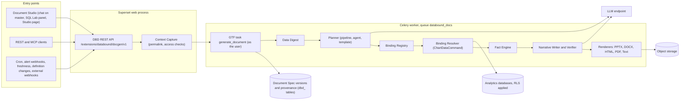

# Part VII: Data-Bound Documents for Apache Superset

**Reads:** `superset/core/api/core_api_injection.py`, `superset/commands/chart/data/get_data_command.py`, `superset/tasks/scheduler.py`, `superset/utils/pdf.py`  ·  **Builds on:** [Part I landing](../presenton/index.md)  ·  **Time:** ~8 min

Part VII is the design half of the book. It takes what Parts I to VI showed about Presenton (prompt plus template in, finished deck out) and specifies how to build the same workflow inside Apache Superset, with one hard difference: every number in every output comes from a live Superset query, and nothing is ever a screenshot. This page states the problem, gives the answer in one paragraph, shows the whole architecture on one diagram, maps the Presenton mechanisms we reuse to the chapters that explain them, and lists every Part VII chapter in reading order.

## The problem

Presenton generates a deck from a prompt and a template. Its language model writes the chart numbers itself: the chart content schema asks the model for `categories` and `series[].values` (`presenton: servers/fastapi/templates/v2/schema.py:1490-1534`) and the hydrator copies them into the slide (`presenton: servers/fastapi/api/v1/ppt/endpoints/presentation.py:1367-1432`). That is acceptable for a pitch deck written from a paragraph of notes. It is not acceptable for a quarterly business review built from a governed BI tool, where the numbers must match the dashboard to the cent and must differ correctly between two users with different row-level security.

Superset, on the other hand, has the governed numbers but no way to produce a native document from them. Its Alerts and Reports feature delivers dashboards as PNG screenshots or as a PDF made of those screenshots (`apache/superset: superset/utils/pdf.py:30-41`), because chart rendering lives only in the browser. A slide built that way is a picture: it cannot be edited, searched, refreshed or checked.

The request behind Part VII asks for both at once: a common framework that brings Presenton's automated flow to Superset for decks, documents, text and pages, triggered on demand or by events, with dynamic data and no screenshots.

## The answer in one paragraph

**Superset Data-Bound Documents** (Data-Bound Documents in prose, `dbd` and `databound` in identifiers) is one output-agnostic generation framework, shipped as a preinstalled Python wheel (`superset-databound-docs`) plus a thin Superset extension (`databound-docgen-<version>.supx`, extension id `databound.docgen`). A user, a schedule, an alert or an agent submits a prompt, a template and a Superset data context (a filtered dashboard, charts, datasets or a SQL Lab query). A Global Task Framework task runs inside Superset as that user, builds a token-budgeted Data Digest, lets the language model plan sections and choose among validated data bindings, resolves every binding through `ChartDataCommand` with the user's permissions and RLS, computes facts deterministically, has the model write prose that cites those facts only through tokens such as `{{f:f_rev}}`, verifies that prose, and renders the resulting Document Spec into native PPTX charts with embedded workbooks, DOCX, vector PDF, Markdown, email and Slack text, or a live HTML page. The language model never writes a number, and every artifact can be refreshed in place when the data changes.

## Architecture at a glance

Three properties of this picture matter more than any box in it:

- **Superset is the data plane.** All data access runs in-process under `override_user`, through the same `ChartDataCommand` the dashboard uses (`apache/superset: superset/commands/chart/data/get_data_command.py:36`), so `raise_for_access` and RLS apply without any credential handling.
- **The agent proposes, the engine disposes.** The language model outputs structure, ids chosen from enums and prose with tokens. Deterministic code produces every value, label and series.
- **One spec, many renderers.** The same `DocumentSpec` becomes a deck, a document, a page or a text brief, and it can be re-resolved later to refresh any of them.

## How Part VII relates to the Presenton chapters

Part VII reuses Presenton's stage shape and several concrete mechanisms, ported under Apache-2.0 with attribution into the separate Data-Bound Documents repository. It does not re-explain Presenton internals; follow the links when you want the original.

| Presenton mechanism | What Data-Bound Documents does with it | Explained in | Used in |
|---|---|---|---|
| Outline, structure and per-slide content calls | Same three stages, with new prompts: outline over a Data Digest, deterministic layout fit, Narrative Writer per section | [Standard generation pipeline](../presenton/08-standard-pipeline.md), [Prompts and schemas](../presenton/09-prompts-and-schemas.md) | [Generation flow](34-generation-flow.md) |
| Strict JSON schemas with retries (`generate_structured_with_schema_retries`) | Ported into `call_structured()`, with enums of binding ids instead of free data fields | [Prompts and schemas](../presenton/09-prompts-and-schemas.md) | [Generation flow](34-generation-flow.md), [Building the generation service](37-generation-service.md) |
| SSE envelope and error fields | Same envelope for the optional stream, plus a long-poll endpoint; new event types such as `binding.resolved` | [Streaming (SSE)](../presenton/10-streaming.md) | [Generation flow](34-generation-flow.md) |
| Template v2 element model and schema builder with character budgets | Extended with `data_slot` and a `kpi` element; bound slots emit only binding enums | [Template v2 format](../presenton/16-template-v2-format.md), [From template to schema to slide](../presenton/17-template-to-slide.md) | [Data-bound slide model](33-data-bound-model.md) |
| Hydrator dispatch per element type | Pattern reused for bound chart, table and KPI handlers | [From template to schema to slide](../presenton/17-template-to-slide.md) | [Native rendering, no screenshots](35-native-rendering.md) |
| Custom templates from PPTX | Replaced by a python-pptx shape-name importer (`slot:chart:trend`), no vision model | [Custom templates from PPTX](../presenton/18-custom-templates.md) | [Data-bound slide model](33-data-bound-model.md) |
| REST API, async tasks, webhooks, MCP | Same surfaces, rebuilt on Superset's `@api`, GTF `@task` and `@tool` | [REST API, async tasks, webhooks, MCP](../presenton/15-api-async-mcp.md) | [Building the Superset extension](36-superset-extension.md) |
| Export through `@presenton/export-core` | **Not reused.** License unknown, browser DOM measurement. Replaced by python-pptx, a DrawingML writer and vector HTML printing | [PPTX and PDF export](../presenton/24-export-pipeline.md) | [Native rendering, no screenshots](35-native-rendering.md) |
| Next.js slide editor (Konva canvas) and Chart.js HTML preview | Not reused. Document Studio is a Superset extension UI with ECharts | [Slide editor](../presenton/22-slide-editor.md) | [Building the Superset extension](36-superset-extension.md) |

!!! note "Availability tags used throughout Part VII"
    **[6.1]** means present in the 6.1.0 tag (May 2026, the latest stable release) and on master. **[M]** means present only on master at `cabd8d4ecc6101f04184bd93b5fa77152d139c4d` (2026-11-02); it is expected in 7.0, but that mapping is unverified. **[M\*]** means present in 6.1.0 but changed on master. Every master-only dependency in the design has a stated 6.1 fallback.

## Reading order

Read the chapters in order the first time. Each one builds on the vocabulary of the previous one.

1. [Vision and requirements](30-vision.md): the request, the interpretation adopted, personas, twelve use cases with prompts, functional and non-functional requirements, and the exact meaning of "dynamic data" and "no screenshots".
2. [Superset landscape (6.1)](31-superset-landscape.md): every Superset API and extension point the design builds on, with a 6.1.0 versus master availability table and the reasons Alerts and Reports cannot be reused for rendering.
3. [Target architecture](32-architecture.md): components, processes, deployment topology, configuration and the decisions that shaped them.
4. [Data-bound slide model](33-data-bound-model.md): the Document Spec, bindings, facts, the token grammar, template data slots and provenance.
5. [Generation flow](34-generation-flow.md): the ten steps from Context Capture to export, with prompts, schemas, the Narrative Verifier and the event protocol.
6. [Native rendering, no screenshots](35-native-rendering.md): the PPTX, DOCX, HTML, PDF and Text Renderers, the viz_type mapping and the no-screenshot guarantee.
7. [Building the Superset extension](36-superset-extension.md): the `.supx` bundle, REST API, GTF tasks, MCP tools, frontend contributions and the Superset Adapter.
8. [Building the generation service](37-generation-service.md): the `databound_docs` wheel, storage tables, the LLM provider layer, caching and Celery routing.
9. [Security, RLS, auth](38-security.md): identity propagation, permissions, RLS-safe narratives, sharing, prompt injection and webhook hardening.
10. [Scheduling and live refresh](39-scheduling-and-refresh.md): live pages, refresh in place, narrative policies, triggers and provenance stamps.
11. [Roadmap](40-roadmap.md): MVP, v1 and v2 scope, testing, prototype gates, risks and the upstream SIP outline.

## What you now know

- Presenton lets the language model write chart numbers, and Superset's reports deliver pictures; Data-Bound Documents closes both gaps at once.
- The framework is a preinstalled wheel plus a thin `databound.docgen` extension, with no new service or database server.
- All data runs in-process through `ChartDataCommand` as the requesting or run-as user, so permissions and RLS apply automatically.
- The language model chooses validated bindings and writes tokenized prose; deterministic code produces every value.
- Part VII reuses Presenton's stage shape, schema builder, retries, SSE envelope and template model, and replaces its export runtime.

## Next

Start with [Vision and requirements](30-vision.md) to see exactly what the framework must do and what it deliberately does not do.
